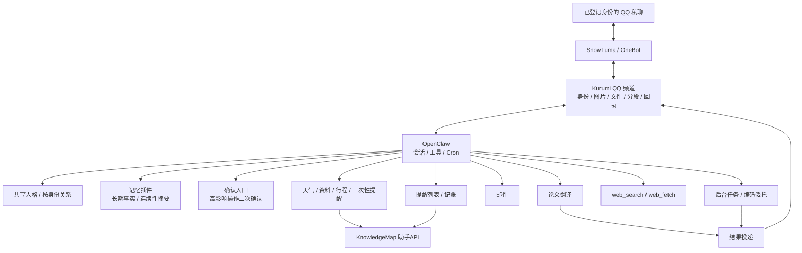

状态：已完成

# 总体架构与设计原则

本文回答三件事：系统由什么组成，新代码应该放在哪一层，现在哪些地方没有守住这些规则。各功能的细节在各自的编号文档里，从[索引](README.md)进入。

## 功能

Kurumi 是只服务已登记 QQ 私聊身份的个人助手，同时承担陪伴和助手两种角色。

- OpenClaw 是唯一的助手宿主，负责会话、模型调用、工具调度和 Cron。
- 自研插件提供个人领域能力，源码在本仓库的 `chatbot/`。
- SnowLuma 提供 QQ 传输（OneBot）。
- KnowledgeMap 是独立项目。提醒列表、账单和天气通过它的 HTTP 接口与网站共用数据。
- DSH 可以独立提供网页或模型服务，但不在助手主链路内，也不消费 QQ。



不做的事：不维护第二套会话、提醒或 QQ 投递宿主；不建设通用的 Task Engine、DAG 或 Router；群聊关闭。

职责按三个逻辑模块划分，不要求各自独占数据库或进程：

| 模块 | 负责什么 | 入口 |
| --- | --- | --- |
| 人格 | 性格、表达方式、按可信身份选择的关系背景 | `roles/`、`config/persona.json`，规则见[文档25](25_人格、记忆与会话连续性.md) |
| 记忆 | 本人的长期事实和有期限的近期摘要 | `chatbot/plugins/kurumi-memory/`，规则见[文档25](25_人格、记忆与会话连续性.md) |
| 功能 | 天气、提醒、论文、邮件、日志等能力 | `chatbot/plugins/`、`chatbot/packages/` |

角色设定不自动成为用户事实，聊天原文和运行日志也不自动成为记忆。权限由可信身份和授权决定，不由人格关系或模型自述决定。

## 设计原则

1. **先做窄能力，再抽象。** 每个领域先有自己清晰的动作、状态和确认边界。只有出现第二个真实使用者时才抽公共代码。理由：提前建通用框架会把还没验证的假设固化下来。
2. **按领域约束写操作。** 邮件发送等操作走“提案 → 本人明确确认 → 受限提交”，见[文档6](6_二次确认.md)。共享事项与账单按明确请求执行，见[文档23](23_KnowledgeMap业务能力桥接.md)。失败和未知状态如实呈现。
3. **模型负责理解，后端负责确定执行。** 外部事实、时间、持久化写入、消息投递都经过窄接口和确定性后端。模型说“已经完成”不等于动作已执行，要看工具结果和后端状态。
4. **事实来源、时间和不确定性可见。** 工具返回里说明数据源、数据时间和时区。公开网页内容是不可信资料，不当作指令。
5. **最小权限，可回滚。** 每项能力只暴露必需的输入、输出和权限。回滚时优先撤掉工具准入或配置，不删业务数据。

## 分层与依赖规则

| 层 | 位置 | 放什么 |
| --- | --- | --- |
| 宿主 | OpenClaw 官方内核，版本由 `config/openclaw-release.json` 固定 | 会话、模型、工具调度、Cron。不改它的源码 |
| 共享包 | `chatbot/packages/` | 不属于单个领域的运行代码 |
| 插件 | `chatbot/plugins/` | 一个领域的工具注册、策略、存储和投递接线 |
| 领域脚本和测试 | `chatbot/scripts/`、`chatbot/tests/<领域>/` | 领域的命令行工具、离线测试、验收脚本 |
| 运维脚本 | `scripts/fusion/` | 同步、备份、健康检查、启停、真实外发验收 |
| 配置意图 | `config/`、`roles/` | 经同步脚本写入运行目录，规则见[配置契约](../config/README.md) |
| 运行状态 | `/home/afrangry/.openclaw-fusion` | 凭据、数据库、日志、人格投影 |

依赖规则：

1. 共享包不导入插件，也不导入 `scripts/fusion/`。
2. 插件不导入其他插件。两个插件需要同一段代码时，把它下沉到共享包。
3. 只从共享包的公开入口导入，不深入它的 `dist/` 或内部文件。
4. 运行期代码不依赖 `scripts/fusion/`。

## 插件与共享包

| 插件 | 作用 | 文档 |
| --- | --- | --- |
| `kurumi-qq` | QQ 私聊通道；另含工具授权判定、exec 写目录围栏、主动唤醒、表情包 | [24](24_统一身份与权限管理.md)、[25](25_人格、记忆与会话连续性.md)、[28](28_本机编码工具委托与实验任务.md) |
| `personal-confirmation` | 自然语言二次确认入口 | [6](6_二次确认.md) |
| `kurumi-logs` | 主人专用的只读日志查询 | [18](18_跨模块链路日志查询.md) |
| `personal-weather`、`personal-profile`、`personal-planning` | 天气与播报、当前所在地、行程 | [2](2_天气模块.md) |
| `personal-reminders` | 一次性提醒 | [3](3_个人提醒.md) |
| `personal-reminder-list`、`kurumi-knowledgemap` | 共享待做列表与定时播报、账单 | [23](23_KnowledgeMap业务能力桥接.md) |
| `kurumi-memory` | 长期记忆和会话连续性 | [25](25_人格、记忆与会话连续性.md)、[29](29_记忆系统.md) |
| `kurumi-mail` | 邮件草稿、确认和发送 | [20](20_邮件能力与横切扩展.md) |
| `kurumi-papers`、`kurumi-research` | 论文 PDF 翻译与回传；researcher 的 PDF 阅读 | [22](22_论文PDF翻译与文件投递.md) |
| `kurumi-tasks` | 后台研究任务（编码启动已关闭，由 `kurumi-coding` 接管） | [9](9_QQ融合助手架构与开发计划.md) |
| `kurumi-coding` | 本机编码工具委托 | [28](28_本机编码工具委托与实验任务.md) |
| `kurumi-e7` | 《第七史诗》Wiki 只读查询 | [27](27_E7数据插件设计.md) |
| `kurumi-web-deepseek` | DeepSeek 搜索和抓取提供方，未加载（当前搜索用 Tavily） | [8](8_检索功能.md) |

| 共享包 | 作用 |
| --- | --- |
| `access-control` | 身份、权限点、工具到权限的映射、成员 Agent 的配置编译 |
| `confirmation-core` | 二次确认协议：提案、授权、单次消费 |
| `personal-domains` | 天气、资料、行程、一次性提醒四个领域的实现 |
| `knowledgemap-client` | KnowledgeMap 业务接口的 HTTP 客户端 |
| `observability` | 追踪事件格式、脱敏、追加写入 |
| `proactive-core` | 主动唤醒的调度、预算和生命周期 |
| `response-core` | 业务通知的表达边界 |
| `domain-adapters` | 策略和存储实现的注册表 |
| `documents` | 受管 PDF 的存储，论文、QQ 文件和邮件附件共用 |
| `scholarly-source` | 公开论文 PDF 的下载 |
| `sandbox` | 项目代码的系统级隔离 |
| `coding-runtime`、`host-exec` | 编码工具的传输；原生 exec 的写目录围栏 |
| `session-records`、`trusted-inbound` | 宿主会话记录的只读读取；可信入站上下文 |

## 限制与已知问题

下面是没有守住上面规则的地方。它们都能正常运行，代价是改一处要动多处。

- **`kurumi-qq` 承担过多。** 除了传输，全部工具调用的授权判定、exec 围栏、主动唤醒都注册在这个插件里，几个插件的追踪日志目录也取自它的配置。
- **插件导入插件（规则 2），三处。** `kurumi-papers` 和 `kurumi-coding` 导入 `kurumi-qq/delivery.js`；`kurumi-qq/proactive/adapters.js` 导入 `kurumi-memory/continuity/read-model.js`。
- **深入导入内部文件（规则 3）。** `kurumi-qq/proactive/adapters.js` 直接导入 `personal-domains/dist/` 下的 8 个内部文件。`personal-domains` 把四个领域放在一个约 1.6 万行的包里，没有只读的公开入口。
- **运行期依赖运维脚本（规则 4）。** `kurumi-logs` 用子进程调用 `scripts/fusion/log-query.mjs`，靠 `backendRoot` 配置找到源码目录。
- **新增工具要登记多处。** 权限映射、主人 `alsoAllow` 和成员 `MEMBER_TOOLS` 分别维护。权限回归检查现有主人白名单的映射，并覆盖成员工具集和执行判定。
- **资料和天气没有分开。** 当前所在地的地点解析依赖 QWeather GeoAPI，资料、行程和天气共用 `weather.sqlite`。
- **三套调度各自实现。** 一次性提醒、提醒列表播报、主动唤醒各有自己的调度入口。
- **依赖边界有部分自动检查。** 后端边界测试扫描共享包对插件和运维脚本的依赖，并检查跨插件导入的两个允许入口。深入共享包内部文件和运行期引用运维脚本仍需审查。

## 如何验证

```bash
# 规则 1：应当没有输出
rg -n "from '[^']*(plugins/|scripts/fusion)" chatbot/packages -g '*.js' -g '*.ts' -g '!**/node_modules/**' -g '!**/dist/**'

# 规则 2：目前输出上面列出的三处，不应增加
rg -n "from '(\.\./)+(kurumi|personal)-[a-z-]+/" chatbot/plugins -g '*.js' -g '!**/node_modules/**' -g '!**/test/**' -g '!**/dist/**'

# 插件独立加载、确认契约等边界测试
/usr/bin/node --test chatbot/tests/backend-boundaries/*.test.mjs
```
