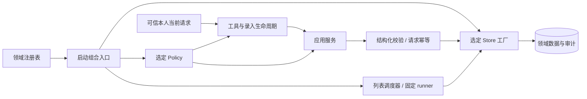

# 后端职责分层与可插拔实现

类型：后端规则与后续设计。状态：现行分层、可插拔实现与四领域独立生命周期已部署；[统一表达与通知](#统一表达与通知方案)已实现并独立验证，生产部署见唯一手册。检索接入范围见[26](26_基础能力插件边界整理与检索接入设计.md)，记忆连续性见[25](25_人格、记忆与会话连续性.md)。验收结论及未覆盖范围统一见[文档16](16_验收与测试总表.md#分领域验收摘要)。

本文维护共享代码归属、语义与执行分工、同步适配器、确认与生命周期契约。完成的实施清单移入[阶段记录](archive/documentation-2026-10-23/21_后端职责分层与代码整理.md)，不在规则正文继续追加开发轮次。

[早期设计 tp.txt](tp.txt)作为原则来源保留。当前采用领域独立装配、显式接口和小型共享包；共用构建或历史共库不否定逻辑分层。只在出现实际复用消费者时抽取公共能力，不把早期完整编排设想写成当前功能。

## N3运行基础的归属（未接入生产）

`chatbot/packages/proactive-core/`维护后台唤醒的Policy、SQLite执行状态和服务编排，不导入具体插件、脚本或宿主私有dist。未来插件组合入口负责可信入站活动、实际会话/模型、只读领域适配器与QQ投递器，不能反向由共享包读取聊天原文或复制领域事实。当前消费者只有独立测试/隔离宿主，尚无生产插件、周期调度器或新增运行授权；后续接线仍须完整实现文档25的上下文及生命周期契约。

前台生命周期适配在同一共享包内；QQ入站仅提供经过身份/去重/路由检查的可选元数据回调，组合入口将其接入具体执行实例，并注册宿主reset/end钩子。共享包不反向导入QQ，未装配的回调不产生N3运行状态；不在另一个工具策略中绕过QQ唯一强制策略。

执行状态和诊断分开：数据库只保存运行绑定、事件去重、租约/代际、正文哈希和实际回执，不保留原始聊天、不作主人记忆或兴趣记录。暂停/新消息使在途判断失效，过期执行标为中断；已开始发送而没有确定回执的事件标为unknown，不在重启或同事件重放时补发。自主兴趣/自身记录、N2整理和长期记忆迁移不在本基础范围。具体语义见[文档25](25_人格、记忆与会话连续性.md)。

## 当前生产实现

| 能力 | 当前路径与事实源 | 执行边界 |
| --- | --- | --- |
| 天气、Profile、行程、一次性提醒 | 四个独立插件装配`packages/personal-domains`默认实现；Profile/行程保留历史共库 | 独立工具、服务与确认后端；集中构建不等于共用生命周期 |
| 提醒列表与账单 | `personal-reminder-list/remote.js`、`kurumi-knowledgemap`→专用HTTP客户端→KnowledgeMap API | 显式异步调用；事项/账单事务、版本、幂等在业务API，本地只保留控制和投递账本，见[23](23_KnowledgeMap业务能力桥接.md) |
| 本人连续性记忆 | `kurumi-memory/continuity/application.js`、`policy.js`、`store.js`→SQLite | 同步Policy/Store，配置键`continuityPolicyAdapter/continuityStoreAdapter`，当前`current-owner/sqlite`；不使用旧MEMORY文件写入，见[25](25_人格、记忆与会话连续性.md) |
| 邮件 | `kurumi-mail/application.js`与同步SQLite Store；`service.js`编排SMTP | 异步SMTP不注册成同步Store；确认消费和外部投递分开，见[20](20_邮件能力与横切扩展.md) |
| 论文与研究 | `kurumi-papers`固定后台进程、`kurumi-research`读取；共享PDF源获取与受管文档包 | 下载、阅读、翻译、投递职责分开，见下文共享表及[22](22_论文PDF翻译与文件投递.md) |
| E7公开资料 | `kurumi-e7`独立插件，`service/query/policy/client/store`分别编排、投影、约束、取数和缓存 | 首批及第二批13种只读action共用`e7_data`；本人只读权限、严格参数与结果裁剪；扩展契约见[27](27_E7数据插件设计.md) |

旧SQLite列表、旧文件记忆接口仅在[兼容实现](#兼容实现)展开。它们保留作未切换模式、兼容探针或隔离回归，不是当前共享事项与连续性记忆的生产存储。

## 单目录编码试点

`kurumi-coding`独立装配专用`kurumi_code`、DSH ACP任务服务、Git工作树编排及`coding`确认后端；不依赖旧`kurumi_task`，不接管其研究任务。通用ACP stdio、自有进程身份与Linux写入边界在`packages/coding-runtime/`，业务规则、可信入站、SQLite任务/确认事务、Git/检查与异步编排各在插件的`policy/inbound/store/workspaces/service`；`results.js`选择并呈现任务轮次内的ACP结果，`store`持久化结果和通知凭据。只有组合入口接线QQ公开投递器。可信工具runId关联已移至`packages/observability/tool-trace.js`，原KnowledgeMap路径只转发，避免复制钩子实现。

`service`按当前权限与项目登记准入，`workspaces`核对实际目录和Git仓库归属，不使用整体配置指纹阻断旧任务。合入前由编排层执行当前检查并复核冻结候选和目标，`store`随后事务消费对应确认；合入检查与历史执行轮次分别留证。规则见[当前条件检查与旧任务兼容](28_本机编码工具委托与实验任务.md#当前条件检查与旧任务兼容)。

主人原生exec的参数约束在共享`packages/host-exec`，QQ组合入口在可信身份校验后调用；它复用`coding-runtime/write-fence.js`，不导入编码插件。写入边界内的临时目录准备同样使用受限进程，防止可写父目录被替换为符号链接后由宿主越界创建目录。原生命令与DSH生命周期分别管理，授权、调用方式与限制见[文档28](28_本机编码工具委托与实验任务.md#主人原生exec)。

主人已批准仅`dsh-pilot`单目录试点，源码allow/load/entries与主人工具白名单已同步部署，插件active，待真人QQ验收。`permissions.js`保留追加式私有权限请求记录与公开计数；DSH执行和项目检查均经过显式写入边界，额外申请拒绝，不回退无限制执行。当前范围与限制以[文档28](28_本机编码工具委托与实验任务.md#单目录qq试点授权2026-10-30)为准。

## 语义与执行的边界

模型将真实需求转换为动作、ID、版本及结构化字段；后端负责可信身份、当前请求、参数、事务、版本和幂等，不再次用聊天动词或完整标题正则裁决已有项维护。“第六条”的已展示列表对应、歧义澄清和单消息多项上限的具体业务规则统一见[提醒列表当前规则](23_KnowledgeMap业务能力桥接.md#当前规则)。

ID为不透明键，不含事项正文。移除重复原文裁决的原因和真实模型边界见[structured-items](verification/backend-refactor-2026-10-16/structured-items/README.md)。后端不能证明任意自然语言与ID必然对应，负向用例不等于所有对话零误解。

## 同步适配器与异步业务API

共享`domain-adapters`只提供同步契约的注册、检查和启动选择。连续性记忆在自己的组合入口声明`evidence/fact/summary` Policy及`read/write/close` Store方法；旧列表和旧显式记忆声明各自不同接口，不能因共用注册机制而混用契约。

KnowledgeMap通过专门异步客户端调用，不能将HTTP Promise伪装为同步Store。事项唯一业务事实在API；本地设置、调度/请求控制和投递账本不构成业务副本。更换到异步驱动需显式调整应用契约，不静默回退旧库。

## 共享代码与插件生命周期

共享运行包不得反向导入具体插件或`scripts/fusion/`；插件组合入口可以接线QQ实际投递器，但只经QQ插件的对外投递入口 [delivery.js](../chatbot/plugins/kurumi-qq/delivery.js)（`createQqDelivery(cfg)` 返回 `sendDocument` / `sendText`），不直接导入 `kurumi-qq/src/*`；发送台账、限额和目标校验仍在QQ插件内部。`capabilities.test.mjs` 扫描所有插件源码，跨插件导入只允许登记的对外入口。代码归属如下，新能力沿用这些边界，不另造全局容器或通用工作流引擎。

| 职责 | 唯一实现/入口 |
| --- | --- |
| 沙箱执行与进程树终止 | `chatbot/packages/sandbox/index.js` |
| 可信入站与引用边界 | `chatbot/packages/trusted-inbound/index.js`；领域再施加准入策略 |
| 结构化事件与脱敏sink | `chatbot/packages/observability/index.js`；运维查询留在 `scripts/fusion/log-query.mjs` |
| 公开学术PDF获取 | `chatbot/packages/scholarly-source/index.js`；研究/翻译共同消费 |
| 阅读文本与页图 | `chatbot/plugins/kurumi-research/papers.js`；阅读缓存由 `kurumi-research.config.cacheRoot` 显式配置 |
| 翻译及受管文档 | `chatbot/plugins/kurumi-papers/service.js`、`chatbot/packages/documents/index.js`；不要求阅读提取成功 |
| 四领域默认实现 | `chatbot/packages/personal-domains/src/`，各 `*-plugin.ts` 独立装配 |
| 独立插件 | `chatbot/plugins/personal-{weather,profile,planning,reminders}/index.js`及各自manifest，原工具归属为1/3/3/7 |
| 集中构建与兼容CLI | `chatbot/scripts/build-personal-plugins.mjs`；旧天气CLI仅转交同一共享实现 |

PDF源边界保留HTTPS网站白名单、禁重定向/凭据、45秒期限、25MiB、PDF签名/hash及符号链接检查。源缓存为`<id>.pdf`和`<id>.source.json`；旧阅读缓存`<id>.json`验证后可复用。阅读解析失败不阻断翻译下载，取消前不发布半文件；无取消信号的相同下载可合并，有独立信号的不合并取消。论文业务参数与产物限制仍归文档22。

四领域分别登记工具、服务和确认后端，不先注册全部再过滤。Profile/行程保留`state/personal-weather/weather.sqlite`历史共库；一次性提醒保留`state/personal-reminders/`。独立生命周期不承诺独立数据库或版本发布。主人 2026-10-22 确认维持现状：四领域继续共用集中构建、上述历史共库和既有 Cron 执行地址；以后要拆库或改地址另开一项，先授权、先备份。

带锁文件的共享库（`personal-domains`）在自己的 `package.json` 用 `file:` 链接声明所依赖的共享包（`confirmation-core`、`access-control`、`knowledgemap-client`），源码按包名导入；子路径须在被依赖包的 `exports` 中列出。没有锁文件的纯 JS 插件沿用相对路径引用共享包。

确认候选和实际记录均按持久domain隔离；Profile/Planning各用自己的provider，提醒维持`personal-reminder`。provider ID不写入持久proposal/grant，domain、ID/hash和scope不改；停止时仅注销本实例注册，一次性提醒停止还须等待在途维护批次。

既有Cron的`personal-weather/dist/reminder-cli.js`是稳定执行地址，集中构建生成最小兼容转发；新提醒使用`personal-reminders`的runner。不得删除旧地址、重写业务副本或重建既有任务来代替兼容。2026-10-21只读核对：生产 Cron 中已没有任务指向旧地址，一次性提醒均已结束；转发仍保留，供从备份恢复的旧任务使用。

2026-10-20结构整理回归、真实隔离Gateway及生产加载的结果与版本边界见[专项报告](verification/capability-decoupling-2026-10-20/README.md)。配置同步的显式延期契约只在[配置说明](../config/README.md#同步契约)维护；新的Search/Fetch provider接入与启用状态见[文档26](26_基础能力插件边界整理与检索接入设计.md)。

2026-10-28（`0dd547a`）插件边界、适配器、权限分级及生命周期复核见[能力结构复核](verification/capability-review-2026-10-28/README.md)。该记录检查当前结构与运行元数据，业务真人验收继续按文档16分别判定；共用构建、历史共库和兼容执行地址仍遵守上面的既定边界。

共享确认在原协议上增加自然候选、预览回执与当前请求入口，公开面由边界测试固定。其 registry 使用版本化 `Symbol.for` 跨宿主加载副本共享确认后端；领域适配器注册表则属于一次组合，避免独立插件实例/测试互相污染。这两种生命周期用途不同。

宿主服务必须显式登记 `stop(ctx)`，异步清理返回 Promise 供宿主等待；不能依赖 `start(ctx)` 的返回函数。论文插件转交 `PaperService.stop()`；邮件插件在停止或启动失败清理时注销本实例持有的确认注册。共享确认的每次注册都有独立身份，旧注销句柄不能影响后续注册，即使复用了同一 provider 对象；跨加载副本的 Symbol 和公开 API 保持兼容。

## 可插拔契约与扩展方法

共享小型注册库：[domain-adapters/index.js](../chatbot/packages/domain-adapters/index.js)，公共类型：[index.d.ts](../chatbot/packages/domain-adapters/index.d.ts)。它只管理实现身份、契约检查与固定选择。

注册表提供 `registerPolicy(id, implementation)`、`registerStore(id, open)`、`resolve({policy,store})`、`ids()`。每次注册有独立身份，返回只删除该次注册的注销函数；同一工厂重新注册也不会被旧句柄删除，重复 ID 被拒。解析后固定策略方法表与工厂，注销/重新注册仅影响后续组合，不热换运行实例。

接口要求同步。打开存储时检查必需方法，返回绑定原始对象的契约视图；每次调用 Policy/Store 契约方法时拒绝 Promise/thenable 返回值（含 `close`），避免误判写入完成，并接收被拒绝 Promise 的 rejection。视图兼容冻结对象、私有字段及 `.db` 等附加属性读取。缺方法、异步策略/存储、未知选择和打开失败明确报错，已打开但无效的资源尽力关闭，不回退默认或临时存储。完整包装边界见[包说明](../chatbot/packages/domain-adapters/README.md)。

新增实现的步骤：实现领域接口 → 在领域持久 `adapters.js` 组合入口注册 → 跑一致性回归 → 配置实现 ID → 按配置同步契约重启。应用服务无需修改。测试/嵌入可通过 `createReminderListPlugin({registry})`、`createMemoryPlugin({registry})` 或 `create*Application({registry,...})` 注入独立注册表。

连续性记忆使用`createContinuityRegistry()`/`createContinuityApplication()`，注册机制相同，方法表、默认ID与配置键以其领域契约为准；旧接口示例见下一节。新实现还需覆盖对应领域的事务、查询、备份恢复与迁移验收，方法存在检查不能证明业务原子性。

## 兼容实现

### 旧本地列表与文件记忆

| 领域 | 接口 | 默认策略 / 存储 ID | 组合与注册 |
| --- | --- | --- | --- |
| 提醒列表 | [contracts.d.ts](../chatbot/plugins/personal-reminder-list/contracts.d.ts) | `default` / `sqlite` | [application.js](../chatbot/plugins/personal-reminder-list/application.js)、[adapters.js](../chatbot/plugins/personal-reminder-list/adapters.js) |
| 显式记忆旧接口 | [contracts.d.ts](../chatbot/plugins/kurumi-memory/contracts.d.ts) | `explicit` / `memory-file` | [application.js](../chatbot/plugins/kurumi-memory/application.js)、[adapters.js](../chatbot/plugins/kurumi-memory/adapters.js) |

显式记忆旧接口和本地列表实现可在 `plugins.entries.<领域>.config` 选择 `policyAdapter` / `storeAdapter`，未配置使用上表默认值；选择不出现在模型工具参数里。当前生产连续性模式有自己独立的适配器键，不与这些旧接口混用，见文档25；配置同步仍按 [config/README.md](../config/README.md)。

以下分层表和流程图仅描述这两套兼容实现，不能用旧`store.js`推断当前连续性SQLite或共享事项的事实源：

| 职责 | 唯一入口与要求 |
| --- | --- |
| 可信入站 | `chatbot/packages/trusted-inbound/index.js` 提供可信当前消息边界；各领域 `inbound.js` 施加准入策略，共享 `access-control` 判身份。策略不能替换身份判定或把引用升级为可信输入 |
| 组合入口 | 各领域 `application.js`，由 `adapters.js` 注册表选择实现；插件在注册时固定选择 |
| 领域策略 | 各领域 `policy.js` 是默认实现；语言动作、字段来源、条件等通过 Policy 接口消费 |
| 应用服务 | 各领域 `service.js` 的 `createListService` / `createMemoryService`；只依赖注入接口和领域模型，不导入具体策略/存储 |
| 领域与存储 | `model.js` 验证结构化字段；列表旧 `store.js` 保存SQLite/审计/账本，显式记忆旧 `store.js` 保存MEMORY.md；生产共享事项与主人连续性分别由文档23/25的存储持有 |
| 请求执行 | 列表 `requests.js` 管理有效期、消息幂等键与重放；记忆服务维护单请求消费，文件存储执行 revision/锁/原子替换 |
| 连续录入 | 列表 `intake.js` 保存进程内当前请求与生命周期，调用注入 Policy；不另存待办，不从策略结果接收身份/时间/消息元数据 |
| 共享确认 | `chatbot/packages/confirmation-core/src/` 的协议、上下文、存储和 registry；`personal-confirmation` 处理可信 QQ 入站、当前请求绑定和自然确认窄工具；领域在自己的事务内消费 grant |
| 交互呈现 | `chatbot/packages/personal-domains/src/interaction/`；各领域显式提供自己负责的澄清/提案工具名单，与 `confirmation-backends.ts` 的确认注册分开 |

### 独立runner与存储替换

提醒列表独立 Cron 程序同样从持久组合入口解析存储。非默认存储 ID 写入固定 payload 的 `KURUMI_LIST_STORE_ADAPTER`；默认 SQLite payload 保持兼容。**只在宿主自定义入口内注册存储不足以让独立 runner 识别它**，部署实现必须同时登记到该持久入口。runner 不接收任意模块路径。调度器拒绝接管绑定到另一存储的旧任务；更换存储时应另做数据与 Cron 迁移验收，改配置不迁移旧数据。

方法存在检查不能证明事务正确。列表存储必须在同一事务内验证唯一目标/当前版本，并原子提交业务数据、审计和请求账本；记忆存储必须比较 revision 并原子替换。新实现需运行这些一致性用例。暂不支持异步数据库驱动，需另行调整服务契约。

当前运维的数据库日志查询与恢复校验仍针对默认 SQLite/文件格式。未来生产换库需同时提供对应的日志查询、备份恢复及数据迁移验收；本次接口替换夹具不代表其它存储已获得生产运维支持。

## 确认契约与已知待办

2026-10-27用户批准改为自然语言确认：助手根据当前本人原文、已展示的冻结预览和真实待确认记录选择具体提案；用户不必输入确认码。一次性提醒、Profile/行程与邮件发送继续使用`confirmation-core`的proposal/grant、可信入站、有效期与事务消费。提醒列表和账单明确维护仍按[共享业务规则](23_KnowledgeMap业务能力桥接.md)直接执行。

- 先生成并展示参数快照；共享确认层持久记录预览、源消息和成功外发的QQ消息关联。没有展示成功、属于本次新生成、已过期/取消或内容哈希变化的提案不可自然确认。
- `personal_confirmation`窄工具查询候选并确认指定ID/hash；模型只判断本次确认意图和指代。插件通过`hooks.allowConversationAccess=true`显式取得宿主会话钩子访问，只在确认工具经授权可用的本人私聊回合注入当前原文；不开放通用文件、命令或消息能力。共享层从宿主捕获真实当前QQ原文，绑定实际run/session/toolCall，复核身份、账号、提案和有效期，再在领域库事务内签发grant。交互钩子不签发grant，业务提交仍在自己的事务内消费grant。
- 刚展示一项后“确认”可执行；多项时“确认今晚八点那条”可唯一选择；多项裸“确认”无法消歧则追问。否定、讨论/转述、引用与附件内容不授权；“确认，不过改成九点”先生成新预览，再等下一条确认。语义判断由模型承担，后端来源/快照检查不等于证明模型理解永远正确。
- 用户明确确认有限多项时，模型一次传入完整`targets`（每项含真实domain、ID/hash），最多16项。此上限是确认工具的独立资源界限，不继承提醒列表的单次维护额度。宿主当前消息首次确认时冻结目标集合；后续调用、重复消息不得扩充或替换集合。单项确认仍不能借同一消息追加第二项；多项裸“确认”仍须澄清。先逐项预检工具权限，任一越权则整批拒绝且不签发grant；再分别检查后端显式批量支持、预览、scope、版本和有效期，在所属领域事务内签发/消费grant；不承诺跨库原子提交。逐项返回授权、拒绝或结果未知，只提交已授权项，失败和未知项不得自动重试或概括成“全部完成”。未显式支持批量的其他领域保持原单项边界。
- 查询候选不等于重新展示。用户要求重看某项时须调用`action=preview`并经冻结输出及成功QQ回执刷新展示关联；之后裸确认按最新实际展示（或可信原生引用）消歧，不按候选排列选项。`domain`始终显式填写：一次性提醒`personal_reminder`、个人资料`personal_profile`、行程`planning`、邮件`mail`；未知映射继续拒绝。领域返回`requiresUserInput:true`时立即提问并等待新消息，同回合不得自行改参数重试。
- 提案有效期仍24小时，grant最多5分钟且不越过提案截止；提醒执行时间独立。重复消息不延长授权，业务提交保留幂等。新消息、回合结束或`/new`使旧回合工具绑定及未消费的自然授权失效，重启后持久预览仍可重新查询；旧版没有展示关联的提案须重新生成预览。
- 不同本人消息在同一秒重新确认同一提案时，以库内后插入的grant消除签发秒数并列；不可误取已失效的上一消息授权。
- 展示时间保留秒级UTC用于有效性检查，最新焦点另用持久化单调顺序；同一源消息的成功展示共享一批顺序。不同消息即使在同一秒送达也能先后区分，旧项重展示更新顺序；新增nullable列兼容旧账本，不删除或重建既有预览。旧记录没有顺序时按原展示时间参与比较。
- 旧“确认 <12位码>”及完整ID/hash入口继续兼容，但日常预览不要求抄码。邮件的收件白名单、正文/附件快照和先消费授权再SMTP保持原约束。

自然语言确认于2026-10-27随`fa0eeba`首次部署；2026-11-07批量/当前请求/展示焦点已择取冻结修复并通过11.1隔离宿主，部署结果见[本轮证据](verification/four-fixes-2026-11-07/README.md)。coding仍单项、合入不含push，真人QQ待复验；分层证据见文档16，不以离线测试代替。此次批准取代此前保留带码的决定；早期研究仅作[历史追溯](verification/deepseek-whale/README.md)。

一次性提醒与列表runner现在等待绑定会话的模型说明，冻结时间/内容等事实保留；天气正式任务仍走agentTurn，旧`daily-brief`中性问候不作为日常通知入口。统一契约见下节，真人与长期验收见文档16。

## 统一表达与通知

2026-11-07已实现并完成独立技术验证：共享模型说明、QQ可见进度、确认说明与冻结事实分离，以及论文/编码结果、失败附件、列表与一次性提醒的通知接线。生产部署位置以唯一[整理记录.md](/home/afrangry/.openclaw-fusion/整理记录.md)为准；模型样本、真实宿主、模拟平台与真人体验分别记载，见[本轮证据](verification/unified-expression-2026-11-07/README.md)。

### 已确认的表达边界

2026-10-29用户选择“自由说明＋关键事实明细”：

- 开场、称呼、语气、解释和确认邀请由模型依据人格生成。业务工具提供事实和执行状态，不指定必须原样发送的应答成句。
- 时间、事项、收件人等重要信息允许单独列出，供用户核对；不预设固定标题、句式或排列顺序。事实含义不能随表达风格改变。
- 数字与重要信息需要有明确的数据依据。优先复用已有上下文、工具结果和提案快照；实际用例缺少必要事实时，再按需补充注入。

### 助手说明与业务产物的改写边界

统一表达层生成面向用户的说明、确认邀请、通知和进度告知，措辞依据人格组织。

邮件正文、论文译文等业务产物按各自任务要求生成。已确认的正文、附件及其他待投递内容在发送时保留对应版本，统一表达层不为调整人格口吻而额外改写。任务本身要求写作、翻译或改写时，仍由对应能力完成。

### 按需提供事实上下文

`{{currentDateTime}}`只是说明“有些信息可能需要注入”的例子，不据此预设变量清单或新增时间处理子系统。具体注入内容由真实用例与现有上下文缺口决定。

- 相对时间理解和自然语言歧义澄清继续由模型负责。表达层不增加聊天关键词解析，也不重复业务层的执行判定。
- 宿主提供可信运行上下文，业务工具提供事实、状态与对应提案快照。注入时保留必要的来源及业务含义，由模型结合当前请求理解。
- 人格与统一表达策略管理措辞。业务结果负责说明发生了什么，不夹带称呼、语气或固定开场要求。

### 通知生成边界

所有助手通知均等待模型生成，再由宿主投递。表达层不增加固定文案或“系统通知”事实明细兜底，生成未完成时不能视为已经通知。

通知生成沿用对应用户的人格、关系、当前可见的会话和已允许使用的记忆，结合近期聊天自然告知。身份、会话与记忆隔离继续遵循既有规则，不因通知而扩大访问范围。事件内容和执行状态以绑定的业务结果为准，聊天语境用于组织表达。

模型选择与降级属于宿主模型机制，配置与启用状态以实际配置为准。本次表达解耦不另行扩展模型可用性治理。

### 开场回应与进度告知的运行支持

回应和告知的表达习惯归[文档25](25_人格、记忆与会话连续性.md#回应与进度告知习惯)。统一表达入口需要支持任务前的自然接话，以及任务过程中的用户可见进度消息。

- 工具生命周期和后台任务状态提供真实的开始、阶段进展及遇阻信息；这些事实供模型组织表达，后端不预制面向用户的句子。
- 开场、进度和最终结果均由模型生成。进度内容应与实际状态一致，不能把准备尝试说成已经完成；后续尝试的说明应与实际行动一致。
- QQ投递须支持经过筛选的用户可见中间消息。内部推理和工具日志不作为进度原文外发。QQ入口使用公开SDK的可见commentary回调，在真实工具开始时发送已生成的进度，按回合去重；推理、工具正文、错误及媒体不进入进度。真实隔离宿主已验证进度和最终消息分离。
- 开场和阶段性进度不签发确认授权，也不替代最终结果或正式预览的送达回执。

### 当前实现与失败处理

共享`chatbot/packages/response-core/`只负责有效可见文本、绑定会话的模型说明与不可丢失的事实，不反向导入业务插件或投递器。普通工具回复沿用当前模型回合；后台说明经公开会话准入读取最新会话、人格与模型选择，绑定原Agent/账号/请求人。开始、生成中和投递前复核权限及业务版本，不把后台结果当新的本人操作请求。

说明回合显式关闭工具执行、消息工具、搜索及codeMode。固定11.1宿主仍可能向模型保留3个发现/回放schema，不能宣称完全没有工具schema；有效工具调用负向探针确认执行被拒绝，业务没有额外写入，生成失败且没有外发。模型超时、推理/错误/空回复不产生固定通知兜底，不自动重试，也不伪造“已通知”注入下一回合。平台已受理、未知和生成失败分别记录。

确认领域提供`presentationFacts`与对应冻结预览/hash。回复保留模型说明，仅补齐缺少的不可变事实片段；没有有效模型回复不单独发送事实清单。只有最终正文包含全部事实且平台回执成功，才记录正式展示；进度、候选查询和工具输出不计展示。旧提案没有事实数组时使用原冻结预览整体兼容。该检查保证快照片段存在，不证明任意自由说明的语义永远正确。

列表和一次性提醒的固定CLI只传slot或UUID给本机鉴权RPC（`personal-reminder-list.compose`、`personal-reminder.compose`，`operator.admin`）；不允许选择目标、文本或路径，也不注册成模型工具。宿主读取真实事项/提醒、先认领原账本，再生成说明并保留完整事实；设置/权限变化抑制输出。生成失败明确未发送、消费本次机会且不自动补发；既有平台未知与已知投递失败的规则保留。模型预算45秒、CLI RPC65秒、受管Cron执行75秒/无输出70秒，避免旧20秒期限提前中断。列表时间和任务身份不因此改变。

2026-11-07列表播报去重：模型仅根据本次时刻、时区和有效项数量生成一段自然开场，不接收本次逐项资料，不逐项概述或重复历史待办；宿主将当前权威快照的完整事实明细按原顺序追加一次。开场包含换行列表或当前事项ID或至少4字的原始标题/内容/备注片段时，明确生成失败、保持未发送，不静默删改模型句子或退回固定开场。模型失败、设置变化、原slot幂等及权限边界沿用原规则。

附件全失败且无文字/引用/有效媒体时走同一绑定说明入口，仍不调用业务工具或拿旧文件顶替；论文和编码结果使用原投递幂等键。完成生成后才进入发送状态，延迟生成/回执不得覆盖较新执行轮次。已确认的邮件正文、附件及译文不因人格表达而重写。

## 默认策略与后续规则调整入口

| 规则 | 当前实现与后续修改位置 |
| --- | --- |
| 已有项动作/目标 | 模型结合对话产生真实参数；已移除原文动作词/标题重复校验 |
| 添加与播报操作准入 | 默认列表 `policy.js`；已有项的语义放权不扩大新增字段来源规则 |
| 标题/内容/备注、DDL/条件 | 默认列表 Policy；结构化长度/日期有效性仍由 `model.js` 执行 |
| 连续录入 | Policy 判断是否开启/继续，`intake.js` 管理 UUID、10 分钟闲置/30 分钟总窗口与重置/结束 |
| 单消息写入粒度 | 共享事项由 `remote.js` 计算目标槽位并检查额度，调用 `knowledgemap-client` 的 `requestKey(domain, request, slot)`；业务规则见[一条消息维护多项](23_KnowledgeMap业务能力桥接.md#一条消息维护多项)，键契约见[版本与幂等](23_KnowledgeMap业务能力桥接.md#写入与查询契约)。本地播报控制与旧SQLite实现的请求账本入口为 `requests.js` 和 `requests.message_key` |
| 长期记忆规则 | 主人连续性、来源/更正/遗忘与摘要契约见文档25；旧显式接口仍保留自己的默认Policy与文件存储约束 |
| 澄清与强制提案预览 | `personal-domains/src/interaction/`，由各领域入口显式配置负责工具，不签发授权 |
| 一次性提醒确认与称呼 | 自然二次确认及通知按上方契约；称呼由人格组织，真实一次性投递仍按文档16分层验收 |

通用确认不包含提醒列表/记忆词表，不新增工作流引擎。模型工具权限、群聊禁用、身份来源和数据库 schema 保持原约束。

## 术语

- **runner**：由原生Cron按固定payload启动的独立程序；列表/一次性提醒通过本机窄RPC等待绑定会话生成说明，执行参数、身份、调度与最终平台投递仍由宿主管理。
- **policyAdapter / storeAdapter**：未切换到共享模式的提醒列表和长期记忆旧接口的配置项，值是领域 `adapters.js` 注册的策略或存储实现ID，启动时固定，见[可插拔契约](#可插拔契约与扩展方法)。

## 开发与验收记录

已结束的初轮分层、已有项调用链修复、适配器和生命周期补正见[阶段记录](archive/documentation-2026-10-23/21_后端职责分层与代码整理.md)。各轮修复前失败、命令、回执和真实/模拟边界仍由原专项报告保存：

| 主题 | 原始证据 |
| --- | --- |
| 初轮与已有项语义边界 | [初轮](verification/backend-refactor-2026-10-16/README.md)、[structured-items](verification/backend-refactor-2026-10-16/structured-items/README.md) |
| 注册选择与同步契约补正 | [adapters](verification/backend-refactor-2026-10-16/adapters/README.md)、[adapter-contracts](verification/backend-refactor-2026-10-16/adapter-contracts/README.md) |
| 显式停止与逐次注册归属 | [plugin-lifecycle](verification/plugin-lifecycle-2026-10-19/README.md) |
| 四领域、PDF共享边界与生产加载 | [capability-decoupling](verification/capability-decoupling-2026-10-20/README.md) |

调用后的契约检查不能取消第三方适配器已经启动的异步副作用，不能替代存储自身的原子性保证；这些同步接口仍不支持异步数据库驱动。

## 验收边界与未完成项

接口替换夹具、隔离模型、模拟 OneBot、生产加载与真人往返分别记录；不能从一层通过推断其他层。原适配器阶段未迁移生产存储，后续共享事项与连续性记忆分别按23/25验收。

恢复点以[文档16](16_验收与测试总表.md)为准；后台副本按[后台开发副本契约](9_QQ融合助手架构与开发计划.md#后台开发副本契约)在任务前审阅；确认机制后续需求归[待办 N4](待办清单.md#n4-优化确认机制)。不把历史未执行的推送、全量恢复或真实外发写为本轮完成。

返回[文档入口](README.md)。
