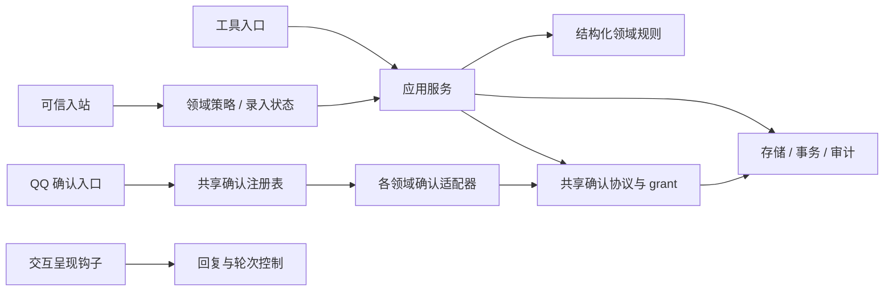

# 后端职责分层与代码整理

状态：**处理中：先修提醒列表调用链，再完成策略/存储可插拔**。2026-10-16（Asia/Shanghai）。入口：[文档目录](README.md)。

## 当前任务与顺序

用户已同意先修复“第六条可以删了”的调用链，修复验收后继续优化现有结构。此前保持行为的分层提交为 `463bb95`；下文初轮结果仅说明该提交，不代表本次行为修复已完成。

- [x] 第一阶段：已有事项的动作与目标由模型结合对话转换成结构化参数，取消后端动作词/列表关键词/标题原文的重复裁决；保留可信当前入站、真实目标、版本、事务、审计和幂等。
- [x] 第一阶段验收：59/59 离线回归、7/7 真实模型隔离对话；原三种表达、排序变化后的序号指代、无先前列表时澄清及否定/假设均通过，生产数据库指纹不变。见[调用链验收](verification/backend-refactor-2026-10-16/structured-items/README.md)。
- [ ] 第二阶段：提醒列表与长期记忆的 Policy/Store 定义契约与注册表，应用服务只依赖接口；提供现有实现作为默认适配器，在启动时选择，验证替换与显式失败。
- [ ] 最终：更新当前规则、开发入口、测试索引和脱敏证据，完成相关回归与运行自检；本地提交仅包含本任务改动。

决策：已有事项的语义判断交给模型。序号依据此前向用户展示的列表定位真实 ID，不按数据库最新顺序重新解释。指代不清时模型澄清；后端仍验证记录存在、唯一目标及版本。添加字段原文、DDL/条件与单消息一项的现行规则本次保留，通过可替换策略明示；带码确认不变。可插拔以明确的组合入口和注册表实现，不增加通用工作流引擎或热切换。

验证边界：临时目录/合成身份/真实模型仅写隔离库；生产业务数据不作验收夹具，不真实发送 QQ/邮件。工作区已有独立邮件模块及脚本索引修改，保留这些改动，不纳入本任务提交。运行加载与配置对齐单独记录；不执行远端推送或重打恢复快照。

第二阶段采用各领域自己的组合入口和适配器注册表。Policy/Store 是不同契约，应用服务通过注入消费；注册/注销/重复检测由共享小型库负责，领域协议不塞入共享库。选择在插件注册时固定，未知 ID/无效契约明确失败，不回退 SQLite 或临时存储。提醒列表工具、调度器、固定 runner 共享组合入口与存储 ID，避免只替换聊天工具后读写两套数据。新增实现需在持久组合入口登记，不能只在宿主进程内注册而让独立 Cron 程序找不到它。

## 需求与范围

本轮根据提醒列表故障调查整理代码职责，为后续调整规则提供清晰的修改位置。模型已传入正确动作与记录 ID，后端仍会根据本次原文重新判断动作、目标和字段；长期记忆也有同类规则。共享确认、对话流程和数据库执行不能混为同一种授权。

用户本轮授权整理文件与函数。采用**保持行为的重构**：不取消现有原文规则，不改变工具参数、确认口令、权限、人格、数据库结构、调度或投递结果。取消哪些规则属于后续决定；本轮不会把“整理代码”解释为放宽权限。

## 分层决定

| 层 | 负责 | 不负责 |
| --- | --- | --- |
| 可信入口 | 主人身份、私聊路由、原始消息、当前调用上下文 | 自然语言动作和字段判断 |
| 领域策略 | 现有的动作词、原文取值、目标提及、连续录入、单消息限制 | SQL、文件写入、通用确认协议 |
| 应用服务 | 依次调用策略和领域执行，组织事务、重放、审计 | 自己新增自然语言词表 |
| 领域与存储 | 结构化字段、真实目标、版本、唯一性、状态流转、事务和持久化 | 读取聊天原文、判断用户怎么表达 |
| 通用确认 | 提案、上下文绑定、口令、有效期、grant、防重放 | 提醒/记忆词表、业务表所有权、回复人格 |
| 交互呈现 | 等待澄清、提案预览、固定文案 | 签发确认授权或代替业务提交 |

`confirmation-core` 已是共享包，`personal-confirmation` 是 QQ 入口插件。保留这两个角色；业务插件通过共享接口注册自身存储适配器，提交时在本领域事务中消费 grant。不要把所有规则收进确认插件，也不引入通用工作流引擎。

## 实施与验收清单

- [x] 核对源码、实际加载配置与已有测试，确认当前混合点。
- [x] 拆分共享确认的协议、上下文和持久化，保持包公开接口兼容。
- [x] 拆分提醒列表的原文策略、应用服务和数据库操作；更新全部调用者。
- [x] 拆分长期记忆的原文策略、应用服务和文件存储；保留固定回归夹具使用的读写接口。
- [x] 明确天气部署容器中的交互钩子边界，与确认核心分开。
- [x] 补充实际分层回归并运行已有领域、确认及消费方测试和构建。
- [x] 更新阅读入口、开发指引、测试索引与验收证据，检查 Git 差异和运行态对齐。

## 验收边界

本轮用临时目录/内存库和模拟上下文验证，不能写生产业务数据或真实发 QQ、邮件。测试必须同时证明：旧允许/拒绝行为保持、存储不依赖原文规则、工具入口仍经过策略、确认在跨领域使用时保持有效期/绑定/一次消费约束。

运行配置未变更；已直接重载 `kurumi-fusion.service` 验证新模块加载。离线通过不等于真实聊天体验已改善，本轮也不宣称原来的“第六条”故障已经修复。

## 结果与待办

重构前基线：确认核心 17/17、确认入口 15/15、天气 162/162。Node 基线 47/48：提醒列表插件的六项样例使用了固定的 2026-10-12/13 截止日期，却使用真实系统时间；2026-10-16 运行时按正确的“拒绝过去 DDL”规则失败。已将该离线夹具的 Date 时钟固定到样例时点，生产时间规则不变。

实现后的代码入口（均相对仓库根目录）：

| 模块 | 路径与函数 |
| --- | --- |
| 确认协议/上下文/存储 | `chatbot/packages/confirmation-core/src/{protocol,scope,schema,store,types,validation}.ts`；公开 API 只由 `src/index.ts` 导出 |
| 确认入站 | `chatbot/plugins/personal-confirmation/src/inbound.ts`、`index.ts`；继续调用共享 registry，不拥有业务数据库 |
| 提醒列表 | `chatbot/plugins/personal-reminder-list/inbound.js`（可信原文）、`policy.js`（原文策略）、`intake.js`（录入生命周期）、`service.js::manageList`（写入编排）、`model.js`（结构化数据）、`store.js`（SQL、审计、回执） |
| 长期记忆 | `chatbot/plugins/kurumi-memory/inbound.js`、`policy.js`、`service.js::changeMemory`、`model.js`、`store.js::{readMemory,writeMemory}`；工具声明和入口在 `index.js` |
| 交互控制 | `chatbot/plugins/personal-weather/src/interaction/`；`index.ts::registerInteractionHooks` 明列启用范围，内部两类 hook 保持原有行为 |
| 天气容器的确认适配器 | `chatbot/plugins/personal-weather/src/confirmation-backends.ts::registerDomainConfirmationBackends`；生命周期注册与回收，不添加确认解析器 |
| 新增回归 | `chatbot/tests/backend-boundaries/{domain,confirmation}.test.mjs`；其他领域原测试保留并更新 import/服务调用 |

通用确认按需用于原来需要提案的领域；提醒列表与长期记忆仍使用各自现有策略，不因为图中的公共层而新增带码确认。源码不再保留旧 `gate.ts`、`intent.js` 或旧位置交互 hook 的兼容转发副本；所有仓库内调用者已更新。移除的构建源对应的旧 `dist/*.js`/`.d.ts` 也已清理，避免编译器残留旧入口。

确认包的 **18 个运行时公开导出保持一致**，类型接口与共享 SQL 不变；三个 TypeScript 包构建通过。现有测试加新增 13 项共 **336/336**（Node 142、确认核心 17、确认入口 15、天气 162）。其中包含邮件对共享包的消费方回归；邮件真实投递不在本次验收范围。

### 后续删减入口（本轮未实施）

- 提醒列表动作词、原文摘录、目标提及、时间语义：`policy.js`；服务显式调用这些检查。
- 连续录入、跨提醒工具拦截：`intake.js`，由插件注册 hook。可信上下文检查独立在 `inbound.js`，不能随词表一起删。
- 单消息只能修改一项：`policy.js::{listRequestKey,checkRequestReplay}`，还涉及当前 `requests.message_key` 的幂等粒度。不能只删冲突检查而保留相同唯一键，也不能为了多项操作取消精确重放保护。
- 长期记忆原文规则：记忆 `policy.js`；保存格式、凭证过滤、文件锁、revision 和原子替换属于模型/存储层。
- 等待澄清、强制提案预览：天气 `interaction/` 的组合入口；移除它们不等于取消确认授权。
- 带码确认仍通过共享包；原生一次性提醒的固定称呼和列表汇总格式仍在原 formatter/runner，未改变。

本轮不增加配置开关或新的通用引擎，不复制领域规则到确认核心。原来“第六条”被拒的问题仍会发生，这是等待用户决定取消策略的已知事项，不是重构验收遗漏。

### 部署与证据

四项自检通过，重载后 9 个插件加载、3 个确认后端注册、QQ 连接正常，`testIngress=false`。没有真实 QQ/邮件测试外发，没有配置写入或数据库迁移。远端模型目录刷新仍有重构前已存在的警告，本轮未处理。证据与复现命令见[本轮验收报告](verification/backend-refactor-2026-10-16/README.md)。

本轮不更新后台开发副本和恢复快照；后续使用副本前按文档 10 同步，备份范围按文档 16 单独验收。后续需要用户决定的是删除哪些策略，而非分层代码如何继续。本轮源码、文档和证据作为一个本地提交收录，不执行远端推送。
