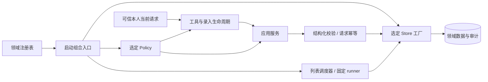

# 后端职责分层与可插拔实现

类型：后端规则。状态：现行分层、可插拔实现与四领域独立生命周期已部署；检索接入范围见[26](26_基础能力插件边界整理与检索接入设计.md)，记忆连续性见[25](25_人格、记忆与会话连续性.md)。验收结论及未覆盖范围统一见[文档16](16_验收与测试总表.md#分领域验收摘要)。

本文维护共享代码归属、语义与执行分工、同步适配器、确认与生命周期契约。完成的实施清单移入[阶段记录](archive/documentation-2026-10-23/21_后端职责分层与代码整理.md)，不在规则正文继续追加开发轮次。

[早期设计 tp.txt](tp.txt)作为原则来源保留。当前采用领域独立装配、显式接口和小型共享包；共用构建或历史共库不否定逻辑分层。只在出现实际复用消费者时抽取公共能力，不把早期完整编排设想写成当前功能。

## 当前生产实现

| 能力 | 当前路径与事实源 | 执行边界 |
| --- | --- | --- |
| 天气、Profile、行程、一次性提醒 | 四个独立插件装配`packages/personal-domains`默认实现；Profile/行程保留历史共库 | 独立工具、服务与确认后端；集中构建不等于共用生命周期 |
| 提醒列表与账单 | `personal-reminder-list/remote.js`、`kurumi-knowledgemap`→专用HTTP客户端→KnowledgeMap API | 显式异步调用；事项/账单事务、版本、幂等在业务API，本地只保留控制和投递账本，见[23](23_KnowledgeMap业务能力桥接.md) |
| 本人连续性记忆 | `kurumi-memory/continuity/application.js`、`policy.js`、`store.js`→SQLite | 同步Policy/Store，配置键`continuityPolicyAdapter/continuityStoreAdapter`，当前`current-owner/sqlite`；不使用旧MEMORY文件写入，见[25](25_人格、记忆与会话连续性.md) |
| 邮件 | `kurumi-mail/application.js`与同步SQLite Store；`service.js`编排SMTP | 异步SMTP不注册成同步Store；确认消费和外部投递分开，见[20](20_邮件能力与横切扩展.md) |
| 论文与研究 | `kurumi-papers`固定后台进程、`kurumi-research`读取；共享PDF源获取与受管文档包 | 下载、阅读、翻译、投递职责分开，见下文共享表及[22](22_论文PDF翻译与文件投递.md) |

旧SQLite列表、旧文件记忆接口仅在[兼容实现](#兼容实现)展开。它们保留作未切换模式、兼容探针或隔离回归，不是当前共享事项与连续性记忆的生产存储。

## 语义与执行的边界

模型将真实需求转换为动作、ID、版本及结构化字段；后端负责可信身份、当前请求、参数、事务、版本和幂等，不再次用聊天动词或完整标题正则裁决已有项维护。“第六条”的已展示列表对应、歧义澄清和一条消息一项的具体业务规则统一见[文档19](19_提醒列表与定时汇总.md#当前规则)。

ID为不透明键，不含事项正文。移除重复原文裁决的原因和真实模型边界见[structured-items](verification/backend-refactor-2026-10-16/structured-items/README.md)。后端不能证明任意自然语言与ID必然对应，负向用例不等于所有对话零误解。

## 同步适配器与异步业务API

共享`domain-adapters`只提供同步契约的注册、检查和启动选择。连续性记忆在自己的组合入口声明`evidence/fact/summary` Policy及`read/write/close` Store方法；旧列表和旧显式记忆声明各自不同接口，不能因共用注册机制而混用契约。

KnowledgeMap通过专门异步客户端调用，不能将HTTP Promise伪装为同步Store。事项唯一业务事实在API；本地设置、调度/请求控制和投递账本不构成业务副本。更换到异步驱动需显式调整应用契约，不静默回退旧库。

## 共享代码与插件生命周期

共享运行包不得反向导入具体插件或`scripts/fusion/`；插件组合入口可以接线QQ实际投递器，但只经QQ插件的对外投递入口 [delivery.js](../chatbot/plugins/kurumi-qq/delivery.js)（`createQqDelivery(cfg)` 返回 `sendDocument` / `sendText`），不直接导入 `kurumi-qq/src/*`；发送台账、限额和目标校验仍在QQ插件内部。`capabilities.test.mjs` 扫描所有插件源码，跨插件导入只允许登记的对外入口。代码归属如下，新能力沿用这些边界，不另造全局容器或通用工作流引擎。

| 职责 | 唯一实现/入口 |
| --- | --- |
| 沙箱执行与进程树终止 | `chatbot/packages/sandbox/index.js` |
| 可信入站与引用边界 | `chatbot/packages/trusted-inbound/index.js`；领域再施加准入策略 |
| 结构化事件与脱敏sink | `chatbot/packages/observability/index.js`；运维查询留在 `scripts/fusion/log-query.mjs` |
| 公开学术PDF获取 | `chatbot/packages/scholarly-source/index.js`；研究/翻译共同消费 |
| 阅读文本与页图 | `chatbot/plugins/kurumi-research/papers.js`；阅读缓存由 `kurumi-research.config.cacheRoot` 显式配置 |
| 翻译及受管文档 | `chatbot/plugins/kurumi-papers/service.js`、`chatbot/packages/documents/index.js`；不要求阅读提取成功 |
| 四领域默认实现 | `chatbot/packages/personal-domains/src/`，各 `*-plugin.ts` 独立装配 |
| 独立插件 | `chatbot/plugins/personal-{weather,profile,planning,reminders}/index.js`及各自manifest，原工具归属为1/3/3/7 |
| 集中构建与兼容CLI | `chatbot/scripts/build-personal-plugins.mjs`；旧天气CLI仅转交同一共享实现 |

PDF源边界保留HTTPS网站白名单、禁重定向/凭据、45秒期限、25MiB、PDF签名/hash及符号链接检查。源缓存为`<id>.pdf`和`<id>.source.json`；旧阅读缓存`<id>.json`验证后可复用。阅读解析失败不阻断翻译下载，取消前不发布半文件；无取消信号的相同下载可合并，有独立信号的不合并取消。论文业务参数与产物限制仍归文档22。

四领域分别登记工具、服务和确认后端，不先注册全部再过滤。Profile/行程保留`state/personal-weather/weather.sqlite`历史共库；一次性提醒保留`state/personal-reminders/`。独立生命周期不承诺独立数据库或版本发布。主人 2026-10-22 确认维持现状：四领域继续共用集中构建、上述历史共库和既有 Cron 执行地址；以后要拆库或改地址另开一项，先授权、先备份。

带锁文件的共享库（`personal-domains`）在自己的 `package.json` 用 `file:` 链接声明所依赖的共享包（`confirmation-core`、`access-control`、`knowledgemap-client`），源码按包名导入；子路径须在被依赖包的 `exports` 中列出。没有锁文件的纯 JS 插件沿用相对路径引用共享包。

确认候选和实际记录均按持久domain隔离；Profile/Planning各用自己的provider，提醒维持`personal-reminder`。provider ID不写入持久proposal/grant，domain、ID/hash和scope不改；停止时仅注销本实例注册，一次性提醒停止还须等待在途维护批次。

既有Cron的`personal-weather/dist/reminder-cli.js`是稳定执行地址，集中构建生成最小兼容转发；新提醒使用`personal-reminders`的runner。不得删除旧地址、重写业务副本或重建既有任务来代替兼容。2026-10-21只读核对：生产 Cron 中已没有任务指向旧地址，一次性提醒均已结束；转发仍保留，供从备份恢复的旧任务使用。

2026-10-20结构整理回归、真实隔离Gateway及生产加载的结果与版本边界见[专项报告](verification/capability-decoupling-2026-10-20/README.md)。配置同步的显式延期契约只在[配置说明](../config/README.md#同步契约)维护；新的Search/Fetch provider接入与启用状态见[文档26](26_基础能力插件边界整理与检索接入设计.md)。

共享确认维持原 18 个运行时公开导出。其 registry 使用版本化 `Symbol.for` 跨宿主加载副本共享确认后端；领域适配器注册表则属于一次组合，避免独立插件实例/测试互相污染。这两种生命周期用途不同。

宿主服务必须显式登记 `stop(ctx)`，异步清理返回 Promise 供宿主等待；不能依赖 `start(ctx)` 的返回函数。论文插件转交 `PaperService.stop()`；邮件插件在停止或启动失败清理时注销本实例持有的确认注册。共享确认的每次注册都有独立身份，旧注销句柄不能影响后续注册，即使复用了同一 provider 对象；跨加载副本的 Symbol 和公开 API 保持兼容。

## 可插拔契约与扩展方法

共享小型注册库：[domain-adapters/index.js](../chatbot/packages/domain-adapters/index.js)，公共类型：[index.d.ts](../chatbot/packages/domain-adapters/index.d.ts)。它只管理实现身份、契约检查与固定选择。

注册表提供 `registerPolicy(id, implementation)`、`registerStore(id, open)`、`resolve({policy,store})`、`ids()`。每次注册有独立身份，返回只删除该次注册的注销函数；同一工厂重新注册也不会被旧句柄删除，重复 ID 被拒。解析后固定策略方法表与工厂，注销/重新注册仅影响后续组合，不热换运行实例。

接口要求同步。打开存储时检查必需方法，返回绑定原始对象的契约视图；每次调用 Policy/Store 契约方法时拒绝 Promise/thenable 返回值（含 `close`），避免误判写入完成，并接收被拒绝 Promise 的 rejection。视图兼容冻结对象、私有字段及 `.db` 等附加属性读取。缺方法、异步策略/存储、未知选择和打开失败明确报错，已打开但无效的资源尽力关闭，不回退默认或临时存储。完整包装边界见[包说明](../chatbot/packages/domain-adapters/README.md)。

新增实现的步骤：实现领域接口 → 在领域持久 `adapters.js` 组合入口注册 → 跑一致性回归 → 配置实现 ID → 按配置同步契约重启。应用服务无需修改。测试/嵌入可通过 `createReminderListPlugin({registry})`、`createMemoryPlugin({registry})` 或 `create*Application({registry,...})` 注入独立注册表。

连续性记忆使用`createContinuityRegistry()`/`createContinuityApplication()`，注册机制相同，方法表、默认ID与配置键以其领域契约为准；旧接口示例见下一节。新实现还需覆盖对应领域的事务、查询、备份恢复与迁移验收，方法存在检查不能证明业务原子性。

## 兼容实现

### 旧本地列表与文件记忆

| 领域 | 接口 | 默认策略 / 存储 ID | 组合与注册 |
| --- | --- | --- | --- |
| 提醒列表 | [contracts.d.ts](../chatbot/plugins/personal-reminder-list/contracts.d.ts) | `default` / `sqlite` | [application.js](../chatbot/plugins/personal-reminder-list/application.js)、[adapters.js](../chatbot/plugins/personal-reminder-list/adapters.js) |
| 显式记忆旧接口 | [contracts.d.ts](../chatbot/plugins/kurumi-memory/contracts.d.ts) | `explicit` / `memory-file` | [application.js](../chatbot/plugins/kurumi-memory/application.js)、[adapters.js](../chatbot/plugins/kurumi-memory/adapters.js) |

显式记忆旧接口和本地列表实现可在 `plugins.entries.<领域>.config` 选择 `policyAdapter` / `storeAdapter`，未配置使用上表默认值；选择不出现在模型工具参数里。当前生产连续性模式有自己独立的适配器键，不与这些旧接口混用，见文档25；配置同步仍按 [config/README.md](../config/README.md)。

以下分层表和流程图仅描述这两套兼容实现，不能用旧`store.js`推断当前连续性SQLite或共享事项的事实源：

| 职责 | 唯一入口与要求 |
| --- | --- |
| 可信入站 | `chatbot/packages/trusted-inbound/index.js` 提供可信当前消息边界；各领域 `inbound.js` 施加准入策略，共享 `access-control` 判身份。策略不能替换身份判定或把引用升级为可信输入 |
| 组合入口 | 各领域 `application.js`，由 `adapters.js` 注册表选择实现；插件在注册时固定选择 |
| 领域策略 | 各领域 `policy.js` 是默认实现；语言动作、字段来源、条件等通过 Policy 接口消费 |
| 应用服务 | 各领域 `service.js` 的 `createListService` / `createMemoryService`；只依赖注入接口和领域模型，不导入具体策略/存储 |
| 领域与存储 | `model.js` 验证结构化字段；列表旧 `store.js` 保存SQLite/审计/账本，显式记忆旧 `store.js` 保存MEMORY.md；生产共享事项与主人连续性分别由文档23/25的存储持有 |
| 请求执行 | 列表 `requests.js` 管理有效期、消息幂等键与重放；记忆服务维护单请求消费，文件存储执行 revision/锁/原子替换 |
| 连续录入 | 列表 `intake.js` 保存进程内当前请求与生命周期，调用注入 Policy；不另存待办，不从策略结果接收身份/时间/消息元数据 |
| 共享确认 | `chatbot/packages/confirmation-core/src/` 的协议、上下文、存储和 registry；`personal-confirmation` 只处理可信 QQ 入站，领域在自己的事务内消费 grant |
| 交互呈现 | `chatbot/packages/personal-domains/src/interaction/`；各领域显式提供自己负责的澄清/提案工具名单，与 `confirmation-backends.ts` 的确认注册分开 |

### 独立runner与存储替换

提醒列表独立 Cron 程序同样从持久组合入口解析存储。非默认存储 ID 写入固定 payload 的 `KURUMI_LIST_STORE_ADAPTER`；默认 SQLite payload 保持兼容。**只在宿主自定义入口内注册存储不足以让独立 runner 识别它**，部署实现必须同时登记到该持久入口。runner 不接收任意模块路径。调度器拒绝接管绑定到另一存储的旧任务；更换存储时应另做数据与 Cron 迁移验收，改配置不迁移旧数据。

方法存在检查不能证明事务正确。列表存储必须在同一事务内验证唯一目标/当前版本，并原子提交业务数据、审计和请求账本；记忆存储必须比较 revision 并原子替换。新实现需运行这些一致性用例。暂不支持异步数据库驱动，需另行调整服务契约。

当前运维的数据库日志查询与恢复校验仍针对默认 SQLite/文件格式。未来生产换库需同时提供对应的日志查询、备份恢复及数据迁移验收；本次接口替换夹具不代表其它存储已获得生产运维支持。

## 确认契约与已知待办

用户已明确选择保留带码确认。一次性提醒、Profile/行程及邮件发送沿用`confirmation-core`的proposal/grant与可信入站；提醒列表和账单明确维护按19/23直接执行，不能把它们的直接保存扩大成全局免确认。

`chatbot/packages/confirmation-core/src/protocol.ts`接受“确认 <12位码>”及旧完整ID/hash格式；单说“确认”不会授权。提案有效期与提醒执行时间是不同字段；展示时须区分两者，不能让模型自行签发授权或更改参数快照。模型可以消歧、追问，不能替用户确认危险或有副作用的操作。

早期“唯一提案自然确认”“明确提醒直接创建”的研究未上线，后被用户保留带码确认的决定取代，**不再列作待开发**；历史出处见[迁移记录](verification/deepseek-whale/README.md)。

**固定输出措辞**：固定一次性提醒 runner（`chatbot/packages/personal-domains/src/reminder-cli.ts`）输出“提醒时间到了：<内容>”，天气 `daily-brief` 问候为“早上好。”，都不带人格称呼；称呼只由人格层决定（`config/persona.json`中“主人”是授权术语，不是日常称呼）。单测断言这两处固定文本不含“主人”。当前每日天气走 agentTurn 定时任务，不调用 `daily-brief`。真实一次性提醒投递的验收状态见[文档16](16_验收与测试总表.md#已知未完成与批准延期)。提醒列表的中性汇总与此独立，不扩展为确认机制重做。

## 默认策略与后续规则调整入口

| 规则 | 当前实现与后续修改位置 |
| --- | --- |
| 已有项动作/目标 | 模型结合对话产生真实参数；已移除原文动作词/标题重复校验 |
| 添加与播报操作准入 | 默认列表 `policy.js`；已有项的语义放权不扩大新增字段来源规则 |
| 标题/内容/备注、DDL/条件 | 默认列表 Policy；结构化长度/日期有效性仍由 `model.js` 执行 |
| 连续录入 | Policy 判断是否开启/继续，`intake.js` 管理 UUID、10 分钟闲置/30 分钟总窗口与重置/结束 |
| 单消息一项 | `requests.js` 和现有 `requests.message_key` 唯一键共同约束；调整批量写入须设计新的幂等粒度，不是删一个拒绝分支 |
| 长期记忆规则 | 主人连续性、来源/更正/遗忘与摘要契约见文档25；旧显式接口仍保留自己的默认Policy与文件存储约束 |
| 澄清与强制提案预览 | `personal-domains/src/interaction/`，由各领域入口显式配置负责工具，不签发授权 |
| 一次性提醒确认与称呼 | 带码确认保持；固定提醒与天气输出遵循上方中性措辞，真实一次性投递仍按文档16复验 |

通用确认不包含提醒列表/记忆词表，不新增工作流引擎。模型工具权限、群聊禁用、身份来源和数据库 schema 保持原约束。

## 术语

- **runner**：由原生Cron按固定payload启动的独立程序，不经过聊天模型，例如提醒列表定时汇总和一次性提醒的投递程序。
- **policyAdapter / storeAdapter**：未切换到共享模式的提醒列表和长期记忆旧接口的配置项，值是领域 `adapters.js` 注册的策略或存储实现ID，启动时固定，见[可插拔契约](#可插拔契约与扩展方法)。

## 开发与验收记录

已结束的初轮分层、已有项调用链修复、适配器和生命周期补正见[阶段记录](archive/documentation-2026-10-23/21_后端职责分层与代码整理.md)。各轮修复前失败、命令、回执和真实/模拟边界仍由原专项报告保存：

| 主题 | 原始证据 |
| --- | --- |
| 初轮与已有项语义边界 | [初轮](verification/backend-refactor-2026-10-16/README.md)、[structured-items](verification/backend-refactor-2026-10-16/structured-items/README.md) |
| 注册选择与同步契约补正 | [adapters](verification/backend-refactor-2026-10-16/adapters/README.md)、[adapter-contracts](verification/backend-refactor-2026-10-16/adapter-contracts/README.md) |
| 显式停止与逐次注册归属 | [plugin-lifecycle](verification/plugin-lifecycle-2026-10-19/README.md) |
| 四领域、PDF共享边界与生产加载 | [capability-decoupling](verification/capability-decoupling-2026-10-20/README.md) |

调用后的契约检查不能取消第三方适配器已经启动的异步副作用，不能替代存储自身的原子性保证；这些同步接口仍不支持异步数据库驱动。

## 验收边界与未完成项

接口替换夹具、隔离模型、模拟 OneBot、生产加载与真人往返分别记录；不能从一层通过推断其他层。原适配器阶段未迁移生产存储，后续共享事项与连续性记忆分别按23/25验收。

恢复点以[文档16](16_验收与测试总表.md)为准；后台副本按[文档10](10_融合助手运行维护.md#后台开发副本契约)在任务前审阅；确认机制后续需求归[待办 N4](待办清单.md#n4-优化确认机制)。不把历史未执行的推送、全量恢复或真实外发写为本轮完成。

返回[文档入口](README.md)。
