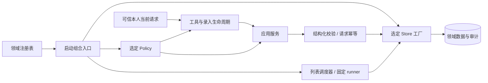

# 后端职责分层与可插拔实现

状态：**分层与可插拔实现已部署；插件停止/确认注册归属补正已于2026-10-20受控加载。** 共享代码归属和四领域插件生命周期在本文统一维护；检索待实施设计见文档26，记忆连续性见文档25，验收结论见[文档16](16_验收与测试总表.md#分领域验收摘要)。更新于2026-10-21（Asia/Shanghai）。入口：[文档目录](README.md)。

## 术语

- **runner**：由原生Cron按固定payload启动的独立程序，不经过聊天模型，例如提醒列表定时汇总和一次性提醒的投递程序。
- **policyAdapter / storeAdapter**：未切换到共享模式的提醒列表和长期记忆旧接口的配置项，值是领域 `adapters.js` 注册的策略或存储实现ID，启动时固定，见[可插拔契约](#可插拔契约与扩展方法)。

## 当前范围与完成清单

用户要求先明确改动范围再实施，并已同意“先修第六条调用链，修复后优化现有结构”。本轮完成提醒列表和长期记忆的策略/存储解耦；共享确认与交互呈现沿用此前分层，不把领域规则收进确认核心。

- [x] 修复已有项动作与目标的重复语言裁决；保留可信当前请求和执行校验。
- [x] 第一阶段离线回归和真实模型隔离对话通过，包括排序变化后的序号指代；数量见[structured-items](verification/backend-refactor-2026-10-16/structured-items/README.md)。
- [x] 定义领域 Policy/Store 契约，提供注册、选择、注销、重复检测及默认实现。
- [x] 应用服务依赖接口，实际工具支持替换；提醒调度与独立 runner 使用相同存储选择。
- [x] 初次可插拔验收的适配器回归包含在 Node 全套中；独立存储可完成实际工具读写，不借用 SQLite/MEMORY.md。
- [x] 结构优化后真实模型和隔离 OpenClaw 宿主通过；生产数据库指纹未变。数量见[适配器报告](verification/backend-refactor-2026-10-16/adapters/README.md)。
- [x] 初次可插拔验收全套回归、三个 TS 构建通过；脚本与 boundary 一致，证据全部归类；本任务变更的 Markdown 本地目标无断链。
- [x] 注册表补正后适配器回归（含子测试）和全套回归通过，数量见[补正报告](verification/backend-refactor-2026-10-16/adapter-contracts/README.md)；三个 TS 构建与接口声明检查、服务重载后四项自检通过。独立证据见下方补正记录。
- [x] 调用链与可插拔实现分别本地提交为 `091e1f4`、`1fc0ca3`；契约补正单独收录。并行邮件文档改动单独保留，不推送远端、不更新后台副本或重打恢复点。

## 语义与执行的边界

模型将真实需求转换为动作、ID、版本及结构化字段；后端负责可信身份、当前请求、参数、事务、版本和幂等，不再次用聊天动词或完整标题正则裁决已有项维护。“第六条”的已展示列表对应、歧义澄清和一条消息一项的具体业务规则统一见[文档19](19_提醒列表与定时汇总.md#当前规则)。

原故障中模型三次均提交`action=void`和同一真实ID/version，后端前两次重新匹配原文并拒绝，只有第三次出现“作废”才执行。该重复裁决已移除，ID是不透明键，不含事项正文。原调用链与真实模型边界见[structured-items](verification/backend-refactor-2026-10-16/structured-items/README.md)。后端不能证明任意自然语言与ID必然对应，否定/假设/引用的模型负向验收不等于所有对话零误解。

## 共享业务的异步边界

提醒列表在 `dataSource=knowledgemap` 时走 `remote.js` 与专用HTTP客户端，事项事务/版本/幂等在KnowledgeMap；本地只保留调度控制与投递账本。以下同步Policy/Store组合适用于旧SQLite列表及显式记忆接口，不能把HTTP Promise伪装成同步Store。主人当前连续性记忆使用文档25的独立Policy/SQLite契约，不再把MEMORY.md当作事实源；其来源、遗忘和摘要生命周期见[文档25](25_人格、记忆与会话连续性.md)。业务桥接见[文档23](23_KnowledgeMap业务能力桥接.md)。

## 职责与代码位置

| 职责 | 唯一入口与要求 |
| --- | --- |
| 可信入站 | `chatbot/packages/trusted-inbound/index.js` 提供可信当前消息边界；各领域 `inbound.js` 施加准入策略，共享 `access-control` 判身份。策略不能替换身份判定或把引用升级为可信输入 |
| 组合入口 | 各领域 `application.js`，由 `adapters.js` 注册表选择实现；插件在注册时固定选择 |
| 领域策略 | 各领域 `policy.js` 是默认实现；语言动作、字段来源、条件等通过 Policy 接口消费 |
| 应用服务 | 各领域 `service.js` 的 `createListService` / `createMemoryService`；只依赖注入接口和领域模型，不导入具体策略/存储 |
| 领域与存储 | `model.js` 验证结构化字段；列表旧 `store.js` 保存SQLite/审计/账本，显式记忆旧 `store.js` 保存MEMORY.md；生产共享事项与主人连续性分别由文档23/25的存储持有 |
| 请求执行 | 列表 `requests.js` 管理有效期、消息幂等键与重放；记忆服务维护单请求消费，文件存储执行 revision/锁/原子替换 |
| 连续录入 | 列表 `intake.js` 保存进程内当前请求与生命周期，调用注入 Policy；不另存待办，不从策略结果接收身份/时间/消息元数据 |
| 共享确认 | `chatbot/packages/confirmation-core/src/` 的协议、上下文、存储和 registry；`personal-confirmation` 只处理可信 QQ 入站，领域在自己的事务内消费 grant |
| 交互呈现 | `chatbot/packages/personal-domains/src/interaction/`；各领域显式提供自己负责的澄清/提案工具名单，与 `confirmation-backends.ts` 的确认注册分开 |

共享确认维持原 18 个运行时公开导出。其 registry 使用版本化 `Symbol.for` 跨宿主加载副本共享确认后端；领域适配器注册表则属于一次组合，避免独立插件实例/测试互相污染。这两种生命周期用途不同。

宿主服务必须显式登记 `stop(ctx)`，异步清理返回 Promise 供宿主等待；不能依赖 `start(ctx)` 的返回函数。论文插件转交 `PaperService.stop()`；邮件插件在停止或启动失败清理时注销本实例持有的确认注册。共享确认的每次注册都有独立身份，旧注销句柄不能影响后续注册，即使复用了同一 provider 对象；跨加载副本的 Symbol 和公开 API 保持兼容。

## 共享代码与插件生命周期

共享运行包不得反向导入具体插件或`scripts/fusion/`；插件组合入口可以接线QQ实际投递器。代码归属如下，新能力沿用这些边界，不另造全局容器或通用工作流引擎。

| 职责 | 唯一实现/入口 |
| --- | --- |
| 沙箱执行与进程树终止 | `chatbot/packages/sandbox/index.js` |
| 可信入站与引用边界 | `chatbot/packages/trusted-inbound/index.js`；领域再施加准入策略 |
| 结构化事件与脱敏sink | `chatbot/packages/observability/index.js`；运维查询留在 `scripts/fusion/log-query.mjs` |
| 公开学术PDF获取 | `chatbot/packages/scholarly-source/index.js`；研究/翻译共同消费 |
| 阅读文本与页图 | `chatbot/plugins/kurumi-research/papers.js`；阅读缓存由 `kurumi-research.config.cacheRoot` 显式配置 |
| 翻译及受管文档 | `chatbot/plugins/kurumi-papers/service.js`、`chatbot/packages/documents/index.js`；不要求阅读提取成功 |
| 四领域默认实现 | `chatbot/packages/personal-domains/src/`，各 `*-plugin.ts` 独立装配 |
| 独立插件 | `chatbot/plugins/personal-{weather,profile,planning,reminders}/index.js`及各自manifest，原工具归属为1/3/3/7 |
| 集中构建与兼容CLI | `chatbot/scripts/build-personal-plugins.mjs`；旧天气CLI仅转交同一共享实现 |

PDF源边界保留HTTPS网站白名单、禁重定向/凭据、45秒期限、25MiB、PDF签名/hash及符号链接检查。源缓存为`<id>.pdf`和`<id>.source.json`；旧阅读缓存`<id>.json`验证后可复用。阅读解析失败不阻断翻译下载，取消前不发布半文件；无取消信号的相同下载可合并，有独立信号的不合并取消。论文业务参数与产物限制仍归文档22。

四领域分别登记工具、服务和确认后端，不先注册全部再过滤。Profile/行程保留`state/personal-weather/weather.sqlite`历史共库；一次性提醒保留`state/personal-reminders/`。独立生命周期不承诺独立数据库或版本发布。

带锁文件的共享库（`personal-domains`）在自己的 `package.json` 用 `file:` 链接声明所依赖的共享包（`confirmation-core`、`access-control`、`knowledgemap-client`），源码按包名导入；子路径须在被依赖包的 `exports` 中列出。没有锁文件的纯 JS 插件沿用相对路径引用共享包。

确认候选和实际记录均按持久domain隔离；Profile/Planning各用自己的provider，提醒维持`personal-reminder`。provider ID不写入持久proposal/grant，domain、ID/hash和scope不改；停止时仅注销本实例注册，一次性提醒停止还须等待在途维护批次。

既有Cron的`personal-weather/dist/reminder-cli.js`是稳定执行地址，集中构建生成最小兼容转发；新提醒使用`personal-reminders`的runner。不得删除旧地址、重写业务副本或重建既有任务来代替兼容。

2026-10-20结构整理回归、真实隔离Gateway及生产加载的结果与版本边界见[专项报告](verification/capability-decoupling-2026-10-20/README.md)。配置同步的显式延期契约只在[配置说明](../config/README.md#同步契约)维护；新的Search/Fetch provider仍仅为[文档26](26_基础能力插件边界整理与检索接入设计.md)的设计。

## 可插拔契约与扩展方法

共享小型注册库：[domain-adapters/index.js](../chatbot/packages/domain-adapters/index.js)，公共类型：[index.d.ts](../chatbot/packages/domain-adapters/index.d.ts)。它只管理实现身份、契约检查与固定选择。

| 领域 | 接口 | 默认策略 / 存储 ID | 组合与注册 |
| --- | --- | --- | --- |
| 提醒列表 | [contracts.d.ts](../chatbot/plugins/personal-reminder-list/contracts.d.ts) | `default` / `sqlite` | [application.js](../chatbot/plugins/personal-reminder-list/application.js)、[adapters.js](../chatbot/plugins/personal-reminder-list/adapters.js) |
| 长期记忆 | [contracts.d.ts](../chatbot/plugins/kurumi-memory/contracts.d.ts) | `explicit` / `memory-file` | [application.js](../chatbot/plugins/kurumi-memory/application.js)、[adapters.js](../chatbot/plugins/kurumi-memory/adapters.js) |

注册表提供 `registerPolicy(id, implementation)`、`registerStore(id, open)`、`resolve({policy,store})`、`ids()`。每次注册有独立身份，返回只删除该次注册的注销函数；同一工厂重新注册也不会被旧句柄删除，重复 ID 被拒。解析后固定策略方法表与工厂，注销/重新注册仅影响后续组合，不热换运行实例。

接口要求同步。打开存储时检查必需方法，返回绑定原始对象的契约视图；每次调用 Policy/Store 契约方法时拒绝 Promise/thenable 返回值（含 `close`），避免误判写入完成，并接收被拒绝 Promise 的 rejection。视图兼容冻结对象、私有字段及 `.db` 等附加属性读取。缺方法、异步策略/存储、未知选择和打开失败明确报错，已打开但无效的资源尽力关闭，不回退默认或临时存储。完整包装边界见[包说明](../chatbot/packages/domain-adapters/README.md)。

显式记忆旧接口和本地列表实现可在 `plugins.entries.<领域>.config` 选择 `policyAdapter` / `storeAdapter`，未配置使用上表默认值；选择不出现在模型工具参数里。当前生产连续性模式有自己独立的适配器键，不与这些旧接口混用，见文档25；配置同步仍按 [config/README.md](../config/README.md)。

新增实现的步骤：实现领域接口 → 在领域持久 `adapters.js` 组合入口注册 → 跑一致性回归 → 配置实现 ID → 按配置同步契约重启。应用服务无需修改。测试/嵌入可通过 `createReminderListPlugin({registry})`、`createMemoryPlugin({registry})` 或 `create*Application({registry,...})` 注入独立注册表。

提醒列表独立 Cron 程序同样从持久组合入口解析存储。非默认存储 ID 写入固定 payload 的 `KURUMI_LIST_STORE_ADAPTER`；默认 SQLite payload 保持兼容。**只在宿主自定义入口内注册存储不足以让独立 runner 识别它**，部署实现必须同时登记到该持久入口。runner 不接收任意模块路径。调度器拒绝接管绑定到另一存储的旧任务；更换存储时应另做数据与 Cron 迁移验收，改配置不迁移旧数据。

方法存在检查不能证明事务正确。列表存储必须在同一事务内验证唯一目标/当前版本，并原子提交业务数据、审计和请求账本；记忆存储必须比较 revision 并原子替换。新实现需运行这些一致性用例。暂不支持异步数据库驱动，需另行调整服务契约。

当前运维的数据库日志查询与恢复校验仍针对默认 SQLite/文件格式。未来生产换库需同时提供对应的日志查询、备份恢复及数据迁移验收；本次接口替换夹具不代表其它存储已获得生产运维支持。

## 确认契约与已知待办

用户已明确选择保留带码确认。一次性提醒、Profile/行程及邮件发送沿用`confirmation-core`的proposal/grant与可信入站；提醒列表和账单明确维护按19/23直接执行，不能把它们的直接保存扩大成全局免确认。

`chatbot/packages/confirmation-core/src/protocol.ts`接受“确认 <12位码>”及旧完整ID/hash格式；单说“确认”不会授权。提案有效期与提醒执行时间是不同字段；展示时须区分两者，不能让模型自行签发授权或更改参数快照。模型可以消歧、追问，不能替用户确认危险或有副作用的操作。

早期“唯一提案自然确认”“明确提醒直接创建”的研究未上线，后被用户保留带码确认的决定取代，**不再列作待开发**；历史出处见[迁移记录](verification/deepseek-whale/README.md)。

**固定输出措辞**：固定一次性提醒 runner（`chatbot/packages/personal-domains/src/reminder-cli.ts`）输出“提醒时间到了：<内容>”，天气 `daily-brief` 问候为“早上好。”，都不带人格称呼；称呼只由人格层决定（`config/persona.json`中“主人”是授权术语，不是日常称呼）。单测断言这两处固定文本不含“主人”。当前每日天气走 agentTurn 定时任务，不调用 `daily-brief`。真实一次性提醒投递的验收状态见[文档16](16_验收与测试总表.md#已知未完成与批准延期)。提醒列表的中性汇总与此独立，不扩展为确认机制重做。

## 默认策略与后续规则调整入口

| 规则 | 当前实现与后续修改位置 |
| --- | --- |
| 已有项动作/目标 | 模型结合对话产生真实参数；已移除原文动作词/标题重复校验 |
| 添加与播报操作准入 | 默认列表 `policy.js`；已有项的语义放权不扩大新增字段来源规则 |
| 标题/内容/备注、DDL/条件 | 默认列表 Policy；结构化长度/日期有效性仍由 `model.js` 执行 |
| 连续录入 | Policy 判断是否开启/继续，`intake.js` 管理 UUID、10 分钟闲置/30 分钟总窗口与重置/结束 |
| 单消息一项 | `requests.js` 和现有 `requests.message_key` 唯一键共同约束；调整批量写入须设计新的幂等粒度，不是删一个拒绝分支 |
| 长期记忆规则 | 主人连续性、来源/更正/遗忘与摘要契约见文档25；旧显式接口仍保留自己的默认Policy与文件存储约束 |
| 澄清与强制提案预览 | `personal-domains/src/interaction/`，由各领域入口显式配置负责工具，不签发授权 |
| 一次性提醒确认与称呼 | 带码确认保持；固定提醒 runner 的“主人”称呼仍是已知独立待办，不属于本次修复 |

通用确认不包含提醒列表/记忆词表，不新增工作流引擎。模型工具权限、群聊禁用、身份来源和数据库 schema 保持原约束。

## 开发与验收记录

### 插件生命周期与确认注册归属补正（2026-10-19）

本次授权只修架构复核中的两个实际缺陷：论文/邮件把清理函数从 `start()` 返回而未被 OpenClaw 调用；确认核心用 provider 对象判断归属，复用对象后可被旧句柄误删。没有扩大为新的接口抽取或工作流开发。

- [x] 修复前新增回归：确认核心 18 过 / 1 失败；真实宿主服务管理器 0 过 / 3 失败，分别复现论文停止未转交、活动/排队任务未停、邮件后端残留。
- [x] 论文/邮件登记显式 `stop()`；论文返回清理 Promise，邮件清空本实例注销句柄，重复停止安全，启动失败不误删其他实例注册。
- [x] 确认核心每次登记新包装对象、保留原 `open()` 接收对象；旧注销不能移除新注册，带码确认仍可路由到新注册。
- [x] 修正邮件两个测试夹具的错误清理约定。新增真实宿主服务管理器隔离回归覆盖等待清理、活动/排队中止、零投递/不重放、邮件重启与失败启动清理。
- [x] 相关回归（Node、宿主管理器、确认核心、确认入口、天气）通过，三个 TS 构建通过。数量、命令、原始回执和边界见[专项报告](verification/plugin-lifecycle-2026-10-19/README.md)。

10月19日该修复阶段未做完整Gateway、模型、真人QQ/SMTP或生产重载。**10月20日00:26:58已受控加载**，后续结构于00:51:20再次加载；独立Gateway、生产RPC和四项检查见[结构整理专项报告](verification/capability-decoupling-2026-10-20/README.md)。原345项修复报告保留原阶段边界。取证时的混合工作树边界见该报告；后续本地收录见[文档16](16_验收与测试总表.md#git工作线归档2026-10-20)。

### 注册表契约补正（2026-10-16）

用户复核发现两项未被原适配器回归覆盖的缺口：普通存储方法返回 Promise 未被拦截；同一工厂注销后重新注册时，旧注销句柄可误删新注册。默认 SQLite/文件实现不受影响，但扩展实现不能依赖该缺口。

- [x] 先用新增回归复现两项缺口（修复前注册表 4 过 / 2 失败，正好对应本次两项）。
- [x] 每次注册使用独立身份，旧注销句柄不得删除后续注册；已解析实例继续固定选择。
- [x] 在契约方法调用返回时拒绝 Promise/thenable，保留原始接收对象及附加属性访问；不把异步结果误报为已完成。
- [x] 实际临时 SQLite 中 `addItem` / `recordRequest` 先写入再返回 Promise，均被拦截并回滚业务数据、审计和请求账本；记忆异步写入不缓存成功结果且资源正常关闭。拒绝结果/清理失败未泄漏未处理 rejection，冻结对象与私有字段回归通过。
- [x] 全套回归（Node、确认核心、确认入口、天气）及适配器部分（含子测试）通过；三个 TS 构建与声明检查通过。服务于 09:19:46 CST 重载，四项自检通过。独立[补正报告](verification/backend-refactor-2026-10-16/adapter-contracts/README.md)保留证据，不覆盖原模型/宿主记录，本次未重跑模型对话或隔离宿主。

调用后的契约检查不能取消第三方适配器已经启动的异步副作用，也不能替代存储自身的原子性保证；异步数据库驱动仍不受支持。

### 阶段结果

| 阶段 | 已落实的决定与结果 |
| --- | --- |
| 保持行为分层 `463bb95` | 拆分确认核心、提醒列表、记忆及交互 hook；回归、3 个 TS 构建、自检与加载通过。固定历史日期夹具只冻结 Date，生产拒绝过去 DDL 不变。证据：[初轮报告](verification/backend-refactor-2026-10-16/README.md) |
| 调用链修复 `091e1f4` | 取消已有项重复语义裁决，更新模型指引与旧拒绝用例；离线回归和真实模型对话通过。证据：[structured-items](verification/backend-refactor-2026-10-16/structured-items/README.md) |
| 可插拔实现 | 独立注册/选择与接口注入，列表工具/调度/runner 一致，记忆策略/存储实际替换；全套回归、结构优化后的模型与隔离宿主通过。最终结果见[适配器报告](verification/backend-refactor-2026-10-16/adapters/README.md) |
| 注册表契约补正 | 普通存储方法异步返回拦截、每次注册独立身份；全套回归、实际 SQLite 回滚、记忆不误报成功及资源/接收对象兼容性通过；见[补正报告](verification/backend-refactor-2026-10-16/adapter-contracts/README.md) |

10月16日并行邮件工作独立提交为 `12c022d`；当时的分层任务未修改邮件模块。修复阶段与结构阶段分本地提交，保留单独回退边界；10月19日邮件停止补正见上方独立记录。

## 验收边界与未完成项

调用链/可插拔阶段使用临时数据库、合成可信入站、真实 DeepSeek、实际插件工厂和隔离 OpenClaw 宿主；OneBot 是模拟端。契约补正只重跑离线回归、构建/类型检查与运行自检。没有真实 QQ/邮件测试外发，未把生产业务数据用作测试夹具。真实模型样例不能证明任意对话必然无歧义，真人 QQ 往返仍需日常使用复核。

2026-10-16适配器验收阶段未切换生产存储；之后共享事项已按文档23迁移到KnowledgeMap，主人连续性已按文档25迁移SQLite。这些后续迁移不能用本阶段替换夹具的通过代替验收。全量备份恢复、后台项目副本同步、远端推送不在本轮执行范围。恢复点仍以[文档 16](16_验收与测试总表.md)为准。服务已有远端模型目录刷新警告，独立于本次领域改动，按实际加载检查记录。
