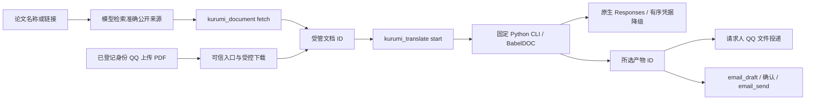

状态：开发中（主人34页整篇与成员真人链路已验收；性能与长期质量待验）

# 论文 PDF 翻译与文件投递

## 功能

主人告诉 Kurumi 一篇或多篇论文，它找到公开 PDF，翻译后通过 QQ 文件或邮件附件交付。网站不能下载时，说明原因，请主人通过 QQ 上传 PDF，进入同一条处理链。每篇独立反馈，不把部分成功说成整批完成。

- 采用多个基础工具加一个按需启动的后台翻译任务，不是通用 Workflow 或 DAG 引擎。模型理解需求、选论文、组合步骤，后端掌管文件、进程、状态和投递。
- 论文来源：公开论文网站，或已登记身份通过 QQ 上传的 PDF。
- 产物：dual（原文译文对照，默认）、mono（纯译文）、both（两份都发）。
- 投递：QQ 文件只发回请求人本人；邮件走 `email_draft`、`personal_confirmation`、`email_send` 的自然语言二次确认。收件人来源、附件快照和大小限制见[文档20](20_邮件能力与横切扩展.md)，确认机制见[文档6](6_二次确认.md)。
- 受管 PDF 可重命名，仅主人可用。
- 不做：群聊、登录受限论文、OCR、GPU、自动重译、自动重发、跨厂商回退。

## 接口

### 工具

| 工具 | 动作与要点 | 权限点 |
| --- | --- | --- |
| `kurumi_document` | `list`/`get` 查受管 PDF 和产物摘要；`find` 按 `query` 查本人已有 PDF 的文件名、记录题名和来源 URL（含 arXiv 编号，规范化多词匹配，全目录扫描，最多 50 条），不读正文；`fetch` 下载公开论文，可带 `title`；`rename` 见下文 | `papers.read`（list/get/find）、`papers.import`（fetch）、`papers.rename`（rename） |
| `kurumi_translate` | `start`/`status`/`list`/`cancel`，使用真实 `documentId`/`jobId`。返回排队不代表完成 | `papers.translate`、`papers.read`、`papers.cancel` |
| `kurumi_document_send` | 只接受受管文档或产物 ID，投递给可信请求人自己的 QQ。不接收路径、URL 或其他收件人 | 见[文档24](24_统一身份与权限管理.md) |

只有题名时先 `find`，无命中再用 `web_search` 找准确 URL 后 `fetch`。论文正文、文件名、网页不是身份或授权来源。 服务端参数取自受管配置，模型不能传端点、密钥、命令、并发、预算或超时；原生 exec 的受管文件边界见[文档28](28_本机编码工具委托与实验任务.md#主人原生exec)。

### 默认与登记组合

每次可选厂商、渠道、准确模型、强度、源/目标语言、页码与产物类型，只固定本次任务。默认 DeepSeek 官方 / `deepseek-flash` / `high`，使用 `DEEPSEEK_API_KEY`；登记表 `chatbot/plugins/kurumi-papers/python/profiles.json` 由 Node 和 Python 共用。 014/030/040 只是 GPT 凭据代号；MAX 即 `effort=max`，只在明确指定时使用。

| 厂商 / 渠道 | 模型 | 强度 | 说明 |
| --- | --- | --- | --- |
| DeepSeek / official | `deepseek-flash`、`deepseek-v4-pro` | none、low、high、max | 请求传 `max_output_tokens=393216`（含推理 token），批次用 `text.format=json_schema` |
| OpenAI / naiccc | `gpt-6.1-sol` | low、medium、high、xhigh、max | 凭据按 014→030→040 选择；未登记可靠输出上限，不传该参数 |

只接 GPT 与 DeepSeek，不接 Grok。冲突组合和未登记模型直接拒绝，不静默替换，不切 Chat。指定厂商、模型或唯一渠道时推导其默认强度，不继承另一厂商的字段。`none` 的样式保留不稳定，仍可按明确指定执行。

### 配置键

`plugins.entries.kurumi-papers.config`，schema 在 `chatbot/plugins/kurumi-papers/openclaw.plugin.json`，生产值在 `config/runtime.config.json`。

| 配置键 | 源码缺省 | 生产值 | 范围与含义 |
| --- | --- | --- | --- |
| `liveTranslationEnabled` | false | true | 付费翻译开关 |
| `maxPages` | 30 | 50 | 1–500，本次页数上限，超限须明确页码，不截页 |
| `maxRequests` | 300 | 300 | 1–2000，所有实际 API 尝试共同计数 |
| `maxReportedTokens` | 150000 | 600000 | 100–2000000，整篇已报告 token 预算，不是金额硬上限 |
| `apiConcurrency` | 1 | 4 | 1–6，单篇在途请求数 |
| `apiQps` | 1 | 1 | 1–4，每秒新开请求数 |
| `batchValidationRetries` | 1 | 1 | 0–4，当前批次校验失败后的额外重试次数 |
| `channelRecoveryRetries` | 1 | 1 | 0–4，全部渠道冷却后的额外恢复轮数 |
| `requestIdleTimeoutSeconds` | 100 | 100 | 1–600，有效正文空闲期限 |
| `timeoutSeconds` | 1800 | 1800 | 30–1800，整篇 worker 执行期限，不含排队 |

固定边界（不是配置项）：

| 边界 | 值 | 位置 |
| --- | --- | --- |
| 任务队列 | 一次一篇，最多 5 篇等待 | `service.js` |
| 单请求总期限 | 600 秒，独立于正文空闲期限 | `python/responses.py` |
| worker 资源 | 地址空间 12 GiB、单文件 100 MiB、CPU 1200 秒 | `runner.js` 的 prlimit |
| 导入 PDF / 翻译产物 | 25 MiB / 100 MiB，均须未加密、1–500 页 | `chatbot/packages/documents/index.js` |

### 操作者命令

```bash
bash chatbot/scripts/setup-paper-translation.sh
node chatbot/scripts/import-paper-credentials.mjs --source /绝对路径/凭据资料.txt --destination /home/afrangry/.openclaw-fusion/paper-credentials.json
node chatbot/scripts/import-paper-credentials.mjs --provider deepseek --source /home/afrangry/.openclaw-fusion/runtime-env.json --destination /home/afrangry/.openclaw-fusion/paper-credentials.json --replace
```

安装与凭据导入是操作者写入步骤，不是模型工具。默认导入中转 GPT 段的三个指定变量，`--provider deepseek` 只取显式 JSON 来源中的 `DEEPSEEK_API_KEY`。已有目标拒绝覆盖，`--replace` 原子合并所选厂商并保留另一厂商，拒绝链接、非 0600 目标和未知旧字段。配置同步见[配置契约](../config/README.md)。

### 文件与路径

| 位置 | 内容 |
| --- | --- |
| `chatbot/packages/documents/index.js` | 受管文档唯一实现，论文、QQ、邮件共用 |
| `chatbot/plugins/kurumi-papers/{index,profiles,service,runner,failure,notification,outputs}.js` | 工具、配置解析、任务、固定子进程、失败说明 |
| `chatbot/plugins/kurumi-papers/python/{engine,responses,http_worker}.py` | 排版适配、批次验证与有界恢复、可取消的一次性 HTTP |
| [共享 QQ 投递入口](21_后端职责分层与代码整理.md#共享代码的唯一实现) | 论文文件和通知的实际投递 |
| `chatbot/plugins/kurumi-qq/src/{attachments,inbound}.js` | 附件事实、纯失败分流和 PDF 接收接线 |
| `/home/afrangry/.openclaw-fusion/documents/` | 受管记录、files、jobs、work、cache、`events.jsonl` |
| `/home/afrangry/.openclaw-fusion/paper-credentials.json` | 0600，GPT 凭据和 `DEEPSEEK_API_KEY` |
| `/home/afrangry/.openclaw-fusion/venvs/paper-translation/` | 独立 Python 环境，按锁文件重建 |

## 原理



翻译进程生成产物后即退出，由 Node 后续投递，不为等邮件确认保留 Python 内存。不驻留翻译服务，不新增监听端口。排版引擎是 PDFMathTranslate-next 2.9.0 的 BabelDOC 0.6.2，配项目自有的 Responses translator，直接调用锁定引擎的同步 API。不用其默认 Chat translator，不改 site-packages，不启动 WebUI。升级这些版本须重新验收。

### 文件、来源和状态

- 身份和权限按[文档24](24_统一身份与权限管理.md)：主人文档在根目录，成员在 `subjects/<QQ>/`。查询、取消、重发和自动投递绑定真实请求人，后台结果不转发给主人。队列共用且逐篇串行，成员不能用邮件，也不能读他人文档和任务。
- 文档 ID 是内容哈希导出的 `doc_…`，产物是 `pdf_…`。读取时复核大小和 SHA256，拒绝路径逃逸和符号链接。工具只返回摘要，不返回文件字节或绝对路径。PDF 由网络隔离的解析进程检查，失败或取消的导入不留未登记文件。
- 公开下载只走 HTTPS 白名单：`arxiv.org`、`export.arxiv.org`、`aclanthology.org`、`openreview.net`、`proceedings.mlr.press`、`proceedings.neurips.cc`。不登录，不跟重定向，另有 45 秒期限、PDF 签名和哈希检查。实现在 `chatbot/packages/scholarly-source/`。
- 源缓存为 `<id>.pdf` 和 `<id>.source.json`，旧阅读缓存 `<id>.json` 验证后可复用。取消不发布半文件；无独立取消信号的相同下载可合并，有独立信号的不合并取消。阅读解析失败不阻断翻译下载。
- QQ 文件 URL 取自已鉴权 OneBot 的 `get_private_file_url`，忽略消息正文里的任何 URL。只允许已登记的 QQ CDN，或公开 IPv4 的固定 `/asn.com/` 路径；IPv4 以固定的 `multimedia.nt.qq.com.cn` 做 SNI 和证书校验，不关闭 TLS 验证。内网和保留地址拒绝。
- 每条消息最多处理前 3 个文件，超量标为 `not_processed`。只有标为 `.pdf` 的候选会下载，随后校验真实字节。`qq_attachment_results` 逐项给出 `registered`、`unsupported_type`、`rejected`、`download_failed`、`validation_failed`、`import_failed`、`not_processed`，只有 `registered` 带本次真实文档 ID。文件名和扩展名是不可信数据。
- 收到文件不等于请求翻译。成功的 PDF 结合本次文字和前文待续请求处理，用途不明先问。失败附件不能拿历史 PDF 顶替。只有失败附件、没有文字、引用和有效媒体时，由 QQ 频道生成绑定会话的模型说明，不派发业务工具，没有固定兜底文案。带文字的附件消息交给模型。
- 追踪事件 `paper.qq_receive`（类型、状态、错误码、成功 ID）和 `paper.qq_ingress_route`（是否派发模型）可按 QQ 消息 ID 查询，不记文件名、正文和签名 URL。查询见[文档18](18_跨模块链路日志查询.md)。
- 任务状态：queued → running → succeeded / failed / cancelled / interrupted。会话 ID 和调用 ID 生成幂等键，同键不同参数拒绝，重放不再付费。
- 投递状态与任务状态分开：`not_requested`、`dispatching`、`platform_accepted`、`failed_or_unknown`。succeeded 只表示产物已登记。Gateway 重启时未完成任务标为 interrupted，遗留的 dispatching 标为 `failed_or_unknown`，都不自动重译、不自动重发。
- QQ 文件上传经过 QQ 插件的发送配额和持久账本。OneBot 上传回执没有 `message_id` 时不伪造。回执未知的由本人决定是否重新投递。
- 邮件只消费受管文档或产物 ID，源文件变化、草稿快照和确认完整性见[文档20](20_邮件能力与横切扩展.md)。

### 受管 PDF 重命名

`kurumi_document action=rename` 只改当前用户受管 PDF 的对外名称，权限点 `papers.rename` 在 owner 权限集里，成员和未授予的主人都被拒绝。先 `get`/`find` 取得 `documentId` 和 `nameVersion`，再提交 `filename` 和 `expectedVersion`。

- 内部文件路径、内容哈希、ID、翻译来源和任务关联不变。输入 PDF 和各译稿各自改名，不联动。
- 新名称用于目录、查找和之后的 QQ 上传。已发送的附件不追溯，新邮件草稿用新名称，已冻结的草稿、确认和发送保持原名与原字节。
- 名称为 1–160 字符、NFC 规范化、`.pdf` 后缀。拒绝前后空格、路径分隔符、控制字符和双向覆盖字符，不静默改成另一个名字。不同 ID 可以同名，靠 ID 区分。
- `nameVersion` 从 0 起，实际改名才加 1，原名提交是 no-op，版本过期拒绝。会话 ID 加调用 ID 做幂等键，同键改参数拒绝。每个文档有排他锁和原子元数据替换，异常遗留的锁显式拒绝，不按时间猜测并删除。
- 日志只记文档 ID、名称版本、changed/duplicate，不记文件名。

### 后台失败说明

翻译失败、或译文已生成但投递失败或未知时，先保存 worker 用量、阶段和结构诊断，再生成白名单字段的 `failureSummary`，供 status、list 和通知共用。

- 说明区分：单篇 token 或请求上限、上游余额/配额/鉴权、渠道中断、总时限、输出校验、文件投递。`translation_budget_exhausted` 不解释成账号余额不足，未知用量不计作 0。
- Responses 未完成时只保存响应状态、未完成原因和实际输出上限，不保存上游正文和推理内容。`max_output_tokens` 解释为本次输出（含推理）到限，`content_filter` 单独说明，缺少原因时不猜。
- status 和 list 只返回有界的任务视图和用量汇总，不含逐请求回执、请求人绑定和内部路径。
- 摘要交给请求人绑定的原会话和 Agent，经 `response-core` 与公开会话准入生成说明，沿用该会话的人格、近期聊天和模型。说明回合关闭工具执行，发送前复核身份和权限。不自动重译、不调预算、不换厂商、不重发文件，成员的结果不改发给主人。生成失败记 `generation_failed`，不发固定兜底，也不假记已通知。通知经 QQ 公开接口，沿用原幂等键，未知不补发。表达边界见[文档21](21_后端职责分层与代码整理.md)。

### 用量与空闲超时

- 从请求开始或最后一次非空白的 `response.output_text.delta` 计时。心跳、创建事件、思考事件和空白不重置。无正文超时先取消 HTTP 进程，记 `api_output_idle_timed_out_unknown` 和未知用量，再按下表切渠道或有限恢复，只重试当前批次。持续有正文仍受 600 秒单请求期限和整篇期限约束。
- 没有可见正文不证明上游没推理、没计费，本地取消也不保证上游停止计费。只有状态为 `completed`、报告了用量且校验通过的响应可用于译文。已报告的用量即使任务失败仍计入预算，未报告的渠道中断记 unknown。所有实际尝试共同消耗请求和用量预算，不自动重跑整篇。
- 校验通过的译文批次保留在本人缓存，整篇失败不清除已完成批次；同一模型、强度、语言和协议的后续任务可复用。单任务用量只统计本次实际 API 请求，不包含命中本地缓存的历史消耗。
- 每次请求独立上下文，不带 `previous_response_id`，顶层 `instructions` 明确。流式只采用终态 response 的完整 output_text 和用量，不采用 reasoning、部分 delta、空输出和 incomplete。记录请求数、实际模型、请求与回显强度、各类 token、responseId 和凭据名称，不记录密钥、论文正文和上游任意错误文本。
- GPT 批次用原数组协议。DeepSeek 批次传 `text.format=json_schema`（`translations` 对象数组、原 ID 枚举）。无论 API 是否接受 schema，本地都核对条数、ID、非空译文和全部公式、样式标记；只允许去掉一个完整的外层 JSON 围栏，不从解释文字里抽取片段。源码、模型、强度和批次协议都进入缓存键。校验失败只记结构原因、数量和位置。

### 重试与渠道切换

实现在 `python/responses.py`。凭据按 014→030→040 选择，同模型同强度，不跨厂商回退。

| 情况 | 处理 |
| --- | --- |
| 明确鉴权失败 | 该凭据冷却 24 小时，直接切下一个 |
| 额度不足 | 直接切换，冷却 120 秒 |
| 短暂限流 | 同渠道退避一次，仍失败则切换并冷却 120 秒 |
| 临时渠道错误、连接或读取超时、流中断 | 切下一个并冷却 300 秒，每批每渠道每轮最多一次 |
| 可切换的 HTTP 状态 | 408、500、502、503、504、520、522、524、529 |
| 所有渠道暂不可用 | 按 `channelRecoveryRetries` 有界恢复，每轮最多等 330 秒，同渠道同时只做一个恢复探测，耗尽即终止 |
| 无鉴权证据的 403、参数或权限错误、错误的模型或强度 | 明确失败，不用换渠道掩盖 |
| 译文结构、公式、样式校验失败 | 按 `batchValidationRetries` 只重试当前批次，失败输出不缓存、不拼进译稿 |

冷却保存在该身份的缓存目录，供它后续任务使用。成功后解除该渠道的相应冷却。任务终态时停止准入并中断在途等待，已完成的响应仍计账。恢复受整篇时限和预算约束，不保证金额上限。`api_stream_error` 只说明没拿到该批完整响应，不能据此归因于厂商、中转或超时。

### Worker 隔离

固定 worker 只挂载系统文件、只读 Python 和适配器、单任务目录与缓存，清空宿主环境，凭据只经 stdin 传入。取消或超时终止整个进程组。翻译允许出站网络，用于调用固定 API、下载布局模型和字体，网络并未隔离。

备份和恢复规则见[文档12](12_目录资产与Git备份整理.md)。恢复演练的副本会关闭 `liveTranslationEnabled` 并清空其中的论文凭据。

## 限制与已知问题

- **性能优化未实施。** 新身份首次使用在 API 前约有 5 分 55 秒公共资源初始化，全渠道冷却时等待很长；多人并发、长期压力和新成员冷启动的性能对照待验，待办见文末。
- **030 凭据用量异常未查清。** 曾有 9 笔 030 的请求报告约 2.3 万输入 token，明显偏高，渠道侧来源和修复未处理。官方 DeepSeek 渠道成功不能说明它已修复。
- **缓存验收边界。** 逐任务本地缓存命中尚无记录，整篇成功和 API 请求数不能证明零缓存。成员身份验收范围见[文档24](24_统一身份与权限管理.md)。
- **质量与强度范围。** MAX 冷缓存、全文逐字和公式校对未覆盖。DeepSeek Flash/low 的整篇结果不能替代 high 档的验收，V4 Pro 只测过短句。`none` 档的标记保持不稳定。
- **渠道可靠性。** 只测过真实短句、部分自然降级和故障注入，没有专门制造渠道耗尽、凭据吊销或每种切换顺序的真实故障，不保证所有凭据长期可用。
- **改名的真人体验未验。** `papers.rename` 仅在离线和隔离宿主（含真实主模型）验证，没有真实 QQ 改名和收件。
- **恢复范围。** Fusion 已有成套隔离恢复；它不证明含真实论文、译稿与在途任务的翻译交付恢复，也不证明真实凭据/API/QQ 可用，范围见[文档12](12_目录资产与Git备份整理.md)。
- **按名查找覆盖不全。** 早期保存的论文没有记录题名，只能按文件名或来源 URL 找到，缺题名的旧记录没有补全。

## 如何验证

离线测试不外发、不调用付费 API；Node 用 `/usr/bin/node`，引擎用已安装的锁定 Python 环境：

```bash
/usr/bin/node --test chatbot/tests/papers/*.test.mjs
python3 chatbot/tests/papers/responses_test.py
python3 chatbot/tests/papers/concurrency_test.py
python3 chatbot/tests/papers/reliability_test.py
/home/afrangry/.openclaw-fusion/venvs/paper-translation/bin/python chatbot/tests/papers/engine_test.py
/usr/bin/node --test chatbot/plugins/kurumi-mail/test/*.test.js chatbot/plugins/kurumi-qq/test/*.test.js chatbot/tests/log-query/log-query.test.mjs
```

版本 `869faf9` 的真实验收：主人 34 页整篇以官方 DeepSeek Flash/high 完成并确认 QQ 收件，已报告用量 312,409 / 600,000 tokens、272 次请求，无校验重试、渠道失败或用量未知；成员单页及复用缓存的 23 页整篇收件通过。全文与公式质量、MAX、改名及长期体验不在此结论内。

`chatbot/tests/papers/` 下的 `acceptance-*` 脚本不是离线测试。其中 `acceptance-host.mjs`、`acceptance-file-ingress.mjs`、`acceptance-api.py`、`acceptance.mjs` 会访问公开站点、调用真实模型或付费翻译 API，`acceptance.mjs` 加 `--send-qq` 或 `--send-mail` 才向本人外发；`acceptance-download.mjs` 只访问公开论文站点并校验 PDF，不调用模型和外发；`acceptance-worker.mjs`、`acceptance-notification-host.mjs` 只起隔离进程，不用凭据或外发。运行前先读脚本头部注释并取得授权，每次用新的 `--out`，不自动续跑付费任务。

## 进行中：性能与交付复验

- 预热或只读共享模型、字体和 tokenizer，个人 PDF、译文缓存及凭据保持隔离；按故障类别/连续失败细分冷却，保留有序同模型切换、有界重试和单路恢复探测。
- 增加初始化、资源、解析、翻译、排版、投递的阶段计时与阶段内进度，不以静态总体权重推算剩余时间。先保持 high、4 并发/QPS1、30 分钟与既有预算，对照首次准备和预热场景，付费复测另获授权。
- MAX 冷缓存、全文/公式质量、改名收件与多人长期体验均按上面的缺口复验。
