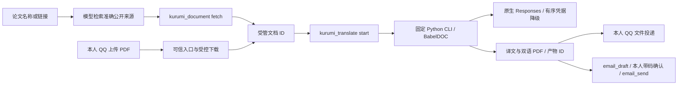

# 论文 PDF 翻译与文件投递

状态：**单篇 API 四并发已部署，多篇逐篇完成后投递。Grok 不在需求范围；DeepSeek 的 V4.1 Flash/MAX 默认调整已部署，通过离线/合成批次/隔离宿主与生产捕获验证。** GPT/MAX 与此前 DeepSeek/low 的完整16页证据保留，不能作为新默认 MAX 的全文验收。生产新流错误的降级缺口待处理，见下文。更新于 2026-10-17（Asia/Shanghai）。唯一阅读入口：[README.md](README.md)。

## 默认配置调整（已部署，2026-10-17）

主人明确不接入 Grok；它不再是待办。DeepSeek 翻译默认采用 **V4.1 Flash / max**，官方要求 API 标识仍用 `deepseek-flash`，当前对应 `DeepSeek-V4.1-Flash-1017`，依据为[官方模型与价格页](https://api-docs.deepseek.com/quick_start/pricing/)。未指定厂商时默认 GPT 6.1 Sol/MAX；本次改变的是显式选择 DeepSeek 后的默认强度。

- [x] Node/Python 共享注册表、工具说明、运行提示词与测试统一为 DeepSeek/MAX；显式其它强度仍按本次请求执行。
- [x] 领域离线69/69、真实合成批次1次/580已报告tokens（1.815秒，max回显、公式/样式标记保留）、真实隔离OpenClaw/主模型四轮编排通过；宿主测试的翻译/OneBot为fixture。MAX 全文质量、耗时仍需独立证据，不复用 low 的结论。
- [x] 两篇生产任务均终止、无在途投递或worker后，同步提示词并重载；生产捕获的Node/Python默认均为DeepSeek/MAX，4并发/QPS1保持，四项自检通过、testIngress=false。部署未打断任务或改写其固定profile。

本轮观察的两篇本人任务均使用 GPT 6.1 Sol/MAX，单篇4并发/QPS1、按篇串行，均在默认调整部署前终止。`2609.24812`（23页）17:18失败后，`2607.28165`（19页）开始，17:34失败；没有完整产物或文件投递。用量和失败批次回执保留，成功翻译缓存不清理；不自动重跑。[本轮证据](verification/paper-translation-2026-10-17/deepseek-max-default/README.md)保存最终状态与部署结果。

**待处理：生产渠道新增错误码。** 第一篇终止为 `api_stream_error`，实际上游码 `upstream_http2_stream_error` 不在当前可切换白名单中，因而没有按临时渠道故障继续降级。47次尝试、121649已报告tokens（含86050推理tokens）、4次用量未知；三个渠道均有实际成功调用。本轮不扩展付费重试规则；后续应独立补该明确流错误的有界切换及回归，不能以默认值调整关闭此问题。

**预算保护已触发，全文可完成性待评估。** 第二篇88次尝试、153676已报告tokens（含95001推理tokens）、2次未知，正文翻译阶段约67%时终止为 `translation_budget_exhausted`。触发的是单任务150000已报告tokens阈值；尚未达到200次请求或1200秒执行期限。并发中已启动的调用仍计账，因此最终可超过阈值；一个在途请求等待600秒后结束，推迟了任务终态。两篇合计275325已报告tokens、6次未知；不能据此推算实际总账单。本轮不提高生产预算，后续应结合MAX成本和成功缓存评估预算或分段策略，不将保护生效等同全文验收成功。

## 单篇四并发验证（已验收）

主人确认：多篇论文仍逐一翻译；先测试单篇内部最多4个API请求并发，完成一篇立即发送一篇。三份GPT Key继续按故障降级使用，不做渠道轮询；GPT模型/MAX及DeepSeek默认保持。开发起点 `9346f87`，工作区干净；文档23提交已在主线，本轮仅收录论文范围，不推送远端。

- [x] 网络等待移出全程互斥锁，最多4个在途请求；计账/预算/冷却/终态短锁保护，回执归属调用线程，快照深复制并按序落盘。
- [x] `apiConcurrency=4`、`apiQps=1` 贯通固定worker、引擎主池与两个限速器；主/回退池合计受4个网络槽限制，术语池1。两项只供操作者配置、各允许1–4，缺省兼容1，不开放模型参数。
- [x] 离线69项通过（Node28、Responses20、并发10、安装引擎11），覆盖实际4路重叠/上限、乱序回执、预算、终态取消、共享冷却/重试频率、成功在途缓存与逐篇投递顺序。Python原子写使用唯一临时文件名防并发碰撞。
- [x] GPT/MAX真实指定16页PDF：复用旧成功批次后，167.192秒、新增57次请求、40439已报告tokens、0未知用量、峰值4，mono/dual均16页；B1的“缺少完整GPT产物”已通过此次缓存续验关闭，**不等于全新缓存全文耗时或稳定性保证**。
- [x] DeepSeek四并发：首轮52.075秒、5请求/14085tokens，样式标记缺失被拒；显式一次复验复用其余4批成功缓存，155.163秒、101新请求/119848tokens生成完整16页，峰值4、0未知用量。两轮累计207.238秒、106请求/133933tokens。原串行458.441秒仅作参考，不是严格冷缓存A/B；首轮失败保留，不自动重试、不放松校验。
- [x] 运行配置/人格同步，重载后四项自检与生产捕获代码的隔离worker检查通过；真实隔离OpenClaw/主模型四轮编排通过，翻译/OneBot为fixture。本轮无QQ/邮件外发。
- [x] 结果、精确产物、证据/脚本索引与当前规则已回填；私密值/链接/范围检查见本轮closeout，收录为独立本地提交（准确提交号查Git历史），不推送远端。

逐篇投递本就存在，本轮以实际阻塞首篇发送的回归证明：第一篇投递完成后才启动第二篇；无需等待全部论文。QQ回执未知不重翻/盲目重发；邮件仍使用草稿和本人带码确认。

达到已报告用量阈值会停止**新请求**，已在途最多4个请求仍可能继续计费；未知用量不记0，不能保证金额硬上限。缓存准备只复制36份公开排版资源；DeepSeek首轮不复制译文缓存，GPT使用旧成功缓存的在线SQLite备份，两类耗时不能直接相除得加速倍数。完整原始回执、缓存来源与抽样页图统一见[四并发证据](verification/paper-translation-2026-10-17/concurrency-four/README.md)。

## 渠道接入与原验收基线

主人本轮要求「先补三个 Key 的降级，再补 DeepSeek 官 Key」。014/030/040 是不同上游渠道，因此切换覆盖临时渠道故障，同时保持准确模型和强度。增补起点 `f8fd5fc`；阶段一本地提交 `f049a64`。本轮只收录论文功能与相关文档/索引，不收录文档 23 的并行开发，不推送远端。

- [x] GPT 014 → 030 → 040：流错误、连接/读取超时、中断、临时 5xx 的有界切换与共享冷却；成功批次缓存不重跑。
- [x] 三渠道独立真实短句成功；串行整篇1800.748秒超时且实际两次014→030切换。后续四并发缓存续验已生成完整GPT译稿，见上节；原失败回执保留。
- [x] DeepSeek 官方原生 Responses 与独立凭据池已接入；该阶段按 Flash/low 验收，新默认 MAX 的状态见顶部，GPT 默认仍为 6.1 Sol/MAX，不跨厂商自动降级。
- [x] 指定 16 页论文的 DeepSeek 翻译完成：105 请求、136595 已报告 tokens、458.441 秒；修复本次引入的结束回调错误后，复用成功缓存，31.047 秒、0 新 API 请求生成 mono/dual 各 16 页。
- [x] 55 项领域回归（Node 26、Responses 20、安装引擎 9）通过；真实 OpenClaw/主模型四轮编排通过，翻译与 OneBot 为模拟。
- [x] 最终代码已重载，生产捕获代码的隔离进程检查和四项运行自检通过，配置/人格对齐、`testIngress=false`。
- [x] 文档、证据/脚本索引、私密值与提交范围已核对；本轮收录为独立本地提交（准确提交号查 Git 历史），不推送远端。

第一页 GPT 样稿的 QQ/修复邮件收件已由本人确认（B2 已关闭）。本轮新增整篇测试**没有实际 QQ/邮件发送**。DeepSeek 整篇已做结构/文本检查与第 1/8/16 页渲染抽查，正文可读；作者/单位间距仍不理想，Poppler 有字体类型警告，不代表全文语义、公式或出版质量验收。实际翻译约 7 分 38 秒，31 秒是缓存重建时间，均不等于“整篇约 1 分钟”。完整用量、失败原始记录与证据清单见[本轮增补报告](verification/paper-translation-2026-10-17/channel-upgrade/README.md)；原实现与单页投递见[原验收报告](verification/paper-translation-2026-10-17/README.md)。

## 本轮关键决定

错误/流中断可能已经计费，切换仍受总请求数、已报告用量和任务期限限制；未知用量不记为 0。每个失败批次每渠道至多一次临时故障尝试，短暂限流允许同渠道退避一次；参数、权限、译文结构、模型/强度错误不靠换渠道掩盖。全部规则见下文资源限制。

DeepSeek 官方支持原生 Responses、顶层 `instructions`、`reasoning.effort=none/low/high/max` 和 `text.format`，因此复用现有协议与排版，不新增监听端口、不改 site-packages。Node/Python 共用固定注册表；任务只获得本厂商 Key。官方来源：[Responses](https://api-docs.deepseek.com/guides/responses_api/)、[思考模式](https://api-docs.deepseek.com/guides/thinking_mode/)、[模型](https://api-docs.deepseek.com/quick_start/pricing/)。

DeepSeek 的 none 模式短句能成功，但实际论文先后出现无效 JSON、增加/丢失样式标记；官方结构化输出也未消除标记丢失。已保留严格校验；low 有完整论文成功证据，**当前选择的默认强度是主人指定的 max**，其验收范围见顶部。none 仍可由本人明确指定，失败不会自动改强度或重跑；V4 Pro 只完成真实短句测试，不能扩称全文通过。

## 需求与已定选择

主人希望告诉 Kurumi 一篇或多篇论文，由它找到原始 PDF、翻译后通过 QQ 文件或邮件附件交付。网站不能下载时，说明原因，请主人通过 QQ 上传 PDF，汇入同一处理链。单篇独立反馈，不把部分成功说成整批完成。

采用 **多个基础工具 + 一个按需后台领域任务**，不是通用 Workflow/DAG 引擎。模型理解需求、选论文和组合步骤；后端掌管文件、进程、状态与投递。遵循[文档 1 的窄接口设计原则](1_bot基础功能开发备忘录.txt)，现行开发/权限规则仍以根 AGENTS 与配置契约为准。

主人要求按 `tp2.txt` 习惯持续记录：本文保存需求、架构、精确产物、已定理由、开发/测试结果和阻塞；有新结论直接更新状态，不累积互相矛盾的旧计划。关键业务选择等待本人决定，其它分支采用推荐方案并记明依据。新增后端脚本只放 `chatbot/scripts/`、测试只放 `chatbot/tests/papers/`；证据从本文、文档 16 与索引到达，不向 archive 放游离材料。SQL 如有变更必须留本地迁移；本轮复用邮件既有字段，**没有新增 SQL 表或迁移**。

| 决定 | 当前规则与原因 |
| --- | --- |
| 默认翻译配置 | naiccc / OpenAI / **gpt-6.1-sol / max**，原生 `/v1/responses`，顶层显式 `instructions`；不修改主聊天的 DeepSeek |
| 每次可选参数 | 厂商、渠道、准确模型、强度、源/目标语言、页码、产物类型；固定到本次任务，不永久改变默认 |
| 当前登记组合 | naiccc/OpenAI gpt-6.1-sol，low/medium/high/xhigh/max；DeepSeek/official deepseek-flash、deepseek-v4-pro，none/low/high/max。DeepSeek 默认 V4.1 Flash/max，API 标识 deepseek-flash；指定厂商、准确模型或唯一渠道可推导其默认，不继承 GPT 的字段。冲突组合与未登记模型直接拒绝，不静默替换或切 Chat。none 实测样式保留不稳，仍可按主人明确指定执行；部署与真实测试范围见顶部与证据 |
| 厂商范围 | 仅 GPT 与 DeepSeek；主人明确不接 Grok，不列为延期或未完成需求。不会自动跨厂商回退 |
| 默认产物 | 双语 PDF；可选纯译文 mono，或 both 两份。不另行询问默认项，采用此前提出的推荐 |
| 执行方式 | CPU模式，一次一篇、最多5篇等待，单篇API并发4/QPS1；每完成一篇即投递所选文件。固定CLI按需启动、结束退出，不驻留翻译服务、不新增监听端口 |
| 持久化 | 保留任务/产物轻量记录；Gateway 重启后未完成任务标为 interrupted，**不自动重新付费翻译** |
| QQ 投递 | 仅本人私聊；平台受理与本人收到分开，回执未知不自动重发 |
| 邮件 | 复用 email_draft/email_send 与原带码确认；测试发件 1794511189@qq.com、唯一收件 365999865@qq.com，主人已明确授权 |
| 真实样本 | `/home/afrangry/桌面/2609.32536v1.pdf`，16 页、646721 字节、未加密；GPT 约 10 分钟、DeepSeek 约 1 分钟是主人参考预期，不能当实测保证 |
| 预算边界 | 主人已指定实际 PDF 验收；用页数、请求数、已报告用量与运行时限限制持续调用。网关忽略输出 token 上限，**不承诺金额硬上限** |
| 并行开发 | 文档 23 的 KnowledgeMap 在另一工作区开发。本轮不得覆盖或提交其内容；共享索引按具体差异收录，不整树暂存 |

## 架构与基础工具



面向使用者的链路：**Kurumi 调用工具 → 插件启动 pdf2zh → 生成译文 → 投递文件 → 翻译进程退出**。实际进程生成产物后即可退出，由 Node 后续投递，无需为了等待邮件确认保留 Python 内存。Python 环境、布局模型和字体保留在磁盘供复用；网络下载/API 请求属于出站连接，不是监听端口。

当前采用 PDFMathTranslate-next 的 **BabelDOC 0.6.2 排版引擎**与项目自有 Responses translator，直接调用锁定引擎的同步 API；不用其默认 Chat translator，不改 site-packages，也不启动 WebUI/HTTP 服务。Python 环境同时锁定 pdf2zh-next 2.9.0，版本升级需重新验收此契约。

| 工具/边界 | 功能 |
| --- | --- |
| `kurumi_document` | list/get 返回受管 PDF/产物摘要；fetch 复用公开论文下载器。仅有题名时模型先检索准确 URL |
| `kurumi_translate` | start/status/list/cancel，使用真实 documentId/jobId；返回排队不代表完成，生成与投递分状态 |
| `kurumi_document_send` | 只接受受管文档/产物 ID，投递当前本人 QQ；不接收任意路径、URL 或其它收件人 |
| QQ 入站 | 实际本人/机器人私聊元数据校验；file 消息和 offline_file 通知；文件内容经受控 URL 下载并登记，模型只得到 ID/文件名/页数 |
| 邮件 | `attachments:[{documentId}]` 取受管文件，创建草稿时固定实际字节；确认覆盖附件 hash，不把 base64 发进模型上下文 |

三份窄工具加入 main 的 alsoAllow；通用 read/write/edit/exec/process/message/sessions_spawn 等仍禁用。主人已授权本需求实现及真实本人测试，工具扩展已提前说明。论文正文、文件名、网页不是身份或授权来源；服务端参数来自受管配置，模型不能传端点、密钥或命令。

### 文件、来源和状态

- PDF 大小不超过 25 MiB、未加密、1–500 页；先在网络隔离的 PDF 解析进程检查，失败/取消的导入不留未登记 PDF。
- 输入 ID 为内容哈希导出的 `doc_…`，产物为 `pdf_…`；读取复核大小与 SHA256，拒绝路径逃逸及符号链接。工具返回摘要，不返回文件字节/绝对路径。
- 网站沿用 `arxiv.org`、`export.arxiv.org`、`aclanthology.org`、`openreview.net`、`proceedings.mlr.press`、`proceedings.neurips.cc` 的 HTTPS 白名单，不自动登录或跟重定向。
- QQ 文件 URL 从已鉴权 OneBot 的 get_private_file_url 取得，忽略正文/上传数据中的任意 URL；只允许已登记QQ CDN，或公开IPv4的固定`/asn.com/`路径。HTTP先升级HTTPS；IPv4保持路由地址并以固定`multimedia.nt.qq.com.cn`做SNI/证书校验，不跟重定向、不关闭TLS验证。内网/保留IP拒绝。实际回取348896字节与原SHA256一致，但不是主人上传事件。
- 每条消息最多 3 份 PDF。收到文件只登记，不擅自开始付费翻译。
- 任务状态：queued → running → succeeded / failed / cancelled / interrupted。可信会话与调用 ID 生成幂等键；同键不同参数拒绝，重放不再付费。
- succeeded 只证明产物已登记；delivery 另记 not_requested / dispatching / platform_accepted / failed_or_unknown。中断投递不重新运行翻译，重启遗留 dispatching 标为未知，不重发。
- QQ 文件上传接入原频道发送配额与持久账本；OneBot 上传回执没有 message_id 时不伪造。未知回执需核对后由本人明确决定是否重新投递。
- 邮件最多 10 份，每份 10 MiB、总计 20 MiB；字节固定在既有 attachments_json 字段，预览只展示元数据。确认后 DB 被篡改则拒绝网络发送；取件源后来变化不改变草稿。

### 默认资源与用量限制

仓库配置意图：单任务最多 30 页、200 次 API 尝试、150000 个已报告 token、1200 秒、单篇最多4个API在途请求/每秒启动1个；选页超限须明确指定范围，不悄悄截页。真实验收脚本另设 300 次、200000 token、1800 秒并在报告列出，不能混称默认配置。

固定 worker 只挂载系统文件、只读 Python/适配器、单任务目录与缓存；清空宿主环境，凭据只经 stdin 传入，不在 argv。限制地址空间 12 GiB、单文件 100 MiB、CPU 1200 秒；取消/超时终止整个进程组。翻译允许出站网络以调用固定 API、下载布局模型和字体；不能据此声称网络也已隔离。无需 GPU/CUDA，本轮未验 GPU。

每次请求独立上下文，不带 previous_response_id；顶层 instructions 明确，原生 Responses 流式只采用终态 response 的完整 assistant/output_text 与用量，不采用 reasoning/部分 delta/空输出/incomplete。完成响应缺少可核实用量则终止；渠道中断的用量记为 unknown，按下述明确规则切换，不把 unknown 记成 0。记录请求数、实际模型、请求/回显强度、输入/输出/缓存/推理 token、responseId 与凭据名称；不记录密钥、论文正文或上游任意错误文本。

GPT 批次使用原数组协议；DeepSeek 批次显式传原生 `text.format=json_schema`，要求 `translations` 对象数组、原 ID 枚举、固定字段，源码/模型/强度与批次协议分别进入缓存键。即使 API 接受 schema，仍在本地核对条数、ID、非空译文及全部公式/样式标记；只允许移除一个精确完整的外层 JSON 围栏，不从解释文字提取片段、不放松标记校验。错误仅记录结构原因/数量/位置，不落正文；引擎接到终态失败立即取消，不继续逐段限速等待。DeepSeek 官方支持 text.format 的依据仍为上文 Responses 文档，不把它等同于中转对同参数的支持。

凭据顺序 **014 → 030 → 040**，同模型/强度不变。鉴权失败冷却 24 小时；额度不足直接切换并冷却 120 秒，短暂限流同渠道退避一次仍失败再切换并冷却 120 秒。明确临时渠道错误（含 upstream_stream_read_error）、连接/读取超时、流中断、408/500/502/503/504/520/522/524/529 直接转下一渠道并冷却 300 秒，每批每渠道最多一次此类尝试。冷却跨任务共享、到期可恢复；成功批次缓存不重跑。没有鉴权证据的 403、参数/权限/解析/译文结构/模型或强度不匹配不切换。所有实际尝试计入任务请求预算，已报告 token 不清零；全失败明确终止。未知用量请求可能已计费，取消/整个任务超时仍终止进程组而不自动重启，因此这些限制不能保证金额上限。

此前全文失败的精确含义：两次最后一个请求均收到了中转发送的 `type=error` 事件，错误码 `upstream_stream_read_error`，本地映射为 `api_stream_error`。中转报告读取其上游响应流失败，未取得该批的完整成功响应和用量。仅凭该码不能进一步定位是中转代理、上游服务还是超时，也不能认定是模型厂商本身故障。当前规则将此错误纳入有界渠道切换，仍不把部分文本拼成完整译稿。这与 QQ/邮件投递和 PDF 排版是不同阶段。官方协议的完成/错误事件说明见 [OpenAI Docs](https://developers.openai.com/api/docs/guides/streaming-responses)；该说明不替中转证明故障根因。

## 精确产物与运维

| 位置 | 归属 |
| --- | --- |
| `chatbot/packages/documents/index.js` | 受管文档唯一实现，供论文、QQ、邮件共用 |
| `chatbot/plugins/kurumi-papers/{index,profiles,service,runner}.js` | 工具、配置解析、任务与固定子进程 |
| `chatbot/plugins/kurumi-papers/python/{engine,responses}.py`、`python/profiles.json` | 排版适配、原生 Responses / 渠道规则与 Node/Python 共用的固定厂商注册表 |
| `chatbot/plugins/kurumi-papers/python/requirements.lock.txt` | 固定 Python 依赖；bitstring 固定 4.3.1 |
| `chatbot/plugins/kurumi-qq/src/{inbound,files,transport}.js` | 本人 PDF 接收与原 OneBot 文件投递 |
| `chatbot/plugins/kurumi-mail/` | 受管附件快照、内容绑定、原确认/SMTP；契约见文档 20 |
| `/home/afrangry/.openclaw-fusion/documents/` | 生产受管记录/files/jobs/work/cache/events.jsonl；不进 Git |
| `/home/afrangry/.openclaw-fusion/paper-credentials.json` | 0600 的三份私密 GPT 凭据与 `DEEPSEEK_API_KEY`；任务只读取所选厂商的凭据，不进 Git |
| `/home/afrangry/.openclaw-fusion/venvs/paper-translation/` | 独立 Python 环境，按锁文件重建 |
| `/home/afrangry/.openclaw-fusion/paper-acceptance/` | 本轮实际 PDF 验收状态/缓存；不是生产目录或可自动续跑队列 |
| `scripts/fusion/log-query.mjs --source papers` | 统一只读链路入口；事件契约见文档 18 |

安装与凭据导入由操作者执行，不是模型工具：

```bash
bash chatbot/scripts/setup-paper-translation.sh
node chatbot/scripts/import-paper-credentials.mjs --source /绝对路径/凭据资料.txt --destination /home/afrangry/.openclaw-fusion/paper-credentials.json
node chatbot/scripts/import-paper-credentials.mjs --provider deepseek --source /home/afrangry/.openclaw-fusion/runtime-env.json --destination /home/afrangry/.openclaw-fusion/paper-credentials.json --replace
```

默认导入只取中转-GPT 段的三个指定变量；`--provider deepseek` 只取显式 JSON 来源中的 `DEEPSEEK_API_KEY`，不复制邮件等其它变量。已有目标默认拒绝覆盖；显式 `--replace` 原子合并所选厂商并保留另一厂商，拒绝符号链接、非 0600 目标及未知旧字段，失败不改旧字节。不得把真实值放进文档、测试输出或提交。配置先改 `config/runtime.config.json` 再 sync-config，人格规则改模板再 sync-persona，不能手改运行副本。完整契约见 config/README。

备份包含受管文档、任务及凭据；Python 环境虽可能被全运行目录备份采集，恢复后仍应按锁文件重建并验证路径。恢复演练副本会关闭 liveTranslationEnabled 并清空其活动论文凭据；不在本轮冒称已做新增功能的全量灾难恢复演练。

## 开发与探查记录

| 阶段 | 结果/判断与证据边界 |
| --- | --- |
| 10-16 初探 | Ubuntu 22.04 x86_64，Ryzen 5600GT、约 27 GiB 内存；现有 Poppler 可用。依赖干跑可解析，公开 arXiv PDF 下载/提取/页图已通过；仅硬件确认 RTX3060，未验证 GPU |
| 10-17 协议探查 | 014：1 次模型查询、8 次合成生成，7 成功/JSON 模式一次 502。Chat 与 Responses 均可用；显式 instructions 使短样本输入从约4239降至29，但不是费用下降倍数。max_output_tokens=16 实际输出106；完整报告 [paper-api](verification/paper-api-2026-10-17/README.md) |
| 依赖部署 | 固定 Python3.12、pdf2zh-next2.9.0、BabelDOC0.6.2。bitstring5删除BitStream，故锁4.3.1并做实际导入检查，不能只看pip check |
| 引擎接入 | 能力探测 do_llm_translate(None) 必须本地返回，不能付费；公式/样式使用 literal/regex 对。基于锁定引擎模板新增契约测试 |
| API客户端标识 | urllib默认UA被边缘403/1010拒绝；显式Kurumi-Papers/1.0后同凭据模型查询200。非鉴权403不轮换，误设冷却只在验收缓存更正 |
| 长请求与推理 | 非流式90秒超时、524/503已保存；流式接口与独立短文通过。原批次首请求报告1001输入、25304输出，其中24740推理；不把“少固定输入开销”说成“总消费已低” |
| CLI结束 | 原异步回调在PDF已生成后可能继续等待；固定独立worker改用同步排版API，父任务仍异步。失败/中断原始回执与真实基线产物归属证据报告 |
| 批次提示词 | 仅解析锁定BabelDOC批次的ID/input，翻译规则放原生instructions；本地检查JSON/ID数量和公式标记。保持指定模型/max；性能依据真实任务分别记录，不由合成提示词实验推断全文收益 |
| 邮件附件 | 使用既有SQL字段保存实际字节，元数据/hash绑定确认；86项邮件回归保留，新增大小/篡改/重开/本地TLS及标准MIME解码回归；未知ID不泄露宿主路径 |
| 邮件乱码修复 | 实际长中文标题触发两次折行，提前结束邮件头，附件Base64被当正文；改为唯一折行入口、UTF-8分块连续、单一RFC2231参数、Uint8Array原始字节。修复邮件重新SMTP投递；2026-10-17 本人确认正文正常、PDF 附件可打开且第一页排版正常，B2 关闭 |
| 单页实际翻译 | 第一页588.58秒、3请求、27462已报告tokens；mono/dual正文可读，作者/单位区合并。本人确认QQ收到，实际TLS回取哈希一致 |
| 整篇实际翻译 | 串行GPT流中断/30分钟超时原始记录保留；后续四并发缓存续验生成完整16页，B1产物缺口关闭。DeepSeek串行105请求完成翻译，四并发首轮样式失败、一次缓存复验后生成16页；精确新增用量和缓存边界见顶部与对应证据 |
| 部署 | 生产配置/人格核对已对齐，重载kurumi-fusion；四项自检通过，testIngress=false。模型/字体缓存39文件344869220字节预热，2个SQLite使用在线备份；不从验收导入凭据冷却 |
| 集成 | 真实 arXiv 获取通过；增补后隔离 OpenClaw/真实主模型四轮通过，包含默认 GPT、会话重置、DeepSeek/low 及仅生成。翻译 worker/OneBot 为 fixture，只证明编排 |
| 插件捕获与产物选择 | 厂商注册表使用静态 JSON import，保证 OpenClaw 捕获完整依赖；双语一份明确为 dual，both 只用于明确要两份，qq 自动发送后不另调发送工具；真实隔离 Host 和最终生产捕获检查通过 |
| 失败取消与结束回调 | 新增终态取消时曾遗漏 BabelDOC0.6.2 的 finish_callback，导致 Save PDF100% 后 TypeError；这是本次适配引入的错误。已补同步 no-op 回调，以同步返回/异常为准；实际安装版本完成/取消回归及零 API 全文复验通过 |
| 诊断边界 | 失败保存 code、异常类型、文件名/函数/行号，在清理任务工作目录前存入任务记录；不落异常原文、正文、源码行、locals 或凭据 |

## 测试命令与当前结果

所有新增测试逐文件在脚本索引登记，证据统一位于 [paper-translation-2026-10-17](verification/paper-translation-2026-10-17/README.md)。

```bash
node --test chatbot/tests/papers/*.test.mjs
python3 chatbot/tests/papers/responses_test.py
python3 chatbot/tests/papers/concurrency_test.py
/home/afrangry/.openclaw-fusion/venvs/paper-translation/bin/python chatbot/tests/papers/engine_test.py
node --test chatbot/plugins/kurumi-mail/test/*.test.js chatbot/plugins/kurumi-qq/test/*.test.js scripts/fusion/test/log-query.test.mjs
```

当前源码回归：Node **28/28**、Responses **20/20**、并发 **10/10**、安装引擎契约 **11/11**，合计 **69/69**。覆盖厂商配置/凭据隔离、原子导入、跨厂商缓存、结构化批次/占位符、结束/取消及既有论文边界。原实现阶段既有邮件/QQ/查询 **112/112**、共享接口/后端与恢复 **54/54** 是历史回执，本轮未重跑，不计入这 69 项。离线通过不替代实际论文质量、真人入站或邮箱到信。

明确授权的真实验收脚本（不要混进离线批量命令）：

```bash
node chatbot/tests/papers/acceptance-download.mjs
node chatbot/tests/papers/acceptance-host.mjs --out /绝对路径/新的host结果.json
node chatbot/tests/papers/acceptance.mjs --input /home/afrangry/桌面/2609.32536v1.pdf --pages 1 --out /绝对路径/证据目录
# DeepSeek 显式加 --provider deepseek；可选 --model deepseek-v4-pro --effort high
# 整篇去掉 --pages；四并发加 --concurrency 4 --qps 1（验收脚本未指定仍为1）
# --send-qq / --send-mail 才实际向本人外发
# 每次必须使用新的 --out；不自动续跑付费任务
```

acceptance-host 启动隔离 Gateway 并调用真实主模型，翻译/OneBot 模拟；不写生产业务。acceptance-worker 需显式 --capture（当前生产捕获的 runner.js）和新 --out，只验证固定 Python/双厂商注册表的真实隔离进程，无凭据/API/外发。acceptance-api.py 需显式 --credentials 和新 --out，真实调用合成短句或 --batch 合成批次，可指定 --provider/--model/--effort；不得作为离线回归运行。acceptance使用真实翻译API及私密验收目录，可用--root复用该目录缓存；每次新任务均是明确运行，不自动续跑旧付费调用。--send-mail按主人本轮授权程序化记录测试确认，**不代表真实QQ带码确认往返或到信**。

## 未覆盖、阻塞与收尾

- **B1 已验收（全文产物生成，2026-10-17）**：四并发复用成功缓存后取得GPT/MAX完整16页译稿，新增用量/耗时见顶部；此前串行超时与未知用量回执保留。全新译文缓存的GPT全文耗时、长时间稳定性及全文人工语言/公式校对仍未覆盖，不自动重跑付费任务。
- **B2 已验收（2026-10-17）**：本人确认修复邮件正文正常、PDF 以附件收到且可打开，第一页原文/译文排版正常；与此前QQ样稿收件相互独立，不扩大为全文质量验收。反馈摘要见[observations.json](verification/paper-translation-2026-10-17/observations.json)。
- 014/030/040 均通过一次真实短句请求；原整篇验收自然故障实测 014 → 030，本次生产任务也实际使用040并取得成功响应，见顶部记录。全部顺序/共享冷却/全失败由故障注入覆盖，未专门制造单批次030 → 040故障或耗尽/吊销 Key，不能把一次成功当长期可用保证。
- DeepSeek 官方 Flash/low 整篇已生成且抽查；新默认 Flash/max 的证据见顶部，未做 MAX 全文验收。V4 Pro 仅短句、none 未通过整篇标记校验。Grok 经主人决定不接入；不会在 GPT/DeepSeek 之间自动切换。
- naiccc 的显式 text.format JSON 模式曾 502，GPT 保留原数组提示词加本地校验；DeepSeek 官方结构化批次已做独立实测。上游输出硬预算和实际金额仍不可验证。
- 主人真实QQ上传原文件→模型→翻译→本人收到、多人/群/登录受限论文、扫描OCR与GPU、超过4并发的压力、完整新增功能灾难恢复未覆盖。
- 本轮不更新后台fusion开发副本、不操作旧系统/归档、不远端推送、不提交文档23相关开发。当前恢复点不包含本功能，若需新停写快照须独立安排。邮件SQL字段结构未变，但新增字节快照不是旧源码可安全消费的保证；回滚应联动源码/配置/私有状态，不能只退旧邮件代码继续发送新草稿。

返回[文档入口](README.md)。
