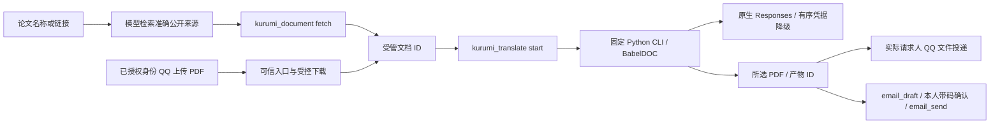

# 论文 PDF 翻译与文件投递

状态：**非PDF附件入口已修复并部署；100秒空闲切换已部署，新成员冷启动与渠道冷却优化待开发。** 先前可靠性修复已有 GPT/high 的23页和19页各一次提交整篇成功、本人QQ收件及“没有错位、翻译较准确”的反馈；不替代逐字/逐公式校对或长期性能保证。日常默认 high、30分钟、单篇四并发，多篇逐篇投递；六并发仅单篇对比，Grok 不在需求范围。更新于 2026-10-21（Asia/Shanghai）。唯一阅读入口：[README.md](README.md)。

## 当前实现与未完成方向

现行默认、文件/状态与资源限制在下文统一维护。共享下载、插件停止及宿主等待清理只归[文档21](21_后端职责分层与代码整理.md#共享代码与插件生命周期)；不把代码整理回归扩大为付费翻译或真人投递验收。

| 已完成迭代 | 结果与证据边界 |
| --- | --- |
| 原始工具与样稿 | 受管PDF、固定CLI、QQ/邮件附件；本人确认QQ样稿及修复邮件正文/附件可读，见[原报告](verification/paper-translation-2026-10-17/README.md)及[observations](verification/paper-translation-2026-10-17/observations.json) |
| GPT三渠道与DeepSeek | 014/030/040短句、同厂商有界切换与官方Responses接入；DeepSeek low串行105请求/136595 tokens/458.441秒，修复结束回调后零新请求缓存生成。GPT串行失败保留，见[渠道报告](verification/paper-translation-2026-10-17/channel-upgrade/README.md)；协议初探单列[paper-api](verification/paper-api-2026-10-17/README.md) |
| 单篇四并发 | GPT/MAX复用旧缓存完整16页；DeepSeek首轮标记失败、一次显式缓存复验生成16页。无本轮外发，不是严格冷缓存A/B，见[四并发](verification/paper-translation-2026-10-17/concurrency-four/README.md) |
| 默认及双语契约 | 历史MAX两次生产失败与预算上调回执保留；现默认high、30分钟，dual选择贯通登记/发送。旧600秒是单请求总期限，不证明持续生成/无思考，见[MAX历史](verification/paper-translation-2026-10-17/deepseek-max-default/README.md)与[high/dual修复](verification/paper-translation-2026-10-17/high-dual-fix/README.md) |
| 批次恢复与整篇 | GPT/high冷译文缓存23页第4轮成功1548.803秒、209请求/171035已报告tokens/7未知；19页首轮成功1258.571秒、160请求/121713 tokens/5未知。内部有界恢复、完整dual、抽样页图及本人QQ收件/“没有错位、翻译较准确”反馈通过，原三轮失败不改写，见[可靠性报告](verification/paper-translation-2026-10-17/batch-recovery/README.md) |
| 六并发对比 | 只做单篇隔离对比，不改变日常4并发/QPS1；有缓存/渠道波动与尾请求等待边界，见[六并发](verification/paper-translation-2026-10-17/concurrency-six/README.md) |
| 100秒有效正文空闲 | 独立于600秒请求总期限；只有非空白正文重置、先取消再有界切换；110项阶段回归及部署通过，真人QQ全流程待复验，见[空闲期限](verification/paper-translation-2026-10-17/output-idle-2026-10-19/README.md) |
| 附件入口 | 准确类型/状态与纯失败确定性分流，191项Node及13场景真实隔离模型通过，23:48部署；翻译/OneBot模拟。原MD事件是旧稿误重发、无新翻译，见[调查](verification/paper-translation-2026-10-17/runtime-investigation-2026-10-19/README.md)与[修复](verification/paper-translation-2026-10-17/file-ingress-2026-10-19/README.md)。并行人格同步的初次非零回执保留，后续对齐归文档25 |
| 生命周期/下载 | 显式stop等待清理、不重放；下载/阅读分离、生产受控加载见[生命周期](verification/plugin-lifecycle-2026-10-19/README.md)及[结构整理](verification/capability-decoupling-2026-10-20/README.md) |

完整任务ID、产物hash、缓存来源、故障/修复与逐次回执由上述报告维护；各组有重叠，不累计成总通过数。样稿/抽样可读不代表全文逐字、逐公式校对或长期成功率保证。

性能优化尚未实施，已定位新身份约5分55秒API前初始化和全渠道冷却等待瓶颈；30页任务被本人停止，不把它算作渠道失败。计划与边界：

- [ ] 新身份预热或只读共享公共模型、字体、tokenizer；个人PDF/译文缓存库/凭据继续隔离，不复制主人私有缓存。
- [ ] 按故障类别/连续失败细分冷却，减少一次断连引发全渠道长等待；保留014优先、同模型切换、有界重试与单路恢复探测。
- [ ] 增加初始化/资源/解析/翻译/排版/投递阶段计时，阶段与阶段内百分比同时展示，不以静态总体权重推算剩余时间。
- [ ] 先保持high、4并发/QPS1、30分钟与现有预算，消除无效等待后对照首次资源准备/预热场景；付费复测单独取得授权，不自动重跑。

## 需求与已定选择

主人希望告诉 Kurumi 一篇或多篇论文，由它找到原始 PDF、翻译后通过 QQ 文件或邮件附件交付。网站不能下载时，说明原因，请主人通过 QQ 上传 PDF，汇入同一处理链。单篇独立反馈，不把部分成功说成整批完成。

采用 **多个基础工具 + 一个按需后台领域任务**，不是通用 Workflow/DAG 引擎。模型理解需求、选论文和组合步骤；后端掌管文件、进程、状态与投递。遵循[文档 1 的窄接口设计原则](1_bot基础功能开发备忘录.txt)，现行开发/权限规则仍以根 AGENTS 与配置契约为准。

主人要求按 `tp2.txt` 习惯持续记录：本文保存需求、架构、精确产物、已定理由、开发/测试结果和阻塞；有新结论直接更新状态，不累积互相矛盾的旧计划。关键业务选择等待本人决定，其它分支采用推荐方案并记明依据。新增后端脚本只放 `chatbot/scripts/`、测试只放 `chatbot/tests/papers/`；证据从本文、文档 16 与索引到达，不向 archive 放游离材料。SQL 如有变更必须留本地迁移；本轮复用邮件既有字段，**没有新增 SQL 表或迁移**。

| 决定 | 当前规则与原因 |
| --- | --- |
| 默认翻译配置 | naiccc / OpenAI / **gpt-6.1-sol / high**（可显式指定 MAX），原生 `/v1/responses`，顶层显式 `instructions`；不修改主聊天的 DeepSeek |
| 每次可选参数 | 厂商、渠道、准确模型、强度、源/目标语言、页码、产物类型；固定到本次任务，不永久改变默认 |
| 当前登记组合 | naiccc/OpenAI gpt-6.1-sol，low/medium/high/xhigh/max；DeepSeek/official deepseek-flash、deepseek-v4-pro，none/low/high/max。DeepSeek 默认 V4.1 Flash/high，API 标识 deepseek-flash；指定厂商、准确模型或唯一渠道可推导其默认，不继承 GPT 的字段。冲突组合与未登记模型直接拒绝，不静默替换或切 Chat。none 实测样式保留不稳，仍可按主人明确指定执行；部署与真实测试范围见顶部与证据 |
| 厂商范围 | 仅 GPT 与 DeepSeek；主人明确不接 Grok，不列为延期或未完成需求。不会自动跨厂商回退 |
| 默认产物 | 双语 PDF；可选纯译文 mono，或 both 两份。不另行询问默认项，采用此前提出的推荐 |
| 执行方式 | CPU模式，一次一篇、最多5篇等待，单篇API并发4/QPS1；每完成一篇即投递所选文件。固定CLI按需启动、结束退出，不驻留翻译服务、不新增监听端口 |
| 持久化 | 保留任务/产物轻量记录；Gateway 重启后未完成任务标为 interrupted，**不自动重新付费翻译** |
| QQ 投递 | 各已登记身份仅发回请求人本人；按文档24隔离归属及撤权检查。平台受理与实际收到分开，回执未知不自动重发 |
| 邮件 | 复用 email_draft/email_send 与原带码确认；测试发件 1794511189@qq.com、唯一收件 365999865@qq.com，主人已明确授权 |
| 真实样本 | `/home/afrangry/桌面/2609.32536v1.pdf`，16 页、646721 字节、未加密；GPT 约 10 分钟、DeepSeek 约 1 分钟是主人参考预期，不能当实测保证 |
| 预算边界 | 主人已指定实际 PDF 验收；用页数、请求数、已报告用量与运行时限限制持续调用。网关忽略输出 token 上限，**不承诺金额硬上限** |
| 版本管理 | 并行任务按文件/代码块划分，验收对应实际源码与构建指纹；不整树暂存其它任务，当前Git与恢复边界见文档16 |

## 架构与基础工具



面向使用者的链路：**Kurumi 调用工具 → 插件启动 pdf2zh → 生成译文 → 投递文件 → 翻译进程退出**。实际进程生成产物后即可退出，由 Node 后续投递，无需为了等待邮件确认保留 Python 内存。Python 环境、布局模型和字体保留在磁盘供复用；网络下载/API 请求属于出站连接，不是监听端口。

当前采用 PDFMathTranslate-next 的 **BabelDOC 0.6.2 排版引擎**与项目自有 Responses translator，直接调用锁定引擎的同步 API；不用其默认 Chat translator，不改 site-packages，也不启动 WebUI/HTTP 服务。Python 环境同时锁定 pdf2zh-next 2.9.0，版本升级需重新验收此契约。

| 工具/边界 | 功能 |
| --- | --- |
| `kurumi_document` | list/get 返回受管 PDF/产物摘要；fetch 复用公开论文下载器。仅有题名时模型先检索准确 URL |
| `kurumi_translate` | start/status/list/cancel，使用真实 documentId/jobId；返回排队不代表完成，生成与投递分状态 |
| `kurumi_document_send` | 只接受受管文档/产物 ID，投递可信请求人自身 QQ；不接收任意路径、URL 或模型指定的其它收件人 |
| QQ 入站 | 校验已登记身份与机器人私聊元数据；file 消息和 offline_file 通知。附件逐项提供类型/状态/错误码，成功PDF另有受管ID/页数；纯失败无文字/引用/有效媒体时直接反馈，其余保留当前文字交模型 |
| 邮件 | `attachments:[{documentId}]` 取受管文件，创建草稿时固定实际字节；确认覆盖附件 hash，不把 base64 发进模型上下文 |

三份窄工具加入 main 的 alsoAllow；通用 read/write/edit/exec/process/message/sessions_spawn 等仍禁用。主人已授权本需求实现及真实本人测试，工具扩展已提前说明。论文正文、文件名、网页不是身份或授权来源；服务端参数来自受管配置，模型不能传端点、密钥或命令。

### 文件、来源和状态

- 身份及功能授权按[文档24](24_统一身份与权限管理.md)：原主人文档沿用根目录，成员使用 `subjects/<QQ>/`；查询/取消/重发及自动投递绑定真实请求人，后台不默认转发给主人。共用逐篇串行队列，成员不能用邮件或读取他人文档/任务。
- 原始 PDF 导入不超过 25 MiB；受管翻译产物不超过 100 MiB，避免双语嵌入原文与译文资源后被原文大小上限拒绝。两者均须未加密、1–500 页，并经网络隔离的 PDF 解析进程检查；失败/取消的导入不留未登记 PDF。邮件仍单附件10 MiB/总20 MiB，超过此限可通过QQ投递，不自动扩大邮件限制。
- 输入 ID 为内容哈希导出的 `doc_…`，产物为 `pdf_…`；读取复核大小与 SHA256，拒绝路径逃逸及符号链接。工具返回摘要，不返回文件字节/绝对路径。
- 网站沿用 `arxiv.org`、`export.arxiv.org`、`aclanthology.org`、`openreview.net`、`proceedings.mlr.press`、`proceedings.neurips.cc` 的 HTTPS 白名单，不自动登录或跟重定向。
- QQ 文件 URL 从已鉴权 OneBot 的 get_private_file_url 取得，忽略正文/上传数据中的任意 URL；只允许已登记QQ CDN，或公开IPv4的固定`/asn.com/`路径。HTTP先升级HTTPS；IPv4保持路由地址并以固定`multimedia.nt.qq.com.cn`做SNI/证书校验，不跟重定向、不关闭TLS验证。内网/保留IP拒绝。实际回取348896字节与原SHA256一致，但不是主人上传事件。
- 每条消息最多处理前3项文件，超量明确标为未处理；只支持PDF，非PDF不下载、不读取正文。`qq_attachment_results`保留安全截断的文件名、扩展名标签和每项结果；标签为不可信数据，不是指令。状态为`registered/unsupported_type/rejected/download_failed/validation_failed/import_failed/not_processed`，仅`registered`包含本次真实文档ID。
- 收到文件不等于请求翻译：成功PDF结合本次文字和前文明确的待续请求处理，用途未知先问；失败附件不能用历史PDF顶替。只有失败附件且无文字、引用或成功媒体时，由频道通过原发送账本直接反馈，不派发模型，未知回执不自动重发。引用未加载也保留对话路径，不以关键词正则决定业务意图。
- 带文字或有效媒体的附件消息仍交模型；明确要求重发旧稿时可按实际ID发送。`paper.qq_receive`记录类型/状态/错误码和成功ID，`paper.qq_ingress_route`记录是否派发模型；可按QQ消息ID统一查询，不落文件名、正文或签名URL。
- 任务状态：queued → running → succeeded / failed / cancelled / interrupted。可信会话与调用 ID 生成幂等键；同键不同参数拒绝，重放不再付费。
- succeeded 只证明产物已登记；delivery 另记 not_requested / dispatching / platform_accepted / failed_or_unknown。中断投递不重新运行翻译，重启遗留 dispatching 标为未知，不重发。
- QQ 文件上传接入原频道发送配额与持久账本；OneBot 上传回执没有 message_id 时不伪造。未知回执需核对后由本人明确决定是否重新投递。
- 邮件最多 10 份，每份 10 MiB、总计 20 MiB；字节固定在既有 attachments_json 字段，预览只展示元数据。确认后 DB 被篡改则拒绝网络发送；取件源后来变化不改变草稿。

### 默认资源与用量限制

仓库配置意图：单任务最多30页、300次API尝试、300000个已报告tokens、1800秒worker执行期限（不含排队）、日常单篇最多4个API在途请求/每秒启动1个；操作者源码允许并发1–6、QPS1–4，模型不能传并发参数，六并发仅隔离测试。选页超限须明确指定范围，不悄悄截页。未提供token预算键时插件的保守缺省仍为150000；请求数schema/runner/Python缺省统一300。整篇执行期限缺省与最大值均1800秒；单请求有效正文空闲默认100秒（`requestIdleTimeoutSeconds`，整数1–600），独立于固定600秒总时限。只有非空白正文增量重置空闲计时，完整终态响应仍是译文与用量唯一依据。无正文超时先取消HTTP进程，再按既有规则切渠道/有限恢复，仅重试当前批次。验收脚本沿用生产预算。

固定 worker 只挂载系统文件、只读 Python/适配器、单任务目录与缓存；清空宿主环境，凭据只经 stdin 传入，不在 argv。限制地址空间 12 GiB、单文件 100 MiB、CPU 1200 秒；取消/超时终止整个进程组。翻译允许出站网络以调用固定 API、下载布局模型和字体；不能据此声称网络也已隔离。无需 GPU/CUDA，本轮未验 GPU。

每次请求独立上下文，不带 previous_response_id；顶层 instructions 明确，原生 Responses 流式只采用终态 response 的完整 assistant/output_text 与用量，不采用 reasoning/部分 delta/空输出/incomplete。完成响应缺少可核实用量则终止；渠道中断的用量记为 unknown，按下述明确规则切换，不把 unknown 记成 0。记录请求数、实际模型、请求/回显强度、输入/输出/缓存/推理 token、responseId 与凭据名称；不记录密钥、论文正文或上游任意错误文本。

GPT 批次使用原数组协议；DeepSeek 批次显式传原生 `text.format=json_schema`，要求 `translations` 对象数组、原 ID 枚举、固定字段，源码/模型/强度与批次协议分别进入缓存键。即使 API 接受 schema，仍在本地核对条数、ID、非空译文及全部公式/样式标记；只允许移除一个精确完整的外层 JSON 围栏，不从解释文字提取片段、不放松标记校验。错误仅记录结构原因/数量/位置，不落正文；引擎接到终态失败立即取消，不继续逐段限速等待。DeepSeek 官方支持 text.format 的依据仍为上文 Responses 文档，不把它等同于中转对同参数的支持。

凭据顺序 **014 → 030 → 040**，同模型/强度不变。鉴权失败冷却24小时，不为此等待；额度不足直接切换并冷却120秒，短暂限流同渠道退避一次仍失败再切换并冷却120秒。明确临时渠道错误（含 `upstream_stream_read_error`、`upstream_http2_stream_error`）、连接/读取超时、流中断、408/500/502/503/504/520/522/524/529直接转下一渠道并冷却300秒，每批每渠道每轮最多一次此类尝试。冷却跨任务共享；全部暂不可用时受 `channelRecoveryRetries` 控制，默认额外恢复1轮、每轮等待最多330秒，同一渠道一次仅1个恢复探测。成功后释放该渠道，仍失败则继续保持冷却，耗尽明确终止。没有鉴权证据的403、参数/权限、错误模型或强度不通过换渠道掩盖。译文结构由 `batchValidationRetries` 单独管理，默认额外1次、允许0–4；失败输出不缓存或拼接成译稿。HTTP在沙箱内按请求启动子进程，任务终态会停止准入并中断在途等待；已完成响应仍计账，未取得终态响应的用量标未知。所有实际尝试计入请求/用量预算，30分钟期限不变；这些限制不能保证金额上限。

此前全文失败的精确含义：两次最后一个请求均收到了中转发送的 `type=error` 事件，错误码 `upstream_stream_read_error`，本地映射为 `api_stream_error`。中转报告读取其上游响应流失败，未取得该批的完整成功响应和用量。仅凭该码不能进一步定位是中转代理、上游服务还是超时，也不能认定是模型厂商本身故障。当前规则将此错误纳入有界渠道切换，仍不把部分文本拼成完整译稿。这与 QQ/邮件投递和 PDF 排版是不同阶段。官方协议的完成/错误事件说明见 [OpenAI Docs](https://developers.openai.com/api/docs/guides/streaming-responses)；该说明不替中转证明故障根因。

## 精确产物与运维

| 位置 | 归属 |
| --- | --- |
| `chatbot/packages/documents/index.js` | 受管文档唯一实现，供论文、QQ、邮件共用 |
| `chatbot/plugins/kurumi-papers/{index,profiles,service,runner}.js` | 工具、配置解析、任务与固定子进程 |
| `chatbot/plugins/kurumi-papers/python/{engine,responses,http_worker}.py`、`python/profiles.json` | 排版适配、批次验证/有界恢复、可取消的一次性HTTP与 Node/Python 共用的固定厂商注册表 |
| `chatbot/plugins/kurumi-papers/python/requirements.lock.txt` | 固定 Python 依赖；bitstring 固定 4.3.1 |
| `chatbot/plugins/kurumi-qq/src/{attachments,inbound,files,transport}.js` | 逐项附件事实、纯失败分流、授权身份PDF接收与原OneBot文件投递 |
| `chatbot/plugins/kurumi-mail/` | 受管附件快照、内容绑定、原确认/SMTP；契约见文档 20 |
| `/home/afrangry/.openclaw-fusion/documents/` | 生产受管记录/files/jobs/work/cache/events.jsonl；不进 Git |
| `/home/afrangry/.openclaw-fusion/paper-credentials.json` | 0600 的三份私密 GPT 凭据与 `DEEPSEEK_API_KEY`；任务只读取所选厂商的凭据，不进 Git |
| `/home/afrangry/.openclaw-fusion/venvs/paper-translation/` | 独立 Python 环境，按锁文件重建 |
| `/home/afrangry/.openclaw-fusion/paper-acceptance/` | 本轮实际 PDF 验收状态/缓存；不是生产目录或可自动续跑队列 |
| `scripts/fusion/log-query.mjs --source papers` | 统一只读链路入口；事件契约见文档 18 |

安装与凭据导入由操作者执行，不是模型工具：

```bash
bash chatbot/scripts/setup-paper-translation.sh
node chatbot/scripts/import-paper-credentials.mjs --source /绝对路径/凭据资料.txt --destination /home/afrangry/.openclaw-fusion/paper-credentials.json
node chatbot/scripts/import-paper-credentials.mjs --provider deepseek --source /home/afrangry/.openclaw-fusion/runtime-env.json --destination /home/afrangry/.openclaw-fusion/paper-credentials.json --replace
```

默认导入只取中转-GPT 段的三个指定变量；`--provider deepseek` 只取显式 JSON 来源中的 `DEEPSEEK_API_KEY`，不复制邮件等其它变量。已有目标默认拒绝覆盖；显式 `--replace` 原子合并所选厂商并保留另一厂商，拒绝符号链接、非 0600 目标及未知旧字段，失败不改旧字节。不得把真实值放进文档、测试输出或提交。配置先改 `config/runtime.config.json` 再 sync-config，人格规则改模板再 sync-persona，不能手改运行副本。完整契约见 config/README。

备份包含受管文档、任务及凭据；Python 环境虽可能被全运行目录备份采集，恢复后仍应按锁文件重建并验证路径。恢复演练副本会关闭 liveTranslationEnabled 并清空其活动论文凭据；不在本轮冒称已做新增功能的全量灾难恢复演练。

## 测试命令与当前结果

所有新增测试逐文件在脚本索引登记，证据统一位于 [paper-translation-2026-10-17](verification/paper-translation-2026-10-17/README.md)。

```bash
node --test chatbot/tests/papers/*.test.mjs
python3 chatbot/tests/papers/responses_test.py
python3 chatbot/tests/papers/concurrency_test.py
python3 chatbot/tests/papers/reliability_test.py
/home/afrangry/.openclaw-fusion/venvs/paper-translation/bin/python chatbot/tests/papers/engine_test.py
node --test chatbot/plugins/kurumi-mail/test/*.test.js chatbot/plugins/kurumi-qq/test/*.test.js scripts/fusion/test/log-query.test.mjs
```

附件修复轮Node相关回归**191/191**（含附件专项26项），见[本轮证据](verification/paper-translation-2026-10-17/file-ingress-2026-10-19/README.md)。涵盖论文、QQ、统一权限、邮件和统一查询；未改Python翻译器，未因附件修复重跑付费翻译。前一轮Node36、Responses20、并发11、安装引擎15、可靠性28合计**110/110**的时点回执保留于[正文空闲超时](verification/paper-translation-2026-10-17/output-idle-2026-10-19/README.md)，不重复累计或冒称本轮重跑。离线通过不替代实际论文质量、真人入站或邮箱到信。

明确授权的真实验收脚本（不要混进离线批量命令）：

```bash
node chatbot/tests/papers/acceptance-download.mjs
node chatbot/tests/papers/acceptance-host.mjs --out /绝对路径/新的host结果.json
node chatbot/tests/papers/acceptance-file-ingress.mjs --out /绝对路径/新的附件入口结果.json
node chatbot/tests/papers/acceptance.mjs --input /home/afrangry/桌面/2609.32536v1.pdf --pages 1 --out /绝对路径/证据目录
# DeepSeek 显式加 --provider deepseek；可选 --model deepseek-v4-pro --effort high
# 整篇去掉 --pages；--concurrency 4 或 6 --qps 1（验收脚本未指定仍为1）
# --send-qq / --send-mail 才实际向本人外发
# 每次必须使用新的 --out；不自动续跑付费任务
```

acceptance-host 和 acceptance-file-ingress 启动隔离 Gateway 并调用真实聊天模型，翻译/OneBot模拟，不写生产业务；后者验证真实附件入口/PDF解析及主人、合成成员的待续/重发编排，不启用生产testIngress。acceptance-worker 需显式 --capture（当前生产捕获的 runner.js）和新 --out，只验证固定 Python/双厂商注册表的真实隔离进程，无凭据/API/外发。acceptance-api.py 需显式 --credentials 和新 --out，真实调用合成短句或 --batch 合成批次，可指定 --provider/--model/--effort；不得作为离线回归运行。acceptance使用真实翻译API及私密验收目录，核对所选产物集合与完整页数；可用--root复用该目录缓存，或为冷译文缓存指定新的root并以--seed-resources-from仅复制公开模型/字体/tokenizer。--reuse-job只验收既有成功产物及投递，不新增付费翻译。每次新任务均是明确运行，不自动续跑旧付费调用。--send-mail按主人本轮授权程序化记录测试确认，**不代表真实QQ带码确认往返或到信**。

## 未覆盖、阻塞与收尾

- **B1 已验收（全文产物生成，2026-10-17）**：GPT/MAX完整16页由缓存续验生成；当前GPT/high另有独立冷译文缓存完整23页、19页各一次提交成功证据，耗时/用量见顶部。MAX冷缓存全文、长时间稳定性及全文人工语言/公式校对仍未覆盖；此前串行超时与未知用量回执保留。
- **B2 已验收（2026-10-17）**：本人确认修复邮件正文正常、PDF 以附件收到且可打开，第一页原文/译文排版正常；与此前QQ样稿收件相互独立，不扩大为全文质量验收。反馈摘要见[observations.json](verification/paper-translation-2026-10-17/observations.json)。
- 014/030/040 均通过一次真实短句请求；原整篇验收自然故障实测 014 → 030，本次生产任务也实际使用040并取得成功响应，见顶部记录。全部顺序/共享冷却/全失败由故障注入覆盖，未专门制造单批次030 → 040故障或耗尽/吊销 Key，不能把一次成功当长期可用保证。
- DeepSeek 官方 Flash/low 整篇已生成且抽查；当前high默认未做实际全文验收，旧MAX生产失败也保留，不能把默认调整视为输出8192不足已修复。V4 Pro 仅短句、none 未通过整篇标记校验。Grok 经主人决定不接入；不会在 GPT/DeepSeek 之间自动切换。
- naiccc 的显式 text.format JSON 模式曾 502，GPT 保留原数组提示词加本地校验；DeepSeek 官方结构化批次已做独立实测。上游输出硬预算和实际金额仍不可验证。
- 主人真实QQ上传原文件→模型→翻译→本人收到的完整新增链路、多人并发/群聊/登录受限论文、扫描OCR与GPU、长期高并发压力（本轮单次6已验证）、完整新增功能灾难恢复未覆盖。
- 恢复范围以[文档16](16_验收与测试总表.md#恢复点与证明范围)的分时配对/材料恢复记录为准；它们不等于新功能完整停写灾难恢复。新快照须独立安排，后台副本不自动随源码更新。回退联动源码/配置/私有状态，不能只退旧邮件代码继续发送新草稿。

返回[文档入口](README.md)。
