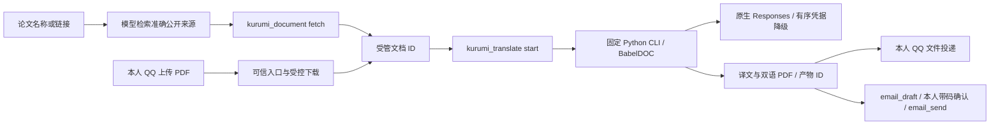

# 论文 PDF 翻译与文件投递

状态：**实现已部署；第一页 QQ 与邮件附件收件已由本人确认，全文验收阻塞**。更新于 2026-10-17（Asia/Shanghai）。唯一阅读入口：[README.md](README.md)。

## 当前状态与下一步

- [x] 需求、窄领域架构与权限范围确认；不新增翻译监听端口。
- [x] 受管 PDF 目录、网站下载、本人 QQ 文件入口/出口、按需任务与重启中断处理。
- [x] 独立 Python 3.12、固定依赖、进程隔离、原生 Responses、014 → 030 → 040 降级及有限重试。
- [x] 邮件受管附件、固定字节/哈希、原带码确认及大小限制。
- [x] 离线回归、真实 arXiv 下载、隔离 OpenClaw + 真实主模型三轮调用。
- [x] 指定论文第一页真实翻译、mono/dual 页图检查、本人确认 QQ 收到 PDF。
- [x] 整篇真实翻译两轮已执行并记录；结果为上游流中断，全文验收**阻塞**，没有完整译稿。
- [x] 邮件乱码根因修复、标准 MIME 解码/哈希回归、真实本人邮箱重发；2026-10-17 本人确认正文正常、PDF 附件可打开、第一页原文与译文排版正常（B2 关闭）。
- [x] 配置/人格对齐、服务重载、四项运行自检与证据登记。
- [x] 本需求独立本地提交（排除文档23并行改动；不推送）。

**当前结论**：单页实际翻译、本人QQ收件和文件回取通过；邮件编码故障已修复，2026-10-17 本人确认收到修复邮件，正文正常、PDF 附件可打开，第一页原文与译文排版正常，B2 已关闭。此反馈只覆盖这一页与收件体验，不代表整篇语言/公式质量通过。整篇两轮分别在1020.995秒/6请求（49849已报告tokens）和518.522秒/5请求（12501已报告tokens）后遭`upstream_stream_read_error`，两轮最后一批用量均未知。复验复用了前轮成功缓存，未重跑已成功批次；没有完整译稿、不再继续本轮付费复试。指定模型/MAX保持不变，不能标全文验收通过。精确回执和质量边界见[证据报告](verification/paper-translation-2026-10-17/README.md)。

**后续边界**：全文实用性由当前中转的流稳定性及MAX耗时阻塞。后续需渠道稳定后再做一次明确授权的复验，或由主人决定扩展其他渠道/厂商；不静默换模型、降强度或用不完整PDF交付。DeepSeek官方与Grok仍属于后续扩展。本轮实现、回归、部署和Git收尾可以独立完成，不能把它们当作全文验收已关闭。

## 需求与已定选择

主人希望告诉 Kurumi 一篇或多篇论文，由它找到原始 PDF、翻译后通过 QQ 文件或邮件附件交付。网站不能下载时，说明原因，请主人通过 QQ 上传 PDF，汇入同一处理链。单篇独立反馈，不把部分成功说成整批完成。

采用 **多个基础工具 + 一个按需后台领域任务**，不是通用 Workflow/DAG 引擎。模型理解需求、选论文和组合步骤；后端掌管文件、进程、状态与投递。遵循[文档 1 的窄接口设计原则](1_bot基础功能开发备忘录.txt)，现行开发/权限规则仍以根 AGENTS 与配置契约为准。

主人要求按 `tp2.txt` 习惯持续记录：本文保存需求、架构、精确产物、已定理由、开发/测试结果和阻塞；有新结论直接更新状态，不累积互相矛盾的旧计划。关键业务选择等待本人决定，其它分支采用推荐方案并记明依据。新增后端脚本只放 `chatbot/scripts/`、测试只放 `chatbot/tests/papers/`；证据从本文、文档 16 与索引到达，不向 archive 放游离材料。SQL 如有变更必须留本地迁移；本轮复用邮件既有字段，**没有新增 SQL 表或迁移**。

| 决定 | 当前规则与原因 |
| --- | --- |
| 默认翻译配置 | naiccc / OpenAI / **gpt-6.1-sol / max**，原生 `/v1/responses`，顶层显式 `instructions`；不修改主聊天的 DeepSeek |
| 每次可选参数 | 厂商、渠道、准确模型、强度、源/目标语言、页码、产物类型；固定到本次任务，不永久改变默认 |
| 当前登记组合 | naiccc/OpenAI gpt-6.1-sol，low/medium/high/xhigh/max；本轮真实测试为 max，其它强度未分别实测。未登记的模型/厂商直接说明，不静默换模型、降强度或切 Chat |
| 未来厂商 | DeepSeek 官方、naiccc Grok 需各自核实模型、协议、推理参数、凭据池及用量；不能把主聊天已用 DeepSeek 当作翻译已接入 |
| 默认产物 | 双语 PDF；可选纯译文 mono，或 both 两份。不另行询问默认项，采用此前提出的推荐 |
| 执行方式 | CPU 模式，一次一篇，最多 5 篇等待；固定 CLI 按需启动，结束退出，不驻留翻译服务、不新增监听端口 |
| 持久化 | 保留任务/产物轻量记录；Gateway 重启后未完成任务标为 interrupted，**不自动重新付费翻译** |
| QQ 投递 | 仅本人私聊；平台受理与本人收到分开，回执未知不自动重发 |
| 邮件 | 复用 email_draft/email_send 与原带码确认；测试发件 1794511189@qq.com、唯一收件 365999865@qq.com，主人已明确授权 |
| 真实样本 | `/home/afrangry/桌面/2609.32536v1.pdf`，16 页、646721 字节、未加密；GPT 约 10 分钟、DeepSeek 约 1 分钟是主人参考预期，不能当实测保证 |
| 预算边界 | 主人已指定实际 PDF 验收；用页数、请求数、已报告用量与运行时限限制持续调用。网关忽略输出 token 上限，**不承诺金额硬上限** |
| 并行开发 | 文档 23 的 KnowledgeMap 在另一工作区开发。本轮不得覆盖或提交其内容；共享索引按具体差异收录，不整树暂存 |

## 架构与基础工具



面向使用者的链路：**Kurumi 调用工具 → 插件启动 pdf2zh → 生成译文 → 投递文件 → 翻译进程退出**。实际进程生成产物后即可退出，由 Node 后续投递，无需为了等待邮件确认保留 Python 内存。Python 环境、布局模型和字体保留在磁盘供复用；网络下载/API 请求属于出站连接，不是监听端口。

当前采用 PDFMathTranslate-next 的 **BabelDOC 0.6.2 排版引擎**与项目自有 Responses translator，直接调用锁定引擎的同步 API；不用其默认 Chat translator，不改 site-packages，也不启动 WebUI/HTTP 服务。Python 环境同时锁定 pdf2zh-next 2.9.0，版本升级需重新验收此契约。

| 工具/边界 | 功能 |
| --- | --- |
| `kurumi_document` | list/get 返回受管 PDF/产物摘要；fetch 复用公开论文下载器。仅有题名时模型先检索准确 URL |
| `kurumi_translate` | start/status/list/cancel，使用真实 documentId/jobId；返回排队不代表完成，生成与投递分状态 |
| `kurumi_document_send` | 只接受受管文档/产物 ID，投递当前本人 QQ；不接收任意路径、URL 或其它收件人 |
| QQ 入站 | 实际本人/机器人私聊元数据校验；file 消息和 offline_file 通知；文件内容经受控 URL 下载并登记，模型只得到 ID/文件名/页数 |
| 邮件 | `attachments:[{documentId}]` 取受管文件，创建草稿时固定实际字节；确认覆盖附件 hash，不把 base64 发进模型上下文 |

三份窄工具加入 main 的 alsoAllow；通用 read/write/edit/exec/process/message/sessions_spawn 等仍禁用。主人已授权本需求实现及真实本人测试，工具扩展已提前说明。论文正文、文件名、网页不是身份或授权来源；服务端参数来自受管配置，模型不能传端点、密钥或命令。

### 文件、来源和状态

- PDF 大小不超过 25 MiB、未加密、1–500 页；先在网络隔离的 PDF 解析进程检查，失败/取消的导入不留未登记 PDF。
- 输入 ID 为内容哈希导出的 `doc_…`，产物为 `pdf_…`；读取复核大小与 SHA256，拒绝路径逃逸及符号链接。工具返回摘要，不返回文件字节/绝对路径。
- 网站沿用 `arxiv.org`、`export.arxiv.org`、`aclanthology.org`、`openreview.net`、`proceedings.mlr.press`、`proceedings.neurips.cc` 的 HTTPS 白名单，不自动登录或跟重定向。
- QQ 文件 URL 从已鉴权 OneBot 的 get_private_file_url 取得，忽略正文/上传数据中的任意 URL；只允许已登记QQ CDN，或公开IPv4的固定`/asn.com/`路径。HTTP先升级HTTPS；IPv4保持路由地址并以固定`multimedia.nt.qq.com.cn`做SNI/证书校验，不跟重定向、不关闭TLS验证。内网/保留IP拒绝。实际回取348896字节与原SHA256一致，但不是主人上传事件。
- 每条消息最多 3 份 PDF。收到文件只登记，不擅自开始付费翻译。
- 任务状态：queued → running → succeeded / failed / cancelled / interrupted。可信会话与调用 ID 生成幂等键；同键不同参数拒绝，重放不再付费。
- succeeded 只证明产物已登记；delivery 另记 not_requested / dispatching / platform_accepted / failed_or_unknown。中断投递不重新运行翻译，重启遗留 dispatching 标为未知，不重发。
- QQ 文件上传接入原频道发送配额与持久账本；OneBot 上传回执没有 message_id 时不伪造。未知回执需核对后由本人明确决定是否重新投递。
- 邮件最多 10 份，每份 10 MiB、总计 20 MiB；字节固定在既有 attachments_json 字段，预览只展示元数据。确认后 DB 被篡改则拒绝网络发送；取件源后来变化不改变草稿。

### 默认资源与用量限制

仓库配置意图：单任务最多 30 页、200 次 API 尝试、150000 个已报告 token、1200 秒；选页超限须明确指定范围，不悄悄截页。真实验收脚本另设 300 次、200000 token、1800 秒并在报告列出，不能混称默认配置。

固定 worker 只挂载系统文件、只读 Python/适配器、单任务目录与缓存；清空宿主环境，凭据只经 stdin 传入，不在 argv。限制地址空间 12 GiB、单文件 100 MiB、CPU 1200 秒；取消/超时终止整个进程组。翻译允许出站网络以调用固定 API、下载布局模型和字体；不能据此声称网络也已隔离。无需 GPU/CUDA，本轮未验 GPU。

每次请求独立上下文，不带 previous_response_id；顶层 instructions 明确，原生 Responses 流式只采用终态 response 的完整 assistant/output_text 与用量，不采用 reasoning/部分 delta/空输出/incomplete。没有可核实用量则终止后续调用。记录请求数、实际模型、请求/回显强度、输入/输出/缓存/推理 token、responseId 与凭据名称；不记录密钥、论文正文或上游任意错误文本。

凭据顺序 **014 → 030 → 040**，同模型/强度不变。鉴权失败、明确额度不足或有限限流退避后才轮换并共享冷却；没有鉴权证据的 403、参数/译文错误不轮换。502/503 最多重试一次，超时/524/流中断等结果未知不自动重放；三份不可用明确失败。网络响应晚于请求取消仍可能已产生消费，因此本地终止不能保证金额上限。

本轮全文失败的精确含义：两次最后一个请求均收到了中转发送的 `type=error` 事件，错误码 `upstream_stream_read_error`，本地映射为 `api_stream_error`；不是本地仅凭断线猜出的错误。中转报告读取其上游响应流失败，未取得该批的完整成功响应和用量。仅凭该码不能进一步定位是中转代理、上游服务还是超时，也不能认定是模型厂商本身故障。插件因此停止任务，不把部分文本拼成完整译稿；此前成功批次仍可在明确新建任务时使用缓存。这与 QQ/邮件投递和 PDF 排版是不同阶段。官方协议的完成/错误事件说明见 [OpenAI Docs](https://developers.openai.com/api/docs/guides/streaming-responses)；该说明不替中转证明故障根因。

## 精确产物与运维

| 位置 | 归属 |
| --- | --- |
| `chatbot/packages/documents/index.js` | 受管文档唯一实现，供论文、QQ、邮件共用 |
| `chatbot/plugins/kurumi-papers/{index,profiles,service,runner}.js` | 工具、配置解析、任务与固定子进程 |
| `chatbot/plugins/kurumi-papers/python/{engine,responses}.py` | 排版适配与原生 Responses / 三凭据规则 |
| `chatbot/plugins/kurumi-papers/python/requirements.lock.txt` | 固定 Python 依赖；bitstring 固定 4.3.1 |
| `chatbot/plugins/kurumi-qq/src/{inbound,files,transport}.js` | 本人 PDF 接收与原 OneBot 文件投递 |
| `chatbot/plugins/kurumi-mail/` | 受管附件快照、内容绑定、原确认/SMTP；契约见文档 20 |
| `/home/afrangry/.openclaw-fusion/documents/` | 生产受管记录/files/jobs/work/cache/events.jsonl；不进 Git |
| `/home/afrangry/.openclaw-fusion/paper-credentials.json` | 0600 的三份私密 GPT 凭据；不进 Git |
| `/home/afrangry/.openclaw-fusion/venvs/paper-translation/` | 独立 Python 环境，按锁文件重建 |
| `/home/afrangry/.openclaw-fusion/paper-acceptance/` | 本轮实际 PDF 验收状态/缓存；不是生产目录或可自动续跑队列 |
| `scripts/fusion/log-query.mjs --source papers` | 统一只读链路入口；事件契约见文档 18 |

安装与凭据导入由操作者执行，不是模型工具：

```bash
bash chatbot/scripts/setup-paper-translation.sh
node chatbot/scripts/import-paper-credentials.mjs --source /绝对路径/凭据资料.txt --destination /home/afrangry/.openclaw-fusion/paper-credentials.json
```

导入只取中转-GPT 段的三个指定变量，默认拒绝覆盖；轮换前核对，使用显式 --replace。不得把真实值放进文档、测试输出或提交。配置先改 `config/runtime.config.json` 再 sync-config，人格规则改模板再 sync-persona，不能手改运行副本。完整契约见 config/README。

备份包含受管文档、任务及凭据；Python 环境虽可能被全运行目录备份采集，恢复后仍应按锁文件重建并验证路径。恢复演练副本会关闭 liveTranslationEnabled 并清空其活动论文凭据；不在本轮冒称已做新增功能的全量灾难恢复演练。

## 开发与探查记录

| 阶段 | 结果/判断与证据边界 |
| --- | --- |
| 10-16 初探 | Ubuntu 22.04 x86_64，Ryzen 5600GT、约 27 GiB 内存；现有 Poppler 可用。依赖干跑可解析，公开 arXiv PDF 下载/提取/页图已通过；仅硬件确认 RTX3060，未验证 GPU |
| 10-17 协议探查 | 014：1 次模型查询、8 次合成生成，7 成功/JSON 模式一次 502。Chat 与 Responses 均可用；显式 instructions 使短样本输入从约4239降至29，但不是费用下降倍数。max_output_tokens=16 实际输出106；完整报告 [paper-api](verification/paper-api-2026-10-17/README.md) |
| 依赖部署 | 固定 Python3.12、pdf2zh-next2.9.0、BabelDOC0.6.2。bitstring5删除BitStream，故锁4.3.1并做实际导入检查，不能只看pip check |
| 引擎接入 | 能力探测 do_llm_translate(None) 必须本地返回，不能付费；公式/样式使用 literal/regex 对。基于锁定引擎模板新增契约测试 |
| API客户端标识 | urllib默认UA被边缘403/1010拒绝；显式Kurumi-Papers/1.0后同凭据模型查询200。非鉴权403不轮换，误设冷却只在验收缓存更正 |
| 长请求与推理 | 非流式90秒超时、524/503已保存；流式接口与独立短文通过。原批次首请求报告1001输入、25304输出，其中24740推理；不把“少固定输入开销”说成“总消费已低” |
| CLI结束 | 原异步回调在PDF已生成后可能继续等待；固定独立worker改用同步排版API，父任务仍异步。失败/中断原始回执与真实基线产物归属证据报告 |
| 批次提示词 | 仅解析锁定BabelDOC批次的ID/input，翻译规则放原生instructions；本地检查JSON/ID数量和公式标记。保持指定模型/max，待真实复验后评价收益 |
| 邮件附件 | 使用既有SQL字段保存实际字节，元数据/hash绑定确认；86项邮件回归保留，新增大小/篡改/重开/本地TLS及标准MIME解码回归；未知ID不泄露宿主路径 |
| 邮件乱码修复 | 实际长中文标题触发两次折行，提前结束邮件头，附件Base64被当正文；改为唯一折行入口、UTF-8分块连续、单一RFC2231参数、Uint8Array原始字节。修复邮件重新SMTP投递；2026-10-17 本人确认正文正常、PDF 附件可打开且第一页排版正常，B2 关闭 |
| 单页实际翻译 | 第一页588.58秒、3请求、27462已报告tokens；mono/dual正文可读，作者/单位区合并。本人确认QQ收到，实际TLS回取哈希一致 |
| 整篇实际翻译 | 首轮上游流中断失败；开发者在授权测试范围内显式新建一轮任务复用成功缓存，仍因同类错误失败。两次均保留记录，未伪造全篇或自动重放未知请求 |
| 部署 | 生产配置/人格核对已对齐，重载kurumi-fusion；四项自检通过，testIngress=false。模型/字体缓存39文件344869220字节预热，2个SQLite使用在线备份；不从验收导入凭据冷却 |
| 集成 | 真实arXiv获取通过；隔离OpenClaw+真实DeepSeek主模型三轮通过，翻译worker/OneBot为fixture，仅证明工具与任务编排，不能替代GPT或真实投递 |

## 测试命令与当前结果

所有新增测试逐文件在脚本索引登记，证据统一位于 [paper-translation-2026-10-17](verification/paper-translation-2026-10-17/README.md)。

```bash
node --test chatbot/tests/papers/*.test.mjs
python3 chatbot/tests/papers/responses_test.py
/home/afrangry/.openclaw-fusion/venvs/paper-translation/bin/python chatbot/tests/papers/engine_test.py
node --test chatbot/plugins/kurumi-mail/test/*.test.js chatbot/plugins/kurumi-qq/test/*.test.js scripts/fusion/test/log-query.test.mjs
```

当前离线为新增Node **20/20**、Responses **11/11**、安装引擎契约 **4/4**、既有邮件/QQ/查询 **112/112**。另有共享接口/后端边界与既有恢复回归 **54/54**（当前工作树含文档23新增的包发现回归；本需求提交不收录该测试改动）。这些离线结果不包括真实论文质量、真人入站或邮箱到信。

明确授权的真实验收脚本（不要混进离线批量命令）：

```bash
node chatbot/tests/papers/acceptance-download.mjs
node chatbot/tests/papers/acceptance-host.mjs
node chatbot/tests/papers/acceptance.mjs --input /home/afrangry/桌面/2609.32536v1.pdf --pages 1 --out /绝对路径/证据目录
# 整篇去掉 --pages；--send-qq / --send-mail 才实际向本人外发
```

acceptance-host 启动隔离Gateway并调用真实主模型，翻译/OneBot模拟；不写生产业务。acceptance使用真实翻译API及私密验收目录，可用--root复用该目录缓存；每次新任务均是明确运行，不自动续跑旧付费调用。--send-mail按主人本轮授权程序化记录测试确认，**不代表真实QQ带码确认往返或到信**。

## 未覆盖、阻塞与收尾

- **B1 全文验收阻塞**：整篇GPT/MAX两轮上游流中断，未生成完整产物；单页9.8分钟也未达到主人对整篇约10分钟的参考预期。不再追加付费复试；后续重新验收或新厂商接入须明确安排。
- **B2 已验收（2026-10-17）**：本人确认修复邮件正文正常、PDF 以附件收到且可打开，第一页原文/译文排版正常；与此前QQ样稿收件相互独立，不扩大为全文质量验收。反馈摘要见[observations.json](verification/paper-translation-2026-10-17/observations.json)。
- 030/040真实鉴权及额度切换未故意制造；本地降级/冷却测试通过，不声称三个真实渠道均已可用。
- DeepSeek官方/Grok翻译未实现；后续各自登记具体模型、凭据和协议，默认不回退它们。
- 显式 text.format JSON模式曾502，当前采用提示词加本地JSON校验；上游输出硬预算和实际金额仍不可验证。
- 主人真实QQ上传原文件→模型→翻译→本人收到、多人/群/登录受限论文、扫描OCR与GPU、并发压力、完整新增功能灾难恢复未覆盖。
- 本轮不更新后台fusion开发副本、不操作旧系统/归档、不远端推送、不提交文档23相关开发。当前恢复点不包含本功能，若需新停写快照须独立安排。邮件SQL字段结构未变，但新增字节快照不是旧源码可安全消费的保证；回滚应联动源码/配置/私有状态，不能只退旧邮件代码继续发送新草稿。

返回[文档入口](README.md)。
