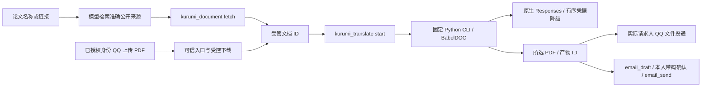

# 论文 PDF 翻译与文件投递

类型：领域规则与运维说明。状态：受管PDF、翻译/投递、附件分流、空闲切换与按名查找已有实现；性能优化未实施。开发与剩余验收分别见[待办 E2](待办清单.md#e2-论文剩余)及[验收总表](16_验收与测试总表.md#分领域验收摘要)。早期“按名查找未重启”属于原轮次记录，不作为当前运行状态。

## 术语

- **014 / 030 / 040**：三个 naiccc GPT 凭据的内部代号，取自凭据ID `OPENAI_API_KEY1_014`、`OPENAI_API_KEY2_030`、`OPENAI_API_KEY3_040` 的后缀，见 [profiles.json](../chatbot/plugins/kurumi-papers/python/profiles.json)。只用于区分凭据和降级顺序，不代表模型或价格。
- **high / MAX**：推理强度（effort）档位。默认 high；MAX 即 `effort=max`，只在用户明确指定时使用。
- **dual / mono / both**：产物类型。dual 是原文与译文对照的双语 PDF（默认），mono 是纯译文，both 两份都发。
- **QPS**：每秒最多启动的翻译API请求数（配置项 `apiQps`）；“4并发/QPS1”指同时最多4个在途请求、每秒最多新开1个。

## 当前实现与未完成方向

现行默认、文件/状态与资源限制在下文统一维护。共享下载、插件停止及宿主等待清理只归[文档21](21_后端职责分层与代码整理.md#共享代码与插件生命周期)；不把代码整理回归扩大为付费翻译或真人投递验收。

按名查找的现行契约：`kurumi_document find` 只查请求人受管PDF的文件名、记录题名和来源URL，规范化多词匹配，全目录扫描、最多50条；`fetch` 可记录 `title`。旧记录缺题名的补全仍归[待办 G5](待办清单.md#g5-早期保存的论文没有题名按名找不到)。

逐轮协议探查、样稿、缓存/冷缓存、并发、双语、恢复、附件和部署记录见[阶段记录](archive/documentation-2026-10-23/22_论文PDF翻译与文件投递.md)及原专项证据，不累计为总通过数。[性能优化方案](#性能优化方案)集中在文末，尚未实施。

## 需求与已定选择

主人希望告诉 Kurumi 一篇或多篇论文，由它找到原始 PDF、翻译后通过 QQ 文件或邮件附件交付。网站不能下载时，说明原因，请主人通过 QQ 上传 PDF，汇入同一处理链。单篇独立反馈，不把部分成功说成整批完成。

采用 **多个基础工具 + 一个按需后台领域任务**，不是通用 Workflow/DAG 引擎。模型理解需求、选论文和组合步骤；后端掌管文件、进程、状态与投递。现行窄接口与模型/后端职责见[文档21](21_后端职责分层与代码整理.md)，设计来源可追溯[文档1](1_bot基础功能开发备忘录.txt)，不把历史文档当当前规则。

本文维护需求、当前契约、精确产物与关键理由；逐轮测试和部署归专项证据，排期归待办。关键业务选择待本人决定，历史真实测试授权不自动扩展到新一轮调用。后端脚本归 `chatbot/scripts/`，测试归 `chatbot/tests/papers/`，SQL随实现留本地迁移；邮件附件复用既有字段，没有新增SQL表或迁移。

| 决定 | 当前规则与原因 |
| --- | --- |
| 默认翻译配置 | naiccc / OpenAI / **gpt-6.1-sol / high**（可显式指定 MAX），原生 `/v1/responses`，顶层显式 `instructions`；不修改主聊天的 DeepSeek |
| 每次可选参数 | 厂商、渠道、准确模型、强度、源/目标语言、页码、产物类型；固定到本次任务，不永久改变默认 |
| 当前登记组合 | naiccc/OpenAI gpt-6.1-sol，low/medium/high/xhigh/max；DeepSeek/official deepseek-flash、deepseek-v4-pro，none/low/high/max。DeepSeek 默认 V4.1 Flash/high，API 标识 deepseek-flash；指定厂商、准确模型或唯一渠道可推导其默认，不继承 GPT 的字段。冲突组合与未登记模型直接拒绝，不静默替换或切 Chat。none 实测样式保留不稳，仍可按主人明确指定执行；部署与真实测试范围见顶部与证据 |
| 厂商范围 | 仅 GPT 与 DeepSeek；主人明确不接 Grok，不列为延期或未完成需求。不会自动跨厂商回退 |
| 默认产物 | 双语 PDF；可选纯译文 mono，或 both 两份。不另行询问默认项，采用此前提出的推荐 |
| 执行方式 | CPU模式，一次一篇、最多5篇等待，单篇API并发4/QPS1；每完成一篇即投递所选文件。固定CLI按需启动、结束退出，不驻留翻译服务、不新增监听端口 |
| 持久化 | 保留任务/产物轻量记录；Gateway 重启后未完成任务标为 interrupted，**不自动重新付费翻译** |
| QQ 投递 | 各已登记身份仅发回请求人本人；按文档24隔离归属及撤权检查。平台受理与实际收到分开，回执未知不自动重发 |
| 邮件 | 复用 email_draft/email_send 与原带码确认；唯一收件人来源、附件快照和限制归[文档20](20_邮件能力与横切扩展.md#受管-pdf-附件)，各次真实测试按实际授权 |
| 验收样本 | 使用各次明确授权的实际PDF；原样本路径、页数与耗时预期见[阶段记录](archive/documentation-2026-10-23/22_论文PDF翻译与文件投递.md)，不作为性能保证 |
| 预算边界 | 主人已指定实际 PDF 验收；用页数、请求数、已报告用量与运行时限限制持续调用。网关忽略输出 token 上限，**不承诺金额硬上限** |
| 版本管理 | 并行任务按文件/代码块划分，验收对应实际源码与构建指纹；不整树暂存其它任务，当前Git与恢复边界见文档16 |

## 架构与基础工具



面向使用者的链路：**Kurumi 调用工具 → 插件启动 pdf2zh → 生成译文 → 投递文件 → 翻译进程退出**。实际进程生成产物后即可退出，由 Node 后续投递，无需为了等待邮件确认保留 Python 内存。Python 环境、布局模型和字体保留在磁盘供复用；网络下载/API 请求属于出站连接，不是监听端口。

当前采用 PDFMathTranslate-next 的 **BabelDOC 0.6.2 排版引擎**与项目自有 Responses translator，直接调用锁定引擎的同步 API；不用其默认 Chat translator，不改 site-packages，也不启动 WebUI/HTTP 服务。Python 环境同时锁定 pdf2zh-next 2.9.0，版本升级需重新验收此契约。

| 工具/边界 | 功能 |
| --- | --- |
| `kurumi_document` | list/get 返回受管 PDF/产物摘要；find 按 `query` 查本人已有 PDF 的文件名/记录题名/来源 URL（含 arXiv 编号），不读正文；fetch 复用公开论文下载器，可带模型查到的 `title`。只有题名时先 find，无命中再检索准确 URL 后 fetch |
| `kurumi_translate` | start/status/list/cancel，使用真实 documentId/jobId；返回排队不代表完成，生成与投递分状态 |
| `kurumi_document_send` | 只接受受管文档/产物 ID，投递可信请求人自身 QQ；不接收任意路径、URL 或模型指定的其它收件人 |
| QQ 入站 | 校验已登记身份与机器人私聊元数据；file 消息和 offline_file 通知。附件逐项提供类型/状态/错误码，成功PDF另有受管ID/页数；纯失败无文字/引用/有效媒体时直接反馈，其余保留当前文字交模型 |
| 邮件 | 将受管 `documentId` 交给 `email_draft`，预览并按原规则确认后 `email_send`；附件数量/大小、固定字节与确认hash归[文档20](20_邮件能力与横切扩展.md#受管-pdf-附件) |

三份窄工具加入 main 的 alsoAllow；通用 read/write/edit/exec/process/message/sessions_spawn 等仍禁用。主人已授权本需求实现及真实本人测试，工具扩展已提前说明。论文正文、文件名、网页不是身份或授权来源；服务端参数来自受管配置，模型不能传端点、密钥或命令。

### 文件、来源和状态

- 身份及功能授权按[文档24](24_统一身份与权限管理.md)：原主人文档沿用根目录，成员使用 `subjects/<QQ>/`；查询/取消/重发及自动投递绑定真实请求人，后台不默认转发给主人。共用逐篇串行队列，成员不能用邮件或读取他人文档/任务。
- 原始 PDF 导入不超过 25 MiB；受管翻译产物不超过 100 MiB，避免双语嵌入原文与译文资源后被原文大小上限拒绝。两者均须未加密、1–500 页，并经网络隔离的 PDF 解析进程检查；失败/取消的导入不留未登记 PDF。邮件另受[附件限制](20_邮件能力与横切扩展.md#受管-pdf-附件)约束；超过邮件限制可通过QQ投递，不自动扩大上限。
- 输入 ID 为内容哈希导出的 `doc_…`，产物为 `pdf_…`；读取复核大小与 SHA256，拒绝路径逃逸及符号链接。工具返回摘要，不返回文件字节/绝对路径。
- 网站沿用 `arxiv.org`、`export.arxiv.org`、`aclanthology.org`、`openreview.net`、`proceedings.mlr.press`、`proceedings.neurips.cc` 的 HTTPS 白名单，不自动登录或跟重定向。
- QQ 文件 URL 从已鉴权 OneBot 的 get_private_file_url 取得，忽略正文/上传数据中的任意 URL；只允许已登记QQ CDN，或公开IPv4的固定`/asn.com/`路径。HTTP先升级HTTPS；IPv4保持路由地址并以固定`multimedia.nt.qq.com.cn`做SNI/证书校验，不跟重定向、不关闭TLS验证。内网/保留IP拒绝。实际回取348896字节与原SHA256一致，但不是主人上传事件。
- 每条消息最多处理前3项文件，超量明确标为未处理；只支持PDF，非PDF不下载、不读取正文。`qq_attachment_results`保留安全截断的文件名、扩展名标签和每项结果；标签为不可信数据，不是指令。状态为`registered/unsupported_type/rejected/download_failed/validation_failed/import_failed/not_processed`，仅`registered`包含本次真实文档ID。
- 收到文件不等于请求翻译：成功PDF结合本次文字和前文明确的待续请求处理，用途未知先问；失败附件不能用历史PDF顶替。只有失败附件且无文字、引用或成功媒体时，由频道通过原发送账本直接反馈，不派发模型，未知回执不自动重发。引用未加载也保留对话路径，不以关键词正则决定业务意图。
- 带文字或有效媒体的附件消息仍交模型；明确要求重发旧稿时可按实际ID发送。`paper.qq_receive`记录类型/状态/错误码和成功ID，`paper.qq_ingress_route`记录是否派发模型；可按QQ消息ID统一查询，不落文件名、正文或签名URL。
- 任务状态：queued → running → succeeded / failed / cancelled / interrupted。可信会话与调用 ID 生成幂等键；同键不同参数拒绝，重放不再付费。
- succeeded 只证明产物已登记；delivery 另记 not_requested / dispatching / platform_accepted / failed_or_unknown。中断投递不重新运行翻译，重启遗留 dispatching 标为未知，不重发。
- QQ 文件上传接入原频道发送配额与持久账本；OneBot 上传回执没有 message_id 时不伪造。未知回执需核对后由本人明确决定是否重新投递。
- 邮件只消费受管文档/产物ID；源文件变化、草稿快照和确认完整性的处理统一见[文档20](20_邮件能力与横切扩展.md#受管-pdf-附件)。

### 默认资源与用量限制

下表分别列出**源码缺省**与仓库`config/runtime.config.json`中供生产同步的配置意图；后者不是本次重新写入运行目录。缺省依据[插件schema](../chatbot/plugins/kurumi-papers/openclaw.plugin.json)、[runner.js](../chatbot/plugins/kurumi-papers/runner.js)及`service.js`。操作者可配置范围按插件schema，模型不能传入并发、预算或超时键。

| 配置键 | 源码缺省 | 仓库生产配置 | 可配置范围 / 含义 |
| --- | --- | --- | --- |
| `liveTranslationEnabled` | false | true | 布尔；实际付费调用开关 |
| `maxPages` | 30 | 30 | 1–500；本次所选页数上限，超限需明确页码，不截页 |
| `maxRequests` | 300 | 300 | 1–2000；所有实际API尝试共同计数 |
| `maxReportedTokens` | 150000 | 300000 | 100–2000000；已报告tokens预算，不是金额硬上限 |
| `apiConcurrency` | 1 | 4 | 整数1–6；单篇在途请求数 |
| `apiQps` | 1 | 1 | 整数1–4；每秒最多新开请求数 |
| `batchValidationRetries` | 1 | 1 | 0–4；当前批次校验失败后的额外重试次数，0禁用 |
| `channelRecoveryRetries` | 1 | 1 | 0–4；全部临时渠道冷却后的额外恢复轮数，0禁用 |
| `requestIdleTimeoutSeconds` | 100秒 | 100秒 | 整数1–600；有效正文空闲期限 |
| `timeoutSeconds` | 1800秒 | 1800秒 | schema为整数30–1800；整篇worker执行期限，不含排队；runner另外校验正数且不超过1800 |

| 固定边界 | 当前值与执行位置 |
| --- | --- |
| 任务队列 | 一次一篇、最多5篇等待；`service.js` |
| 单请求总期限 | 600秒；`python/responses.py`，独立于正文空闲期限，不是公开配置项 |
| API并发与验收脚本 | 日常4并发来自仓库配置；manifest、runner和验收脚本未指定时为1，六并发只属于隔离对比 |
| worker资源 | 地址空间12 GiB、单文件100 MiB、CPU 1200秒；`runner.js`的prlimit |

#### 正文空闲与用量

从请求开始或最后一次非空白`response.output_text.delta`计时。心跳、创建事件、思考事件和空白不重置空闲计时。无正文超时先取消HTTP进程，记录`api_output_idle_timed_out_unknown`及未知用量，再按下表切渠道/有限恢复，只重试当前批次。持续有正文仍受单请求600秒及整篇期限约束。

没有可见正文不证明上游未推理或未计费，本地取消也不保证停止上游计费。完整终态响应才提供可核实译文和用量；渠道中断记unknown，不记0。所有实际尝试共同消耗请求/用量预算，不自动重跑整篇。

#### 重试与渠道切换

实现入口为[python/responses.py](../chatbot/plugins/kurumi-papers/python/responses.py)。凭据按014→030→040选择，同模型/强度不变，不跨厂商回退。

| 情况 | 处理与边界 |
| --- | --- |
| 明确鉴权失败 | 当前凭据冷却24小时，直接切下一渠道，不等待 |
| 额度不足 | 直接切换，冷却120秒 |
| 短暂限流 | 同渠道退避一次；仍失败切换并冷却120秒 |
| 明确临时渠道错误、连接/读取超时、流中断 | 切下一渠道并冷却300秒；每批每渠道每轮最多一次此类尝试 |
| 可切换的HTTP状态 | 408、500、502、503、504、520、522、524、529；临时错误含`upstream_stream_read_error`、`upstream_http2_stream_error` |
| 所有渠道暂不可用 | 按`channelRecoveryRetries`做有界恢复，每轮等待最多330秒，同渠道一次一个恢复探测；耗尽终止 |
| 无鉴权证据的403、参数/权限、错误模型或强度 | 明确失败，不通过换渠道掩盖 |
| 译文结构/公式/样式校验失败 | 按`batchValidationRetries`仅重试当前批次；失败输出不缓存、不拼成译稿 |

冷却跨任务共享；成功释放该渠道，失败继续冷却。任务终态停止准入并中断在途等待，已完成响应仍计账。上述有界恢复共同受整篇时限与预算约束，不能保证金额上限。

`api_stream_error`只说明未取得该批完整成功响应，不能单凭该码归因于模型厂商、中转或超时，也不能用部分文本拼成完整译稿。历史两次全文失败与原始回执见[high-dual-fix报告](verification/paper-translation-2026-10-17/high-dual-fix/README.md)及[阶段记录](archive/documentation-2026-10-23/22_论文PDF翻译与文件投递.md)。协议参考[Responses流事件说明](https://developers.openai.com/api/docs/guides/streaming-responses)不替中转证明故障根因。

固定 worker 只挂载系统文件、只读 Python/适配器、单任务目录与缓存；清空宿主环境，凭据只经 stdin 传入，不在 argv。限制地址空间 12 GiB、单文件 100 MiB、CPU 1200 秒；取消/超时终止整个进程组。翻译允许出站网络以调用固定 API、下载布局模型和字体；不能据此声称网络也已隔离。无需 GPU/CUDA，本轮未验 GPU。

每次请求独立上下文，不带 previous_response_id；顶层 instructions 明确，原生 Responses 流式只采用终态 response 的完整 assistant/output_text 与用量，不采用 reasoning/部分 delta/空输出/incomplete。完成响应缺少可核实用量则终止；渠道中断的用量记为 unknown，按下述明确规则切换，不把 unknown 记成 0。记录请求数、实际模型、请求/回显强度、输入/输出/缓存/推理 token、responseId 与凭据名称；不记录密钥、论文正文或上游任意错误文本。

GPT 批次使用原数组协议；DeepSeek 批次显式传原生 `text.format=json_schema`，要求 `translations` 对象数组、原 ID 枚举、固定字段，源码/模型/强度与批次协议分别进入缓存键。即使 API 接受 schema，仍在本地核对条数、ID、非空译文及全部公式/样式标记；只允许移除一个精确完整的外层 JSON 围栏，不从解释文字提取片段、不放松标记校验。错误仅记录结构原因/数量/位置，不落正文；引擎接到终态失败立即取消，不继续逐段限速等待。DeepSeek 官方支持 text.format 的依据仍为[Responses协议说明](https://developers.openai.com/api/docs/guides/streaming-responses)，不把它等同于中转对同参数的支持。

## 精确产物与运维

| 位置 | 归属 |
| --- | --- |
| `chatbot/packages/documents/index.js` | 受管文档唯一实现，供论文、QQ、邮件共用 |
| `chatbot/plugins/kurumi-papers/{index,profiles,service,runner}.js` | 工具、配置解析、任务与固定子进程 |
| `chatbot/plugins/kurumi-papers/python/{engine,responses,http_worker}.py`、`python/profiles.json` | 排版适配、批次验证/有界恢复、可取消的一次性HTTP与 Node/Python 共用的固定厂商注册表 |
| `chatbot/plugins/kurumi-papers/python/requirements.lock.txt` | 固定 Python 依赖；bitstring 固定 4.3.1 |
| `chatbot/plugins/kurumi-qq/delivery.js` | QQ对外投递入口；论文插件组合入口先校验任务绑定，再经它发PDF和完成通知，不直接导入QQ内部文件 |
| `chatbot/plugins/kurumi-qq/src/{attachments,inbound,files,transport}.js` | 逐项附件事实、纯失败分流、授权身份PDF接收与原OneBot文件投递 |
| `chatbot/plugins/kurumi-mail/` | 受管附件快照、内容绑定、原确认/SMTP；契约见文档 20 |
| `/home/afrangry/.openclaw-fusion/documents/` | 生产受管记录/files/jobs/work/cache/events.jsonl；不进 Git |
| `/home/afrangry/.openclaw-fusion/paper-credentials.json` | 0600 的三份私密 GPT 凭据与 `DEEPSEEK_API_KEY`；任务只读取所选厂商的凭据，不进 Git |
| `/home/afrangry/.openclaw-fusion/venvs/paper-translation/` | 独立 Python 环境，按锁文件重建 |
| `/home/afrangry/.openclaw-fusion/paper-acceptance/` | 本轮实际 PDF 验收状态/缓存；不是生产目录或可自动续跑队列 |
| `scripts/fusion/log-query.mjs --source papers` | 统一只读链路入口；事件契约见文档 18 |

安装与凭据导入由操作者执行，不是模型工具：

```bash
bash chatbot/scripts/setup-paper-translation.sh
node chatbot/scripts/import-paper-credentials.mjs --source /绝对路径/凭据资料.txt --destination /home/afrangry/.openclaw-fusion/paper-credentials.json
node chatbot/scripts/import-paper-credentials.mjs --provider deepseek --source /home/afrangry/.openclaw-fusion/runtime-env.json --destination /home/afrangry/.openclaw-fusion/paper-credentials.json --replace
```

默认导入只取中转-GPT 段的三个指定变量；`--provider deepseek` 只取显式 JSON 来源中的 `DEEPSEEK_API_KEY`，不复制邮件等其它变量。已有目标默认拒绝覆盖；显式 `--replace` 原子合并所选厂商并保留另一厂商，拒绝符号链接、非 0600 目标及未知旧字段，失败不改旧字节。不得把真实值放进文档、测试输出或提交。配置先改 `config/runtime.config.json` 再 sync-config，人格规则改模板再 sync-persona，不能手改运行副本。完整契约见 config/README。

备份包含受管文档、任务及凭据；Python 环境虽可能被全运行目录备份采集，恢复后仍应按锁文件重建并验证路径。恢复演练副本会关闭 liveTranslationEnabled 并清空其活动论文凭据；不在本轮冒称已做新增功能的全量灾难恢复演练。

## 测试命令与当前结果

所有新增测试逐文件在脚本索引登记，证据统一位于 [paper-translation-2026-10-17](verification/paper-translation-2026-10-17/README.md)。

```bash
node --test chatbot/tests/papers/*.test.mjs
python3 chatbot/tests/papers/responses_test.py
python3 chatbot/tests/papers/concurrency_test.py
python3 chatbot/tests/papers/reliability_test.py
/home/afrangry/.openclaw-fusion/venvs/paper-translation/bin/python chatbot/tests/papers/engine_test.py
node --test chatbot/plugins/kurumi-mail/test/*.test.js chatbot/plugins/kurumi-qq/test/*.test.js scripts/fusion/test/log-query.test.mjs
```

既有离线结果、源码基线和未覆盖层级见[阶段记录](archive/documentation-2026-10-23/22_论文PDF翻译与文件投递.md)与[文档16](16_验收与测试总表.md)，本页不继续按轮次追加通过数。


明确授权的真实验收脚本（不要混进离线批量命令）：

```bash
node chatbot/tests/papers/acceptance-download.mjs
node chatbot/tests/papers/acceptance-host.mjs --out /绝对路径/新的host结果.json
node chatbot/tests/papers/acceptance-file-ingress.mjs --out /绝对路径/新的附件入口结果.json
node chatbot/tests/papers/acceptance.mjs --input /home/afrangry/桌面/2609.32536v1.pdf --pages 1 --out /绝对路径/证据目录
# DeepSeek 显式加 --provider deepseek；可选 --model deepseek-v4-pro --effort high
# 整篇去掉 --pages；--concurrency 4 或 6 --qps 1（验收脚本未指定仍为1）
# --send-qq / --send-mail 才实际向本人外发
# 每次必须使用新的 --out；不自动续跑付费任务
```

acceptance-host 和 acceptance-file-ingress 启动隔离 Gateway 并调用真实聊天模型，翻译/OneBot模拟，不写生产业务；后者验证真实附件入口/PDF解析及主人、合成成员的待续/重发编排，不启用生产testIngress。acceptance-worker 需显式 --capture（当前生产捕获的 runner.js）和新 --out，只验证固定 Python/双厂商注册表的真实隔离进程，无凭据/API/外发。acceptance-api.py 需显式 --credentials 和新 --out，真实调用合成短句或 --batch 合成批次，可指定 --provider/--model/--effort；不得作为离线回归运行。acceptance使用真实翻译API及私密验收目录，核对所选产物集合与完整页数；可用--root复用该目录缓存，或为冷译文缓存指定新的root并以--seed-resources-from仅复制公开模型/字体/tokenizer。--reuse-job只验收既有成功产物及投递，不新增付费翻译。每次新任务均是明确运行，不自动续跑旧付费调用。--send-mail按主人本轮授权程序化记录测试确认，**不代表真实QQ带码确认往返或到信**。

## 未覆盖、阻塞与收尾

| 范围 | 仍需明确的边界 |
| --- | --- |
| 全文质量与强度 | GPT/high已有冷译文缓存整篇证据；MAX冷缓存、全文逐字/公式校对未覆盖。DeepSeek Flash/low整篇不替代当前high档全文验收，V4 Pro短句不替代整篇；none仍有标记保持限制 |
| 渠道可靠性 | 真实短句、部分自然降级与故障注入分别记录，不保证所有Key长期可用；未专门制造耗尽/吊销或每种顺序的真实故障。naiccc结构化模式失败与未知用量回执保留 |
| 真实往返 | 真人上传原文件→模型→真实翻译→收件全链路仍按待办E2安排；样稿收件/第一页反馈不扩大为全文质量验收 |
| 负载与能力范围 | 多人并发、长期压力、登录受限论文、OCR/GPU等未覆盖；群聊不在开放范围。六并发隔离对比不改变日常四并发 |
| 预算与恢复 | 金额硬上限和上游输出硬预算不可验证；新增功能完整停写灾难恢复未验收，现有恢复点范围见文档16 |

原失败、本人反馈和分渠道用量见阶段记录及其原始报告。性能方向见[性能优化方案](#性能优化方案)，任务下一步在待办。回退须联动源码/配置/私有状态，不能只回退旧邮件代码继续发送新草稿；后台副本不自动随源码更新。


## 性能优化方案

性能优化尚未实施，已定位新身份约5分55秒API前初始化和全渠道冷却等待瓶颈；30页任务被本人停止，不把它算作渠道失败。计划与边界：

- 新身份预热或只读共享公共模型、字体、tokenizer；个人PDF/译文缓存库/凭据继续隔离，不复制主人私有缓存。
- 按故障类别/连续失败细分冷却，减少一次断连引发全渠道长等待；保留014优先、同模型切换、有界重试与单路恢复探测。
- 增加初始化/资源/解析/翻译/排版/投递阶段计时，阶段与阶段内百分比同时展示，不以静态总体权重推算剩余时间。
- 先保持high、4并发/QPS1、30分钟与现有预算，消除无效等待后对照首次资源准备/预热场景；付费复测单独取得授权，不自动重跑。

返回[文档入口](README.md)。
