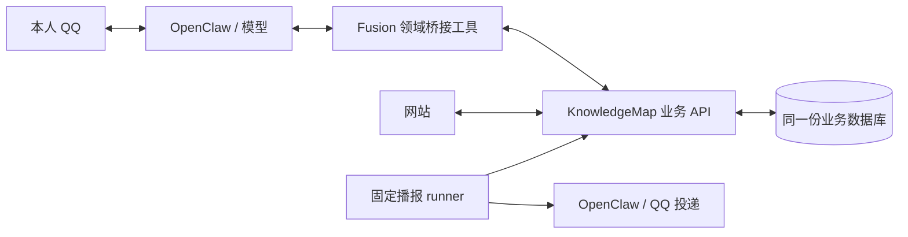

状态：开发中（共享业务已部署；播报稳定性、共享默认城市与长期验收未完成）

# KnowledgeMap共享业务：提醒列表、记账与天气

网站和 QQ 助手共用 KnowledgeMap 的业务能力和同一份 MySQL 数据：待做事项（提醒列表）、记账、天气。模型理解表达、查询候选、组织参数并调用工具；业务端负责校验、事务和持久化，返回真实结果。业务 API 的精确路由和 SQL 在 KnowledgeMap 仓库的 `/home/afrangry/repository/docs/18_助手业务接口与共享数据.md` 维护。

## 功能

| 模块 | 能力 | 边界 |
| --- | --- | --- |
| 待做事项 / 提醒列表 | 查询、新增、修改、完成、作废、恢复；每日播报 | 一次性到点提醒是另一种能力，见[文档3](3_个人提醒.md) |
| 记账 | 新增、查询、月汇总、单笔修改和实际删除；分类取自真实标签目录 | 唯一目标直接执行，歧义先澄清；不批量，不承诺删除可撤销 |
| 天气 | 地点查询、天气读取，说明观测时间、数据时效和失败 | 不同步两端默认城市；天气模块见[文档2](2_天气模块.md) |

不做：TradeSim、Notes/知识图谱、条件事件触发、通用工作流引擎、批量账单维护。

### 待做事项规则

- 标题必需，内容、备注、日期/时间可空；没有日期时不补造今天。“越快越好”“活动结束后”这类条件留在内容或备注，不当事件触发器。
- 逾期未完成仍在待做和播报中。完成、作废退出有效列表；作废保留历史并可恢复，恢复为待做时清除完成和作废时间戳。
- 本人明确的维护请求直接保存，不需要带码确认。一次性提醒 `personal_reminder_*` 走[二次确认](6_二次确认.md)。
- 模型负责理解请求、查询候选和版本、选择动作和真实 `km:<id>`。后端校验本人当前请求、会话、有效期、字段、版本、事务和幂等，不用原文动词重判动作。
- “第六条”按此前实际展示的列表定位，再查询核对 ID 和 version，不用新排序改选目标；没有此前列表或有歧义先澄清。能力询问、引用、假设和否定不写入。

### 一条消息维护多项

- 一条本人消息最多维护 8 个不同事项（`maxItemsPerMessage`），每项单独调用；第 9 个目标在发请求前拒绝。
- 新增按归一标题计目标，已有事项按真实 ID 计目标。标题归一为 NFKC、去首尾空白、连续空白合一，保留大小写和标点；归一只用于幂等目标，保存的字段取本次原文。
- 同一消息内，同目标同参重试复用原结果且不额外计数；同目标不同参数拒绝，需新消息维护。
- 逐项提交，已成功的项不因其他项失败回滚；回复逐项说明成功、失败或结果未知。
- 结果未知时只能用相同参数重试核对，不得改写旧库、转建一次性提醒或自动化任务。
- `schedule/pause/resume` 仍一条消息一项。

### 每日播报

- 默认每天 00:00、08:00、12:00、18:00（Asia/Shanghai），24:00 等同 00:00；时刻集合最多 24 项，次数等于时刻数，可修改或暂停/恢复。设置以本地 settings 为准，`defaultTimes` 只用于首次建库。
- 原生 Cron 运行 `chatbot/scripts/reminder-list.mjs run --slot HH:mm`。slot 是“日期 + 设定时刻”的一次计划播报，同一 slot 只生成一次。固定 CLI 经鉴权的本机 RPC 让宿主从业务 API 读取完整有效列表，按网站顺序呈现事项明细一次；模型只写一段自然开场（时刻、时区、数量），不注入逐项资料。
- 只有查询成功、设置版本一致、处于设定时刻后 2 分钟窗口内且该 slot 未被占用时才准备正文。空列表跳过；API 故障不宣告空列表，也不读旧库；完整正文超过 500000 字节失败，不截断。
- 模型生成失败明确记为未发送，不发固定兜底，不自动补发。开场校验记录空文案、换行和具体事项重复，错误保留规则和生成记录引用，不复制被拒的私密正文。
- 投递账本记录 prepared/skipped/delivered/failed/unknown。清单成功需要本 slot 已生成非空冻结正文、Cron 执行成功且有送达回执；失败运行的错误通知即使送达，也只表示通知送达。未知送达不自动重发。
- 标题、内容、备注作为普通数据输出，措辞中性，不写死人格称呼。

### 账单维护

- 明确且唯一的单笔修改、删除直接执行；先查真实记录和 version，指代有歧义先澄清。删除沿用网站的实际删除规则，不是作废或回收站，保留请求回执和删除前快照供审计。
- 账单带共享 version，网站编辑/删除和助手维护都按 ID 与 version 提交；冲突时重新查询，不覆盖新事实。业务写入和幂等回执同事务。
- 每条消息一笔，不传槽位。后端消费结构化动作，不解析聊天动词；模型字段错误被严格拒绝，不静默改写成合法写入。

## 接口

### 工具与配置

| 工具 | 权限点 | 说明 |
| --- | --- | --- |
| `knowledge_bills_get` | `bills.read` | 账单查询：`tags` 查真实分类，`list` 按日期/分类/备注分页，`get` 按 id 取单笔和 version，`monthly` 月汇总 |
| `knowledge_bill_add` | `bills.manage` | 新增一笔，必需 `amount`（十进制字符串）和 `expense_date`（YYYY-MM-DD） |
| `knowledge_bill_manage` | `bills.manage` | `action=update\|delete`，带 `id` 和 `expected_version` |
| `personal_reminder_list_get` | `reminder-list.read` | 查询共享有效项或历史，同时返回本地播报设置 |
| `personal_reminder_list_manage` | `reminder-list.manage`；`schedule/pause/resume` 为 `reminder-list.schedule` | 新增、修改、完成、作废、恢复和播报设置 |
| `personal_weather_get_brief` | `weather.read` | 天气，见[文档2](2_天气模块.md) |

以上全部 owner-only，授权规则归[文档24](24_统一身份与权限管理.md)。账单三个工具由插件 `kurumi-knowledgemap` 提供。

配置在 `config/runtime.config.json` 的 `plugins.entries` 下：

| 键 | 作用 |
| --- | --- |
| `personal-reminder-list.config.dataSource` | 当前为 `knowledgemap`，走异步 `remote.js` |
| `bridgeBaseUrl` | 业务 API 地址，当前 `http://127.0.0.1:3086` |
| `bridgeTokenFile` / `tokenFile` | 专用助手 token 文件，位于 `~/.config/knowledgemap/assistant-token`，权限 600 |
| `personal-weather.config.weatherBackend` | 当前为 `knowledgemap` |

命令行连接可用环境变量 `KURUMI_KM_BASE_URL`、`KURUMI_KM_TOKEN_FILE` 覆盖。

### 运行边界

- 专用 API 常驻在 `127.0.0.1:3086`，由 `knowledgemap-assistant.service` 运行，读取网站同一业务数据库和后端配置。网站 `localhost:3000` 和开发后端 `127.0.0.1:3085` 不是助手的日常依赖。`/api/health` 只证明进程存活。
- 助手通过专用认证的 `/api/assistant/` 访问天气、账单、标签、日历和仪表盘，拿不到任意 HTTP、SQL 或数据库凭据，也不使用网站登录密钥；CORS 不当认证。

### 写入与查询契约

1. 查询返回真实 ID、version、总数和分页信息，目标由模型基于返回事实选定。
2. 写入携带可信请求和幂等键，业务端在同一事务保存结果和幂等回执；响应丢失后按同一键核对，不无条件重复 POST。待做的键为 `tasks:` + sha256(`会话:消息:槽位`)，新增槽位 `add:<归一标题>`，已有项 `item:<ID>`。同键同参重放原结果，同键异参拒绝。
3. 已有项维护带 version，网站在查询后改过则冲突，重新查询，不静默覆盖。网站和助手的写入口都要带 version。
4. 错误区分：参数不合法、未找到、并发冲突、重复请求、连接失败、结果未知。未取得确定结果不宣称成功，也不改写到旧库。
5. 业务校验归 KnowledgeMap；桥接只做传输契约检查，不复制分类或事项状态规则。必填字段缺失先澄清，可空字段按业务契约留空。

### 链路关联

真实 runId 由 [tool-trace.js](../chatbot/packages/knowledgemap-client/tool-trace.js) 在宿主 before/after_tool_call 钩子中按可信会话和真实 toolCallId 关联，完成或重置时清理。工厂上下文不提供 runId，模型参数不参与生成。账单、事项、天气共用这一关联，HTTP 头、旁路事件和业务写日志用同一值；固定 Cron 没有对话 run 时留空。日志隐藏凭据和不必要的个人正文，查询入口见[文档18](18_跨模块链路日志查询.md#适配器与关联规则)。

### 代码入口

| 路径 | 作用 |
| --- | --- |
| `chatbot/packages/knowledgemap-client/{client,inbound}.js` | 固定地址异步 HTTP 客户端、可信当前请求、错误/分页/日志 |
| `chatbot/packages/knowledgemap-client/tool-trace.{js,d.ts}` | runId 关联，不参与授权 |
| `chatbot/plugins/kurumi-knowledgemap/` | 三个账单工具 |
| `chatbot/plugins/personal-reminder-list/{index,remote,data-source}.js` | 提醒列表工具、共享模式实现、持久切换标记 |
| `chatbot/scripts/reminder-list.mjs` | 固定播报 runner |
| `chatbot/packages/personal-domains/src/knowledgemap-client.ts` | 天气 API 适配，保留地点解析、逐小时和预警 |
| `backend/scripts/{migrate_assistant,serve_assistant,backup_assistant}.py`、`backend/sql/` | KnowledgeMap 仓库内的迁移、服务、MySQL 备份和 SQL |

## 原理



- **模型**理解请求、查询候选和标签、选择动作和目标，含糊时询问；后端不用聊天动词正则重判模型已明确的动作。
- **Fusion 桥接层**提供窄工具、可信本人上下文、固定地址的 HTTP 客户端、参数转换、超时和错误映射。不给模型任意 HTTP、SQL 或数据库凭据。
- **KnowledgeMap 业务端**拥有账单和待做事项的唯一事实，负责校验、事务、状态规则和并发控制。桥接层不建影子账本，也不双向同步。
- **调度与投递**仍由 Fusion/OpenClaw 负责。本地 `state/personal-reminder-list/list.sqlite` 只保存播报设置、投递账本、审计和原请求账本，不构成第二份业务事项；其中旧 `items` 表仅作历史保留。
- **持久切换标记** `state/personal-reminder-list/data-source.json`：固定 runner 即使收到旧 Cron 参数也读取共享数据，旧 SQLite 的业务读写遇到标记会拒绝。工具、调度器和 runner 必须同批使用共享模式，不从旧库静默回退。
- **同步 Store 不能承载 HTTP**：Fusion 的同步 Policy/Store 拒绝 Promise/thenable，共享待做走显式异步应用边界（`remote.js`）。`policyAdapter/storeAdapter`、同步 `application.js` 和 `intake.js` 只服务未切换的 SQLite 实现与隔离回归。适配器契约见[文档21](21_后端职责分层与代码整理.md)。
- **不引入**通用工作流引擎或另一套同步机制；模型先查列表/标签，再调用维护接口。

### 回退约束

回退代码不能靠删除切换标记或重新启用旧库完成：先暂停写入，备份共享库和状态，核对 KnowledgeMap 上新增和修改的事项增量，再决定保留方式。新增的兼容列和表可以保留。完整恢复需要 Fusion 材料、KnowledgeMap MySQL、业务环境（`backend/.env`）和专用 token，这些都要私密备份。

### 配对备份

Fusion 和 KnowledgeMap 分别采集，Fusion 的 SQLite 快照不含 MySQL，两者分时采集，不是同一时刻停写的跨系统快照。Fusion 备份与恢复归[文档12](12_目录资产与Git备份整理.md)，这里只记录与本文档配对的两项。

- **代码配对备份**：`node chatbot/scripts/backup-knowledgemap-code.mjs --output-dir <新的绝对路径>`，手工执行，目标目录必须不存在。对 `/home/afrangry/kurumi-fusion` 和 `/home/afrangry/repository` 各保存 `history.bundle`（全部分支）、`working-tree.tar.gz`（含未提交和未跟踪文件）、`index`、`staged.patch`、`unstaged.patch`、`status.txt` 和带 SHA256 的 `manifest.json`。只读 Git 工作树，不停服务、不碰运行状态和远端；不含被忽略文件、依赖、凭据和数据库。采集期间工作树变化则失败，保留 `INCOMPLETE` 标记，换新目录重试。恢复时在新目录克隆 bundle、检出 manifest 的 head、叠加工作树包并逐个核对哈希，不替换正在使用的检出的 index。
- **MySQL 备份**：KnowledgeMap 仓库的 `backend/scripts/backup_assistant.py`（single-transaction 导出），配置和 token 另行私密备份。
- **恢复演练**：`node chatbot/tests/knowledgemap/recovery.mjs --backup-dir <备份绝对路径>` 只在临时目录演练 Git 与 SQLite 恢复；MySQL 恢复与并发用例在网站 `backend/tests/assistant_mysql_cases.py`，只用独立临时库，不对生产库 DROP。整套 Fusion 演练归文档12。

## 限制与已知问题

- 共享默认城市未做：Fusion 的当前所在地与网站默认城市各存各的，当前只共享天气查询。
- 提醒列表整天四个时段的连续播报、长期压力和长时间服务故障恢复未验收。开场仍可能生成多行或重复事项而被校验拒绝；固定 runner 的技术错误可能经原生 Cron 对外发送，这不算清单播报成功。具体诊断和对账已部署，生成稳定性与技术错误外发边界仍待修复。
- 账单维护没有 QQ 外发验收，也没有手机真人连续对话；模型的字段或分类选择仍可能出错，由后端严格拒绝后自纠。
- 单消息多项维护的本人 QQ 验证样本为每消息 3 项；8/9 项上限、重试和冲突只有离线与隔离 HTTP 证据。
- 两系统备份分时采集，后续 Fusion 单独恢复点不证明 MySQL 与 Fusion 同一时刻一致，也不代替账单状态的配对恢复验证。

## 如何验证

离线用例，不外发、不碰生产：

```bash
/usr/bin/node --test chatbot/tests/knowledgemap/bridge.test.mjs chatbot/tests/knowledgemap/bills.test.mjs chatbot/tests/knowledgemap/http.test.mjs
/usr/bin/node --test chatbot/tests/reminder-list/*.test.mjs
```

`bridge.test.mjs` 覆盖播报失败/防重/设置竞态、空列表只记 skipped、旧 runner 防旧写和共享模式工具声明；`http.test.mjs` 起本机独立 FastAPI/SQLite，核对两入口数据一致；`chatbot/tests/reminder-list/` 是 SQLite 实现的回归，不证明共享业务。

带副作用的验收脚本，运行前读头部注释：

| 脚本 | 副作用 |
| --- | --- |
| `chatbot/tests/knowledgemap/acceptance-model.mjs` | 真实模型加合成可信钩子和隔离 API，不证明完整宿主 |
| `chatbot/tests/knowledgemap/acceptance-host.mjs` | 真实模型、独立 OpenClaw、模拟 OneBot、临时 API；`--bills-round2` 跑账单用例，不发 QQ |
| `chatbot/tests/knowledgemap/acceptance-bills-live.mjs` | `--live --out <新文件>`：真实模型/API/MySQL/网页/天气，不发 QQ，精确清理测试账单 |
| `chatbot/tests/knowledgemap/acceptance-live.mjs` | `--live --qq`：真实模型/API/MySQL，向本人 QQ 发送一次播报，短暂启用测试入口并重启 Fusion |

真实写入测试必须使用明确测试标记，记录精确 ID 并按 ID 清理，不对表做整体删除，不清空真实账单或 `calendar_events`。
