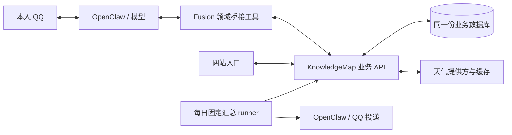

# KnowledgeMap 业务能力桥接

状态：**第一轮开发中**。日期：2026-10-17。本文负责天气、待做事项、记账接入的需求、架构、决策、实施与验收记录。阅读入口：[README.md](README.md)。

用户已于 2026-10-17 确认 Q01–Q04，并要求跨两个 Git 仓库做好版本隔离与今晚基线备份。第一轮完成天气、待做及记账新增/查询/月汇总；账单修改/删除属于第二轮，共享默认城市属于后续数据库整合迭代。文档 22 的论文/PDF/文件投递开发不属于本任务。

## 当前进度

- [x] 读取 `tp2.txt`、两仓库开发约定，核对相关 API、数据结构与 Git 工作区。
- [x] 写明需求、范围、推荐架构、可预见的决策与分层验收方案。
- [x] 得到 Q01–Q04 的决定，冻结第一轮业务与切换范围。
- [x] 保存两个仓库的今晚代码基线，建立独立开发分支/工作区。
- [x] 开发桥接工具和必要的业务 API 增强，在隔离环境完成测试。
- [ ] 经切换检查后部署，补充真实接口、模型及两入口一致性证据。
- [ ] 更新运行、验收与脚本索引，核对本次提交范围并收尾。

**当前阶段：P3–P4 合入、真实库迁移与切换。** 代码在独立工作区开发；真实业务数据尚未迁移。每个阶段开始与上下文压缩后先重读本文，更新实际结果。

## 1. 需求与交付范围

### 用户目标

网站和 QQ 助手作为两个入口，共用个人项目已经提供的业务能力与同一份业务数据。模型理解用户表达、查询事实、组织参数并调用工具；业务模块负责校验、执行、持久化，返回真实结果。用户无需知道表名、SQL 或内部记录 ID。

典型交互：

1. “我今天午饭吃了 14 块钱”——助手新增账单，网站 `/bills` 刷新后能看到；网站记下的账单，助手也能查询。
2. “把晾衣服那条去掉”——助手查询现存事项、确定目标、调用作废接口；网站与 QQ 查询反映同一状态。指代不唯一则澄清。
3. 通过 QQ 查询天气，使用个人项目提供的天气业务接口，明确地点、观测时间及数据是否可用。
4. 提醒列表继续支持可调整的每日播报时间与次数；播报的数据来源与日常查询保持一致。

| 模块 | 本轮计划 | 明确边界 |
| --- | --- | --- |
| 天气 | 地点查询、天气读取、失败与数据时效说明 | 默认地点与已有高级天气能力的处理见 Q04 |
| 待做事项 / 提醒列表 | 查询、新增、修改、完成、作废、恢复；衔接每日汇总 | 状态、无 DDL 表达和存量迁移见 Q01–Q02 |
| 记账 | 新增、查询、月度汇总；分类通过真实标签目录取得 | 修改与删除的开放范围见 Q03 |
| TradeSim | 暂不接入 | 模块尚未完成，本轮不包装或调用其接口 |
| Notes / 知识图谱 | 暂不接入 | `/notes` 的接法尚未确定 |

本轮不建设通用工作流引擎。模型可以先查列表/标签，再调用维护接口；以后对流程稳定、复杂且实测成功率不足的高频任务，另行评估固定工作流。

### 记录约定

遵循用户引用的 [tp2.txt](tp2.txt) 工作习惯：本文保留需求、当前状态、已定判断与理由、产物路径、测试结果、阻塞和必要纠错；不累积互相矛盾的旧计划。关键业务选择等待用户决定，独立方向可在获得继续开发指令后推进。

Fusion 的任务记录集中在本文；KnowledgeMap 的执行状态仍以其根目录 `/home/afrangry/repository/todolist.txt` 的稳定任务 ID 为准。若后续改动该项目，为其建立本地 API/测试契约文档，由本文件引用，不复制整套进度清单。

## 2. 已核实的代码现状

以下为 **2026-10-17 的源码核对结果**，不代表真实服务、数据库或端到端验收已经通过。

| 位置 | 已有能力与限制 | 对方案的影响 |
| --- | --- | --- |
| `/home/afrangry/repository/backend/app/routers/bill.py` | 账单增查改删、月度汇总；标签为可空外键 | 复用业务 API；金额、日期、标签含义由业务端校验，模型不编造标签 ID |
| 同仓库 `backend/app/schemas/bill.py` | 日期与正金额必需，支付信息等可空 | 简单记账不强迫补齐所有可选字段；金额使用十进制语义 |
| 同仓库 `backend/app/routers/calendar.py`、`crud/calendar.py` | 待做与安排两类；完成、作废分别记录；待做查询不限日期，逾期未完成仍保留 | 与助手原列表的自动过期规则存在差异，需要明确切换规则 |
| 同仓库 `backend/app/schemas/calendar.py` | `event_date` 必填，`event_time` 可空 | 无 DDL 不能未经说明就映射成“今天截止”；需确定兼容方案 |
| 同仓库 `backend/app/routers/weather.py` | 和风天气、城市搜索、当前天气与未来天气摘要 | 尚不能直接替代 Fusion 的全部天气能力 |
| `/home/afrangry/kurumi-fusion/chatbot/plugins/personal-weather/` | 已有天气简报及逐小时等组件，并承载位置、行程、一次性提醒相关能力 | 更换天气来源时应明确能力覆盖，不能整体移除插件来实现桥接 |
| `chatbot/plugins/personal-reminder-list/` | SQLite 业务项、版本/幂等、可空 DDL、自动过期及每日汇总 | 切换必须覆盖工具、调度器和独立 runner；只换聊天入口会形成两套事实 |
| `chatbot/packages/domain-adapters/` | 现有 Policy/Store 明确为同步契约，拒绝 Promise/thenable | HTTP 桥接需要显式异步应用边界，不能伪装成现有同步 Store |

KnowledgeMap 开发后端默认 `127.0.0.1:3085`，网站 `localhost:3000`；默认端口来自当前启动代码，开发前仍需核对实际监听。现有 `/api/health` 只表明进程存活，不证明数据库或天气上游可用。

现有可复用接口包括 `/api/bills/`、`/api/bills/summary/monthly`、`/api/tags/`、`/api/calendar-events/`、完成/作废子接口、`/api/dashboard/pending/`、`/api/weather/` 与城市搜索。**接口存在不等于已经满足桥接需要**：身份验证、写入幂等、并发版本、错误格式及数据完整性需要逐项核对和补足。

## 3. 推荐架构与职责

代码按此结构完成，真实部署/迁移尚待本轮切换验收。

- **模型**：理解真实请求，查询候选和标签，选择业务动作、目标与参数；含糊时询问。后端不重新用聊天动词正则来决定模型已经明确的业务动作。
- **Fusion 桥接层**：提供窄领域工具、可信本人上下文、固定服务地址的 HTTP 客户端、参数转换、超时/错误映射与链路关联。不给模型任意 HTTP、SQL 或数据库凭据。
- **KnowledgeMap 业务端**：拥有账单与待做事项的唯一业务事实；复用或完善校验、事务、状态规则、并发控制与防重复写入。桥接层不另建影子账本/待办表并双向同步。
- **调度与投递**：继续由 Fusion/OpenClaw 负责。播报时查询同一业务 API；本地可保留播报偏好、请求关联、投递账本，它们不构成第二份业务事项。

建议新增一个职责明确的桥接插件，内部按天气、待做、记账分工具与适配模块，共用 HTTP 客户端。具体工具名与文件划分在接口契约确定后写入本文；不先建设泛用的多系统插件框架。

### 写入与查询契约

1. 查询返回真实 ID、必要的版本/并发标记、明确总数与分页信息；目标定位由模型基于返回事实完成。
2. 写入关联可信请求和幂等键，业务端在同一事务中保存业务结果与幂等结果。响应丢失后按同一键核对，不能无条件重复 POST。
3. 已有项维护须能够发现“网站在查询后又改过这条”的冲突；冲突返回后重新查询，不静默覆盖。版本机制需覆盖网站与助手的写入口。
4. 错误区分参数不合法、未找到、并发冲突、重复请求、连接失败、结果未知；未取得确定结果时不宣称成功，也不静默改写到旧库。
5. 业务校验由个人项目统一承担；桥接可做传输契约检查，不复制另一套分类或事项状态规则。无必要字段先澄清，可空字段按业务契约留空。
6. 沿用现有确认共享件；本轮不重新设计全局确认机制。一次性提醒的带码确认保持原规则，新增账单/维护事项的权限边界按 Q03 及业务范围落实。

网络为异步调用。优先增加明确的异步应用服务与 API 适配边界，复用无 I/O 的规则；保持现有同步注册表契约有效。具体改造范围需在开发前列出，避免影响记忆、邮件等已使用该注册表的领域。

### 权限与日志

只开放本轮业务工具，不放宽 QQ 主 agent 的通用文件/命令能力。新增白名单键及具体业务写能力在实施方案中逐项列明，再按配置同步契约部署。

固定配置 KnowledgeMap 的服务地址，凭据仅在私密文件保存（本轮为 `~/.config/knowledgemap/assistant-token`，600）。需为助手访问定义独立认证与受限能力，不能把网站登录密钥交给模型，也不能把 CORS 当认证。沿用 [文档 18](18_跨模块链路日志查询.md) 的扩展方式关联 QQ 消息、run、工具、API 请求与业务记录 ID；日志隐藏凭据和不必要的个人正文。

## 4. 已确认决定与迭代范围

| 编号 | 用户决定（2026-10-17） | 本轮落实方式 |
| --- | --- | --- |
| Q01 | 默认采用网站待做规则；逾期仍待做、支持无 DDL、作废可恢复，Kurumi 侧相应调整 | 业务端统一状态；无 DDL 明确保存，不虚构今天截止；需要的字段/显示兼容由本轮完成 |
| Q02 | 同意存量切换 | 验证后迁移现存事项及状态，保留时刻、次数与暂停设置，工具与固定播报 runner 同批切换；旧库保留，不双写 |
| Q03 | 首期新增、查询、月汇总，明确记账直接保存；文档23第一轮闭环后再开放修改/删除 | 修改/删除列为本文第二轮迭代，不以首轮未开放当作遗漏；其确认/撤销细则第二轮补齐 |
| Q04 | 本轮不自动同步默认城市；后期整合数据库时读取同一数据库中的默认城市，可能第三轮 | 本轮共享天气查询并保留既有能力；统一偏好作为后续迭代，不默认改动当前城市 |

无 DDL 和“活动结束后”仍保留含义，不依据关联活动擅自生成截止时间；真实事件依赖/条件触发不在第一轮。TradeSim、Notes 不接入。关键新决策如确需用户判断，将单独标为阻塞；目前没有等待用户回答的阻塞。

## 5. 后续实施顺序

| 阶段 | 工作 | 进入下一阶段的依据 |
| --- | --- | --- |
| P1 契约冻结 | 按已确认 Q01–Q04 检查真实服务、API 与数据库结构；登记 KnowledgeMap 执行任务 ID；列清字段、动作、权限、错误与迁移映射 | 文档中的规则与两端现状无冲突；阻塞项有明确范围 |
| P2 业务 API 与客户端 | 补齐确有缺口的认证/校验/幂等/并发；开发固定地址异步客户端和窄领域工具 | 两端隔离契约测试通过，失败不会静默落入旧存储 |
| P3 逐域联通 | 先天气只读、记账查询，再记账写入与待做维护；复用现有业务规则 | 每域都有请求到实际业务结果的证据；只读成功不替代写入验收 |
| P4 列表与播报切换 | 迁移预览、逐项对照、切换工具和 runner；保存旧状态与映射；检查同一时刻防重复播报 | 数据数量/字段/状态可核对，全部待决映射已解决 |
| P5 端到端与收尾 | 验证网站与助手双向操作、真实模型路由、本人 QQ 投递及异常恢复；同步文档与索引 | 满足下文验收，提交仅含本任务内容，明确尚未覆盖范围 |

回退不能简单“重新启用旧库”：切换后新写入的事实可能只在 KnowledgeMap，回退前必须核对增量、暂停有关写入并决定保留方式。运行快照、恢复与远端推送按仓库既有授权规则执行，不纳入自动收尾。

## 6. 测试、产物与完成标准

### 测试计划

当前已完成首批隔离测试；具体结果见第8节，未列证据的层次仍待执行。测试优先使用隔离状态与临时数据库，不能清空真实账单或 `calendar_events`，不能将示例事项当真实数据导入。

| 层次 | 必测内容 | 证明范围 |
| --- | --- | --- |
| 业务端隔离 | 金额/标签、日期空值、状态、分页、认证、并发冲突、同键重试与不同参数拒绝、事务失败回滚 | 业务规则和接口契约；不等同真实 MySQL/QQ |
| 桥接层 | 固定地址、身份上下文、超时、错误结构、未知写入结果、参数映射；不允许任意 URL/SQL | 工具与 HTTP 客户端行为 |
| 同数据集集成 | 助手创建账单→网站 API 可见；网站创建账单→工具可查；待做双向维护与冲突 | 两入口操作同一记录，不以两份副本的相似结果替代 |
| 模型对话 | “午饭 14 元”、无 DDL、“活动后”、第几条/同名项、`/new` 后先查再维护、失败不谎报成功 | 模型真实选工具与参数能力；模拟工具通过不算真实接口通过 |
| 调度与迁移 | 查询与汇总同源、终态过滤、可改时刻/暂停、同 slot 防重、API 离线不播假列表、存量映射与重复导入 | 调度与数据切换契约；输出正文与 QQ 送达分别验证 |
| 真实入口 | 网站显示实际记录、本人 QQ 查询/维护/回执；天气地点、时效与失败情况 | 实际页面和频道链路；只向本人私聊，测试事项可追溯清理 |
| 相关回归 | 原一次性提醒/确认、天气与列表相关用例；Fusion 配置、人格、依赖与健康四项自检 | 既有能力与部署对齐，不声称所有领域均端到端通过 |

天气测试使用可控上游覆盖失败和缺失字段，真实上游另做只读冒烟。真实业务写入测试须使用明确测试标记、记录精确 ID 并按 ID 清理；保留审计，不对表做整体删除。

### 产物归属与索引

后续代码、测试和证据路径在实现时更新为精确文件；下表未附实施记录的条目仍属计划。

| 产物 | 计划位置与登记方式 |
| --- | --- |
| Fusion 桥接插件 | `chatbot/plugins/` 下独立模块；具体名称在 P1 冻结 |
| Fusion 新增测试 | `chatbot/tests/knowledgemap/`；每个文件头写 `对应文档：docs/23_KnowledgeMap业务能力桥接.md「测试计划」`，本文登记具体文件/命令/边界 |
| Fusion 后端辅助脚本 | `chatbot/scripts/`；同样有归属说明，登记 `docs/verification/SCRIPTS.md`；不向根目录或 archive 投放临时文件 |
| KnowledgeMap 改造 | `/home/afrangry/repository/backend/`；遵守该项目唯一 Base/Session、业务模块和文档约定 |
| KnowledgeMap 测试与辅助脚本 | 其 `backend/tests/`、`backend/scripts/`；文件头指向该仓库实际建立的配套契约文档并登记测试覆盖，执行 `check_doc_refs.py` |
| SQL | 有结构变化时保留定向迁移与 schema 更新；不执行带 DROP 的整库快照，不直接改真实数据作迁移替代 |
| 验收证据 | 实施时建立 `docs/verification/` 下任务专属目录，登记 `INDEX.md` 和证据覆盖规则；本轮不建空证据目录 |

完成条件：三个纳入领域的已确认范围均有实现和对应证据；网站与助手读写同一事实；原提醒播报衔接且不重复；权限/错误/并发/幂等有验证；迁移可核对；文档与实际部署一致；未覆盖及阻塞写清。不把“插件能加载”或“服务健康”作为功能全部通过的证据。

## 7. 并行开发与 Git 边界

只读调查起点：Fusion `df376ca9ee51d6ee1bd8fd39cf52883c72d2607e`（本地 main 当时领先远端 14）；KnowledgeMap `c70ba8b0dfa0c3dd333a072e25215aa0098dae06`（master 当时领先远端 1）。这些是带日期的观察，不是永久同步状态。

调查时两仓库已有其他开发改动：Fusion 为文档 22 对应论文/PDF/文件投递，涉及 `AGENTS.md`、QQ 代码、共享文档/证据索引等；KnowledgeMap 为账单界面重构，涉及 `Bills.vue`、顶栏、新背景组件、前端测试、文档 17、`todolist.txt` 等。对方仍可能继续写入，不能用最初清单推断后续文件都是本任务产物。

本任务不覆盖、暂存或提交这些改动。已在仓库外保存调查起点的私有差异留档，仅用于识别已有改动；它不是业务备份或恢复点。后续优先使用独立分支/工作区隔离实现；涉及共享入口时按具体差异核对，禁止 `git add .` 将他人的内容混入提交。既有未推送提交也不能当作本任务授权远端推送的依据。

今晚代码基线：`/home/afrangry/kurumi-backups/knowledgemap-bridge-2026-10-17-01-03-26/`。两个仓库各含 Git bundle、tracked/非忽略 untracked 工作树包、暂存/未暂存补丁、status 与 SHA256；bundle 验证成功，打包期间文件变化为 0。该包包含当时的文档22和账单UI未提交改动；忽略文件、凭据与业务数据另在变更前备份，不误称全量运行快照。恢复说明在该目录 README.md，必须在新目录演练，不覆盖并行开发现场。

开发工作区：`/home/afrangry/.codex/worktrees/knowledgemap-bridge/fusion`、`/home/afrangry/.codex/worktrees/knowledgemap-bridge/knowledgemap`；两仓库分支均为 `codex/knowledgemap-bridge`，从上述各自 HEAD 建立。部署前核对主工作区的新增提交和并行改动，按差异合入，只提交本任务内容。

## 8. 实施与验收记录

- **隔离开发**：网站新增专用认证 `/api/assistant/`，复用业务服务与同一 Base/Session，具备事务幂等和版本冲突；日期可空、备注独立保存，网页入口同样提交版本。计划使用独立 loopback `3086` 服务，避免日常助手依赖开发服务器。
- **Fusion**：`chatbot/packages/knowledgemap-client/` 固定地址异步客户端；`kurumi-knowledgemap` 提供记账工具；原列表插件显式异步共享模式，SQLite仅保留设置、请求与投递账本；天气适配保留原有解析与高级能力。通用同步领域注册表不变。
- **隔离结果**：业务API30/30、桥接22/22、真实本机HTTP双入口1组、网页6项通过；网站与天气TS构建通过；既有日历114/114、账单13/13、仪表盘55/55、天气24/24、列表/日志Node54/54通过。真实模型6/6、隔离OpenClaw宿主6/6（含真实/new及修改时刻生成2个共享Cron）；无真实QQ或生产写入。
- **数据恢复资料**：今晚基线 `private-state/` 已保存MySQL一致性导出、6个SQLite在线备份、3份私密配置和SHA256；已在临时目录恢复Git文件548+204并逐字节核对，6库quick_check通过；MySQL完整备份在唯一临时库恢复后验证定向迁移、行数保留、双会话版本冲突和并发同键只落一笔。真实结构和事项尚未迁移。
- **下一步**：保留并行改动，选择性合入两仓库、运行定向DDL、导入预览/核对后原子启用持久切换标记；启动专用API并同步生产配置，验证工具/runner/本人投递和最终索引。

2026-10-17 第一轮启动：收到用户明确决定，完成代码基线和独立工作区；实际检查助手列表共 14 项（active 4、completed 4、expired 4、void 2），其中 active 无 DDL 2 项。此处只登记数量，不把私有正文写入仓库。旧 expired 的迁移将保持历史退出有效列表，不自动复活；新写入采用网站逾期仍待做规则。若预览发现不能保真映射的资料，先阻塞该条，不猜测。

返回[文档入口](README.md)。

## 迁移与切换

1. 验证今晚备份后，KnowledgeMap `backend/scripts/migrate_assistant.py --apply --backup-dir <今晚基线>` 只修改日期可空并添加note/version与请求/来源表；定向SQL留在 `backend/sql/assistant_bridge.sql`。MySQL DDL非事务，脚本按存在性可重跑；不改原业务行。
2. 安装 `backend/scripts/knowledgemap-assistant.service`，专用API监听127.0.0.1:3086，token文件600；数据库和天气配置读取网站同一backend/.env。
3. 暂停旧列表写入，运行 `chatbot/scripts/import-knowledgemap-list.mjs --source <旧列表绝对库路径>` 默认预览。来源hash和网站冲突均需核对，不能相似标题自动合并；重复来源ID不重复建行。
4. `--apply --expect-source-hash <预览hash> --backup-dir <今晚基线> --activate` 保存来源映射，核对源数据未变后原子写入 `state/personal-reminder-list/data-source.json`。旧expired/void保持归档，completed保留完成；原始字段和版本保存在来源表，业务行使用网站版本。
5. 持久标记保证旧Cron即使没有新环境变量也走共享API；SQLite旧items读写拒绝。再同步配置/人格并启动Fusion，调度器将原声明更新为共享runner；相同slot的历史投递账本不重置。
6. 核对14项映射、两入口、设置与声明、旧项逻辑hash、API失败不旧库回退、本人私聊投递和四项自检。若导入发现真实歧义，阻塞那条迁移，不猜测。

## 备份与恢复演练

恢复测试：`node chatbot/tests/knowledgemap/recovery.mjs --backup-dir <今晚基线>`；MySQL恢复与并发在网站 `backend/tests/assistant_mysql_cases.py --backup-dir ... --env-file ...`。只在独立目录/唯一临时库操作，生产库不DROP。压缩包SHA256针对gzip字节，另验证解压完整性。

回退代码与数据分开：先暂停桥接写入并保存切换后的共享库/状态；今晚Git bundle+工作树包可恢复两端代码及当时未提交工作。添加的兼容列/表可以保留；恢复旧列表前核对KnowledgeMap新增/修改的事项增量，不能仅删除切换标记或把旧备份覆盖新业务事实。token、backend/.env、运行配置需私密备份。远端不推送。

### 本轮产物登记

| 路径 | 用途与边界 |
| --- | --- |
| `chatbot/packages/knowledgemap-client/{client,inbound}.js` | 固定地址异步传输、可信当前请求；错误/分页/日志，不包含业务SQL |
| `chatbot/plugins/kurumi-knowledgemap/` | `knowledge_bills_get` 与 `knowledge_bill_add`，仅第一轮权限 |
| `chatbot/plugins/personal-reminder-list/{remote,data-source}.js` | 共享业务与本地播报控制、持久切换保护 |
| `chatbot/plugins/personal-weather/src/knowledgemap-client.ts` | 既有天气接口的API适配，保留解析/逐小时/预警能力 |
| `chatbot/scripts/import-knowledgemap-list.mjs` | 只读来源/默认预览；apply写共享库，activate写私密切换标记 |
| `chatbot/tests/knowledgemap/bridge.test.mjs` | 离线22项，含失败/防重/设置竞态/旧runner防旧写 |
| `chatbot/tests/knowledgemap/http.test.mjs` | 本机真实HTTP→独立FastAPI/SQLite，两入口数据一致 |
| `chatbot/tests/knowledgemap/acceptance-model.mjs` | 真实模型6组+实际工具，合成可信钩子与隔离API，不证明完整宿主 |
| `chatbot/tests/knowledgemap/acceptance-host.mjs` | 真实模型+独立OpenClaw+mockOneBot+临时API，6组；不发QQ |
| `chatbot/tests/knowledgemap/recovery.mjs` | Git/SQLite恢复演练，不改生产、不启动旧系统 |
| 网站 `backend/tests/assistant_*`、`backend/scripts/{migrate_assistant,serve_assistant}.py` | 精确命令/边界见网站文档18「测试与脚本」，本文件不重复清单 |
| `docs/verification/knowledgemap-bridge-2026-10-17/` | 本轮证据，README说明边界；登记INDEX/SCRIPTS与分类脚本 |
