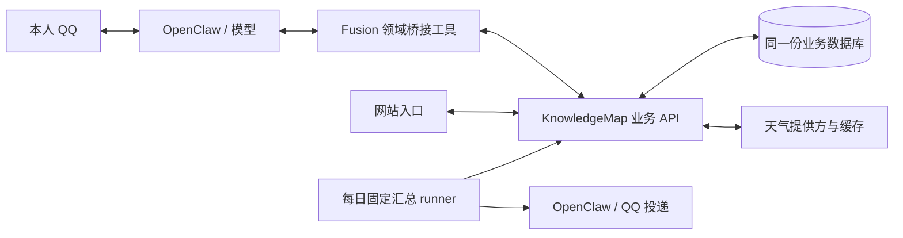

# KnowledgeMap 业务能力桥接

类型：跨项目接口规则与迁移手册。状态：**天气、共享事项与账单完整维护已部署；共享默认城市仍为后续迭代。** 验收结论见[文档16](16_验收与测试总表.md#分领域验收摘要)。实现范围沿用既有记录；2026-10-23整理过程与规则的边界。本文负责跨项目桥接、接口、迁移、配对恢复和记账规则；提醒列表/播报的用户规则唯一归[文档19](19_提醒列表与定时汇总.md)。阅读入口：[README.md](README.md)。

本文先说明当前业务、接口和执行契约，再列迁移、切换、备份、恢复和回退。开发轮次通过[历史证据与版本](#历史证据与版本)追溯，不作为当前能力的阅读顺序。业务API精确路由和SQL由KnowledgeMap仓库文档18维护；提醒列表用户规则归[文档19](19_提醒列表与定时汇总.md)。

## 需求与交付范围

网站和 QQ 助手作为两个入口，共用个人项目已经提供的业务能力与同一份业务数据。模型理解用户表达、查询事实、组织参数并调用工具；业务模块负责校验、执行、持久化，返回真实结果。用户无需知道表名、SQL 或内部记录 ID。

典型交互：

1. “我今天午饭吃了 14 块钱”——助手新增账单，网站 `/bills` 刷新后能看到；网站记下的账单，助手也能查询。
2. “把晾衣服那条去掉”——助手查询现存事项、确定目标、调用作废接口；网站与 QQ 查询反映同一状态。指代不唯一则澄清。
3. 通过 QQ 查询天气，使用个人项目提供的天气业务接口，明确地点、观测时间及数据是否可用。
4. 提醒列表继续支持可调整的每日播报时间与次数；播报的数据来源与日常查询保持一致。

| 模块 | 当前交付 | 明确边界 |
| --- | --- | --- |
| 天气 | 地点查询、天气读取、失败与数据时效说明 | 默认地点与已有高级天气能力的处理见 Q04 |
| 待做事项 / 提醒列表 | 查询、新增、修改、完成、作废、恢复；衔接每日汇总 | 状态、无 DDL 表达和存量迁移见 Q01–Q02 |
| 记账 | 新增、查询、月度汇总、单笔修改与实际删除；分类通过真实标签目录取得 | 唯一目标直接执行，歧义澄清；不批量、不承诺删除撤销，规则见[账单完整维护](#账单完整维护) |
| TradeSim | 暂不接入 | 模块尚未完成，当前范围不包装或调用其接口 |
| Notes / 知识图谱 | 暂不接入 | `/notes` 的接法尚未确定 |

当前范围不建设通用工作流引擎。模型可以先查列表/标签，再调用维护接口；以后对流程稳定、复杂且实测成功率不足的高频任务，另行评估固定工作流。

## 接口与运行边界

常驻专用API为`127.0.0.1:3086`，由`knowledgemap-assistant.service`运行；它读取网站同一业务数据库和后端配置。网站`localhost:3000`、开发后端默认`127.0.0.1:3085`不是助手日常依赖入口；`/api/health`只证明进程存活。

天气、账单、标签、日历和仪表盘能力由KnowledgeMap业务端持有，助手通过专用认证的`/api/assistant/`访问，不能取得任意HTTP/SQL工具或数据库密码。日期可空、备注、版本和幂等已按本次接口增强落实；网站同样提交版本。业务端精确路由、SQL和测试只在 `/home/afrangry/repository/docs/18_助手业务接口与共享数据.md`维护。

Fusion同步Policy/Store拒绝Promise/thenable，不能拿HTTP驱动冒充同步Store。共享待做走显式异步应用边界，本地仅保留播报/请求/投递控制，详见下节和文档19。

本文的**runner**是原生Cron按固定payload启动的独立汇总程序，直接读业务API、不调用模型；完整定义见[文档21](21_后端职责分层与代码整理.md#术语)。**slot**是一轮计划播报，键为“日期 + 设定时刻（HH:mm）”；同一slot只生成一次播报，重复触发不再发送。

## 当前业务与执行契约

### 架构与职责

代码与实际部署均按此结构；各层验收边界分别记录。

- **模型**：理解真实请求，查询候选和标签，选择业务动作、目标与参数；含糊时询问。后端不重新用聊天动词正则来决定模型已经明确的业务动作。
- **Fusion 桥接层**：提供窄领域工具、可信本人上下文、固定服务地址的 HTTP 客户端、参数转换、超时/错误映射与链路关联。不给模型任意 HTTP、SQL 或数据库凭据。
- **KnowledgeMap 业务端**：拥有账单与待做事项的唯一业务事实；复用或完善校验、事务、状态规则、并发控制与防重复写入。桥接层不另建影子账本/待办表并双向同步。
- **调度与投递**：继续由 Fusion/OpenClaw 负责。播报时查询同一业务 API；本地可保留播报偏好、请求关联、投递账本，它们不构成第二份业务事项。

记账由 `kurumi-knowledgemap` 插件提供三份窄工具（查询、新增、维护），待做与天气保留原领域工具名称并接入API适配；三者共用异步HTTP客户端。不引入通用工作流引擎或另一套同步机制。

### 写入、查询、版本与幂等

1. 查询返回真实 ID、必要的版本/并发标记、明确总数与分页信息；目标定位由模型基于返回事实完成。
2. 写入关联可信请求和幂等键，业务端在同一事务中保存业务结果与幂等结果。响应丢失后按同一键核对，不能无条件重复 POST。
3. 已有项维护须能够发现“网站在查询后又改过这条”的冲突；冲突返回后重新查询，不静默覆盖。版本机制需覆盖网站与助手的写入口。
4. 错误区分参数不合法、未找到、并发冲突、重复请求、连接失败、结果未知；未取得确定结果时不宣称成功，也不静默改写到旧库。
5. 业务校验由个人项目统一承担；桥接可做传输契约检查，不复制另一套分类或事项状态规则。无必要字段先澄清，可空字段按业务契约留空。
6. 沿用现有确认共享件；不重新设计全局确认机制。一次性提醒的带码确认保持原规则，新增账单/维护事项的权限边界按 Q03 及业务范围落实。

共享网络调用由异步应用服务与API适配承接，复用无I/O规则；同步注册表契约保持不变。后续扩展仍需先列清影响范围，避免波及记忆、邮件等同步消费者。

### 账单完整维护

- 用户已确认：明确且唯一的单笔修改、删除直接执行；先查真实记录和版本，指代有歧义先澄清，不开放批量删除。删除沿用网站实际删除规则；不是作废或回收站，不承诺撤销，保留请求回执与删除前快照供审计。一次性提醒的带码确认不变。
- KnowledgeMap 继续拥有唯一业务数据及校验。账单增加共享版本，网站编辑/删除携带读取时版本；助手按ID及版本维护，冲突重新查询，不覆盖新事实。业务写入与幂等回执同事务。
- 新增保留现有 `knowledge_bill_add`；查询补单条和备注筛选；增设窄工具 `knowledge_bill_manage(action=update|delete)`。后端消费结构化动作，不解析聊天动词。单条维护保存前后快照；首期只支持一次消息一笔。
- 提升工具说明及模型实际可见参数提示，不把模型字段错误静默改写成合法写入。用真实宿主首次调用证据评估，不能保证模型永不犯错。
- 从受支持的真实工具调用上下文取得runId，贯穿HTTP头、API日志和旁路事件；不伪造runId或只在测试夹具塞字段。
- 默认城市共库、TradeSim、Notes、批量账单维护、网站视觉重构与论文业务不在已交付范围。

### 权限与真实runId

业务工具按[文档24](24_统一身份与权限管理.md)逐项授权，记账/待做/天气仍owner-only；不放宽QQ主agent的通用文件/命令能力，配置只经同步契约部署。

固定配置 KnowledgeMap 的服务地址，凭据仅在私密文件保存（位置为 `~/.config/knowledgemap/assistant-token`，600）。助手访问使用独立认证与受限能力，不能把网站登录密钥交给模型，也不能把CORS当认证。沿用 [文档 18](18_跨模块链路日志查询.md) 的扩展方式关联 QQ 消息、run、工具、API 请求与业务记录 ID；日志隐藏凭据和不必要的个人正文。

真实runId由共享[tool-trace.js](../chatbot/packages/knowledgemap-client/tool-trace.js)在宿主before/after_tool_call钩子中，按可信会话与真实toolCallId关联，并在完成或重置时清理。工厂上下文不提供runId；模型参数不参与生成。账单、事项、天气复用该关联，HTTP头、旁路事件和业务写日志使用同一值。固定Cron没有对话run时允许留空，不伪造。关联强度与查询入口见[文档18](18_跨模块链路日志查询.md#适配器与关联规则)。

### 已确认的范围决定

| 编号 | 用户决定（2026-10-17） | 有效决定与对应规则 |
| --- | --- | --- |
| Q01 | 默认采用网站待做规则，Kurumi侧相应调整 | 已实现，唯一业务规则见[文档19](19_提醒列表与定时汇总.md#当前规则)，本文件不维护第二份状态/DDL规范 |
| Q02 | 同意存量切换 | 验证后迁移现存事项及状态，保留时刻、次数与暂停设置，工具与固定播报 runner 同批切换；旧库保留，不双写 |
| Q03 | 首期新增、查询、月汇总；首轮闭环后开放修改/删除；用户进一步确认明确唯一单笔直接执行 | 已落实真实ID/version、实际删除、歧义澄清和事务幂等；不新增带码确认、批量或撤销 |
| Q04 | 本需求不自动同步默认城市；后期整合数据库时读取同一数据库中的默认城市，可能第三轮 | 本需求共享天气查询并保留既有能力；统一偏好作为后续迭代，不默认改动当前城市 |

事项字段、逾期/无DDL/活动条件和恢复规则统一引用文档19；本桥接不另定义状态语义。TradeSim、Notes不接入。关键新决策如确需用户判断，将单独标为阻塞；目前没有等待用户回答的阻塞。

## 迁移

以下是首次切换的可复验步骤；已迁移生产不能将示例当日常重置。历史14项映射见原阶段记录，操作前重新预览本次来源并核对哈希。

1. 验证本次获授权的变更前备份后，KnowledgeMap `backend/scripts/migrate_assistant.py --apply --backup-dir <变更前基线绝对路径>` 只修改日期可空并添加note/version与请求/来源表；定向SQL留在 `backend/sql/assistant_bridge.sql`。MySQL DDL非事务，脚本按存在性可重跑；不改原业务行。
2. 安装 `backend/scripts/knowledgemap-assistant.service`，专用API监听127.0.0.1:3086，token文件600；数据库和天气配置读取网站同一backend/.env。
3. 暂停旧列表写入；CLI通过 `KURUMI_KM_BASE_URL=http://127.0.0.1:3086 KURUMI_KM_TOKEN_FILE=/home/afrangry/.config/knowledgemap/assistant-token OPENCLAW_STATE_DIR=/home/afrangry/.openclaw-fusion` 指定连接和来源目录。运行 `chatbot/scripts/import-knowledgemap-list.mjs --source <旧列表绝对库路径>` 默认预览。来源hash和网站冲突均需核对，不能相似标题自动合并；重复来源ID不重复建行。

## 切换与回退约束

迁移写入和`--activate`在下列同一次导入中执行；先完成上一节的来源预览、哈希核对与授权备份。

4. `--apply --expect-source-hash <预览hash> --backup-dir <变更前基线绝对路径> --activate` 保存来源映射，核对源数据未变后原子写入 `state/personal-reminder-list/data-source.json`。旧expired/void保持归档，completed保留完成；原始字段和版本保存在来源表，业务行使用网站版本。
5. 持久标记保证旧Cron即使没有新环境变量也走共享API；SQLite旧items读写拒绝。再同步配置/人格并启动Fusion，调度器将原声明更新为共享runner；相同slot的历史投递账本不重置。
6. 核对本次预览的全部映射（首轮14项见阶段记录）、两入口、设置与声明、旧项逻辑hash、API失败不旧库回退、本人私聊投递和四项自检。若导入发现真实歧义，阻塞那条迁移，不猜测。

工具、调度器和独立runner必须同批切换；持久`data-source.json`约束旧Cron，不从旧SQLite业务表静默回退，设置和投递账本仍由本地维护。具体读写分工在文档19，来源预览见[迁移](#迁移)，激活步骤在本节维护。

回退代码不能简单重新启用旧库：先暂停有关写入，备份共享状态并核对增量，再决定保留方式。完整恢复需要Fusion材料、KnowledgeMap MySQL、环境及专用token；配对备份不是同一时刻停写。运行快照、停机和远端推送按实际授权执行。

回退代码与数据分开：先暂停桥接写入并保存切换后的共享库/状态；上述Git bundle+工作树包可恢复两端代码及当时未提交工作。添加的兼容列/表可以保留；恢复旧列表前核对KnowledgeMap新增/修改的事项增量，不能仅删除切换标记或把旧备份覆盖新业务事实。token、backend/.env、运行配置需私密备份。远端不推送。

## 备份

Fusion与KnowledgeMap分别采集代码、配置及私密状态；Fusion SQLite快照不包含共享MySQL。分时配对不等于跨系统同一时刻停写。代码备份脚本`chatbot/scripts/backup-knowledgemap-code.mjs`保存两端Git bundle、工作树、独立index和patch，不停止服务，也不包含忽略文件或数据库；MySQL另用业务端`backup_assistant.py`。

### 配对资料与恢复范围

切换后资料配对保留（不是跨系统同一时刻停写快照）：

| 资料 | 绝对路径与验证 |
| --- | --- |
| KnowledgeMap共享库及私密配置 | `/home/afrangry/kurumi-backups/knowledgemap-bridge-2026-10-17-post-cutover/`；`backend/scripts/backup_assistant.py` 的MySQL single-transaction导出。独立临时库完整恢复、迁移二次无操作、双会话冲突、并发同键写入均通过；恢复数量与用例数见第一轮证据 `recovery.json` |
| Fusion源码和运行材料 | `/home/afrangry/kurumi-backups/2026-10-16-18-07-42-knowledgemap-post-cutover/`；源提交`4f26366`加当时未提交补丁/未跟踪文件，含并行工作现场；`quiesced=false`，SQLite全部健康，manifest项全部匹配。修正依赖装配后的隔离Gateway/导入/模拟投递/项目检查全部通过，不含共享MySQL；数量见第一轮证据 `recovery.json` |

切换后的代码收尾包含查询runId关联、恢复装配修复、脚本索引和本文件结论，晚于上述备份；从Git中的本任务收尾提交恢复这些工具。备份本身不改写为“最新提交、跨库全静止”。原始演练目录仅是私密临时产物，持久证据见专项目录`recovery.json`和README。

### 账单完整维护的代码与MySQL资料

| 材料 | 保留位置与范围 |
| --- | --- |
| 代码与并行工作现场 | `/home/afrangry/kurumi-backups/knowledgemap-bills-round2-2026-10-17-code/`；采集Fusion `c1844dd`、KnowledgeMap `27f4519`及当时工作树/index，代码恢复逐项核对通过 |
| MySQL与私密配置 | `/home/afrangry/kurumi-backups/knowledgemap-bills-round2-2026-10-17-mysql/`；临时库完整恢复与迁移/并发用例见第二轮报告 |

两者分时采集，不是跨系统停写快照；账单维护实现提交需与这些资料配合。没有包含账单维护新增状态的Fusion全量快照，旧快照不能冒称覆盖。模型字段/分类选择仍可能出错，后端严格拒绝；无真人手机连续对话或该轮QQ新增外发验收。共享默认城市、TradeSim、Notes、批量与删除撤销仍不在已交付范围。

## 恢复验证

恢复测试：`node chatbot/tests/knowledgemap/recovery.mjs --backup-dir <变更前基线绝对路径>`；MySQL恢复与并发在网站 `backend/tests/assistant_mysql_cases.py --backup-dir ... --env-file ...`。只在独立目录/唯一临时库操作，生产库不DROP。压缩包SHA256针对gzip字节，另验证解压完整性。

完整Fusion演练命令：`node scripts/fusion/restore-verify.mjs --backup <Fusion备份绝对路径>`。恢复副本使用不可用共享API和假token，禁Cron、真实投递和付费翻译；测试不访问真实业务。`scripts/fusion/lib/package-manifests.mjs`只读发现仓库自有锁文件包，由依赖自检和恢复器共同使用，避免新插件漏装。

材料、模拟链路、真实依赖和同一时点停写分别记录。使用上节登记的配对资料，不得恢复到生产库或以删除切换标记代替回退。统一标准见[文档16](16_验收与测试总表.md#恢复点与证明范围)。

## 代码与脚本入口

| 路径 | 用途与边界 |
| --- | --- |
| `chatbot/packages/knowledgemap-client/{client,inbound}.js` | 固定地址异步传输、可信当前请求；错误/分页/日志，不包含业务SQL |
| `chatbot/plugins/kurumi-knowledgemap/` | `knowledge_bills_get`、`knowledge_bill_add`、`knowledge_bill_manage`，增查改删三工具及manifest声明一致 |
| `chatbot/packages/knowledgemap-client/tool-trace.{js,d.ts}` | 会话/调用精确关联真实宿主runId，三领域复用，不参与授权 |
| `chatbot/plugins/personal-reminder-list/{remote,data-source}.js` | 共享业务与本地播报控制、持久切换保护 |
| `chatbot/packages/personal-domains/src/knowledgemap-client.ts` | 天气/默认城市的API适配，保留解析/逐小时/预警能力；天气与Profile独立插件的装配归属见文档21 |
| `chatbot/scripts/import-knowledgemap-list.mjs` | 只读来源/默认预览；apply写共享库，activate写私密切换标记 |
| `chatbot/tests/knowledgemap/bridge.test.mjs` | 离线用例，含播报失败/防重/设置竞态/非到期时刻与暂停不查询/空列表只记skipped/播报文本格式与中性措辞/旧runner防旧写/共享模式工具声明 |
| `chatbot/tests/knowledgemap/http.test.mjs` | 本机真实HTTP→独立FastAPI/SQLite，两入口数据一致 |
| `chatbot/tests/knowledgemap/acceptance-model.mjs` | 真实模型对话组+实际工具，合成可信钩子与隔离API，不证明完整宿主 |
| `chatbot/tests/knowledgemap/acceptance-host.mjs` | 真实模型+独立OpenClaw+mockOneBot+临时API；默认跑第一轮用例，`--bills-round2`跑第二轮账单用例，不发QQ |
| `chatbot/tests/knowledgemap/acceptance-live.mjs` | `--live --qq` 才执行真实模型/API/MySQL/网页与本人QQ；短暂启用测试入口并恢复，只清理精确标记测试行，保留回执 |
| `chatbot/tests/knowledgemap/recovery.mjs` | Git/SQLite恢复演练，不改生产、不启动旧系统 |
| `chatbot/tests/knowledgemap/bills.test.mjs`、`acceptance-bills-live.mjs` | 第二轮离线声明/可信上下文用例；显式`--live --out <新文件>`验证真实模型/API/MySQL/网页/天气，无QQ外发，精确清理测试账单并关闭测试入口 |
| `scripts/fusion/lib/package-manifests.mjs`、`scripts/fusion/test/recovery.test.mjs` | 依赖包发现与恢复装配回归，归属本文件「备份与恢复演练」；不修改邮件/PDF业务 |
| 网站 `backend/tests/assistant_*`、`backend/scripts/{migrate_assistant,serve_assistant}.py` | 精确命令/边界见网站文档18「测试与脚本」，本文件不重复清单 |
| `docs/verification/knowledgemap-bridge-2026-10-17/` | 首轮证据，README说明边界；登记INDEX/SCRIPTS与分类脚本 |

## 验收计划与产物归属

已执行的结果见[历史证据与版本](#历史证据与版本)和专项证据；下表同时规定今后回归需要覆盖的边界。测试优先使用隔离状态与临时数据库，不能清空真实账单或 `calendar_events`，不能将示例事项当真实数据导入。

| 层次 | 必测内容 | 证明范围 |
| --- | --- | --- |
| 业务端隔离 | 金额/标签、日期空值、状态、分页、认证、并发冲突、同键重试与不同参数拒绝、事务失败回滚 | 业务规则和接口契约；不等同真实 MySQL/QQ |
| 桥接层 | 固定地址、身份上下文、超时、错误结构、未知写入结果、参数映射；不允许任意 URL/SQL | 工具与 HTTP 客户端行为 |
| 同数据集集成 | 助手创建账单→网站 API 可见；网站创建账单→工具可查；待做双向维护与冲突 | 两入口操作同一记录，不以两份副本的相似结果替代 |
| 模型对话 | “午饭 14 元”、无 DDL、“活动后”、第几条/同名项、`/new` 后先查再维护、失败不谎报成功 | 模型真实选工具与参数能力；模拟工具通过不算真实接口通过 |
| 调度与迁移 | 查询与汇总同源、终态过滤、可改时刻/暂停、同 slot 防重、API 离线不播假列表、存量映射与重复导入 | 调度与数据切换契约；输出正文与 QQ 送达分别验证 |
| 真实入口 | 网站显示实际记录、本人 QQ 查询/维护/回执；天气地点、时效与失败情况 | 实际页面和频道链路；只向本人私聊，测试事项可追溯清理 |
| 相关回归 | 原一次性提醒/确认、天气与列表相关用例；Fusion 配置、人格、依赖与健康四项自检 | 既有能力与部署对齐，不声称所有领域均端到端通过 |

天气测试使用可控上游覆盖失败和缺失字段，真实上游另做只读冒烟。真实业务写入测试须使用明确测试标记、记录精确 ID 并按 ID 清理；保留审计，不对表做整体删除。

### 记录与完成标准

精确产物和脚本清单见[代码与脚本入口](#代码与脚本入口)。归属规则：

- Fusion领域脚本在 `chatbot/scripts/`，测试在 `chatbot/tests/knowledgemap/`；按文件或套件在 `scripts/fusion/documentation-map.json`关联本文件，登记 `verification/SCRIPTS.md`。
- KnowledgeMap脚本、测试、SQL分别在其 `backend/scripts/`、`backend/tests/`、`backend/sql/`；反向引用该项目文档18，执行 `check_doc_refs.py`。
- 证据放专项目录并登记INDEX和可执行分类；没有向archive或根目录投放测试文件。不执行含DROP的schema快照升级真实库。

完成条件：三个纳入领域的已确认范围均有实现和对应证据；网站与助手读写同一事实；原提醒播报衔接且不重复；权限/错误/并发/幂等有验证；迁移可核对；文档与实际部署一致；未覆盖及阻塞写清。不把“插件能加载”或“服务健康”作为功能全部通过的证据。

## 历史证据与版本

| 阶段 | 来源版本与证据 |
| --- | --- |
| 天气、共享待做、记账首轮 | Fusion `4f26366` / KnowledgeMap `a311fe8`；[原专项报告](verification/knowledgemap-bridge-2026-10-17/README.md) |
| 账单完整维护与真实runId | Fusion `97ed797` / KnowledgeMap `1efec0e`；[第二轮报告](verification/knowledgemap-bills-round2-2026-10-17/README.md) |

详细实施、存量计数、错误修复和部署过程见[阶段记录](archive/documentation-2026-10-23/23_KnowledgeMap业务能力桥接.md)。原始失败回执保持不变；真人手机、合成入站、隔离模型/API和QQ实际送达分别说明，不互相替代。当前验收摘要归[文档16](16_验收与测试总表.md)。

Fusion任务排期归[待办清单](待办清单.md)；KnowledgeMap执行项仍以其`/home/afrangry/repository/todolist.txt`的稳定任务ID为准。两仓库代码与Git边界、当时工作树及部署记录见[阶段记录](archive/documentation-2026-10-23/23_KnowledgeMap业务能力桥接.md)。当前HEAD/工作区/远端按[文档12](12_目录资产与Git备份整理.md#git-与实时状态查询)重新查询，不能由历史代码包推断已提交推送或完整恢复。

## 后续迭代与未覆盖范围

- **后续数据库整合**：两端默认城市读取同库设置；当前范围只共享天气业务API，Profile与网站偏好仍独立。
- **未覆盖**：真人从手机发起的完整往返、持续多轮真实聊天、整天四个时段连续播报、长期压力和长时间服务故障恢复。单次QQ送达、隔离故障回归与全量恢复演练不能代替这些验证。
- **不在范围**：TradeSim、Notes、条件事件触发、通用工作流引擎。当前无等待用户决定的首轮阻塞。

返回[文档入口](README.md)。
