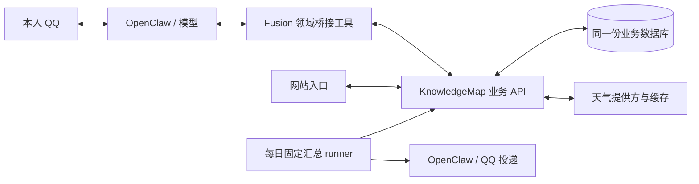

# KnowledgeMap 业务能力桥接

状态：**第一、第二轮均已验收并部署**。日期：2026-10-17。本文负责跨项目桥接、接口、迁移、配对恢复和记账规则；提醒列表/播报的用户规则唯一归[文档19](19_提醒列表与定时汇总.md)。阅读入口：[README.md](README.md)。

用户已于 2026-10-17 确认 Q01–Q04，并要求跨两个 Git 仓库做好版本隔离与今晚基线备份。第一轮完成天气、待做及记账新增/查询/月汇总；账单修改/删除属于第二轮，共享默认城市属于后续数据库整合迭代。文档 22 的论文/PDF/文件投递开发不属于本任务。

**当前阶段：两轮已闭环。** 14项存量及播报已切换，账单支持增删改查/月汇总和真实runId关联。各层结果见第8/10节；共享默认城市仍待后续整合，长期真人体验不由单次冒烟推断。

## 1. 需求与交付范围

### 用户目标

网站和 QQ 助手作为两个入口，共用个人项目已经提供的业务能力与同一份业务数据。模型理解用户表达、查询事实、组织参数并调用工具；业务模块负责校验、执行、持久化，返回真实结果。用户无需知道表名、SQL 或内部记录 ID。

典型交互：

1. “我今天午饭吃了 14 块钱”——助手新增账单，网站 `/bills` 刷新后能看到；网站记下的账单，助手也能查询。
2. “把晾衣服那条去掉”——助手查询现存事项、确定目标、调用作废接口；网站与 QQ 查询反映同一状态。指代不唯一则澄清。
3. 通过 QQ 查询天气，使用个人项目提供的天气业务接口，明确地点、观测时间及数据是否可用。
4. 提醒列表继续支持可调整的每日播报时间与次数；播报的数据来源与日常查询保持一致。

| 模块 | 当前交付 | 明确边界 |
| --- | --- | --- |
| 天气 | 地点查询、天气读取、失败与数据时效说明 | 默认地点与已有高级天气能力的处理见 Q04 |
| 待做事项 / 提醒列表 | 查询、新增、修改、完成、作废、恢复；衔接每日汇总 | 状态、无 DDL 表达和存量迁移见 Q01–Q02 |
| 记账 | 新增、查询、月度汇总、单笔修改与实际删除；分类通过真实标签目录取得 | 唯一目标直接执行，歧义澄清；不批量、不承诺删除撤销，第二轮规则见第10节 |
| TradeSim | 暂不接入 | 模块尚未完成，本轮不包装或调用其接口 |
| Notes / 知识图谱 | 暂不接入 | `/notes` 的接法尚未确定 |

本轮不建设通用工作流引擎。模型可以先查列表/标签，再调用维护接口；以后对流程稳定、复杂且实测成功率不足的高频任务，另行评估固定工作流。

### 记录约定

遵循用户引用的 [tp2.txt](tp2.txt) 工作习惯：本文保留需求、当前状态、已定判断与理由、产物路径、测试结果、阻塞和必要纠错；不累积互相矛盾的旧计划。关键业务选择等待用户决定，独立方向可在获得继续开发指令后推进。

Fusion 的任务记录集中在本文；KnowledgeMap 的执行状态仍以其根目录 `/home/afrangry/repository/todolist.txt` 的稳定任务 ID 为准。业务API/测试契约见该库 `docs/18_助手业务接口与共享数据.md`，本文件只引用，不复制整套进度清单。

## 2. 接口与运行边界

常驻专用API为`127.0.0.1:3086`，由`knowledgemap-assistant.service`运行；它读取网站同一业务数据库和后端配置。网站`localhost:3000`、开发后端默认`127.0.0.1:3085`不是助手日常依赖入口；`/api/health`只证明进程存活。

天气、账单、标签、日历和仪表盘能力由KnowledgeMap业务端持有，助手通过专用认证的`/api/assistant/`访问，不能取得任意HTTP/SQL工具或数据库密码。日期可空、备注、版本和幂等已按本次接口增强落实；网站同样提交版本。业务端精确路由、SQL和测试只在 `/home/afrangry/repository/docs/18_助手业务接口与共享数据.md`维护。

Fusion同步Policy/Store拒绝Promise/thenable，不能拿HTTP驱动冒充同步Store。共享待做走显式异步应用边界，本地仅保留播报/请求/投递控制，详见下节和文档19。

## 3. 架构与职责

代码与实际部署均按此结构；各层验收边界分别记录。

- **模型**：理解真实请求，查询候选和标签，选择业务动作、目标与参数；含糊时询问。后端不重新用聊天动词正则来决定模型已经明确的业务动作。
- **Fusion 桥接层**：提供窄领域工具、可信本人上下文、固定服务地址的 HTTP 客户端、参数转换、超时/错误映射与链路关联。不给模型任意 HTTP、SQL 或数据库凭据。
- **KnowledgeMap 业务端**：拥有账单与待做事项的唯一业务事实；复用或完善校验、事务、状态规则、并发控制与防重复写入。桥接层不另建影子账本/待办表并双向同步。
- **调度与投递**：继续由 Fusion/OpenClaw 负责。播报时查询同一业务 API；本地可保留播报偏好、请求关联、投递账本，它们不构成第二份业务事项。

记账由 `kurumi-knowledgemap` 插件提供三份窄工具（查询、新增、维护），待做与天气保留原领域工具名称并接入API适配；三者共用异步HTTP客户端。不引入通用工作流引擎或另一套同步机制。

### 写入与查询契约

1. 查询返回真实 ID、必要的版本/并发标记、明确总数与分页信息；目标定位由模型基于返回事实完成。
2. 写入关联可信请求和幂等键，业务端在同一事务中保存业务结果与幂等结果。响应丢失后按同一键核对，不能无条件重复 POST。
3. 已有项维护须能够发现“网站在查询后又改过这条”的冲突；冲突返回后重新查询，不静默覆盖。版本机制需覆盖网站与助手的写入口。
4. 错误区分参数不合法、未找到、并发冲突、重复请求、连接失败、结果未知；未取得确定结果时不宣称成功，也不静默改写到旧库。
5. 业务校验由个人项目统一承担；桥接可做传输契约检查，不复制另一套分类或事项状态规则。无必要字段先澄清，可空字段按业务契约留空。
6. 沿用现有确认共享件；本轮不重新设计全局确认机制。一次性提醒的带码确认保持原规则，新增账单/维护事项的权限边界按 Q03 及业务范围落实。

共享网络调用由异步应用服务与API适配承接，复用无I/O规则；同步注册表契约保持不变。后续扩展仍需先列清影响范围，避免波及记忆、邮件等同步消费者。

### 权限与日志

业务工具按[文档24](24_统一身份与权限管理.md)逐项授权，记账/待做/天气仍owner-only；不放宽QQ主agent的通用文件/命令能力，配置只经同步契约部署。

固定配置 KnowledgeMap 的服务地址，凭据仅在私密文件保存（本轮为 `~/.config/knowledgemap/assistant-token`，600）。助手访问使用独立认证与受限能力，不能把网站登录密钥交给模型，也不能把CORS当认证。沿用 [文档 18](18_跨模块链路日志查询.md) 的扩展方式关联 QQ 消息、run、工具、API 请求与业务记录 ID；日志隐藏凭据和不必要的个人正文。

## 4. 已确认决定与迭代范围

| 编号 | 用户决定（2026-10-17） | 本轮落实方式 |
| --- | --- | --- |
| Q01 | 默认采用网站待做规则，Kurumi侧相应调整 | 已实现，唯一业务规则见[文档19](19_提醒列表与定时汇总.md#当前规则)，本文件不维护第二份状态/DDL规范 |
| Q02 | 同意存量切换 | 验证后迁移现存事项及状态，保留时刻、次数与暂停设置，工具与固定播报 runner 同批切换；旧库保留，不双写 |
| Q03 | 首期新增、查询、月汇总；首轮闭环后开放修改/删除；用户进一步确认明确唯一单笔直接执行 | 第二轮已落实真实ID/version、实际删除、歧义澄清和事务幂等；不新增带码确认、批量或撤销 |
| Q04 | 本轮不自动同步默认城市；后期整合数据库时读取同一数据库中的默认城市，可能第三轮 | 本轮共享天气查询并保留既有能力；统一偏好作为后续迭代，不默认改动当前城市 |

事项字段、逾期/无DDL/活动条件和恢复规则统一引用文档19；本桥接不另定义状态语义。TradeSim、Notes不接入。关键新决策如确需用户判断，将单独标为阻塞；目前没有等待用户回答的阻塞。

## 5. 切换与回退约束

工具、调度器和独立runner必须同批切换；持久`data-source.json`约束旧Cron，不从旧SQLite业务表静默回退，设置和投递账本仍由本地维护。具体读写分工在文档19，首次操作步骤见下文“迁移与切换”。

回退代码不能简单重新启用旧库：先暂停有关写入，备份共享状态并核对增量，再决定保留方式。完整恢复需要Fusion材料、KnowledgeMap MySQL、环境及专用token；配对备份不是同一时刻停写。运行快照、停机和远端推送按实际授权执行。

## 6. 测试、产物与完成标准

### 测试计划

已执行的结果见第8节与专项证据；下表同时规定今后回归需要覆盖的边界。测试优先使用隔离状态与临时数据库，不能清空真实账单或 `calendar_events`，不能将示例事项当真实数据导入。

| 层次 | 必测内容 | 证明范围 |
| --- | --- | --- |
| 业务端隔离 | 金额/标签、日期空值、状态、分页、认证、并发冲突、同键重试与不同参数拒绝、事务失败回滚 | 业务规则和接口契约；不等同真实 MySQL/QQ |
| 桥接层 | 固定地址、身份上下文、超时、错误结构、未知写入结果、参数映射；不允许任意 URL/SQL | 工具与 HTTP 客户端行为 |
| 同数据集集成 | 助手创建账单→网站 API 可见；网站创建账单→工具可查；待做双向维护与冲突 | 两入口操作同一记录，不以两份副本的相似结果替代 |
| 模型对话 | “午饭 14 元”、无 DDL、“活动后”、第几条/同名项、`/new` 后先查再维护、失败不谎报成功 | 模型真实选工具与参数能力；模拟工具通过不算真实接口通过 |
| 调度与迁移 | 查询与汇总同源、终态过滤、可改时刻/暂停、同 slot 防重、API 离线不播假列表、存量映射与重复导入 | 调度与数据切换契约；输出正文与 QQ 送达分别验证 |
| 真实入口 | 网站显示实际记录、本人 QQ 查询/维护/回执；天气地点、时效与失败情况 | 实际页面和频道链路；只向本人私聊，测试事项可追溯清理 |
| 相关回归 | 原一次性提醒/确认、天气与列表相关用例；Fusion 配置、人格、依赖与健康四项自检 | 既有能力与部署对齐，不声称所有领域均端到端通过 |

天气测试使用可控上游覆盖失败和缺失字段，真实上游另做只读冒烟。真实业务写入测试须使用明确测试标记、记录精确 ID 并按 ID 清理；保留审计，不对表做整体删除。

### 产物归属与索引

精确产物和脚本清单见文末「本轮产物登记」。归属规则：

- Fusion领域脚本在 `chatbot/scripts/`，测试在 `chatbot/tests/knowledgemap/`；按文件或套件在 `scripts/fusion/documentation-map.json`关联本文件，登记 `verification/SCRIPTS.md`。
- KnowledgeMap脚本、测试、SQL分别在其 `backend/scripts/`、`backend/tests/`、`backend/sql/`；反向引用该项目文档18，执行 `check_doc_refs.py`。
- 证据放专项目录并登记INDEX和可执行分类；没有向archive或根目录投放测试文件。不执行含DROP的schema快照升级真实库。

完成条件：三个纳入领域的已确认范围均有实现和对应证据；网站与助手读写同一事实；原提醒播报衔接且不重复；权限/错误/并发/幂等有验证；迁移可核对；文档与实际部署一致；未覆盖及阻塞写清。不把“插件能加载”或“服务健康”作为功能全部通过的证据。

## 7. 并行开发与 Git 边界

只读调查起点：Fusion `df376ca9ee51d6ee1bd8fd39cf52883c72d2607e`（本地 main 当时领先远端 14）；KnowledgeMap `c70ba8b0dfa0c3dd333a072e25215aa0098dae06`（master 当时领先远端 1）。这些是带日期的观察，不是永久同步状态。

调查时两仓库已有其他开发改动：Fusion 为文档 22 对应论文/PDF/文件投递，涉及 `AGENTS.md`、QQ 代码、共享文档/证据索引等；KnowledgeMap 为账单界面重构，涉及 `Bills.vue`、顶栏、新背景组件、前端测试、文档 17、`todolist.txt` 等。对方仍可能继续写入，不能用最初清单推断后续文件都是本任务产物。

本任务不覆盖、暂存或提交这些改动。已在仓库外保存调查起点的私有差异留档，仅用于识别已有改动；它不是业务备份或恢复点。后续优先使用独立分支/工作区隔离实现；涉及共享入口时按具体差异核对，禁止 `git add .` 将他人的内容混入提交。既有未推送提交也不能当作本任务授权远端推送的依据。

2026-10-17变更前代码基线：`/home/afrangry/kurumi-backups/knowledgemap-bridge-2026-10-17-01-03-26/`。两个仓库各含 Git bundle、tracked/非忽略 untracked 工作树包、暂存/未暂存补丁、status 与 SHA256；bundle 验证成功，打包期间文件变化为 0。该包包含当时的文档22和账单UI未提交改动；忽略文件、凭据与业务数据另在变更前备份，不误称全量运行快照。恢复说明在该目录 README.md，必须在新目录演练，不覆盖并行开发现场。

收尾前差异留档：`/home/afrangry/kurumi-backups/knowledgemap-bridge-git-closeout-2026-10-17-02-54-28/`，保存两仓库原index、暂存/未暂存补丁与变更文件哈希包；不是数据库快照。收尾保持文档22和账单UI原有暂存/未暂存边界，不要求整个并行工作区干净。

开发工作区：`/home/afrangry/.codex/worktrees/knowledgemap-bridge/fusion`、`/home/afrangry/.codex/worktrees/knowledgemap-bridge/knowledgemap`；两仓库分支均为 `codex/knowledgemap-bridge`，从上述各自 HEAD 建立。部署前核对主工作区的新增提交和并行改动，按差异合入，只提交本任务内容。

## 8. 实施与验收记录

- **隔离开发**：网站新增专用认证 `/api/assistant/`，复用业务服务与同一 Base/Session，具备事务幂等和版本冲突；日期可空、备注独立保存，网页入口同样提交版本。独立 loopback `3086` 服务避免日常助手依赖开发服务器。
- **Fusion**：`chatbot/packages/knowledgemap-client/` 固定地址异步客户端；`kurumi-knowledgemap` 提供记账工具；原列表插件显式异步共享模式，SQLite仅保留设置、请求与投递账本；天气适配保留原有解析与高级能力。通用同步领域注册表不变。
- **隔离结果**：业务API30/30、桥接23/23、本机HTTP双入口1组、恢复回归11/11（Node合计35/35）、网页6项通过；网站与天气TS构建通过，天气插件162/162；既有日历114/114、账单13/13、仪表盘55/55、天气24/24、列表/日志Node54/54通过。真实模型6/6、隔离OpenClaw宿主6/6（含实际/new及修改时刻生成2个共享Cron）；本组不访问生产库或外发QQ。
- **数据恢复资料**：变更前基线 `private-state/` 已保存MySQL一致性导出、6个SQLite在线备份、3份私密配置和SHA256；已在临时目录恢复Git文件548+204并逐字节核对，6库quick_check通过；MySQL完整备份在唯一临时库恢复后验证定向迁移、行数保留、双会话版本冲突和并发同键只落一笔。上述是切换前恢复证据；真实切换另记录如下。
- **真实切换**：定向DDL完成3处列调整/新增和2张助手表；原始bills/calendar/tags行数仍为0/5/37。预览无冲突后导入14项，共享历史19项、有效待做4项；逐项核对来源映射、标题/内容/备注/日期及状态14/14，旧items逻辑hash、播报设置保持一致。4份每日列表Cron均已转为共享源；API和Fusion均active/enabled。配置/人格同步及健康通过。
- **合入边界**：Fusion实现提交 `4f26366`，KnowledgeMap实现提交 `a311fe8`；以本任务patch单独进index，55份/5份不相交并行文件逐字节保持。共享文件合并保留文档22和账单UI的已有改动，只提交本任务差异；未推送。全量配置同步保留了工作区已有文档22的配置意图，未执行任何付费翻译。
- **真实入口7/7**：真实模型创建14元账单→网站、网站新增3.50元→模型、无DDL事项→真实网页编辑→模型语义作废、共享天气及原生Cron本人QQ投递回读均通过。播报包含全部4项，同slot再次运行无输出。测试账单2笔/事项1条按精确ID清理，保留请求和投递回执；临时Cron已撤销，`testIngress=false`。入站为合成本人消息，未冒称真人手机发送。
- **恢复补正**：切换后完整演练首次25/26，发现恢复器仍硬编码3个依赖包，漏装已有邮件插件。依赖检查与恢复现共用锁文件包发现，4包按各自锁文件安装，仅对声明build的包构建；新增回归后同一备份26/26通过。此项仅改运维装配，不提交文档22业务代码。
- **收尾复验**：桥接/恢复34/34、四项自检、网站脚本引用与真实schema对齐通过；当前20份入口/规则文档225个本地链接无断链。隔离分支147脚本/188证据、并行主工作区161脚本/228证据均分类覆盖且boundary无矛盾；扫描根的区别及命令摘要记入`validation.json`。

迁移来源共14项（active4、completed4、expired4、void2），其中active无DDL2项；旧expired保持历史退出有效列表，没有自动复活。新写入采用网站逾期仍待做规则。这里只登记数量，私有正文保留在私密库/来源映射中。

## 迁移与切换

1. 验证今晚备份后，KnowledgeMap `backend/scripts/migrate_assistant.py --apply --backup-dir <变更前基线绝对路径>` 只修改日期可空并添加note/version与请求/来源表；定向SQL留在 `backend/sql/assistant_bridge.sql`。MySQL DDL非事务，脚本按存在性可重跑；不改原业务行。
2. 安装 `backend/scripts/knowledgemap-assistant.service`，专用API监听127.0.0.1:3086，token文件600；数据库和天气配置读取网站同一backend/.env。
3. 暂停旧列表写入；CLI通过 `KURUMI_KM_BASE_URL=http://127.0.0.1:3086 KURUMI_KM_TOKEN_FILE=/home/afrangry/.config/knowledgemap/assistant-token OPENCLAW_STATE_DIR=/home/afrangry/.openclaw-fusion` 指定连接和来源目录。运行 `chatbot/scripts/import-knowledgemap-list.mjs --source <旧列表绝对库路径>` 默认预览。来源hash和网站冲突均需核对，不能相似标题自动合并；重复来源ID不重复建行。
4. `--apply --expect-source-hash <预览hash> --backup-dir <变更前基线绝对路径> --activate` 保存来源映射，核对源数据未变后原子写入 `state/personal-reminder-list/data-source.json`。旧expired/void保持归档，completed保留完成；原始字段和版本保存在来源表，业务行使用网站版本。
5. 持久标记保证旧Cron即使没有新环境变量也走共享API；SQLite旧items读写拒绝。再同步配置/人格并启动Fusion，调度器将原声明更新为共享runner；相同slot的历史投递账本不重置。
6. 核对14项映射、两入口、设置与声明、旧项逻辑hash、API失败不旧库回退、本人私聊投递和四项自检。若导入发现真实歧义，阻塞那条迁移，不猜测。

## 备份与恢复演练

恢复测试：`node chatbot/tests/knowledgemap/recovery.mjs --backup-dir <变更前基线绝对路径>`；MySQL恢复与并发在网站 `backend/tests/assistant_mysql_cases.py --backup-dir ... --env-file ...`。只在独立目录/唯一临时库操作，生产库不DROP。压缩包SHA256针对gzip字节，另验证解压完整性。

切换后资料配对保留（不是跨系统同一时刻停写快照）：

| 资料 | 绝对路径与验证 |
| --- | --- |
| KnowledgeMap共享库及私密配置 | `/home/afrangry/kurumi-backups/knowledgemap-bridge-2026-10-17-post-cutover/`；`backend/scripts/backup_assistant.py` 的MySQL single-transaction导出。独立临时库完整恢复、迁移二次无操作、双会话冲突、并发同键写入4组通过，恢复数量0账单/19事项/37标签 |
| Fusion源码和运行材料 | `/home/afrangry/kurumi-backups/2026-10-16-18-07-42-knowledgemap-post-cutover/`；源提交`4f26366`加当时未提交补丁/未跟踪文件，含并行工作现场；`quiesced=false`，12/12 SQLite健康，42710个manifest项匹配。修正依赖装配后的隔离Gateway/导入/模拟投递/项目检查26/26，不含共享MySQL |

完整Fusion演练命令：`node scripts/fusion/restore-verify.mjs --backup <Fusion备份绝对路径>`。恢复副本使用不可用共享API和假token，禁Cron、真实投递和付费翻译；测试不访问真实业务。`scripts/fusion/lib/package-manifests.mjs`只读发现仓库自有锁文件包，由依赖自检和恢复器共同使用，避免新插件漏装。

切换后的代码收尾包含查询runId关联、恢复装配修复、脚本索引和本文件结论，晚于上述备份；从Git中的本任务收尾提交恢复这些工具。备份本身不改写为“最新提交、跨库全静止”。原始演练目录仅是私密临时产物，持久证据见专项目录`recovery.json`和README。

回退代码与数据分开：先暂停桥接写入并保存切换后的共享库/状态；上述Git bundle+工作树包可恢复两端代码及当时未提交工作。添加的兼容列/表可以保留；恢复旧列表前核对KnowledgeMap新增/修改的事项增量，不能仅删除切换标记或把旧备份覆盖新业务事实。token、backend/.env、运行配置需私密备份。远端不推送。

## 后续迭代与未覆盖范围

- **第二轮已完成**：账单单笔修改、实际删除、共享版本/幂等及真实runId；结果见第10节。
- **后续数据库整合**：两端默认城市读取同库设置；本轮只共享天气业务API，Profile与网站偏好仍独立。
- **未覆盖**：真人从手机发起的完整往返、持续多轮真实聊天、整天四个时段连续播报、长期压力和长时间服务故障恢复。单次QQ送达、隔离故障回归与全量恢复演练不能代替这些验证。
- **不在范围**：TradeSim、Notes、条件事件触发、通用工作流引擎。当前无等待用户决定的首轮阻塞。

### 本轮产物登记

| 路径 | 用途与边界 |
| --- | --- |
| `chatbot/packages/knowledgemap-client/{client,inbound}.js` | 固定地址异步传输、可信当前请求；错误/分页/日志，不包含业务SQL |
| `chatbot/plugins/kurumi-knowledgemap/` | `knowledge_bills_get`、`knowledge_bill_add`、`knowledge_bill_manage`，增查改删三工具及manifest声明一致 |
| `chatbot/packages/knowledgemap-client/tool-trace.{js,d.ts}` | 会话/调用精确关联真实宿主runId，三领域复用，不参与授权 |
| `chatbot/plugins/personal-reminder-list/{remote,data-source}.js` | 共享业务与本地播报控制、持久切换保护 |
| `chatbot/packages/personal-domains/src/knowledgemap-client.ts` | 天气/默认城市的API适配，保留解析/逐小时/预警能力；天气与Profile独立插件的装配归属见文档21 |
| `chatbot/scripts/import-knowledgemap-list.mjs` | 只读来源/默认预览；apply写共享库，activate写私密切换标记 |
| `chatbot/tests/knowledgemap/bridge.test.mjs` | 离线24项，含失败/防重/设置竞态/旧runner防旧写/共享模式工具声明 |
| `chatbot/tests/knowledgemap/http.test.mjs` | 本机真实HTTP→独立FastAPI/SQLite，两入口数据一致 |
| `chatbot/tests/knowledgemap/acceptance-model.mjs` | 真实模型6组+实际工具，合成可信钩子与隔离API，不证明完整宿主 |
| `chatbot/tests/knowledgemap/acceptance-host.mjs` | 真实模型+独立OpenClaw+mockOneBot+临时API；默认6组，`--bills-round2`14组，不发QQ |
| `chatbot/tests/knowledgemap/acceptance-live.mjs` | `--live --qq` 才执行真实模型/API/MySQL/网页与本人QQ；短暂启用测试入口并恢复，只清理精确标记测试行，保留回执 |
| `chatbot/tests/knowledgemap/recovery.mjs` | Git/SQLite恢复演练，不改生产、不启动旧系统 |
| `chatbot/tests/knowledgemap/bills.test.mjs`、`acceptance-bills-live.mjs` | 第二轮离线声明/可信上下文8项；显式`--live --out <新文件>`验证真实模型/API/MySQL/网页/天气，无QQ外发，精确清理测试账单并关闭测试入口 |
| `scripts/fusion/lib/package-manifests.mjs`、`scripts/fusion/test/recovery.test.mjs` | 依赖包发现与恢复装配回归，归属本文件「备份与恢复演练」；不修改邮件/PDF业务 |
| 网站 `backend/tests/assistant_*`、`backend/scripts/{migrate_assistant,serve_assistant}.py` | 精确命令/边界见网站文档18「测试与脚本」，本文件不重复清单 |
| `docs/verification/knowledgemap-bridge-2026-10-17/` | 本轮证据，README说明边界；登记INDEX/SCRIPTS与分类脚本 |

## 9. 维护与版本查询

首次/第二轮实现提交分别在第8/10节登记；当前HEAD、工作区与远端以两仓库Git查询为准，不把2026-10-17的并行工作树状态当永久结论。后台副本在新任务前按[文档10](10_融合助手运行维护.md#后台开发副本契约)审阅和同步，不能从本文件历史检查表推断已追平。取证阶段、独立工作树与未提交依赖继续从专项报告和Git历史追溯。

## 10. 第二轮：账单完整维护与调用链优化

2026-10-17 用户授权实施。背景：真人 `/new` 后的午饭记账成功，但模型首次误用 `date`，自纠为 `expense_date`；业务日志未取得真实 runId。本轮将两点和账单增删改查一并完善，现已部署并在下述范围验收。

### 决策与边界

- 用户已确认：明确且唯一的单笔修改、删除直接执行；先查真实记录和版本，指代有歧义先澄清，不开放批量删除。删除沿用网站实际删除规则；不是作废或回收站，不承诺撤销，保留请求回执与删除前快照供审计。一次性提醒的带码确认不变。
- KnowledgeMap 继续拥有唯一业务数据及校验。账单增加共享版本，网站编辑/删除携带读取时版本；助手按ID及版本维护，冲突重新查询，不覆盖新事实。业务写入与幂等回执同事务。
- 新增保留现有 `knowledge_bill_add`；查询补单条和备注筛选；增设窄工具 `knowledge_bill_manage(action=update|delete)`。后端消费结构化动作，不解析聊天动词。单条维护保存前后快照；首期只支持一次消息一笔。
- 提升工具说明及模型实际可见参数提示，不把模型字段错误静默改写成合法写入。用真实宿主首次调用证据评估，不能保证模型永不犯错。
- 从受支持的真实工具调用上下文取得runId，贯穿HTTP头、API日志和旁路事件；不伪造runId或只在测试夹具塞字段。
- 本轮不做默认城市共库、TradeSim、Notes、批量账单维护、网站视觉重构或文档22业务开发。

### 第二轮开发与验收

- [x] 核对两个仓库现状，确认删除规则；独立分支 `codex/knowledgemap-bills-round2`，工作树在 `/home/afrangry/.codex/worktrees/knowledgemap-bills-round2/{fusion,knowledgemap}`。
- [x] 变更前备份代码/index/并行工作及共享MySQL；登记准确路径、哈希和恢复边界。
- [x] 实现业务版本、单条查询/修改/删除、事务幂等和网站版本传递；SQL留档。
- [x] 实现桥接工具、参数提示、真实调用上下文关联；更新配置及提示词意图。
- [x] 隔离业务、桥接、MySQL并发与恢复、真实模型/宿主测试；索引全部测试与证据。
- [x] 部署后只操作标记测试账单，验证网站与助手同源及日志关联，保护既有真实记录；恢复测试入口关闭。
- [x] 两仓库按本任务差异单独本地提交，文档22/P15并行改动不纳入；文档/agent与索引同步，无远端推送。当前状态以Git查询和本节证据为准。

初始Fusion基线以代码备份manifest为准（并行文档22正在提交，不能冻结成较早观察值）；KnowledgeMap起点`27f4519`，原6份账单UI相关改动不属于本任务。网站版本传递只改必要调用行，不提交视觉重构。

产物沿用本文件「本轮产物登记」及网站文档18「测试与脚本」。新增 `chatbot/scripts/backup-knowledgemap-code.mjs` 归属本节，保存两个主工作树的Git bundle、工作树包、独立index与patch；只读源码并写新的私密备份目录，不停服务、不含忽略文件或数据库。共享MySQL另用既有 `backup_assistant.py` 保存。第二轮证据放 `docs/verification/knowledgemap-bills-round2-2026-10-17/`。

当前阻塞：无。后续关键选择按用户约定记录并等待；独立方向继续开发。

### 第二轮开发记录

- 回退基线：`/home/afrangry/kurumi-backups/knowledgemap-bills-round2-2026-10-17-code/` 保存Fusion `c1844dd`（668文件）、KnowledgeMap `27f4519`（221文件）及原有工作树/index；`recovery.mjs --code-only`逐项恢复、哈希和HEAD核对通过。共享库及私密配置在同名前缀的 `...-mysql/`，原1账单/19事项/37标签已完整恢复到临时MySQL。二者分时采集，不是跨系统停写快照。
- 业务与桥接初版完成：网站/助手共用账单version；窄工具维护；API同事务回执保存删除前快照；日期/金额及标签层级说明；三领域通过宿主调用钩子取得真实runId，工厂上下文本身不提供该字段。
- 测试纠错：原事项样例“衣服晾好了”可能合理选择complete，严格void测试改为明确取消；浏览器夹具补网站标签路由。真实宿主发现新工具漏登记manifest，补齐并增加三处声明一致性回归；真实MySQL强制并发同键修改复现旧版本分支未重放回执，修正为回滚后读取原回执，不放宽不同请求的版本校验。
- 索引检查曾从独立工作树误读固定主仓库，已改为按脚本自身路径确定源码根；索引表与机器分类都登记新脚本，避免未合入文件漏检。生产同步工具仍按既有固定部署目录契约运行。

### 第二轮验收与部署结果

证据集中在[第二轮目录](verification/knowledgemap-bills-round2-2026-10-17/README.md)，不复制生产聊天正文。

| 层次 | 结果与边界 |
| --- | --- |
| 业务API | 新账单13项+原助手30项=43/43；既有账单13/13，SQLite隔离，含字段校验、完整快照、不同请求版本冲突和回滚 |
| 桥接与日志 | Node32/32（账单8、既有桥接23、真实本机HTTP1）；列表/日志54/54；天气162/162与构建通过 |
| 真实MySQL | 临时库全恢复1账单/19事项/37标签，迁移/二次无操作、实际双会话账单更新/删除冲突及强制并发同键重放，6组通过；不写源库，临时库删除 |
| 网页 | 独立真实浏览器9项通过，覆盖旧账单编辑/删除被409拒绝、刷新后正确版本可删除；合入后的当前P15页面也通过同组，前端TS/构建通过 |
| 模型与宿主 | 隔离真实宿主14/14；18条API runId逐项属于真实transcript，账单schema错误0；模型计算36.80、语义修改、new后删除、两笔同名澄清通过，无QQ/生产写入 |
| 真实运行 | 合成本人入口10/10，真实模型/API/MySQL/网页/天气；新增36.80→模型改35.50→网页表单改32.10→模型查询→new后删除；同名两笔不删并询问，12条API runId精确关联，后端3条写日志同runId |
| 部署及清理 | 定向DDL仅新增bills.version，原三表业务行哈希不变；testIngress已关闭，测试账单ID4/5/6全部删除，原有1笔账单逐字段不变，请求回执保留；无真实QQ外发 |

实现合入提交：Fusion `97ed797`、KnowledgeMap `1efec0e`；后续文档/SQL快照/证据收尾提交另见Git日志。KnowledgeMap本任务index树与独立实现提交逐字一致，网站视觉重构的4份不相交文件字节保持；共享Bills.vue只提交两处版本参数，todolist只提交本轮状态。原6份并行改动继续保留，不能声称整个网站工作区干净。

运行配置仅增加已授权的`knowledge_bill_manage`白名单，通用文件/命令权限未放宽；同步人格后重启Fusion及专用API。网站8020当前是到3000的转发，没有运行需更新的旧前端构建快照。四项自检、索引覆盖和文档链接检查见validation.json。

**未覆盖与后续**：模型参数与分类选择仍可能出错（隔离基本用例出现过错用子类ID并自行纠正），服务保持严格拒绝，不保证模型永不重试。第二轮没有手机真人连续对话或QQ新增外发验收，也未重打含本轮状态的Fusion全量快照；变更前代码/MySQL基线和本轮Git提交用于回退，旧全量快照不冒称包含本轮。共享默认城市、TradeSim、Notes、批量与删除撤销继续不在范围。当前无决策阻塞。

返回[文档入口](README.md)。
