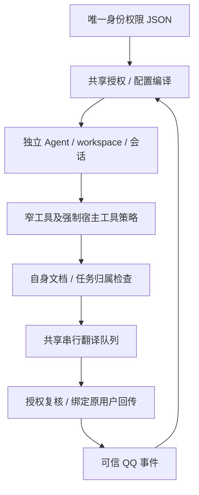

# 统一身份与权限管理

状态：**首期实现已部署；已登记成员 `3311723223`、`2752966052` 启用相同聊天/论文权限，群聊与成员个人业务关闭。** 各成员真人验收结论见[文档16](16_验收与测试总表.md#分领域验收摘要)。更新日期：2026-10-21（Asia/Shanghai）。阅读入口：[文档目录](README.md)。

本文是本需求的规则、架构、开发决定、验收与未完成项的唯一展开位置；具体证据见[本次验收](verification/access-control-2026-10-19/README.md)。状态快照遵循 [tp2.txt](tp2.txt)；模拟通过、配置部署和真人验证分别记录。

## 当前进度

- [x] 确定唯一权限来源、显式权限字典和首期范围。
- [x] 实现共享授权、配置编译、可信宿主工具策略及原主人兼容。
- [x] 实现第二身份的会话/workspace、文件、论文任务及投递隔离；合成身份隔离宿主通过。
- [x] 其余业务接入功能检查；未完成多用户业务隔离的能力强制 owner-only。
- [x] 授权日志接入统一查询；补充后端管理入口与索引。
- [x] 最终离线回归和真实隔离宿主通过（数量见[验收报告](verification/access-control-2026-10-19/README.md)）；配置同步/构建/依赖/健康检查完成，回填验收总表。
- [x] 按用户授权登记成员 `3311723223`，revision=2；独立工作区、配置同步与 Fusion 重载完成，权限回归及四项自检通过。
- [x] 真人第二 QQ `3311723223`：用户在本轮反馈“验收成功”；未独立复盘具体测试步骤，不扩大为跨身份攻击、负载或恢复验收。
- [x] 新成员 `2752966052`：用户明确授权相同聊天/论文权限；revision=3、独立工作区、配置同步与重载完成，权限回归及四项自检通过。部署时的在途论文按用户追加要求停止，不自动重放。
- [ ] `2752966052` 真人聊天与论文往返：由用户后续验收。
- [x] 提交审查发现的账单权限漏检与旧测试夹具问题已在后续提交中修复；2026-10-20 于 `2ba0308` 的独立副本完成定向补验，见第8节。该结果不替代全部待推送提交的审查。

## 1. 需求与已定范围

用户希望用一张矩阵管理身份敏感功能：每行一个 QQ，另有“性质”区分 QQ 用户/群，其余列表示聊天、论文、发消息、发邮件等功能权限；人数少，可采用本地文件。用户明确授权 `3311723223` 和 `2752966052`，均仅开放一般聊天、论文检索、PDF导入、翻译、取消任务和QQ文件回传；各自登记为独立member，不视为主人别名。

首期使用 JSON。原主人保留现有能力，成员可单独获准聊天、公开检索、自身 PDF 导入/翻译/取消/文件回传；默认独立身份，不共享主人资料。群聊、邮件、提醒、记忆、账单、代码及自动化均不向成员开放。系统不因“换了 QQ”推断是同一个人；新身份必须由操作者显式登记。

统一的是**身份授权的管理与判断**。插件加载、Agent 工具上限、网络域名、文件路径、项目保护根、翻译模型组合与费用限制继续独立生效。模型理解请求并组合窄工具；聊天正文、自报身份、昵称、引用、网页、PDF 和模型参数都不能授予身份或改变接收人。原有事务、版本、幂等、确认和未知投递对账保留。

## 2. 唯一配置来源与管理方式

[config/access-control.json](../config/access-control.json) 是唯一编辑来源。`version=1` 表示结构版本，`revision` 是操作者每次修改时递增的策略版本；`subjects` 每行含：

| 字段 | 规则 |
| --- | --- |
| `qq` / `kind` | QQ 以字符串保存；性质仅 `user` / `group`，身份键为 `qq:user:<QQ>` / `qq:group:<QQ>` |
| `role` / `enabled` | 恰好一个启用且不设过期的 owner，其余为 member；角色不隐含授予未来新增权限 |
| `permissions` | 显式权限键对应布尔值；缺省、未知身份/权限、禁用或到期默认拒绝 |
| `mailRecipients` | 当前仅 owner 可以配置精确邮箱；无通配符，不按 QQ 自动推断邮箱 |
| `note` / `expiresAt` | 备注可选；成员可设带日期的到期时间，过期后即使路由仍存在也不能进入 |

群记录仅可禁用且无授权。成员若被授予尚未完成隔离的 owner-only 能力或邮件目标，整个配置校验失败，不部分应用。

运行文件不再维护第二份独立权限表。`sync-config.mjs` 校验并编译来源，将策略写入 `channels.kurumi-qq.accessControl`，同时派生频道 ownerId、主人命令名单、天气 scheduledOwnerId、邮件 allowedRecipients 及成员 Agent/binding。`config/runtime.config.json` 不重复保存这几个身份字段；消费者读取**编译后的运行配置**，例如 `configure-domains.mjs` 读取运行文件中派生的 ownerId，不直接把仓库意图当作可启动配置。

同步使用现有单文件原子替换，写入前保存 0600 配置备份；非法策略不写入。既有主人号码变更会被 `owner_change_requires_explicit_data_migration` 拒绝，不能靠改矩阵把旧个人资料移交给另一个 QQ。策略在配置重载/服务重启后生效；首期运维统一按“同步并重启”操作，**不承诺即时热撤权**。

管理入口是 [chatbot/scripts/access-control.mjs](../chatbot/scripts/access-control.mjs)，只读校验/展示，无模型、网络或运行状态写入：

```bash
node chatbot/scripts/access-control.mjs --check
node chatbot/scripts/access-control.mjs --matrix   # TSV：QQ、性质、角色、启用、到期、逐权限列、邮件目标
node chatbot/scripts/access-control.mjs --json
```

没有 QQ 内改权限工具或可视化编辑器；`access.manage` 作为保留的管理员能力键，不代表聊天模型能编辑授权。未来换成 SQLite 时只替换唯一持久来源并明确迁移，不同时维护两份权威数据。

## 3. 权限字典与执行边界

完整权限及工具/action 映射只在 [permissions.js](../chatbot/packages/access-control/permissions.js) 维护；未知工具拒绝，新增业务须同时登记映射和测试。当前分组如下：

| 范围 | 权限 | 首期边界 |
| --- | --- | --- |
| 入口/命令/检索 | `chat.use`、`commands.basic`、`search.use` | 成员仅允许 `/new`、`/reset`；其它斜杠命令拒绝，不继承管理员命令 |
| QQ 输出 | `qq.reply`、`qq.file.reply`、`qq.notify` | 只回传自身；`qq.notify` 用于论文后台通知，既有定时任务仍受主人专属调度/投递契约约束 |
| 论文 | `papers.import/read/translate/cancel` | 每个 action 独立授权，且校验文档/任务归属 |
| 邮件 | `mail.status/draft/send/history` | 仅 owner；收件目标仍需独立白名单，发送仍需带码确认 |
| 个人业务 | `weather.read`、`profile.read/manage`、`planning.read/manage`、`reminders.read/manage`、`reminder-list.read/manage/schedule`、`memory.read/manage`、`bills.read/manage` | 仅 owner，不将统一入口当作这些数据已多用户隔离 |
| 后台与管理 | `tasks.code/research/read`、`automations.read/manage`、`sessions.read`、`stickers.use`、`commands.admin`、`access.manage` | 仅 owner；原工具/项目/确认限制继续生效 |

共享实现：[chatbot/packages/access-control/](../chatbot/packages/access-control/)。它是本地共享包，不是新服务，不开端口。授权从可信宿主取得发送者/频道/account/Agent/会话并检查一致性；owner 标志必须与实际角色相符，不把获准聊天的成员标为主人。

QQ 插件注册宿主强制 `registerTrustedToolPolicy`，覆盖内置工具及动态 `tool_call` 的真实内层调用。缺少该宿主接口会启动失败，不静默降级。领域工具在执行入口复核功能与身份；工具展示过滤不是唯一防线。成员的 `session_status` 不能指定他人会话或更改模型。

后台研究/项目任务只接受固定 `agent:<researcher|project-…>:kurumi-task-<24位hash>` 通道、对应 Agent 和已配置工具，并复核主人的任务权限。OpenClaw 交接保留可信 channel/account/owner 标志，但可能省略 senderId；仅在这些固定委托通道接受该明确 owner 权限或真正无 requester 的系统调用。空对象、仅缺少 senderId、成员、错误频道/account 均不构成委托。main 普通回合缺少可信身份仍拒绝。天气 Cron 仅允许 main 的规范 UUID 会话和天气只读工具，不因此取得邮件等权限。真实隔离宿主已覆盖主人发起研究任务的交接路径。

`commands.ownerAllowFrom` 只承担原宿主管理命令兼容；它与业务身份来源不同步手工维护。单独关闭某个管理权限不撤销已经登记的 Cron 或追回已发内容；需取消已有任务时按领域工具处理。禁用 chat.use/身份和发送权限会拒绝后续相关入口/投递。

## 4. 会话、资源与投递隔离



- owner 沿用 main、`workspace/` 和旧会话；成员使用 `qq-user-<QQ>`，会话为 `agent:qq-user-<QQ>:kurumi-qq:direct:<QQ>`，workspace 位于 `.openclaw-fusion/users/<QQ>/workspace/`。配置路由与实际身份必须一致；成员工作区未准备好或符号链接逃逸时拒绝入站。
- `sync-persona.mjs` 只向每个已启用身份写 SOUL/IDENTITY/AGENTS/USER 四份受管文件。成员共享角色卡，使用专用 [MEMBER_AGENTS.md](../scripts/fusion/templates/MEMBER_AGENTS.md)，不复制主人 USER、MEMORY、历史或研究资料。本人/成员关系素材由可信角色选择，只进入对应 USER；具体人格契约见[文档25](25_人格、记忆与会话连续性.md)。独立成员模板没有“对方就是主人”的授权暗示；人格本身不是身份授权。
- owner PDF 目录继续为 `documents/`，成员为 `documents/subjects/<QQ>/`；同字节哈希可得到相同 ID，但目录/元数据独立，猜到 ID 不取得他人的文件。上传 URL 查询的实际 OneBot user_id 使用发送者，忽略正文 URL；缓存和暂存图片同样按身份分隔。
- `documents/jobs/` 保留共享任务账本和唯一串行队列，新增任务保存可信 subject/account/Agent/会话/目标绑定；查询、取消、重发按绑定过滤。历史无 requester 的任务仅解释为原主人任务，不移交成员。工作区/队列不是模型可读路径。
- 翻译准入、排队执行前、执行中（500ms 轮询）及实际回传前复核身份/权限；撤权会拒绝排队启动或中止活动 worker，不能保证追回上游已发生的费用。重启保留任务/投递证据，遗留 queued/running 标 interrupted，不自动重付费；dispatching 标未知，不盲重发。
- QQ 消息和文件始终回传被绑定身份自身，不从异步闭包重新读取 owner 当接收人。主人旧账本幂等键保持，成员按身份命名空间，防止相同 key 串用回执。仍共享原全局滚动配额/最多5个等待任务，不提供成员独立费用账单或调度公平性保证。
- 邮件、记忆、Profile/行程、提醒、KnowledgeMap、研究/代码数据保持 owner-only。邮件草稿没有多主体改造，confirmation-core 的主人 scope 不放宽，不能仅授权一个权限就让成员访问旧库。

## 5. 日志与维护步骤

授权审计位于 `.openclaw-fusion/channel/access-events.jsonl`，0600。事件含工具/权限、允许或拒绝码、策略 revision、可信 requester 的有限元数据及 session/run/toolCallId；不记录工具参数、聊天/PDF 正文或凭据。查询与扩展契约见[文档18](18_跨模块链路日志查询.md)：

```bash
node scripts/fusion/log-query.mjs --source access-control --json
node scripts/fusion/log-query.mjs --source access-control --contains capability_not_allowed
```

新增成员的登记步骤：

1. 在唯一来源增加 `kind=user, role=member` 的真实号码，显式勾选首期权限、邮箱目标为空，递增 revision。不得把测试 fixture 号码写入生产。
2. `access-control.mjs --check/--matrix`；审阅 `sync-config.mjs --diff` 和 `sync-persona.mjs --diff`。
3. 无活动任务时先 `sync-persona.mjs --apply` 准备隔离工作区，再 `sync-config.mjs --apply`，重启 `kurumi-fusion.service`，检查配置/人格/依赖/健康。
4. 只在该账号和用户明确授权范围验收真人对话、上传、翻译与文件回传，以及跨身份拒绝。测试模型/OneBot通过不能替代此步骤。

撤权时禁用记录或收回显式权限并递增 revision，同步并重启；保留工作区、文档、任务和投递账本用于核对。已有在途发送与已发生付费不保证可撤回。回退代码前先禁用成员并处理活动任务；有多身份状态后不能仅回退代码就声称恢复了单主人状态。

## 6. 开发决定与验证快照

源码基线：`9c88003` 加本需求当时明确纳入的权限改动。实现与回归已分别提交为 `db5afec`、`427a4e9`。新增后端脚本放 `chatbot/scripts/`，测试放 `chatbot/tests/access-control/`；本需求使用 JSON 和目录命名空间，无数据库 SQL 迁移。未改 SnowLuma/DSH。部署验收时“混合工作区未提交”是当时的状态快照；后续收录情况见[文档16](16_验收与测试总表.md#git工作线归档2026-10-20)。

| 阶段 | 已执行结果 / 后续 |
| --- | --- |
| 基线与架构 | 核实原入口、目标、文件、任务和旧 workspace 的单主人假设，选择共享授权及独立 Agent，避免只放宽入口 |
| 配置与执行 | 单一配置源、严格校验、派生配置、只读矩阵 CLI、宿主强制策略、领域执行复核均已实现 |
| 资源与后台 | 独立目录/任务绑定、共享串行队列、归属/撤权/实际收件对象与旧账本兼容已通过离线初验 |
| 委托补正 | 首次增加的后台宿主回归发现 Gateway 省略 senderId；按真实可信 owner 元数据修正固定委托判定。失败与成功证据均保留，不使用任意缺失发送者作为授权 |
| 回归 | Node（含权限域）、天气、确认入口回归和真实隔离宿主均通过。旧任务归属/幂等键兼容和投递前撤回文件权限均通过。命令、构建与结果见[验收报告](verification/access-control-2026-10-19/README.md) |
| 首次部署 | 2026-10-19 21:36 +08:00，无活动论文任务时同步唯一缺失的 accessControl 并重启 Fusion；配置/人格/依赖/健康四项通过，QQ连接正常、testIngress=false。当时名单只有原主人，无真实测试外发 |
| 真实成员登记 | 用户授权 `3311723223` 仅聊天与自身论文，revision从1递增到2。先准备成员4份人格文件，再同步4项配置差异并重启Fusion；无活动论文/dispatching投递。权限回归、owner-only权限拒绝、独立Agent/路由/工作区与四项自检通过。主人权限/main Agent/4份人格哈希不变，testIngress=false；本次未主动外发或启动付费翻译。原始结果见[成员部署记录](verification/access-control-2026-10-19/member-deployment.json) |
| 用户验收及追加成员 | 用户确认 `3311723223` 验收成功，并授权 `2752966052` 相同权限，revision从2递增到3。最初检测到在途论文而等待，随后用户明确要求停止现有任务、优先新增；停止Fusion终止worker后同步4项配置差异并启动。原任务记为failed/pdf_worker_failed，记录为本次人为停止的结果，不当作独立渠道故障或自动重跑。权限回归、主人专属权限拒绝、各身份独立Agent/路由、受管人格文件及四项自检通过；既有两身份权限/Agent/人格哈希不变。记录见[追加成员部署](verification/access-control-2026-10-19/member-2752966052-deployment.json) |

## 7. 未完成与范围外

- **待验收：`2752966052` 真人聊天与论文往返。** 已部署相同10项共享权限（聊天、基本会话命令、公开检索、自身论文导入/读取/翻译/取消与QQ回传/任务通知）；邮件目标为空，其余权限拒绝。`3311723223` 已获用户验收反馈；配置/离线结果不代替新账号的真人验收。
- **未开发：其余个人业务的多用户数据归属/确认 scope、群聊、账号合并共享、可视化与 QQ 内权限管理。** 校验器明确拒绝超出首期的成员授权，不能通过手改权限绕过。
- **未验收：包含本次多身份代码的全量停写快照/恢复演练、真人并发/大规模负载及跨机器人账户。** 备份已纳入权限来源，运行文件随原状态备份；旧恢复点只证明各自旧版本。
- **不提供：撤回已发送内容/上游计费、无限队列、每身份费用硬上限。** 既有单任务请求/tokens/30分钟与全局队列限制继续有效。

本需求关闭条件是首期代码/离线与隔离宿主/文档/部署一致，逐个成员记录部署与用户验收状态；不能将“开发完成”或某个成员反馈成功写成“所有业务已完成多用户验收”。完整结果见[文档16](16_验收与测试总表.md)与[证据索引](verification/INDEX.md)。

## 8. 提交审查发现与补验（2026-10-20）

原审查仅针对已提交的 `542b6f9`，没有将当时未提交的开发内容纳入结论。记录时修复已进入本地历史，因此按下表区分发现基线与复验版本；不将旧缺陷继续描述成当前待修，也不将定向复验扩大为全部提交获准推送。

| 编号 / 严重度 | 原发现及影响 | 最新状态与关闭依据 |
| --- | --- | --- |
| CR-F01 / P1 | `kurumi-knowledgemap/index.js` 调用 `authorizedOwner(ctx, config)` 时没有传权限名；当时 QQ 插件也未接线 `toolPolicyDecision`。关闭 `bills.read/manage` 后仍可能读写，owner 身份不能替代显式功能授权 | **定向已验收**：`db5afec` 补上账单读/写权限与宿主强制策略。于 `2ba0308` 副本用真实工具工厂和替身客户端复验：允许读取时进入客户端；收回两项权限后三个账单工具均拒绝，新增 API 请求为0 |
| CR-F02 / P2 | `542b6f9` 的权限/桥接组和后端边界组均有失败用例；原测试夹具未提供新 `accessControl`，授权提前拒绝使原断言失败。不能用工作区中的修正证明提交版已通过 | **定向已验收**：`427a4e9` 收录夹具修正。于 `2ba0308` 从源码构建后复跑，权限/桥接/账单组和后端边界组全部通过；两组覆盖有别，不与其他阶段计数相加 |

精确命令、环境准备、首次准备不足的失败和最终结果存于[提交审查补验记录](verification/access-control-2026-10-19/commit-review-2026-10-20.json)。后端组比原组多了生命周期用例，权限/桥接组另含账单用例。首次补验遗漏生成旧CLI兼容入口及确认包链接，出现环境失败；补齐构建后通过，没有为通过测试改源码。

本轮仅使用合成身份、临时状态和替身业务客户端，没有连接生产业务API、写生产数据库、外发或重启服务。原广泛测试结果（见同一记录）仍是旧审查时点的历史数据，本轮没有重跑该完整集合。KnowledgeMap 开发入口暴露问题仍由其文档15第10.3节跟踪；全部最新提交的最终推送判断尚需重新审查。
