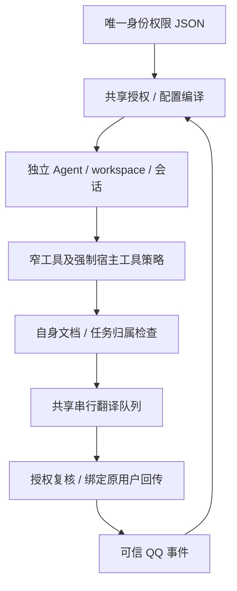

# 统一身份与权限管理

类型：身份与授权规则。状态：**首期实现已部署；已登记成员 `3311723223`、`2752966052` 启用相同聊天/论文权限，群聊与成员个人业务关闭。** 各成员真人验收结论见[文档16](16_验收与测试总表.md#分领域验收摘要)。实现范围按既有部署记录；2026-10-23仅整理结构。阅读入口：[文档目录](README.md)。

本文维护身份来源、执行策略、资源隔离和运维步骤。成员真人验收与整体证明范围只由[文档16](16_验收与测试总表.md)维护；已完成的成员登记/重载与开发过程见[阶段记录](archive/documentation-2026-10-23/24_统一身份与权限管理.md)，不作为日常操作许可。

## 当前进度

本节保留历史链接入口；实现范围以文首状态为准，待完成条件见[第7节](#7-未完成与范围外)，逐次结果见[阶段记录](archive/documentation-2026-10-23/24_统一身份与权限管理.md#当前进度)。

## 1. 需求与已定范围

用户希望用一张矩阵管理身份敏感功能：每行一个 QQ，另有“性质”区分 QQ 用户/群，其余列表示聊天、论文、发消息、发邮件等功能权限；人数少，可采用本地文件。用户明确授权 `3311723223` 和 `2752966052`，均仅开放一般聊天、论文检索、PDF导入、翻译、取消任务和QQ文件回传；各自登记为独立member，不视为主人别名。

首期使用 JSON。原主人保留现有能力，成员可单独获准聊天、公开检索、自身 PDF 导入/翻译/取消/文件回传；默认独立身份，不共享主人资料。群聊、邮件、提醒、记忆、账单、代码及自动化均不向成员开放。系统不因“换了 QQ”推断是同一个人；新身份必须由操作者显式登记。

统一的是**身份授权的管理与判断**。插件加载、Agent 工具上限、网络域名、文件路径、项目保护根、翻译模型组合与费用限制继续独立生效。模型理解请求并组合窄工具；聊天正文、自报身份、昵称、引用、网页、PDF 和模型参数都不能授予身份或改变接收人。原有事务、版本、幂等、确认和未知投递对账保留。

## 2. 唯一配置来源与管理方式

[config/access-control.json](../config/access-control.json) 是唯一编辑来源。`version=1` 表示结构版本，`revision` 是操作者每次修改时递增的策略版本；`subjects` 每行含：

| 字段 | 规则 |
| --- | --- |
| `qq` / `kind` | QQ 以字符串保存；性质仅 `user` / `group`，身份键为 `qq:user:<QQ>` / `qq:group:<QQ>` |
| `role` / `enabled` | 恰好一个启用且不设过期的 owner，其余为 member；角色不隐含授予未来新增权限 |
| `permissions` | 显式权限键对应布尔值；缺省、未知身份/权限、禁用或到期默认拒绝 |
| `mailRecipients` | 当前仅 owner 可以配置精确邮箱；无通配符，不按 QQ 自动推断邮箱 |
| `note` / `expiresAt` | 备注可选；成员可设带日期的到期时间，过期后即使路由仍存在也不能进入 |

群记录仅可禁用且无授权。成员若被授予尚未完成隔离的 owner-only 能力或邮件目标，整个配置校验失败，不部分应用。

运行文件不再维护第二份独立权限表。`sync-config.mjs` 校验并编译来源，将策略写入 `channels.kurumi-qq.accessControl`，同时派生频道 ownerId、主人命令名单、天气 scheduledOwnerId、邮件 allowedRecipients 及成员 Agent/binding。`config/runtime.config.json` 不重复保存这几个身份字段；消费者读取**编译后的运行配置**，例如 `configure-domains.mjs` 读取运行文件中派生的 ownerId，不直接把仓库意图当作可启动配置。

同步使用现有单文件原子替换，写入前保存 0600 配置备份；非法策略不写入。既有主人号码变更会被 `owner_change_requires_explicit_data_migration` 拒绝，不能靠改矩阵把旧个人资料移交给另一个 QQ。策略在配置重载/服务重启后生效；首期运维统一按“同步并重启”操作，**不承诺即时热撤权**。

管理入口是 [chatbot/scripts/access-control.mjs](../chatbot/scripts/access-control.mjs)，只读校验/展示，无模型、网络或运行状态写入：

```bash
node chatbot/scripts/access-control.mjs --check
node chatbot/scripts/access-control.mjs --matrix   # TSV：QQ、性质、角色、启用、到期、逐权限列、邮件目标
node chatbot/scripts/access-control.mjs --json
```

没有 QQ 内改权限工具或可视化编辑器；`access.manage` 作为保留的管理员能力键，不代表聊天模型能编辑授权。未来换成 SQLite 时只替换唯一持久来源并明确迁移，不同时维护两份权威数据。

## 3. 权限字典与执行边界

完整权限及工具/action 映射只在 [permissions.js](../chatbot/packages/access-control/permissions.js) 维护；未知工具拒绝，新增业务须同时登记映射和测试。当前分组如下：

| 范围 | 权限 | 首期边界 |
| --- | --- | --- |
| 入口/命令/检索 | `chat.use`、`commands.basic`、`search.use` | 成员仅允许 `/new`、`/reset`；其它斜杠命令拒绝，不继承管理员命令 |
| QQ 输出 | `qq.reply`、`qq.file.reply`、`qq.notify` | 只回传自身；`qq.notify` 用于论文后台通知，既有定时任务仍受主人专属调度/投递契约约束 |
| 论文 | `papers.import/read/translate/cancel` | 每个 action 独立授权，且校验文档/任务归属 |
| 邮件 | `mail.status/draft/send/history` | 仅 owner；收件目标仍需独立白名单，发送仍需带码确认 |
| 个人业务 | `weather.read`、`profile.read/manage`、`planning.read/manage`、`reminders.read/manage`、`reminder-list.read/manage/schedule`、`memory.read/manage`、`bills.read/manage` | 仅 owner，不将统一入口当作这些数据已多用户隔离 |
| 后台与管理 | `tasks.code/research/read`、`automations.read/manage`、`sessions.read`、`stickers.use`、`commands.admin`、`access.manage` | 仅 owner；原工具/项目/确认限制继续生效 |

共享实现：[chatbot/packages/access-control/](../chatbot/packages/access-control/)。它是本地共享包，不是新服务，不开端口。授权从可信宿主取得发送者/频道/account/Agent/会话并检查一致性；owner 标志必须与实际角色相符，不把获准聊天的成员标为主人。

QQ 插件注册宿主强制 `registerTrustedToolPolicy`，覆盖内置工具及动态 `tool_call` 的真实内层调用。缺少该宿主接口会启动失败，不静默降级。领域工具在执行入口复核功能与身份；工具展示过滤不是唯一防线。成员的 `session_status` 不能指定他人会话或更改模型。

后台研究/项目任务只接受固定 `agent:<researcher|project-…>:kurumi-task-<24位hash>` 通道、对应 Agent 和已配置工具，并复核主人的任务权限。OpenClaw 交接保留可信 channel/account/owner 标志，但可能省略 senderId；仅在这些固定委托通道接受该明确 owner 权限或真正无 requester 的系统调用。空对象、仅缺少 senderId、成员、错误频道/account 均不构成委托。main 普通回合缺少可信身份仍拒绝。

天气 Cron 仅允许 main 的规范 UUID 会话和天气只读工具，不因此取得邮件等权限。OpenClaw 2026.9.7 的 Cron 运行只带投递频道/account（`{channel: kurumi-qq, accountId: default}`），没有 senderId 和 owner 标志；这种纯投递身份只在天气 Cron 通道视同无 requester 的系统调用，后台任务通道仍不接受。带任何 senderId 或 owner 标志、频道或 account 不对，仍按上面的委托规则判断。2026-10-20 的规则漏掉了这种形态，每日天气因此连续三天被拒（待办 N8，2026-10-22 修正）。真实隔离宿主已覆盖主人发起研究任务的交接路径。


`commands.ownerAllowFrom` 只承担原宿主管理命令兼容；它与业务身份来源不同步手工维护。单独关闭某个管理权限不撤销已经登记的 Cron 或追回已发内容；需取消已有任务时按领域工具处理。禁用 chat.use/身份和发送权限会拒绝后续相关入口/投递。

## 4. 会话、资源与投递隔离



- owner 沿用 main、`workspace/` 和旧会话；成员使用 `qq-user-<QQ>`，会话为 `agent:qq-user-<QQ>:kurumi-qq:direct:<QQ>`，workspace 位于 `.openclaw-fusion/users/<QQ>/workspace/`。配置路由与实际身份必须一致；成员工作区未准备好或符号链接逃逸时拒绝入站。
- `sync-persona.mjs` 只向每个已启用身份写 SOUL/IDENTITY/AGENTS/USER 四份受管文件。成员共享角色卡，使用专用 [MEMBER_AGENTS.md](../scripts/fusion/templates/MEMBER_AGENTS.md)，不复制主人 USER、MEMORY、历史或研究资料。本人/成员关系素材由可信角色选择，只进入对应 USER；具体人格契约见[文档25](25_人格、记忆与会话连续性.md)。独立成员模板没有“对方就是主人”的授权暗示；人格本身不是身份授权。
- owner PDF 目录继续为 `documents/`，成员为 `documents/subjects/<QQ>/`；同字节哈希可得到相同 ID，但目录/元数据独立，猜到 ID 不取得他人的文件。上传 URL 查询的实际 OneBot user_id 使用发送者，忽略正文 URL；缓存和暂存图片同样按身份分隔。
- `documents/jobs/` 保留共享任务账本和唯一串行队列，新增任务保存可信 subject/account/Agent/会话/目标绑定；查询、取消、重发按绑定过滤。历史无 requester 的任务仅解释为原主人任务，不移交成员。工作区/队列不是模型可读路径。
- 翻译准入、排队执行前、执行中（500ms 轮询）及实际回传前复核身份/权限；撤权会拒绝排队启动或中止活动 worker，不能保证追回上游已发生的费用。重启保留任务/投递证据，遗留 queued/running 标 interrupted，不自动重付费；dispatching 标未知，不盲重发。
- QQ 消息和文件始终回传被绑定身份自身，不从异步闭包重新读取 owner 当接收人。主人旧账本幂等键保持，成员按身份命名空间，防止相同 key 串用回执。仍共享原全局滚动配额/最多5个等待任务，不提供成员独立费用账单或调度公平性保证。
- 邮件、记忆、Profile/行程、提醒、KnowledgeMap、研究/代码数据保持 owner-only。邮件草稿没有多主体改造，confirmation-core 的主人 scope 不放宽，不能仅授权一个权限就让成员访问旧库。

## 5. 日志与维护步骤

授权审计位于 `.openclaw-fusion/channel/access-events.jsonl`，0600。事件含工具/权限、允许或拒绝码、策略 revision、可信 requester 的有限元数据及 session/run/toolCallId；不记录工具参数、聊天/PDF 正文或凭据。查询与扩展契约见[文档18](18_跨模块链路日志查询.md)：

```bash
node scripts/fusion/log-query.mjs --source access-control --json
node scripts/fusion/log-query.mjs --source access-control --contains capability_not_allowed
```

新增成员的登记步骤：

1. 在唯一来源增加 `kind=user, role=member` 的真实号码，显式勾选首期权限、邮箱目标为空，递增 revision。不得把测试 fixture 号码写入生产。
2. `access-control.mjs --check/--matrix`；审阅 `sync-config.mjs --diff` 和 `sync-persona.mjs --diff`。
3. 无活动任务时先 `sync-persona.mjs --apply` 准备隔离工作区，再 `sync-config.mjs --apply`，重启 `kurumi-fusion.service`，检查配置/人格/依赖/健康。
4. 只在该账号和用户明确授权范围验收真人对话、上传、翻译与文件回传，以及跨身份拒绝。测试模型/OneBot通过不能替代此步骤。

撤权时禁用记录或收回显式权限并递增 revision，同步并重启；保留工作区、文档、任务和投递账本用于核对。已有在途发送与已发生付费不保证可撤回。回退代码前先禁用成员并处理活动任务；有多身份状态后不能仅回退代码就声称恢复了单主人状态。

## 6. 开发决定与验证快照

当前代码使用JSON与目录命名空间，无本需求数据库SQL迁移。执行授权与资源隔离的实现入口如下：

| 职责 | 唯一入口 |
| --- | --- |
| 权限来源校验与共享授权 | `chatbot/packages/access-control/config.js`、`index.js` |
| 工具/action权限映射 | `chatbot/packages/access-control/permissions.js` |
| 独立工作区与人格投影 | `chatbot/packages/access-control/workspaces.js` |
| 配置编译 / 人格同步 | `scripts/fusion/sync-config.mjs`、`scripts/fusion/sync-persona.mjs` |
| 只读管理与离线用例 | `chatbot/scripts/access-control.mjs`、`chatbot/tests/access-control/` |

首期实现、真实宿主交接补正、成员登记和部署已移至[阶段记录](archive/documentation-2026-10-23/24_统一身份与权限管理.md#6-开发决定与验证快照)，原始回执仍在[权限专项证据](verification/access-control-2026-10-19/README.md)。旧混合工作区观察不作为当前Git状态。


## 7. 未完成与范围外

- **待验收：`2752966052` 真人聊天与论文往返。** 已部署相同10项共享权限（聊天、基本会话命令、公开检索、自身论文导入/读取/翻译/取消与QQ回传/任务通知）；邮件目标为空，其余权限拒绝。`3311723223` 已获用户验收反馈；配置/离线结果不代替新账号的真人验收。
- **未开发：其余个人业务的多用户数据归属/确认 scope、群聊、账号合并共享、可视化与 QQ 内权限管理。** 校验器明确拒绝超出首期的成员授权，不能通过手改权限绕过。
- **未验收：包含本次多身份代码的全量停写快照/恢复演练、真人并发/大规模负载及跨机器人账户。** 备份已纳入权限来源，运行文件随原状态备份；旧恢复点只证明各自旧版本。
- **不提供：撤回已发送内容/上游计费、无限队列、每身份费用硬上限。** 既有单任务请求/tokens/30分钟与全局队列限制继续有效。

本需求关闭条件是首期代码/离线与隔离宿主/文档/部署一致，逐个成员记录部署与用户验收状态；不能将“开发完成”或某个成员反馈成功写成“所有业务已完成多用户验收”。完整结果见[文档16](16_验收与测试总表.md)与[证据索引](verification/INDEX.md)。

## 8. 提交审查发现与补验（2026-10-20）

原发现基线为 `542b6f9`：CR-F01是账单权限未传入及宿主强制策略漏接线，修复归 `db5afec`；CR-F02是新权限上下文下旧测试夹具失配，修复归 `427a4e9`。两者于固定 `2ba0308` 副本完成定向补验，不作为当前待修事项。

原发现、首次准备不足的环境失败、补验方法及未覆盖范围完整保留于[阶段记录](archive/documentation-2026-10-23/24_统一身份与权限管理.md#8-提交审查发现与补验2026-10-20)和[原回执](verification/access-control-2026-10-19/commit-review-2026-10-20.json)。定向补验不代表后续全部提交获准推送；外部 CR-K01 仍由[文档16](16_验收与测试总表.md#结论的使用范围)指向其所属项目。

返回[文档入口](README.md)。
