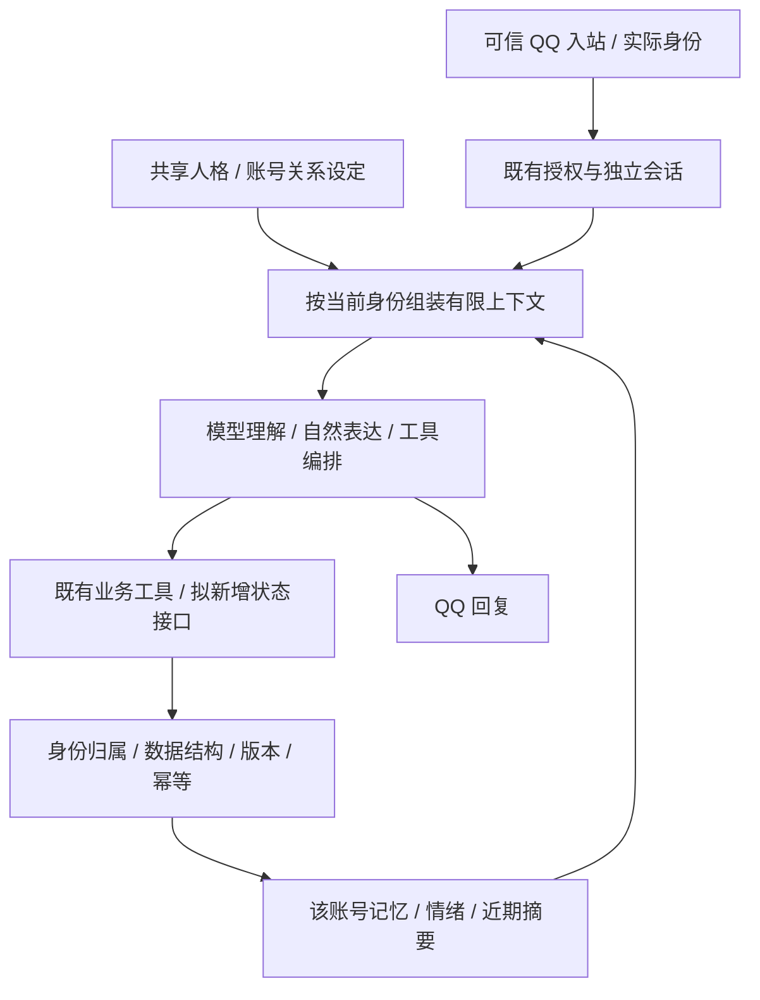

# 人格、记忆与会话连续性

状态：**P1已部署；P2代码、隔离验收、主人记忆迁移、运行配置定向同步、备份与隔离恢复核验已完成；自动记忆仅本人，`/new`保留长期记忆及有期限近期摘要；P3–P5待处理。** 更新日期：2026-10-20（Asia/Shanghai）。

本文件统一维护本需求的背景、方案、决定、开发进度与验收边界。每次实施均以当时实查的 Git `HEAD` 和被明确纳入的文件为源码基线；未提交的并行改动不属于可复现基线。用户已授权实施P1，并明确选择P2：自动记忆先仅本人，成员保持现有权限；`/new`保留长期事实和有期限近期摘要。P2代码、离线回归、真实隔离宿主验收、生产迁移、定向运行配置同步和恢复核验均已完成。P3持续情绪和P4主动联系仍未进入实施。

## 1. 需求与范围

助手已具备聊天、论文、提醒等工具能力，本需求补充情感陪伴，让性格、对人的了解及相处经历能够跨会话延续，同时保持原有业务执行可靠。

已确认的需求：

- 使用用户提供的世凪人格作为改造素材，保留其含蓄、温柔、有独立态度的表达特点。
- 本人使用恋人背景；其他已授权账号共享基础性格，不继承本人的恋人关系、私密经历或资料。
- 各账号的关系、记忆与会话分别隔离；人格设定不产生身份授权，不允许通过聊天自称本人改变权限。
- 人格、记忆、会话放在同一需求下统筹设计，先建文档再开展实施。

拟达成的体验：新会话仍能使用已保存且相关的记忆，情绪与关系有连续性；安慰、玩笑和任务处理保持同一人格。主动关心是后续阶段的候选能力，收件对象、频率与启用条件尚未确定。

本文件承接新的人格与连续性设计；当前人格切换契约仍见[文档11](11_小鲸鱼与DeepSeek切换及确认策略研究.md)和[配置契约](../config/README.md)，身份及资源授权仍见[文档24](24_统一身份与权限管理.md)。

## 2. 已核实的现状

以下为P1/P2完成后的源码、已安装OpenClaw及运行配置现状；P1/P2证据见第9、10节，其余阶段仍属计划。

| 范围 | 当前事实与依据 |
| --- | --- |
| 人格来源 | [config/persona.json](../config/persona.json) 指向 `roles/世凪.md`，身份名为世凪；本人恋人/成员普通朋友素材单独放在 `roles/relationships/` |
| 人格生成 | [workspaces.js](../chatbot/packages/access-control/workspaces.js) 的 `personaFiles()` 给各已启用聊天身份投影相同 SOUL/IDENTITY；本人与成员各用自己的 AGENTS/USER，按可信角色追加关系素材，不复制本人记忆 |
| 同步入口 | [sync-persona.mjs](../scripts/fusion/sync-persona.mjs) 管理各 workspace 的 SOUL、IDENTITY、AGENTS、USER 四份文件；不能直接改运行副本替代来源变更 |
| 长期记忆 | [kurumi-memory](../chatbot/plugins/kurumi-memory/index.js) 连续性模式仅供本人私聊使用；当前原文可触发最多4条稳定事实和1条有限期摘要，明确记住/更正/忘记仍可显式操作 |
| 记忆存储 | [continuity/store.js](../chatbot/plugins/kurumi-memory/continuity/store.js) 使用 `.kurumi-memory/state.sqlite` 单行 version=2 快照、SQLite事务/CAS、来源/回执/遗忘屏障；`MEMORY.md` 已迁移为说明文本，保留旧读取兼容，旧写入在连续性模式明确拒绝 |
| 账号与会话 | 本人使用 main 与 `workspace/`；成员使用 `qq-user-<QQ>` 与 `users/<QQ>/workspace/`；配置 `session.dmScope=per-channel-peer`，QQ 入口校验实际路由 |
| 工具边界 | main 禁用通用 read/write/edit/apply_patch/exec/process/message/sessions_spawn；成员保持窄工具上限，且未开放长期记忆 |
| 主动维护 | 源码及运行配置均为 `heartbeat.every=0m`、`plugins.slots.memory=none`；三个聊天 workspace 均没有 INNER.md、HEARTBEAT.md、mood.json 或 heartbeat-state.json |
| 主模型 | 源码和运行配置为 `deepseek/deepseek-flash`；P1保持模型不变，已实测适配后人格的8个对话场景，未执行上游整套模板 |
| 已安装宿主 | 本机 OpenClaw 为 `2026.9.7`；原生 bootstrap 文件表不包含 INNER.md 或情绪 JSON。不能假定任意顶层 Markdown 或 JSON 会自动进入上下文 |

运行状态根目录为 `/home/afrangry/.openclaw-fusion`。P2新增唯一记忆数据库 `.openclaw-fusion/workspace/.kurumi-memory/state.sqlite`，SQL见[连续性schema](../chatbot/plugins/kurumi-memory/continuity/schema.sql)；不新增服务、端口、定时任务或通用文件工具。主人原有6条长期事实已迁移并私密备份，连续性配置已定向写入运行配置并热加载；后续配置变更仍不能用完整同步覆盖并行运行态差异。

## 3. 参考项目与适配结论

参考仓库：[Candy-A-Mine/openclaw-persona-template](https://github.com/Candy-A-Mine/openclaw-persona-template)，本次核对版本固定为 [`ee7465c63550f9803f6f861580c33861ae4bf81b`](https://github.com/Candy-A-Mine/openclaw-persona-template/tree/ee7465c63550f9803f6f861580c33861ae4bf81b)。许可为 MIT；本次改编保留原作者版权及[MIT许可](../roles/LICENSE.openclaw-persona-template)。

用户提供文件：`/home/afrangry/桌面/DSH/openclaw维护/SOUL.md`。已按字节核对，它与上述版本的 `workspace/SOUL.md` 完全一致，53,535字节，SHA256：

```text
2619d7d7c1c250cbab8c4aad3217c8bb6d974548d2f131a76383b0ac95c5c423
```

上游仓库提供的是人格、工作区和运行配置模板，没有自带实现情绪持久化的业务插件或回归测试。其主要机制如下：

| 上游机制 | 借鉴方向与适配要求 |
| --- | --- |
| SOUL / INNER | 分别描述外在表达与内在背景；素材里的恋人关系、纪念日及共同经历必须移到本人专属关系层，不能留在成员共享内容中 |
| `memory/mood.json` | 区分瞬时情绪、长期基调、关系倾向、未解决事项和历史；需要真实持久化与加载入口，文件名本身不产生效果 |
| 日记与 MEMORY | 将近期互动整理为长期认识；当前受管 MEMORY 格式与上游自由文本格式不兼容，不能直接复制覆盖 |
| 每2小时 heartbeat | 由模型按提示词写日记、整理记忆、维护情绪并判断主动联系；本机未启用，照搬需要额外执行能力、调度与预算设计 |
| 主动联系 | 上游给出09:00–22:00窗口、默认6小时冷却、未回复暂停等思路；这些值仅为参考，不是本项目已批准的默认值 |
| 自动成长 | 上游让模型修改 SOUL/INNER/USER；本项目拟将学习结果独立保存，避免覆盖受管人格、授权与运行规则 |
| Telegram互动与模型建议 | 其反应、贴纸、发送工具及 Claude 配置不直接适用于当前 QQ/DeepSeek；应分别验证，不能复制整份 example 配置 |

当前宿主默认单文件bootstrap预算为20,000字符，上游完整卡接近该预算。P1适配后的共享卡为3191字符，本人USER787、成员USER428字符；隔离宿主实际系统输入约13712–17462字符，共享全文未截断。后续扩展仍须检查实际注入与总成本，不能仅凭AGENTS中写“先读文件”认定INNER/情绪已经加载。

## 4. 拟采用的职责划分

P1的人格与关系已按第9节实现；记忆、情绪及主动联系仍是初步方案，接口、路径和存储结构在对应阶段细化。延续项目原则：模型理解、归纳与生成，后端提供有身份边界的读取、持久化、版本和投递能力。



### 4.1 共享人格与关系

- 共享人格维护世凪的性格、表达习惯和可共享背景；本人恋人设定单独投影，仅进入本人上下文。
- 关系类型由可信账号和受管配置决定。成员的好感变化不能自行升级为本人或恋人权限。
- 情绪、亲近程度和未解决事项按账号保存；共享性格不意味着共享情绪或关系记录。
- 上游的“睡觉所以不回复”、冷战或防御等描述需要适配助手场景：可以影响语气，不应导致明确任务被无故丢弃、假报成功或改变授权。

### 4.2 记忆、日记与成长

区分三类来源：用户明确事实、实际互动摘要、角色虚构生活/日记。P2只持久化前两类；每条记录有主人归属、来源和时间，模型推测与待验证判断不能自动当作用户事实。角色日记和持久情绪留到P3/P4。

记忆读取按当前主人身份及话题选择，受`maxContextChars`限制。摘要默认7天、最多32条；事实最多128条，满时明确失败。更正/遗忘清空本域摘要、推进generation并阻止旧回合重放；历史聊天及备份仍保留，不承诺一次遗忘清除所有材料。

自动提取仅覆盖主人当前QQ原文中的稳定事实/偏好和有限期近期摘要；成员不获得工具或主人上下文。学习结果保存在连续性SQLite并带来源、版本和回执，核心角色卡与授权规则仍由项目管理。

### 4.3 会话连续性

当前聊天上下文、近期摘要、长期事实和情绪状态分开。`/new`只重开原生聊天上下文，保留有效长期事实和未过期摘要；“忘记”只处理连续性域，不删除宿主原聊天和私密备份。

真实隔离宿主已验证`/new`、手动压缩和临时重启后的注入边界。实现使用可信`reply_dispatch`原文、`before_prompt_build`有限注入、实际run/tool authority及生命周期失效；压缩钩子没有足够身份字段，不用于授权写入。自动阈值压缩仍属于宿主能力边界，不由P2强制开启。

### 4.4 主动陪伴与工具权限

主动联系留到后续阶段，须有独立启用设置、接收者绑定、时段、冷却、未回复控制、发送回执和取消方式。论文任务通知的 `qq.notify` 不自动授权闲聊主动外发；维护任务也不必每次发送消息。

若后续P3/P4需要新的窄状态工具或宿主写入通路，实施前列明工具能力、可写对象及权限调整，取得相应同意；不静默解除通用文件/命令禁用，也不借已有业务工具绕过限制。P2已部署的自动记忆仅限当前本人可信回合，不扩大为成员或通用文件写入权限。

## 5. 分阶段计划与进度

| 阶段 | 内容与完成依据 | 状态 |
| --- | --- | --- |
| P0 需求与研究建档 | 核对上游固定版本、用户素材、现有配置与源码；建立本文件及阅读/验收入口 | 已验收（仅文档建档）；核对结果见第8节 |
| P1 人格与关系分离 | 共享/本人/成员素材与投影已部署，实际注入及跨账号对话通过 | 已验收（自动化边界）；真人QQ体感待复验，见第9节 |
| P2 记忆与会话连续性 | 决定自动记忆边界，设计归属/来源/检索/更正/遗忘与摘要机制，验证 `/new`、压缩和重启 | **已验收**：代码、离线回归、隔离宿主、生产迁移、定向配置同步、备份与隔离恢复均有证据；自动阈值压缩和真实模型归纳质量仍未覆盖 |
| P3 情绪与关系持久化 | 定义有限状态、更新来源、衰减、版本/幂等及失败处理；验证不同账号独立且不干扰业务 | 待处理 |
| P4 日记、成长与主动联系 | 在前述状态可靠后接入维护与可控外发，验证静默、频率、取消和投递对账 | 待处理；主动联系策略未定 |
| P5 部署与最终验收 | 分别记录离线、真实模型、隔离宿主、真人 QQ、部署自检与恢复边界，回填文档16 | 待处理；P2的部署/恢复证据已完成，真人QQ体感与全需求验收仍待后续阶段 |

P1已完成授权范围；用户已授权继续P2，具体决定与工作状态见第10节；P3–P5继续作为计划。后续每阶段开始前重新读本文件，决定落地后把对应方案更新为实际契约，保留关键原因和未覆盖范围。

## 6. 待决策事项

这些问题不阻塞文档建立；推进依赖方向前确认并记录结果，未确认的方向不擅自上线。

| 编号 | 待定内容 | 当前建议与原因 | 状态 |
| --- | --- | --- | --- |
| D01 | 自动记忆范围、留存与成员权限 | 用户2026-10-20明确选择先仅本人；成员维持原权限。近期摘要默认7天、可配置，稳定事实至更正/遗忘 | 已决定并已部署 |
| D02 | `/new`、遗忘及历史清理的区别 | 用户2026-10-20明确选择保留长期记忆和有期限近期摘要。遗忘处理本域有效材料，原聊天和备份仍保留 | 已决定并已部署 |
| D03 | 恋人背景中的称呼、纪念日和共同经历 | P1默认称“你”，不设纪念日或共同经历；素材日期/剧情不导入真实历史 | P1默认已决定；以后自定义时再确认，不阻塞当前部署 |
| D04 | 主动联系的对象、时段、次数与暂停规则 | 优先本人可开关，成员默认关闭；维护与外发分离，频率按实际体验调整 | 待决策 |
| D05 | 新工具及状态写入权限 | 采用明确受限的领域接口，列出增量工具/权限再批准，不开放任意文件修改 | 接口设计后确认 |

无须现在一次性回答全部问题；开发时可先处理不依赖它们的素材分层和离线研究。若出现关键新分支，写明阻塞对象、候选方案和继续工作的范围。

## 7. 验收计划与产物归属

P1已有投影回归、真实隔离宿主和官方DeepSeek结果，详见第9节。下表是整体需求的验收维度，尚未开发的阶段不因P1通过而标为通过。

| 维度 | 必须验证的行为 |
| --- | --- |
| 人格与关系 | 本人恋人、成员非恋人；无小鲸鱼身份残留、未替换占位符或本人私密关系注入成员；检查最终模型输入和截断 |
| 身份隔离 | 伪造本人、猜记忆ID、引用他人经历、后台维护及错误路由均不能读写别人的状态；禁用身份按权限处理 |
| 记忆准确性 | 明确事实、推测、虚构日记来源可区分；更正、遗忘、冲突和过时信息处理可核对，无旧摘要误恢复 |
| 会话连续性 | `/new`、压缩、重启按约定保留或清理；其他账号的会话、摘要和情绪不受影响 |
| 情绪与任务 | 语气有连续性但工具执行诚实；论文、提醒和确认规则不因撒娇、冷战或关系状态失效 |
| 持久化 | 重复/并发事件、版本冲突、写入失败、进程中断和恢复不会误报完成或串数据 |
| 主动联系 | 未启用、静默时段、冷却、未回复、取消、撤权、重启与未知回执均受控；不把内部维护文本发入聊天 |
| 体感与成本 | 在当前 DeepSeek 上分场景试聊，由用户评价自然程度；记录额外延迟、请求和上下文消耗，不先假定必须换模型 |

产物归属遵循[文档16](16_验收与测试总表.md)和根 [AGENTS.md](../AGENTS.md)：

- 受管角色素材留在 `roles/`，配置意图留在 `config/`；P1精确文件见第9节，不复制上游整套工作区覆盖现有文件。
- 新后端脚本放 `chatbot/scripts/`，测试放 `chatbot/tests/<本领域>/`；产生 SQL 时随对应实现留存并说明版本。
- 情绪、记忆、日记、聊天摘要与原始对话属于 `.openclaw-fusion` 私密运行状态，不提交进仓库。P2连续性事实与摘要唯一写入路径为 `.openclaw-fusion/workspace/.kurumi-memory/state.sqlite`；迁移脚本和私密备份位置见第10节，不创建第二份权威来源。
- P1证据在 [persona-memory-2026-10-19](verification/persona-memory-2026-10-19/README.md)，已登记证据及脚本索引；后续阶段沿用相同归属规则，不创建空测试目录或无归属归档。
- 真实模型、模拟通道、真人外发、恢复演练分别记录；本人的历史测试授权不自动扩展到其他账号外发。未验证的内容如实保留待处理。
- 回退须明确人格/config版本与新状态结构的兼容关系；先关闭新增维护/外发，再按批准方案回退，不删除旧记忆、会话或业务账本。

## 8. 建档与授权摘要

2026-10-19先完成上游固定版本、用户素材、宿主及权限的只读核对，并建立本文、阅读入口和验收引用。随后用户明确同意“先做第一部分”，完成P1人格/关系分离；2026-10-20用户进一步明确D01/D02并同意继续P2。P2授权仅覆盖本人自动记忆和`/new`连续性，不扩展为持续情绪、主动联系或成员记忆权限。

P1实施时保留了既有混合工作区与并行附件功能改动，没有暂存、提交或推送；这描述的是当时的源码基线，不是当前Git状态。人格/记忆代码后续进入本地提交 `542b6f9`，未推送；完整收尾状态见[文档16](16_验收与测试总表.md#git工作线归档2026-10-20)。具体产物、实测结果与未覆盖项如下。

## 9. P1共享人格与关系分离

### 已决定的实现范围

- 共享素材放 `roles/世凪.md`，性格、表达、兴趣、背景保持丰富；在这一份启用文件中内化共享的内在背景，不要求模型另读未注入的 INNER.md。
- `config/persona.json` 增加按可信角色选择的 `relationshipFiles.owner/member`，关系素材放 `roles/relationships/`。SOUL/IDENTITY在各账号相同，关系段只投影到该账号的USER.md；本人资料不进入成员文件。
- 本人使用平等恋人设定，日常称呼默认“你”；成员使用普通朋友设定。移除原卡预置的2026-03-13告白日期、学长关系与搬行李经历，不生成共同历史或纪念日。D03中的这些值不阻塞P1，以后用户指定后再增加。
- 角色背景保留成年大学生、物理/文学兴趣与含蓄相处方式；不锁定2024入学/当前大二等随日期失效的学籍信息，不伪造当前线下活动、真实天气或见面经历。明确询问身份、工具与事实时诚实回答。
- 移除当前无法执行的日记、mood.json、自动成长、Telegram reaction/撤回和睡眠拒答指令；工具用法继续由既有AGENTS模板及真实工具声明负责。原角色卡和上游许可保留可追溯来源。
- 不改身份矩阵、模型、工具权限、会话历史、MEMORY或数据库。为避免日常历史污染，验收使用独立临时宿主与合成对话，真实QQ收件和主会话重置不作为自动步骤。

### 产物与验收结果

| 项目 | 当前状态与证据 |
| --- | --- |
| 共享角色卡、两份关系素材及许可 | 已完成：[世凪](../roles/世凪.md)、[本人恋人](../roles/relationships/本人恋人.md)、[普通朋友](../roles/relationships/普通朋友.md)、[MIT许可](../roles/LICENSE.openclaw-persona-template)。共享卡保留丰富背景但不是原53535字节全文复制；未支持的行为没有留作空承诺 |
| 投影支持关系分层与配置校验 | 已完成：[workspaces.js](../chatbot/packages/access-control/workspaces.js)；`relationshipFiles`可省略兼容旧配置，配置时须完整且仅含owner/member；拒绝素材穿越、符号链接、空文件和占位符，模板替换要求恰好一次。完整契约见[配置说明](../config/README.md#人格投影契约) |
| 离线回归 | **42/42通过**：人格投影、权限、资源隔离及既有日志查询；验证成员无本人关系/私密事实、记忆/历史不覆盖、禁用身份跳过、非法输入拒绝、旧配置兼容及0600文件权限。见[node-tests.txt](verification/persona-memory-2026-10-19/node-tests.txt) |
| 实际宿主注入 | 真实隔离OpenClaw2026.9.7、确定性模型及模拟OneBot **8/8通过**。检查真正发往模型的共享全文、关系标记和本人私密记忆哨兵；本人独享私密记忆，成员未注入。`/new`保持成员关系，同一会话更新SOUL下一回合生效。见[host-fixture-fixed.json](verification/persona-memory-2026-10-19/host-fixture-fixed.json) |
| 官方DeepSeek试聊 | 同一隔离入口、官方`deepseek/deepseek-flash` **8/8通过**，涉及名字/恋人/朋友、自称本人不能改关系、疲惫时陪伴、成员能力诚实、`/new`及跨身份返回。8次请求，上游报告输入53121、输出326 tokens；无真实QQ/邮件外发，未执行付费翻译或业务写入。见[host-live.json](verification/persona-memory-2026-10-19/host-live.json) |
| 生产人格同步 | 2026-10-19 23:58 +08:00，无在途论文/dispatching投递时执行。3身份共12份受管文件对齐，本次实际更新6份SOUL/USER；关系投影正确。58份现有私密工作区/agent文件哈希未变，运行/权限/凭据及两份旧角色卡哈希不变。未重启服务，PID不变。见[deployment.json](verification/persona-memory-2026-10-19/deployment.json) |
| 四项自检、文档与索引 | 健康、依赖、配置和人格检查通过，QQ在线、`testIngress=false`；最终检查为180脚本/46个boundary声明无矛盾、446证据全分类、12文档246本地链接无缺失及围栏配对、`git diff --check`通过。见[selfchecks.json](verification/persona-memory-2026-10-19/selfchecks.json)，链接检查不覆盖远端和页内锚点 |

测试入口为 [projection.test.mjs](../chatbot/tests/persona/projection.test.mjs) 和 [acceptance-host.mjs](../chatbot/tests/persona/acceptance-host.mjs)，已登记[脚本索引](verification/SCRIPTS.md)。宿主脚本必须指定新绝对`--out`，默认确定性模型；只有显式`--live`调用官方DeepSeek，最多24次请求，每次请求最多1200输出tokens，仅保存合成对话、检查结果和用量。首次夹具因临时配置缺少本机SDK要求的ownership/systemAgent在模型调用前退出；[原失败回执](verification/persona-memory-2026-10-19/host-fixture.json)保留，修正测试配置后通过，不涉及生产故障。

### 部署、热加载与回退

四份文件仍由`sync-persona.mjs`统一管理。当前宿主每回合核对bootstrap内容，隔离宿主已验证同一会话SOUL刷新，因此本轮只应用文件，无需重启。角色卡和关系属于提示词上下文，身份权限仍由可信入站与后端授权负责；配置或路由变更继续按文档24执行。

私密回退材料位于：

```text
/home/afrangry/.openclaw-fusion/migration/before-yonagi-p1-2026-10-19T15-57-58-046Z/
```

其中`runtime-before/`是本次正式同步前12份文件的精确副本；并行附件任务曾同步过中间世凪投影，所以不能将它称作原始小鲸鱼基线。`original-sources/config/persona.json`、原投影源码及未改动的小鲸鱼卡另外保存，`templates-at-apply/`仅供比较。退回小鲸鱼可由操作者恢复原persona配置，利用现投影器的旧配置兼容能力，保留当前业务模板和权限，先审阅差异再同步。精确还原本次同步前文件则可能恢复中间世凪状态，随后仍须处理来源漂移；不整仓恢复、不覆盖MEMORY/会话/账本。这是P1局部材料，未做全系统停写恢复演练。

### 尚未完成及能力边界

- 真人QQ的自然程度、称呼偏好与长对话体验待用户复验。隔离样本的规则通过不保证每次回复自然；本次有一条回复夹入英文单词，原样保留在证据，不据此宣称中文风格完全稳定。
- P2生产迁移、连续性配置定向同步和主人模板同步已完成；迁移前的 `MEMORY.md` 与配置私密备份仍保留。后续运行配置变更必须继续先审阅差异并定向同步，不能用完整配置同步覆盖并行运行态差异。
- P3–P5的持久情绪、日记、主动联系及全系统恢复仍未开发或验收；P2的`/new`、摘要TTL、遗忘屏障和成员拒绝已通过离线/隔离验收，成员长期记忆仍未开放。
- 固定一次性提醒runner仍可能发送写死的“主人”，这是[文档11](11_小鲸鱼与DeepSeek切换及确认策略研究.md)中的独立待办，不受人格卡接管，本轮未修改。
- P1未端到端重验论文/邮件/提醒业务，也未为记忆功能进行真实QQ外发；P2生产记忆迁移和配置部署有独立证据。P2新增SQL、迁移脚本、验收器补正和测试均已登记；后续源码收录状态见文档16顶部的Git归档记录。

## 10. P2记忆与会话连续性

### 当前范围与进度（2026-10-20）

用户同意“可以进行下一步”，进入P2。已核实当前源码和宿主实际钩子，并落实记忆的身份/来源/版本、读取、保存、更正、遗忘及会话生命周期；P3情绪、P4主动联系不在此阶段。实施阶段为保护并行附件与插件生命周期改动，没有整仓暂存或混合提交；相关代码后来已按工作线本地收录，见文档16顶部。远端仍未推送。

用户已明确答复D01/D02：先仅本人自动保存稳定偏好、明确个人事实与近期摘要，成员维持原权限；`/new`保留长期记忆及有期限近期摘要。自动提取由现有聊天模型通过受限`kurumi_memory`工具完成，不新增常驻模型进程、端口、任意文件工具或定时付费归纳。摘要默认7天、最多32条；稳定事实最多128条，超限明确失败、不静默淘汰长期事实。每回合最多一次批量写入（最多4事实+1摘要），没有值得保存的内容可以不写。

| 项目 | 当前状态 |
| --- | --- |
| 当前记忆接口与可插拔契约核对 | 已核实并扩展：`kurumi-memory`的Policy/Store同步接口、连续性SQLite version=2/revision、明确原文许可与成员拒绝 |
| D01/D02范围与语义 | 用户已明确选择，仅本人自动记忆，新会话保留长期事实和有限期摘要 |
| 存储/注入/来源与遗忘架构 | 已完成SQLite事务快照、Policy/Store注册表及受限prompt钩子；旧MEMORY已显式迁移，细则如下 |
| 真实宿主hook字段/顺序与`/new`/压缩 | 两轮8/8后扩展调查**12/12**通过：本人/成员`/new`真实模型历史清理、手动压缩钩子及摘要在临时宿主重启后继续使用；自动阈值压缩尚未验证 |
| 实现、离线/模型/隔离宿主验收 | 已完成：离线回归、真实隔离OpenClaw/确定性模型/模拟OneBot **4/4**场景通过；完整结果见P2 README |
| 部署、恢复边界、四项自检与文档索引 | **已完成**：生产迁移、主人模板/连续性配置定向同步、健康/依赖/配置/人格自检、15库备份及隔离恢复19/19；证据见下表 |

### P2生产落地与恢复证据

| 项目 | 结果与边界 |
| --- | --- |
| 旧记忆迁移 | `memory-migrate.mjs --apply`已将原`MEMORY.md`的6条事实导入SQLite，迁移前原文保存在`/home/afrangry/.openclaw-fusion/migration/before-memory-p2-2026-10-19T16-53-12-652Z/MEMORY.md`；迁移预览显示`alreadyMigrated=true`、revision=4、facts=6。 |
| 唯一生产状态 | `/home/afrangry/.openclaw-fusion/workspace/.kurumi-memory/state.sqlite`，目录700、数据库600；`workspace/MEMORY.md`仅保留连续性说明，不再作为第二写入源。 |
| 运行配置与提示词 | `plugins.entries.kurumi-memory.config.continuity`已定向启用，`summaryTtlDays=7`、`maxContextChars=6000`；同级适配器选择为`continuityPolicyAdapter=current-owner`、`continuityStoreAdapter=sqlite`。主人受管AGENTS已同步，`sync-persona --diff`显示12份文件一致。Gateway热加载日志确认插件替换和配置revision接受。 |
| 生产健康 | `health.mjs`返回`ok=true`，Gateway/QQ/频道/记忆库正常，`testIngress=false`；未重启生产服务，未发送验收消息。 |
| 备份 | `/home/afrangry/kurumi-backups/2026-10-19-17-02-19-p2-memory-closeout/`为非停写恢复材料，15/15 SQLite快照，包含连续性数据库、工作区、配置、Git bundle及混合工作区补丁；`quiesced=false`，跨库不是同一停写时刻。 |
| 隔离恢复 | [recovery-verify.json](verification/persona-memory-2026-10-19/p2/recovery-verify.json)使用上述备份的`--skip-deps`材料模式，manifest 43,335项、15库和必需内容均通过，**19/19**检查通过；不启动生产服务、不连接真实QQ。恢复副本连续性SQLite读到revision=4、6条事实。 |

本机SDK声明了`before_prompt_build`的当前请求字段及`agent_end`/压缩/重置生命周期；真实隔离QQ宿主实测发现`currentUserMessage`和`currentUserMessageId`并未提供，不能照类型声明实施。实际prompt钩子可提供agent/session/run/workspace、sender/channel及短期toolAuthority，已核对授权注入；当前原文仍须从`reply_dispatch`的可信RawBody接收，绑定本次实际宿主身份与回合，不能拿拼装prompt、引用或旧messages冒充当前本人原文。

[专项证据](verification/persona-memory-2026-10-19/p2/README.md)保留两轮8/8及扩展后的**12/12**隔离调查：12个聊天回合加1次确定性摘要请求，本人与成员`/new`后的实际模型输入不再包含各自重置前的历史哨兵；共享人格/关系和本人私密记忆哨兵仍按身份加载。手动压缩实际减少3条上下文记录，前后钩子可观察；随后继续聊天及临时宿主重启后均读到持久化的合成摘要，成员没有读到本人摘要。测试不使用生产对话，不调用真实模型/QQ/邮件，不重启生产。

已安装SDK的reset实现保留原sessionId并更新lifecycleRevision；隔离运行也观察到`/new`前后sessionId相同而历史已清理。所以不能把sessionId变化当作重开成功或许可失效的唯一依据，也不能仅按固定sessionKey继承旧许可。压缩钩子只提供会话归属与消息计数，本次没有sender、runId或toolAuthority，不能单独拿它授予业务写权限。后续实现须基于可信入站和当前回合授权维护自己的失效边界。

扩展调查首次临时配置使用了本机SDK已废弃的reserveTokens，在0次模型调用时被拒；移除该临时参数后通过，失败回执保留。确定性模型的token用量是夹具值，不用于判断压缩率、摘要质量或真实成本。当前已验证自动记忆存储/来源/遗忘、隔离宿主注入、生产迁移与恢复材料；尚未验证宿主自动阈值压缩、真实模型归纳质量或真人QQ体感。生产健康/依赖/配置/人格自检通过，QQ在线、testIngress=false。

### 已决定的实施契约与测试方案

1. **统一存储与来源**：`.openclaw-fusion/workspace/.kurumi-memory/state.sqlite`作为唯一可写事实，以单行有界JSON快照保存事实/摘要/来源/回执，复用同步Policy/Store注册机制。选用本机已有node:sqlite，以事务内revision比较及提交处理并发和进程中断，省去自制文件锁的崩溃恢复；不新增外部服务或向量库。SQL保存在`chatbot/plugins/kurumi-memory/continuity/schema.sql`。原MEMORY显式导入并私密备份后变为固定说明，不包含正文、旧事实或可写副本；旧读取接口供恢复探针兼容，旧写入明确拒绝，不复制Profile、事项或论文库。
2. **模型归纳与后端约束**：延续模型解释、后端校验的边界；归纳必须可追溯可信本次用户话语，网页/PDF、引用、角色虚构生活和模型推测不能晋升为本人事实。自动保存由已决定范围开关控制，敏感凭据拒绝。读取按实际账号、现行权限和上下文预算，不能用模型传入QQ或路径选择存储。
3. **会话与遗忘**：`/new`清当前聊天、不改本域有效记忆。摘要到期不注入，保存时清理过期摘要。更正/遗忘清空本域近期摘要、推进generation并记录同文自动重存屏障，拒绝旧回合重放；显式重新记住可由当前消息恢复。宿主原聊天及原生压缩历史不作为自动提取源，也不在本域删除；旧上下文仍含原话时需`/new`才移出模型输入，不承诺全历史擦除。
4. **交付与权限**：扩展既有`kurumi_memory`的`observe`与revision/来源参数；连续性模式显式选择`current-owner`/`sqlite`，旧显式模式继续兼容。受管配置仅增加本插件连续性配置及`hooks.allowConversationAccess`，沿用本人已有memory.read/manage；成员工具/权限、通用read/write/exec禁用均不变。钩子只为实际本人QQ回合注入受限参考资料和固定规则，工具写入绑定当前入站、实际runId和宿主调用授权。
5. **验收矩阵**：离线已验证来源/身份隔离、非法内容、事务/版本、同参重放、过期及并发、遗忘屏障和旧格式迁移；隔离宿主已验证真正模型输入、`/new`、成员隔离、失败不误报及权限撤销。生产迁移、定向配置、自检、备份和材料隔离恢复已有独立证据；自动阈值压缩、真实模型归纳质量和真人QQ体感仍不在本阶段结论内。

D01/D02阻塞已解除。P2代码、离线/隔离验收、主人现有6条长期记忆迁移、定向配置同步、备份和隔离恢复核验均已完成；生产启用事实以当前配置、健康检查和本节证据为准。P3/P4未开始，不因P2授权启用情绪或主动联系。

返回[文档入口](README.md)。
