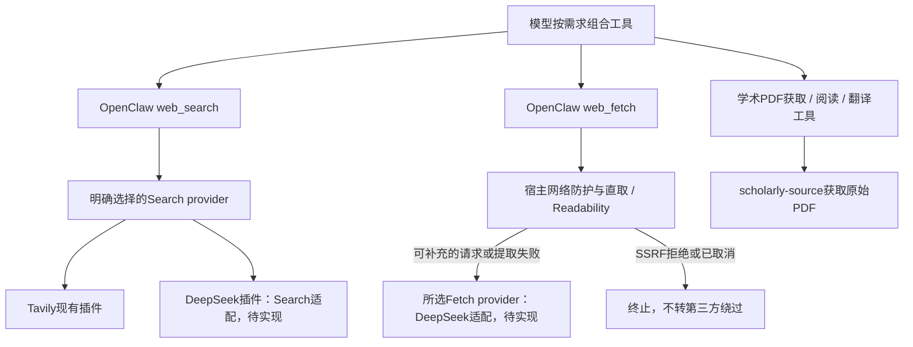

# 基础能力插件边界整理与检索接入设计

状态：**三项前置修改、回归、生产加载及文档/证据收尾已完成；检索提供方设计完成，尚未接入新API**。日期：2026-10-20（Asia/Shanghai）。阅读入口：[文档目录](README.md)。

## 需求与范围

用户要求在开发 DeepSeek Search/Fetch 前，先完成：已有生命周期修复的受控加载、共享代码归属与论文下载边界整理、天气容器拆分，然后更新规则文档并设计检索扩展边界。配套检查包含工作树归属、依赖方向、独立加载/停止/禁用的回归。当前只设计新检索提供方，不调用或接入新的付费 API。

架构原则：模型理解真实需求并组合基础工具；插件拥有领域操作和生命周期，后端负责可信输入、权限、结构化校验、事务、幂等、调度和实际投递。只在流程稳定、复杂且模型编排成功率不足时另行设计领域工作流；本轮不建设通用 Workflow/DAG 引擎，也不把异步 HTTP 能力塞进同步 Store。

## 完成清单

- [x] 核对源码、运行配置与开发指引；记录当前混合工作树基线。
- [x] 核对在途任务，构建并验证既有停止/确认注册补正，受控重启并通过运行检查。
- [x] 把沙箱执行、可信入站、结构化日志等共享能力归入共享包，消除共享包反向引用插件。
- [x] 分开公开论文下载与阅读解析；研究/翻译共同使用下载边界，翻译下载不依赖全文提取。
- [x] 拆分天气、Profile、行程、一次性提醒的插件注册与生命周期；保留现有数据、确认和既有任务兼容性。
- [x] 增加依赖边界、独立启停、下载/阅读隔离及原行为回归：533/533；真实隔离Gateway加载/禁用5/5。
- [x] 同步配置并受控重启；生产RPC确认独立插件与1/3/3/7工具归属，11个Cron声明未变，论文11项且无在途。
- [x] 更新相关规则与证据索引，写明检索提供方设计、未覆盖范围及 Git 收录状态。

## 起点与授权

起点提交 `9c88003`。本地主线当时领先缓存的 `origin/main` 28 个提交，未刷新远端。工作树已有身份权限、附件入口、人格/会话调查及生命周期修复等混合修改，不能把当时的HEAD当作完整复现基线。本轮不重置、丢弃或把这些修改混合提交；后续收录状态见本文末尾。

本轮授权包含上述三项结构修改及必要的受控 Fusion 加载、测试与文档维护；不新增身份、不改变工具权限语义、不向其他人或群外发、不推送远端。现有生产状态和业务库不删除、不重建，无数据库迁移计划；若需要 SQL，须先在后端保存脚本。

临时代码回退基线为 `/tmp/kurumi-decoupling-20261020-vqpnmihp/`，包含起点工作树文件与 SHA256；它只是本次编辑保护，不是停写生产恢复点。正式结果不依赖这个临时路径，验证结果将保存于 `docs/verification/capability-decoupling-2026-10-20/` 并登记索引。

## 已核实的结构与实施决定

1. 通用确认与 Policy/Store 已有实际替换与事务回归，保留其公共协议。论文/邮件显式 `stop()` 与确认逐次注册身份补正已于00:26:58首次生产加载，最终结构于00:51:20再次加载。
2. 共享包不依赖具体插件；插件组合入口可把 QQ 投递器、运行配置与领域服务接线。统一权限实现继续使用 `packages/access-control`，不放宽身份/渠道约束。
3. 公开 PDF 获取只负责来源、请求、限制和文件完整性；论文阅读负责文本/页图，翻译消费受管文档。保留受支持网站、TLS、大小、取消、缓存完整性等原约束。
4. 天气容器拆为 weather/profile/planning/reminders 四个独立插件；默认领域实现与历史共享 SQLite 放在 `packages/personal-domains`，各注册文件分别装配自己的工具/服务，不先注册全量再过滤。共享数据并不等于共享生命周期，不新增全局容器或工作流。
5. 不迁移 SQLite、不改变工具名和原始提醒的带码确认。核对后确认运行期确认 provider ID 不进入持久提案/grant，因此 Profile/Planning 改为各自 provider，并按持久 domain 过滤候选，避免同库重复命中；持久 domain、ID/hash、scope 和既有提案不改。提醒 provider 仍为 `personal-reminder`。这是对起初“所有后端 ID 不变”的修正，不能用同一个 provider 同时登记两个插件。
6. 旧 `personal-weather/dist/reminder-cli.js` 是已持久化 Cron 的稳定执行地址，保留最小版本化兼容入口；新提醒使用自身 runner 根目录。旧入口只转交同一实现，不维护第二份业务逻辑，也不重建既有任务。
7. 当前提醒列表走 KnowledgeMap 异步业务接口；同步领域适配器只适用于对应本地实现。检索沿用 OpenClaw 提供方契约，不另造重复注册表。
8. 共享实现包允许集中构建，但插件启用、工具归属、确认后端注册与服务停止分别独立。Profile/行程仍共用历史SQLite，暂不拆数据库，避免把生命周期整理扩大成数据迁移。

## 当前代码归属

以下路径均相对仓库根目录；共享包不运行时导入插件或部署脚本，依赖方向有回归约束。插件的组合入口仍可接线QQ实际投递器，不宣称插件之间完全没有组合依赖。

| 职责 | 唯一实现/入口 |
| --- | --- |
| 沙箱执行与进程树终止 | `chatbot/packages/sandbox/index.js` |
| 可信当前入站与引用边界 | `chatbot/packages/trusted-inbound/index.js`；领域再施加自己的准入策略 |
| 结构化事件与脱敏sink | `chatbot/packages/observability/index.js`；运维查询仍在 `scripts/fusion/log-query.mjs` |
| 公开学术PDF获取 | `chatbot/packages/scholarly-source/index.js`；研究/翻译共同消费 |
| 阅读文本与页图 | `chatbot/plugins/kurumi-research/papers.js`；研究缓存由 `kurumi-research.config.cacheRoot` 显式配置 |
| 翻译与受管文档导入 | `chatbot/plugins/kurumi-papers/service.js`、`chatbot/packages/documents/index.js`；下载成功后不要求研究全文提取成功 |
| 四领域默认实现 | `chatbot/packages/personal-domains/src/`；各 `*-plugin.ts` 分别装配，不全量注册后过滤 |
| 独立插件 | `chatbot/plugins/personal-{weather,profile,planning,reminders}/index.js` 及各自manifest |
| 构建与CLI兼容 | `chatbot/scripts/build-personal-plugins.mjs`；旧天气CLI与旧提醒地址仅转交同一共享实现 |

PDF源保留HTTPS网站白名单、禁重定向/凭据、45秒期限、25MiB、PDF签名/hash与符号链接检查。源缓存为 `<id>.pdf` + `<id>.source.json`；旧阅读缓存 `<id>.json` 校验后可直接复用。阅读解析失败不会使翻译下载失败。带独立取消信号的下载不合并取消，取消前不发布半文件；没有取消信号的相同下载可合并。

## 阶段记录

### 准备

- 已完整阅读根开发指引、配置同步契约与 `tp2.txt`；新文档序号26未被占用。
- 起点服务启动于2026-10-19 23:48:35，早于邮件/论文停止补正；因此先核实在途状态，再构建和受控加载，不把服务活动当成源码已加载。

### 既有修复加载

- 原论文状态11项，无 queued/running/dispatching；未取消用户任务。
- 确认核心、确认入口、天气三项构建与实际宿主服务管理器3项停止回归通过。
- 2026-10-20 00:26:58 受控重启 Fusion，运行健康检查通过（Gateway/QQ频道连接、testIngress关闭、业务库检查）。加载时间与构建源码指纹见 `verification/capability-decoupling-2026-10-20/initial-loaded.json`；没有用真人外发替代加载检查。

### 共享与下载边界

- 沙箱、可信入站、结构化日志已移至 `packages/sandbox`、`trusted-inbound`、`observability`；所有实际 import 已切换，旧实现文件删除。
- `packages/scholarly-source` 只获取 PDF；研究工具额外生成阅读缓存，翻译直接消费下载结果。支持验证旧阅读缓存的 PDF/hash 后复用，不强制再次下载或解析。
- 研究缓存新增显式 `cacheRoot`，不从 QQ 频道状态推导；下载/解析分离、旧缓存完整性和取消回归6/6。

### 独立注册与边界回归

- 新入口为 `chatbot/plugins/personal-{weather,profile,planning,reminders}/index.js`；每个入口只导入共享库对应的 `*-plugin.js`，分别注册1/3/3/7个原工具，不改工具白名单。
- 默认实现统一在 `chatbot/packages/personal-domains/src/`，有独立锁文件/依赖与构建；`chatbot/scripts/build-personal-plugins.mjs` 生成共享 dist 和3个旧/新CLI入口，清除天气旧 dist 容器残留。原天气构建/测试命令只作转交。
- 新确认适配器同时约束候选枚举和实际记录，只能处理本插件 domain；独立启停、历史提案继续提交、停用后不能跨域签发均有回归。实际宿主服务管理器会等待一次性提醒正在执行的维护批次结束；日志/服务ID改归 `personal-reminders`，防止停后仍有在途维护。
- 初轮18项边界回归通过；完整库162项原业务回归通过。初轮3个失败均为新夹具假设错误（所在地未改变不生成提案、身份拒绝的实际错误码、提醒CLI将usage写stderr），修正夹具后通过，没有放宽实现迎合测试。
- 完整回归533/533通过：Node337、默认领域162、确认核心19、确认入口15。新增等待停止用例包含在Node337；最后补齐邮件和并行记忆入口的共享授权import后，定向30/30复验通过，与总数有重叠不相加。
- 真实隔离Gateway5/5：全开和逐个禁用四插件，RPC同时核对实际工具归属、插件活动状态和确认后端；无需模型/API/QQ。两次夹具失败分别是探针未声明启动激活、SDK将禁用状态报告为`unloaded`，原始回执保留，未放宽工具或授权断言。
- 恢复隔离配置增加 `personal-profile` 的KnowledgeMap凭据/地址禁用，避免新增入口逃逸到生产API；只验证改写回归，本轮未运行全量备份恢复。

### 最终生产加载与并行开发边界

- 00:51:19通过 `sync-config.mjs --apply --defer-plugin=kurumi-memory` 同步拆分配置，00:51:20受控重启Fusion。重载前11个论文任务均无queued/running/dispatching；未取消或重放用户任务。
- 新增显式延期参数仅允许保留两端仍启用、`plugins.allow`包含且加载路径一致的**完整既有插件条目**，仅能配合`--diff/--apply`；普通`--check`永远比较完整仓库意图，不把部分部署冒充全量对齐。原9项自检通过后，补充负向用例发现遗漏了`plugins.allow`成员校验；修复后10项同步自检通过，包含未登记插件拒绝。前后回执与说明见[专项报告](verification/capability-decoupling-2026-10-20/README.md)；运维契约见[配置说明](../config/README.md)。
- 生产`plugins.list`确认四插件、论文、邮件、确认入口均active；`tools.catalog`确认weather/profile/planning/reminders分别拥有1/3/3/7个原工具。11个Cron的ID及schedule/payload/delivery/enabled指纹不变；论文仍11项、无在途；搜索仍Tavily。
- 本轮延期的是文档25的记忆部署。00:53:34运行配置随后被并行P2任务更新为连续性模式；本轮不回退、不代替其迁移/验收，不将“记忆配置从未变化”写为通过。该变化和实际配置/人格检查分别记录在本专项报告，最终P2部署结论由[文档25](25_人格、记忆与会话连续性.md)维护。
- 加载与声明证据见[final-loaded.json](verification/capability-decoupling-2026-10-20/final-loaded.json)，健康、依赖和完整配置/人格检查见[专项报告](verification/capability-decoupling-2026-10-20/README.md)。

### 文档与证据关闭

- 已更新唯一阅读入口、根开发指引、配置同步契约和相关当前规则；所有旧共享实现路径与当前代码归属对齐。保留历史原始报告及阶段计数，用后续指针说明已加载，不重写原始验收事实。
- 最终健康、依赖、完整配置/人格检查均退出0，QQ在线、testIngress=false，12份受管人格文件对齐；服务仍为00:51:20启动，15个已记录源码/构建指纹均匹配。元数据见[closeout-state.json](verification/capability-decoupling-2026-10-20/closeout-state.json)。
- 脚本索引187项、49份boundary声明双向一致；证据覆盖全部归类。收尾复核还为配置延期补充`plugins.allow`成员负向用例：先保存失败回执，再修复并通过10项自检。24份当前规则/入口/相关报告的本地链接目标均存在，`git diff --check`通过；只验证本地文件目标，不扩大为官网可达或Markdown锚点验收。完整文件分组由专项报告维护，没有未归属的本轮证据。
- 本轮无待用户决策阻塞；下一阶段按下述提供方设计实施。用户随后授权独立提交本轮改动，收录边界见文末；起点和并行工作仍不混入本次提交，也不宣称远端同步。

## 检索接入设计

### 已核实的宿主契约与采用方案

本机固定OpenClaw **2026.9.7** 已提供 `api.registerWebSearchProvider`、`api.registerWebFetchProvider`。类型声明在安装包 `dist/plugin-entry-q9C-gfAu.d.ts` 的web-provider-types；Fetch执行路径在 `dist/openclaw-tools-DCQphGzC.mjs` 的 `fetchWebPayload`。本轮实查安装源码，没有调用新的检索API。

推荐新增独立插件 `chatbot/plugins/kurumi-web-deepseek/`，在同一插件内分别实现Search和Fetch provider，继续暴露宿主原有 `web_search` / `web_fetch`。HTTP客户端、参数映射、响应规整留在插件内部；目前没有第二个消费者，不先建设新的共享检索包或注册表。它是两个基础能力的提供方适配，不是论文/提醒/天气工作流，也不新增同义工具。

**Fetch不是全量代理。** 本机原生主路径为直接HTTP与正文提取；所选Fetch provider在可补充的请求失败、非2xx、HTML提取失败或Readability关闭的HTML路径中参与，某些HTML失败路径还会使用基础提取。注册DeepSeek Fetch不等于每个URL都经DeepSeek，SSRF拒绝和取消不会转provider绕过。若以后要求所有网页均走第三方，应单独明确该语义与成本，不能在提供方适配中暗改宿主主路径。Markdown抓取不替代原始PDF、页图解析或交互浏览器。

### 接口、配置与维护规则（待实现）

| 边界 | 实施要求 |
| --- | --- |
| Search provider | `createTool(ctx)` 返回description、parameters、异步execute；遵守调用signal和`assertCurrent`，将query/count等映射到官方接口。不支持的日期/域过滤须明确说明或拒绝，不能静默丢弃后声称满足 |
| Fetch provider | 实现独立 `createTool/execute(args,{signal})`，按宿主url/extractMode/maxChars契约返回正文、来源URL/最终URL、状态和截断信息，由宿主继续包装外部不可信内容 |
| HTTP客户端 | 固定官方端点、凭据只从登记的私密来源解析；有限超时/响应大小/并发，支持取消；显式区分空结果、认证、限流、上游失败和未知回执 |
| 选择与禁用 | 仓库明确指定Search/Fetch所选provider，不因主模型也叫DeepSeek就隐式切换。不启用新的自动发现/多提供方收费重试；禁用插件后不残留工具或注册，回退用配置选择原provider |
| 权限与内容 | 延用宿主工具授权/调用时效和外部内容不可信边界；搜索结果、网页正文不产生业务写入、身份或确认授权，不增加通用文件/命令权限 |
| 缓存与费用 | 核对宿主缓存是否包含provider/有效参数，保留来源与截断事实；不把未知用量写成0，不把厂商“不成功不收费”的承诺扩大成模型tokens免费或本地取消后不计费 |
| 可观测性 | 复用 `packages/observability`，记录provider、工具、run/call关联、耗时、结果数、状态/取消/截断；默认不记完整query、网页或Key。运维查询增加只读适配，不让运行插件反向导入查询脚本 |

实施前复核DeepSeek官方Search/Fetch API参数、价格和空结果/失败计费定义；本轮未复核官网价格，不把历史调研当本轮验收。现有Tavily额外工具和权限如何处理须随真实provider实施一并审阅，不能仅改provider字符串就宣称全部检索链路切换。

### 下一阶段验收矩阵

1. 契约单元：查询参数、结果/正文映射、来源/长度/截断；不支持的过滤、空结果、401/429/5xx、超时、取消和畸形响应。
2. 宿主集成：插件单独启停、选择与回退、实际注册和模型可见工具；原生Fetch直取成功/补路径/SSRF拒绝/取消，不旁路宿主防护。
3. 权限与费用：请求失效后不继续发送、私密配置不进输出、无隐式提供方切换或无界重试；缓存跨provider不串结果，日志可追踪但不泄露正文。
4. 分开记录离线、本地HTTP、隔离宿主、真实API、真实模型和真人QQ；只在接口实现与离线验收完成后做有预算的真实请求，不以stub冒充真实效果。

## 验收与未覆盖范围

详细证据集中于[本轮报告](verification/capability-decoupling-2026-10-20/README.md)，不复制长日志。无数据库schema迁移/SQL；保留全部旧数据和任务。没有新检索API、真实模型对话、真人QQ/SMTP或付费翻译验收；没有全量停写恢复、后台项目副本更新或远端写入。

本轮没有必须追加的架构前置改造。三项整理配套的依赖方向、生命周期、兼容性、部署和文档核对是其关闭条件；P2记忆、新成员冷启动/渠道冷却、Tavily旧参数和真人体感各归对应任务，不扩大成本轮必须修完的范围。现有共享领域库与历史共享DB是明确保留的耦合，若日后确有独立版本发布/状态迁移需求再拆。

### Git收录边界

用户授权后，本轮按起点源码快照提取变更并单独提交：共享包归属、论文下载/阅读边界、四领域插件拆分、部署同步补正及配套测试、配置和文档。重叠文件按代码块收录；构建dist仍按仓库规则忽略。实际提交可用 `git log --oneline --grep='isolate personal capability plugins'` 查找。

结构拆分提交时，统一权限、附件入口、人格与P2记忆等并行改动仍留在工作区，没有混入本次提交。新共享领域入口和部分验收夹具当时依赖权限实现，验收也依赖起点已有的生命周期修复；因此本轮533项与生产加载结果对应完整工作树，不能等同于仅检出结构拆分提交的验收。上述是阶段性收录边界。随后权限、生命周期、附件与人格/记忆已分别进入本地提交，具体状态见[文档16](16_验收与测试总表.md#git工作线归档2026-10-20)。当前检索提供方仍只是设计，远端未推送。

返回[文档入口](README.md)。
