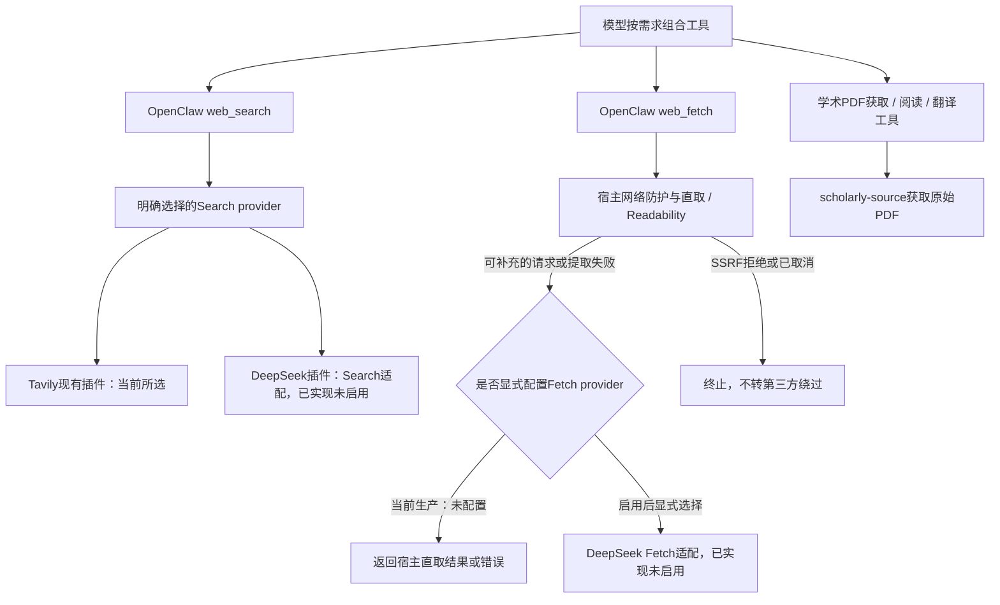

# 检索提供方接入设计

状态：**DeepSeek Search/Fetch插件已实现并通过离线测试，待复验；生产未启用，未发出真实API请求**。更新：2026-10-21。入口：[文档目录](README.md)。

## 需求、范围与当前进度

计划在OpenClaw原有`web_search`/`web_fetch`下增加DeepSeek提供方，保留模型自主组合基础工具的方式，不建设Workflow/DAG引擎。当前搜索仍为Tavily，不因主聊天也用DeepSeek而隐式切换。

- [x] 三项前置：生命周期补正加载、共享代码/PDF下载边界、四个个人领域插件独立装配；**现行规则唯一归[文档21](21_后端职责分层与代码整理.md#共享代码与插件生命周期)**。
- [x] 核实固定宿主的Search/Fetch扩展契约，完成下方设计与验收矩阵。
- [x] 2026-10-21复核官方API参数、限额、费用和失败计费（[Search/Fetch指南](https://api-docs.deepseek.com/guides/search/)、[价格](https://api-docs.deepseek.com/quick_start/pricing)），结论见下方“官方接口事实”。
- [x] 实现独立提供方、配置与日志查询适配，离线契约测试通过 · 待复验（主人统一复验）。
- [ ] 隔离宿主、真实API、真实模型、真人QQ各层验收；生产启用（配置+重启）。均需主人授权，真实请求另需预算。

已完成结构整理的命令、回归数量、隔离Gateway用例、生产加载、失败夹具、并行源码和Git边界统一保存在[专项报告](verification/capability-decoupling-2026-10-20/README.md)。不在本设计重复维护结构规则或长阶段时间线，也不将其验收扩大为新检索已接通。

## 检索接入设计

### 已核实的宿主契约与采用方案

本机固定OpenClaw **2026.9.7** 已提供 `api.registerWebSearchProvider`、`api.registerWebFetchProvider`。类型声明在安装包 `dist/plugin-entry-q9C-gfAu.d.ts` 的web-provider-types；Fetch执行路径在 `dist/openclaw-tools-DCQphGzC.mjs` 的 `fetchWebPayload`。2026-10-20核对固定安装源码时未调用新的检索API；2026-10-21实现前再次核对上述类型与执行路径，并复核官网文档（只读网页，未调用API）。

推荐新增独立插件 `chatbot/plugins/kurumi-web-deepseek/`，在同一插件内分别实现Search和Fetch provider，继续暴露宿主原有 `web_search` / `web_fetch`。HTTP客户端、参数映射、响应规整留在插件内部；目前没有第二个消费者，不先建设新的共享检索包或注册表。它是两个基础能力的提供方适配，不是论文/提醒/天气工作流，也不新增同义工具。

**Fetch不是全量代理。** 本机原生主路径为直接HTTP与正文提取。当前生产 `config/runtime.config.json` 的 `tools.web.fetch` 没有配置provider，图中的补充路径还不存在，失败时直接返回宿主结果。实施后，所选Fetch provider在可补充的请求失败、非2xx、HTML提取失败或Readability关闭的HTML路径中参与，某些HTML失败路径还会使用基础提取。注册DeepSeek Fetch不等于每个URL都经DeepSeek，SSRF拒绝和取消不会转provider绕过。若以后要求所有网页均走第三方，应单独明确该语义与成本，不能在提供方适配中暗改宿主主路径。Markdown抓取不替代原始PDF、页图解析或交互浏览器。

### 官方接口事实（2026-10-21复核）

| 项 | 官方定义 |
| --- | --- |
| 端点 | `POST https://api.deepseek.com/v1/tools/search`、`/v1/tools/fetch`，Bearer Key |
| Search参数 | `query` 1–128字符，支持 `site:`、`-site:`、`"短语"`、`-词`、`lang:`、`after:`、`before:`；`count` 1–50；可选 `ori_question`、`need_content` |
| Search结果 | `results[]`：`rerank_score`、`title`、`url`、`snippet`、`summary`、`content`、`site_name`、`site_icon`、`date`、`authority` |
| Fetch | `{url}` → `{title, content}`（Markdown） |
| 错误 | 400参数、401认证、402余额、403抓取被拒、404无正文、408超时、413过大、429限流、500内部、504下游超时；官方建议仅408/429/5xx可重试 |
| 计费与限额 | 每1000次成功且非空请求0.75美元；失败、空结果、超时不计费。Search 100 QPS、Fetch 25 QPS |

“不成功不收费”只覆盖DeepSeek检索请求本身；模型读入检索结果的tokens照常计费，本地取消但上游已完成的请求是否计费无法从本地确认。

### 已实现产物与已定判断（待复验）

| 边界 | 实现 |
| --- | --- |
| 插件 | [`chatbot/plugins/kurumi-web-deepseek/`](../chatbot/plugins/kurumi-web-deepseek/)：`index.js`注册Search/Fetch provider（ID `deepseek`），`client.js`为固定端点HTTP客户端；清单 `contracts.webSearchProviders/webFetchProviders` 均声明 `deepseek`，`activation.onStartup:false` |
| 配置 | `credentialsFile`（必填绝对路径，JSON内 `DEEPSEEK_API_KEY`；须为普通文件、非符号链接、权限不含组/其他位）、`traceFile`（可选绝对路径）、`timeoutSeconds`（1–60，默认25）。Key每次调用时读取，不进入宿主配置或环境变量 |
| 选择 | `requiresCredential:false`、`envVars:[]`、无 `authProviderId/autoDetectOrder`：宿主自动发现永远不会选中它，必须显式写 `tools.web.search.provider` / `tools.web.fetch.provider` 为 `deepseek` |
| Search | 只接受 `query`、`count`（1–10，默认5）；其他参数（如freshness、域名过滤字段）返回 `unsupported_parameter` 并提示改写成query运算符，不静默丢弃。标题/摘要用宿主 `wrapWebContent` 包装、共20000字符预算并标 `truncated`；结果带 url、站点、日期、score、authority，`externalContent.untrusted=true`。插件内缓存（最多100条，TTL取 `tools.web.search.cacheTtlMinutes`，默认15分钟），只缓存非空结果，键为query+count，不与其他provider共享 |
| Fetch | 按宿主 `{url, extractMode, maxChars}` 契约返回 `title/text/finalUrl/status/contentType/extractor/rawLength`；`text` 模式做轻量Markdown转纯文本。长度截断、落盘和不可信包装仍由宿主完成。宿主SSRF拒绝或取消时不会调用provider；插件另外拒绝本机、内网、链路本地、IPv4映射/NAT64、无点主机名和带用户名密码的URL |
| HTTP | `redirect:'error'`、默认超时25秒、响应上限4 MiB、最多4个并发且排队可取消；发送前再执行 `assertCurrent`。错误码：`cancelled`、`timeout`、`network_failed`、`invalid_response`，以及上表状态码对应的 `auth_failed`、`insufficient_balance`、`rate_limited`、`upstream_timeout`、`upstream_failed` 等；错误带HTTP状态供宿主诊断，消息不转述上游正文。插件不自动重试，避免重复计费 |
| 可观测性 | 配置 `traceFile` 后每次真实调用写一条 `web-deepseek/provider_call`（0600）：工具、`ok/empty/error/cancelled`、错误码、HTTP状态、耗时、query字符数、结果数、截断；不记query文本、URL、正文或Key。只读查询 `log-query.mjs --source web-deepseek`，见[文档18](18_跨模块链路日志查询.md#适配器与关联规则)。宿主provider上下文（2026.9.7）不传run/toolCallId，只能按时间与会话工具调用对照 |
| 权限与内容 | 不新增工具名或权限；仍是宿主 `web_search`/`web_fetch` 的授权与调用时效；结果不产生业务写入或确认授权 |

离线测试：`chatbot/tests/web-deepseek/*.test.mjs`（12项，注入fetch，不发网络请求）。覆盖参数映射、结果规整与包装、截断、缓存、空结果、全部官方错误码、超时/取消/调用失效、畸形与超限响应、并发上限、URL拒绝、凭据文件权限、Key与query不进结果/错误/日志、清单与注册ID一致、不可自动发现，以及日志查询适配。

**启用步骤（未执行，需主人授权）**：建立0600凭据文件；在运行配置加入插件加载路径与 `plugins.entries.kurumi-web-deepseek.config`；显式设置Search/Fetch provider；重启Gateway（影响在线QQ）。回退：把provider改回 `tavily`/删除fetch provider并重启。Tavily插件的额外工具在切换后是否保留须随启用一并决定，不能只改provider字符串就宣称全部检索链路已切换。

### 下一阶段验收矩阵

1. 契约单元：查询参数、结果/正文映射、来源/长度/截断；不支持的过滤、空结果、401/429/5xx、超时、取消和畸形响应。**离线已通过，待复验。**
2. 宿主集成：插件单独启停、选择与回退、实际注册和模型可见工具；原生Fetch直取成功/补路径/SSRF拒绝/取消，不旁路宿主防护。**未做，需隔离宿主授权。**
3. 权限与费用：请求失效后不继续发送、私密配置不进输出、无隐式提供方切换或无界重试；缓存跨provider不串结果，日志可追踪但不泄露正文。**离线部分已通过，待复验；隐式切换的宿主侧确认归第2项。**
4. 分开记录离线、本地HTTP、隔离宿主、真实API、真实模型和真人QQ；只在接口实现与离线验收完成后做有预算的真实请求，不以stub冒充真实效果。**目前只有离线层。**

## 实施与记录入口

实现代码在上表插件目录，离线测试在`chatbot/tests/web-deepseek/`；本文登记精确产物、已定判断与未完成项，隔离宿主或真实API证据按文档16规则进入`verification/`并登记文档归属。插件已在仓库但未进入生产加载列表，生产搜索仍为Tavily。

本设计不改变身份权限、业务数据库、已有确认口令或Cron。开始实现前复核当前Git工作区和活动任务；真实API/模型、外发、重启和停写恢复按实际授权分别记录，离线通过不等于这些层级已验收。TradeSim/Notes、P2记忆、新成员冷启动、渠道冷却、Tavily历史参数和长期体验分别归现有领域文档，不作为新的架构前置继续堆入本文。

返回[文档入口](README.md)。
