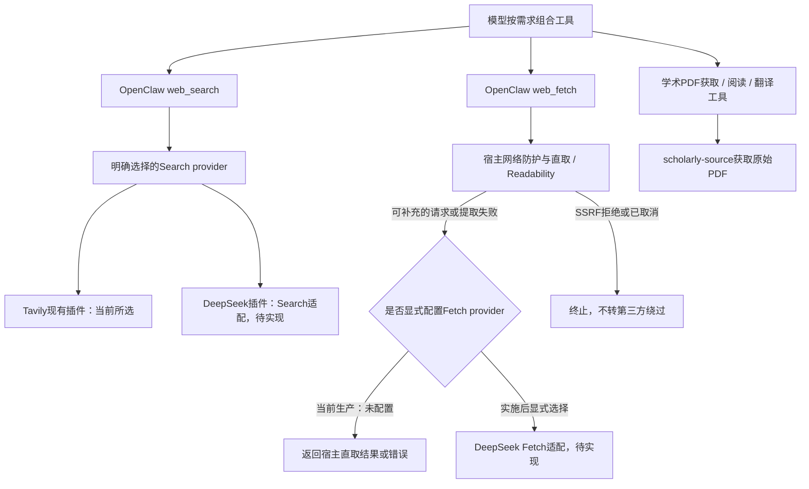

# 检索提供方接入设计

状态：**架构前置已完成并加载，DeepSeek Search/Fetch尚未实现或接入新API**。更新：2026-10-21。入口：[文档目录](README.md)。

## 需求、范围与当前进度

计划在OpenClaw原有`web_search`/`web_fetch`下增加DeepSeek提供方，保留模型自主组合基础工具的方式，不建设Workflow/DAG引擎。当前搜索仍为Tavily，不因主聊天也用DeepSeek而隐式切换。

- [x] 三项前置：生命周期补正加载、共享代码/PDF下载边界、四个个人领域插件独立装配；**现行规则唯一归[文档21](21_后端职责分层与代码整理.md#共享代码与插件生命周期)**。
- [x] 核实固定宿主的Search/Fetch扩展契约，完成下方设计与验收矩阵。
- [ ] 实施前重新核对官方API参数、费用和失败计费；本轮没有重查官网价格。
- [ ] 实现独立提供方、配置、日志查询适配与分层验收；尚无新API请求或付费调用。

已完成结构整理的命令、回归数量、隔离Gateway用例、生产加载、失败夹具、并行源码和Git边界统一保存在[专项报告](verification/capability-decoupling-2026-10-20/README.md)。不在本设计重复维护结构规则或长阶段时间线，也不将其验收扩大为新检索已接通。

## 检索接入设计

### 已核实的宿主契约与采用方案

本机固定OpenClaw **2026.9.7** 已提供 `api.registerWebSearchProvider`、`api.registerWebFetchProvider`。类型声明在安装包 `dist/plugin-entry-q9C-gfAu.d.ts` 的web-provider-types；Fetch执行路径在 `dist/openclaw-tools-DCQphGzC.mjs` 的 `fetchWebPayload`。2026-10-20核对固定安装源码时未调用新的检索API；本次文档归并未重新探查宿主或官网。

推荐新增独立插件 `chatbot/plugins/kurumi-web-deepseek/`，在同一插件内分别实现Search和Fetch provider，继续暴露宿主原有 `web_search` / `web_fetch`。HTTP客户端、参数映射、响应规整留在插件内部；目前没有第二个消费者，不先建设新的共享检索包或注册表。它是两个基础能力的提供方适配，不是论文/提醒/天气工作流，也不新增同义工具。

**Fetch不是全量代理。** 本机原生主路径为直接HTTP与正文提取。当前生产 `config/runtime.config.json` 的 `tools.web.fetch` 没有配置provider，图中的补充路径还不存在，失败时直接返回宿主结果。实施后，所选Fetch provider在可补充的请求失败、非2xx、HTML提取失败或Readability关闭的HTML路径中参与，某些HTML失败路径还会使用基础提取。注册DeepSeek Fetch不等于每个URL都经DeepSeek，SSRF拒绝和取消不会转provider绕过。若以后要求所有网页均走第三方，应单独明确该语义与成本，不能在提供方适配中暗改宿主主路径。Markdown抓取不替代原始PDF、页图解析或交互浏览器。

### 接口、配置与维护规则（待实现）

| 边界 | 实施要求 |
| --- | --- |
| Search provider | `createTool(ctx)` 返回description、parameters、异步execute；遵守调用signal和`assertCurrent`，将query/count等映射到官方接口。不支持的日期/域过滤须明确说明或拒绝，不能静默丢弃后声称满足 |
| Fetch provider | 实现独立 `createTool/execute(args,{signal})`，按宿主url/extractMode/maxChars契约返回正文、来源URL/最终URL、状态和截断信息，由宿主继续包装外部不可信内容 |
| HTTP客户端 | 固定官方端点、凭据只从登记的私密来源解析；有限超时/响应大小/并发，支持取消；显式区分空结果、认证、限流、上游失败和未知回执 |
| 选择与禁用 | 仓库明确指定Search/Fetch所选provider，不因主模型也叫DeepSeek就隐式切换。不启用新的自动发现/多提供方收费重试；禁用插件后不残留工具或注册，回退用配置选择原provider |
| 权限与内容 | 延用宿主工具授权/调用时效和外部内容不可信边界；搜索结果、网页正文不产生业务写入、身份或确认授权，不增加通用文件/命令权限 |
| 缓存与费用 | 核对宿主缓存是否包含provider/有效参数，保留来源与截断事实；不把未知用量写成0，不把厂商“不成功不收费”的承诺扩大成模型tokens免费或本地取消后不计费 |
| 可观测性 | 复用 `packages/observability`，记录provider、工具、run/call关联、耗时、结果数、状态/取消/截断；默认不记完整query、网页或Key。运维查询增加只读适配，不让运行插件反向导入查询脚本 |

实施前复核DeepSeek官方Search/Fetch API参数、价格和空结果/失败计费定义；本轮未复核官网价格，不把历史调研当本轮验收。现有Tavily额外工具和权限如何处理须随真实provider实施一并审阅，不能仅改provider字符串就宣称全部检索链路切换。

### 下一阶段验收矩阵

1. 契约单元：查询参数、结果/正文映射、来源/长度/截断；不支持的过滤、空结果、401/429/5xx、超时、取消和畸形响应。
2. 宿主集成：插件单独启停、选择与回退、实际注册和模型可见工具；原生Fetch直取成功/补路径/SSRF拒绝/取消，不旁路宿主防护。
3. 权限与费用：请求失效后不继续发送、私密配置不进输出、无隐式提供方切换或无界重试；缓存跨provider不串结果，日志可追踪但不泄露正文。
4. 分开记录离线、本地HTTP、隔离宿主、真实API、真实模型和真人QQ；只在接口实现与离线验收完成后做有预算的真实请求，不以stub冒充真实效果。

## 实施与记录入口

实现代码放拟议的独立插件，领域测试放`chatbot/tests/`，后端管理脚本放`chatbot/scripts/`；开发时在本文登记精确产物、已定判断与未完成项，证据按文档16规则进入`verification/`并登记文档归属。该插件目前不存在，文中的目录是计划，不是失效生产路径。

本设计不改变身份权限、业务数据库、已有确认口令或Cron。开始实现前复核当前Git工作区和活动任务；真实API/模型、外发、重启和停写恢复按实际授权分别记录，离线通过不等于这些层级已验收。TradeSim/Notes、P2记忆、新成员冷启动、渠道冷却、Tavily历史参数和长期体验分别归现有领域文档，不作为新的架构前置继续堆入本文。

返回[文档入口](README.md)。
