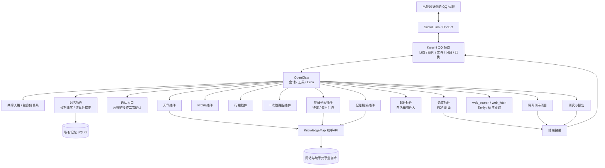

# QQ 融合助手架构与边界

本文只描述当前架构。文档入口在 [`README.md`](README.md)，验收规则在 [`16_验收与测试总表.md`](16_验收与测试总表.md)。

## 架构决定

**OpenClaw 是唯一助手宿主，Kurumi 是能力项目，SnowLuma 提供 QQ 传输，DSH 不在助手主链路内。**


```

不再维护第二套会话、提醒或 QQ 投递宿主。DSH 可以独立提供网页或模型服务，但启动它不应启动旧 qq-bridge，也不能成为 QQ 消费者。

## 当前资产

| 职责 | 路径或状态 |
| --- | --- |
| 新源码 | `/home/afrangry/kurumi-fusion`，MyBot `main` |
| 新运行状态 | `/home/afrangry/.openclaw-fusion`，凭据、会话、数据库和任务状态 |
| 旧系统 A | `/home/afrangry/kurumi-archive/legacy-openclaw`，只作为回退材料 |
| 旧系统 B | `/home/afrangry/kurumi-archive/qq-bridge`，配合 SnowLuma 和 DSH |
| 共享业务 | `/home/afrangry/repository` 的 KnowledgeMap MySQL；`knowledgemap-assistant.service` 提供 loopback 3086 API |
| QQ 传输 | `/home/afrangry/snowluma` 的受管服务 |
| 恢复材料 | `/home/afrangry/kurumi-backups` |

新系统不依赖 `/home/afrangry/.openclaw`；该原路径不存在。旧系统只能按[回退规则](15_旧系统回退.md)恢复，不能直接从归档路径启动。

## 能力边界

- QQ 身份及功能授权由 `config/access-control.json` 统一管理；只接收已登记用户私聊并回传自身，群聊关闭。成员使用独立 Agent/workspace，只允许聊天与自身论文等首期能力；个人业务仍仅主人。当前名单及真人验收状态见[文档24](24_统一身份与权限管理.md)。
- 人格素材来自 `roles/`，共享世凪性格并按可信身份选择关系，主人记忆不进入成员会话；人格与连续性唯一事实边界见[文档25](25_人格、记忆与会话连续性.md)。DeepSeek Flash 是当前主模型；模型配置见[配置契约](../config/README.md#主模型与人格切换)，图片验证边界见[文档10](10_融合助手运行维护.md#qq图片与引用)。
- 天气、Profile、行程和一次性提醒是四个独立插件，分别注册工具、确认后端和服务生命周期；默认实现共用 `packages/personal-domains`，Profile/行程仍保留历史共享SQLite。通用确认由 `confirmation-core` 提供，业务提交、grant消费、幂等、取消和投递对账在领域内完成。现行职责、共享代码、下载/阅读与生命周期统一归[文档21](21_后端职责分层与代码整理.md)；待实施检索设计见[文档26](26_基础能力插件边界整理与检索接入设计.md)。
- [提醒列表](19_提醒列表与定时汇总.md)与网站共用KnowledgeMap事项，逾期仍待做；本地只保留偏好/投递账本。账单支持明确新增、查询和月汇总，天气经同一业务API；接口、迁移与迭代范围见[文档23](23_KnowledgeMap业务能力桥接.md)。
- 代码任务在恢复项目副本和 Bubblewrap 中执行；项目检查不能访问生产目录、主机服务总线或真实网络。
- 研究材料与报告保存在私有运行目录；原始论文和页图与可写笔记分离。

## 依赖与升级

OpenClaw SDK 和 `ws` 使用已验收的固定版本。源码依赖由仓库 lockfile 管理，运行状态不进入 Git。升级必须经过依赖检查、构建、领域回归和隔离恢复验收，再更新部署服务。

## 当前运行

- `kurumi-fusion.service`：默认助手，`active/enabled`。
- `knowledgemap-assistant.service`：常驻业务API，`active/enabled`；独立于网站开发服务器。
- `snowluma.service`、`snowluma-qq.service`：QQ 传输，`active/enabled`。
- `openclaw-gateway.service`、`qq-bridge.service`：旧消费者，`inactive` 且**已 mask**（2026-10-10 起，单元原件归档在 `/home/afrangry/kurumi-archive/legacy-units/`；手动 `start` 被拒绝）。恢复旧系统前须按[文档 15](15_旧系统回退.md)只解除所选单元的屏蔽。
- `dsh-web.service`：可独立运行，但不消费 QQ。
- `testIngress=false`；验收入口关闭，日常不执行真实外发测试脚本。

## 维护边界

行为修改先改源码和配置来源，再同步私有运行目录；会话和长期记忆在运行目录维护；业务数据库和专用token在各自登记的私密位置备份。配置同步遵循 [`config/README.md`](../config/README.md)，资产与恢复点归属遵循[文档 12](12_目录资产与Git备份整理.md)，备份与恢复的验收标准遵循[文档 16](16_验收与测试总表.md)，旧系统切换遵循[文档 15](15_旧系统回退.md)；测试证据统一从文档 16 和 `verification/INDEX.md` 查找。
