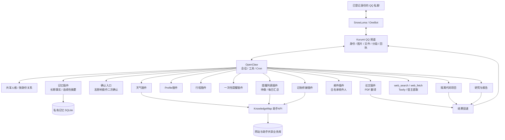

# QQ 融合助手架构与运行维护

<a id="qq-融合助手架构与边界"></a>
<a id="融合助手运行维护"></a>

类型：架构规则与操作手册。状态：维护现行架构、开发运维与后台副本契约；各领域上线范围、验收结论和未完成项分别见归属文档与[验收总表](16_验收与测试总表.md)。

本文说明系统如何组成、职责与能力边界，以及开发、检查和维护的操作路径。阅读入口见[README](README.md)，配置意图与运行事实的分工见[配置契约](../config/README.md)；逐轮开发和部署过程进入验证记录。

按需阅读：[系统架构](#架构决定) · [三模块](#人格记忆与功能三模块) · [目录与资产](#当前资产) · [能力边界](#能力边界) · [服务职责](#服务职责与运行检查) · [健康与同步](#常用操作) · [开发验证与升级](#开发与验证) · [QQ图片与引用](#qq图片与引用) · [链路查询](#跨模块链路查询) · [项目接入](#代码项目接入与合入) · [副本维护](#后台开发副本契约) · [栈启停](#dsh与融合栈统一启停)。

先做只读检查，再按本次改动与授权选择构建、同步或重启。已结束的依赖部署与基线观察见[阶段记录](archive/documentation-2026-10-23/10_融合助手运行维护.md)。

## 架构决定

**OpenClaw 是唯一助手宿主，Kurumi 是能力项目，SnowLuma 提供 QQ 传输，DSH 不在助手主链路内。**



不再维护第二套会话、提醒或 QQ 投递宿主。DSH 可以独立提供网页或模型服务，但启动它不应启动旧 qq-bridge，也不能成为 QQ 消费者。

## 人格、记忆与功能三模块

项目同时承担情感陪伴与 AI 助手两种角色。三模块是逻辑职责划分，不要求每个模块独占数据库、构建或进程：

| 模块 | 负责什么 | 代码与规则入口 |
| --- | --- | --- |
| 人格 | 性格、身份、表达方式及按可信身份选择的关系背景 | `roles/`、`config/persona.json`、`scripts/fusion/templates/` → `scripts/fusion/sync-persona.mjs`；规则归[25](25_人格、记忆与会话连续性.md) |
| 记忆 | 本人的长期事实、有限期近期摘要；与宿主聊天历史共同提供连续性 | `chatbot/plugins/kurumi-memory/continuity/`、`chatbot/plugins/kurumi-memory/inbound.js`；宿主管理原生会话，规则归[25](25_人格、记忆与会话连续性.md) |
| 功能 | 天气、资料/行程、提醒、日志、论文、邮件及后台项目等能力 | `chatbot/plugins/`、共享 `chatbot/packages/` 与运维 `scripts/fusion/`；代码分层归[21](21_后端职责分层与代码整理.md) |

角色设定不自动成为用户事实；聊天原文、运行日志与任务账本也不自动成为陪伴记忆。工具执行仍受可信身份、授权和领域事务约束，不能由人格关系或模型自述决定权限。

早期设计素材保留在[tp.txt](tp.txt)。其中“能力边界明确、模型负责理解、后端负责确定执行、稳定事实与动态状态分离”等原则与当前分层一致；PlanIR、DAG 和完整控制平面不据此视为已实现或当前开发任务。

## 当前资产

| 职责 | 路径或状态 |
| --- | --- |
| 源码主仓库 | `/home/afrangry/kurumi-fusion`，保存源码与配置意图；Git 状态按[资产文档](12_目录资产与Git备份整理.md#git-与实时状态查询)实查 |
| 私有运行状态 | `/home/afrangry/.openclaw-fusion`，凭据、会话、数据库和任务状态 |
| 旧系统历史 | 原A/B系统及物理归档已退役，必要独有源码历史保留在私密备份根history/ |
| 共享业务 | `/home/afrangry/repository` 的 KnowledgeMap MySQL；`knowledgemap-assistant.service` 提供 loopback 3086 API |
| QQ 传输 | `/home/afrangry/snowluma` 的受管服务 |
| 恢复材料 | `/home/afrangry/kurumi-backups` |

融合助手不依赖 `/home/afrangry/.openclaw`。当前恢复与旧系统退役边界见[资产与回退手册](12_目录资产与Git备份整理.md#旧系统回退)，不再承诺旧A/B整套运行恢复。

## 能力边界

- QQ 身份及功能授权由 `config/access-control.json` 统一管理；只接收已登记用户私聊并回传自身，群聊关闭。成员使用独立 Agent/workspace，只允许聊天与自身论文等首期能力；个人业务仍仅主人。当前名单及真人验收状态见[文档24](24_统一身份与权限管理.md)。
- 人格素材来自 `roles/`，共享世凪性格并按可信身份选择关系，主人记忆不进入成员会话；人格与连续性唯一事实边界见[文档25](25_人格、记忆与会话连续性.md)。DeepSeek Flash 是当前主模型；模型配置见[配置契约](../config/README.md#主模型与人格切换)，图片验证边界见[QQ图片与引用](#qq图片与引用)。
- 天气、Profile、行程和一次性提醒是四个独立插件，分别注册工具、确认后端和服务生命周期；默认实现共用 `packages/personal-domains`，Profile/行程仍保留历史共享SQLite。通用确认由 `confirmation-core` 提供，业务提交、grant消费、幂等、取消和投递对账在领域内完成。现行职责、共享代码、下载/阅读与生命周期统一归[文档21](21_后端职责分层与代码整理.md)；待实施检索设计见[文档26](26_基础能力插件边界整理与检索接入设计.md)。
- [提醒列表、记账与天气](23_KnowledgeMap业务能力桥接.md)经KnowledgeMap业务API共用网站数据；用户规则、每日播报、接口、版本与迁移在同一文档维护。
- 代码任务在独立项目副本和 Bubblewrap 中执行；项目检查不能访问生产目录、主机服务总线或真实网络。
- 研究材料与报告保存在私有运行目录；原始论文和页图与可写笔记分离。

## 服务职责与运行检查

- `kurumi-fusion.service`：默认助手。
- `knowledgemap-assistant.service`：常驻业务API，独立于网站开发服务器。
- `snowluma.service`、`snowluma-qq.service`：QQ 传输。
- `openclaw-gateway.service`、`qq-bridge.service`：旧消费者；日常保持屏蔽。恢复旧系统前须按[旧系统回退](12_目录资产与Git备份整理.md#解除屏蔽的阶段)只解除所选单元的屏蔽。
- `dsh-web.service`：可独立运行，但不消费 QQ。
- `testIngress=false`；验收入口关闭，日常不执行真实外发测试脚本。

上面列服务职责与预期约束，实时 active/enabled 状态由 `node scripts/fusion/health.mjs` 核对；操作见[常用操作](#常用操作)。

## 维护边界

行为修改先改源码和配置来源，再同步私有运行目录；会话和长期记忆在运行目录维护；业务数据库和专用token在各自登记的私密位置备份。配置同步遵循 [`config/README.md`](../config/README.md)，资产归属、备份保留与旧系统切换遵循[资产与回退手册](12_目录资产与Git备份整理.md)，Fusion备份与恢复的验收标准遵循[验收总表](16_验收与测试总表.md)；测试证据统一从文档 16 和 `verification/INDEX.md` 查找。

## 常用操作

以下命令在`/home/afrangry/kurumi-fusion`执行；按当前任务选择一组，不整页批量执行。

### 只读检查

```bash
node scripts/fusion/health.mjs
systemctl --user status kurumi-fusion.service
journalctl --user -u kurumi-fusion.service -n 100 --no-pager
systemctl --user status snowluma.service snowluma-qq.service
```

`health.mjs`只读，不发QQ、不创建任务；兼容入口`probe-final.mjs`指向同一检查。合法活动提醒会列出状态。QQ断线先看SnowLuma/QQ服务及online状态，不重启旧bridge。默认滚动24小时500条额度按物理消息计数，不清空历史绕过。

### 配置同步

先分别审阅配置与人格差异，只读命令为：

```bash
node scripts/fusion/sync-config.mjs --diff
node scripts/fusion/sync-persona.mjs --diff
```

确认改动属于本次已授权部署后，按涉及内容选择写入命令：

```bash
node scripts/fusion/sync-config.mjs --apply
node scripts/fusion/sync-persona.mjs --apply
```

运行配置变更同步后需要重启；仅四份受管人格文件变更，当前宿主下一回合加载。身份登记还有工作区准备顺序，见[文档24](24_统一身份与权限管理.md#登记与撤权)。受管键、删除语义及凭据入口以[配置契约](../config/README.md)为准。

### 服务启停

以下均改变服务状态；按本次具体授权执行所需动作：

```bash
systemctl --user restart kurumi-fusion.service
systemctl --user stop kurumi-fusion.service
systemctl --user start kurumi-fusion.service
```

停止服务不只杀子进程，否则Restart策略会拉起。`run-gateway.mjs`是前台入口，日常不与systemd并开。首次`install-service.mjs`会禁用旧助手并启用融合，只用于明确切换。DSH与Fusion联合启停另见[栈启停](#dsh与融合栈统一启停)，QQ传输独立管理。

## 开发与验证

诊断日志由宿主按10MiB轮转，Gateway启动/运行时清理7天前的旧日志，活动诊断文件总预算60MiB。插件捕获只是运行代码临时副本，Gateway退出后清理，下一次启动前清理遗留；不会作为恢复数据备份。配置同步仅在统一备份根 `.working/config-sync/openclaw.before.json` 留一份待验证回退副本，验证完成后由整理/发布流程移除。宿主维护的last-good按其消费契约保留。

文档与脚本归属检查只扫描本仓库；目录内含 `.git` 目录或工作树指针文件时视为另一个仓库边界，不递归扫描。普通嵌套目录仍纳入检查，避免用目录名排除掩盖游离脚本。

开发目录与私有运行状态按[目录与资产](#当前资产)和[维护边界](#维护边界)区分。人格行为模板在`scripts/fusion/templates/AGENTS.md`，修改后按[配置同步](#配置同步)投影到私有workspace；人格来源仍由roles/config管理。

先用`node scripts/fusion/link-dependencies.mjs`准备开发依赖。下表是按领域选择的离线构建/验证入口，不是一次全项目验收；确认消费方测试前先依次构建确认核心、确认入口和共享领域库。

| 领域 | 命令与前提 |
| --- | --- |
| 确认核心 | `npm --prefix chatbot/packages/confirmation-core run build`；`npm --prefix chatbot/packages/confirmation-core test` |
| 确认入口 | `npm --prefix chatbot/plugins/personal-confirmation run build` |
| 四领域共享实现与兼容CLI | `node chatbot/scripts/build-personal-plugins.mjs`；`npm --prefix chatbot/packages/personal-domains test` |
| QQ、旧记忆接口、后台任务与研究 | `node --test chatbot/plugins/kurumi-qq/test/*.test.js chatbot/plugins/kurumi-memory/test/*.test.js chatbot/plugins/kurumi-tasks/test/*.test.js chatbot/plugins/kurumi-research/test/*.test.js` |
| 提醒列表 | `node --test chatbot/tests/reminder-list/*.test.mjs` |
| 后端边界 | `node --test chatbot/tests/backend-boundaries/*.test.mjs` |
| 适配器 | `node --test chatbot/tests/domain-adapters/*.test.mjs` |
| 权限 | `node --test chatbot/tests/access-control/*.test.mjs` |
| 本机编码委托 | `node --test chatbot/tests/coding/*.test.mjs`；真实DSH、隔离宿主与QQ按[文档28](28_本机编码工具委托与实验任务.md#后续实施与验收)分别授权与记录，不批量执行`acceptance-*.mjs` |
| 检索提供方 | `node --test chatbot/tests/web-deepseek/*.test.mjs` |
| E7只读数据 | `npm --prefix chatbot/plugins/kurumi-e7 run build`；`node --test chatbot/tests/e7/*.test.mjs`；实际HTTP/宿主/模型记录归文档27，不能用离线结果代替QQ验收 |
| 人格与连续性记忆 | `node --test chatbot/tests/persona/*.test.mjs` |
| KnowledgeMap桥接 | `node --test chatbot/tests/knowledgemap/*.test.mjs` |
| 邮件与论文Node层 | `node --test chatbot/plugins/kurumi-mail/test/*.test.js chatbot/tests/papers/*.test.mjs` |
| 论文协议Python层 | `python3 chatbot/tests/papers/responses_test.py`；其余并发/可靠性用例见文档22 |
| 论文排版引擎 | `/home/afrangry/.openclaw-fusion/venvs/paper-translation/bin/python chatbot/tests/papers/engine_test.py` |


后端职责分层、Policy/Store 适配器与确认共享接口见[文档 21](21_后端职责分层与代码整理.md)；跨层回归在 `chatbot/tests/backend-boundaries/`，替换回归在 `chatbot/tests/domain-adapters/`。确认消费方回归须先构建确认核心、确认入口和共享领域库三个 TypeScript 包。

天气、Profile、行程、一次性提醒在各自插件独立装配；`build-personal-plugins.mjs` 集中构建共享实现并生成兼容CLI。不要删除旧 `personal-weather/dist/reminder-cli.js`：恢复的旧Cron可能仍以此为执行地址；新提醒使用 `personal-reminders`。原天气包的build/test命令只作转交；依赖安装按共享库自己的锁文件进行。现行归属与兼容规则见[文档21](21_后端职责分层与代码整理.md#共享代码与插件生命周期)，独立启停证据见其专项报告。

QQ 身份/权限/邮件目标只改 `config/access-control.json`，用 `chatbot/scripts/access-control.mjs --check/--matrix` 审阅；成员人格和路由均由同步工具生成，不能只改频道 owner 或工具上限。登记、撤权、独立目录与真人验证按[文档24](24_统一身份与权限管理.md)。

<a id="依赖与升级"></a>

### 固定依赖与升级恢复

| 项目 | 当前约束与操作入口 |
| --- | --- |
| 宿主/连接库 | 版本由 `config/openclaw-release.json` 指定（当前OpenClaw **2026.11.1**、`ws` **8.22.0**）；以 `verify-dependencies.mjs` 检查。仓库 `node_modules/openclaw` 链接到全局安装，全局升级也会替换仓库依赖 |
| 全局升级 | 不直接运行 `openclaw update`；先更新版本契约、锁文件并验证。`run-gateway.mjs` 将非自身请求的子进程退出（含0）视为失败，systemd 按失败重试；版本检查持续失败时重试到限后停在 failed，用 `systemctl --user --failed` 检查 |
| 交互保护 | `scripts/fusion/openclaw-update-guard.sh` 可由 `~/.bashrc` 加载；拦截普通 `openclaw update`，放行 `update status`、`--dry-run`、`--help`。显式升级用 `KURUMI_ALLOW_OPENCLAW_UPDATE=1`；它不能拦截 `npm i -g`、绝对路径或 `command openclaw update` |
| 服务模板 | 源码模板和已安装单元分别维护；同步单元后执行 `systemctl --user daemon-reload`。Fusion 的 `Wants=` 包含 SnowLuma/QQ；是否运行仍以健康检查为准 |
| 依赖安装 | 领域包按各自 lockfile 执行 `npm ci`；第三方 Tavily 由 `install-plugins.mjs` 和 `config/plugins.package-lock.json` 管理 |
| 主机工具 | Git、Bubblewrap、Poppler、prlimit；不依赖旧 `.openclaw` 或归档树 |

仅当当前数据库与批准版本匹配、全局宿主意外被替换时，可使用系统 Node 重装批准版（shell 中 nvm 的 Node 22 低于该宿主要求）。跨版本回退必须还原对应恢复点状态：

```bash
PATH=/usr/bin:/bin /usr/bin/npm i -g --prefix /home/afrangry/.npm-global openclaw@2026.11.1
```

该命令会更改全局安装，须作为已授权的修复步骤执行，不能放进日常只读检查。2026-10-21–22 的重启、模板同步及交互保护验证仅属原时点记录，见[阶段记录](archive/documentation-2026-10-23/10_融合助手运行维护.md#依赖与服务部署记录原文)与[验收总表](16_验收与测试总表.md)。

升级先更新版本契约与锁文件，完成依赖检查、构建、领域回归和隔离恢复验收后再部署。运行状态不进入Git。隔离恢复使用v3清单指定的内核/Python/执行边界辅助包工件，先验证SHA256及解包树；新点标记fusion-only，不采集独立KnowledgeMap/DSH项目，无scope的旧点按原契约兼容。实际恢复和升级入口见运行根《整理记录.md》及[文档12](12_目录资产与Git备份整理.md)。

离线测试、真实验收和探针的完整清单见[测试与证据索引](verification/INDEX.md)。`scripts/fusion/test-*.mjs` 可能真实发本人 QQ、创建任务或重启服务，不能按普通离线测试批量运行。执行前审阅脚本，使用独立会话/项目和有限发送预算；结束后关闭 `testIngress`、正常取消测试任务并检查真实终态，不删除账本。

## QQ图片与引用

图片入站通过 `chatbot/plugins/kurumi-qq/src/media.js` 的 `stageImage`：仅接受确切QQ CDN白名单或已暂存的本地图片，保留HTTPS、无URL凭据/非默认端口、禁重定向、8MiB及图片类型校验。`multimedia.nt.qq.com.cn`与`multimedia.nt.qq.com`均在白名单；加载失败先查频道暂存和附件状态，再查模型实际收到的媒体，不能只凭回复归因于视觉模型。

远程图片与表情共用 `stageImage`。URL通过QQ CDN白名单校验后，按该次请求的精确主机生成Fake-IP策略，字段与天气插件所用SDK helper一致（RFC 2544与IPv6 ULA兼容，不启用通用私网放行）。下载使用 `fetchWithSsrFGuard` 的 `trusted_env_proxy` 模式，保留15秒超时、HTTPS和禁重定向；响应交给 `saveResponseMedia` 做大小、类型校验及暂存，并在结束时释放请求资源。

历史CDN下载、独立DeepSeek看图与频道回归见[模型与图片证据](verification/deepseek-whale/README.md)；2026-10-27本人QQ新图与表情复测见[QQ图片验收](verification/qq-image-2026-10-27/retest-0119.md)。验收结论与未覆盖范围统一见[文档16](16_验收与测试总表.md)，不能据一次图片往返保证识图细节或建议正确。

**私聊引用策略**：默认`replyToMode: off`，普通回复不自动引用当前入站；仅模型为明确回复较早消息或区分话题主动输出SDK显式引用标签时保留引用。适配器明确允许off下的显式标签，宿主处理模式后交给`transport.js`，多段只第一条附带引用，状态/进度不自动引用。不从正文中的CQ字样或外部资料推断可信目标。主人/成员模板均说明默认普通发送；配置意图和同步路径见`config/README.md`。旧验收历史清理已由全局整理完成；正式会话归档产品的保留/导出/恢复策略尚未定，不能把本轮物理清理或原生/new等同该能力。N11状态只在《整理记录.md》维护，/new和记忆连续性规则见[文档25](25_人格、记忆与会话连续性.md)。

## 跨模块链路查询

需要还原一轮 QQ 对话时使用只读入口 [`scripts/fusion/log-query.mjs`](../scripts/fusion/log-query.mjs)，它按统一事件契约读取 SnowLuma 日志、OpenClaw runtime/transcript、频道回执和提醒数据库：

```bash
node scripts/fusion/log-query.mjs --message-id=<QQ消息ID>
node scripts/fusion/log-query.mjs --proposal-id <提案ID> --json
```

没有消息 ID 时给出明确的 `--from`/`--to` 时间范围。默认按 `Asia/Shanghai` 解释无时区时间。查询只读，不调用 Gateway、OneBot、模型或 Cron；输出可能包含私聊正文和本机路径，不提交到 Git。扩展新功能时保留其原始日志，并按[文档 18](18_跨模块链路日志查询.md)接入事件适配器或可选结构化 sink，不另造一套业务日志数据库。

日常配置只使用 [config/README.md](../config/README.md) 中的同步入口；原`prepare.mjs`、`configure-*.mjs`、`copy-domain-state.py`一次性迁移入口已退役，只在Git历史追溯。

## 代码项目接入与合入

当前没有通过旧项目注册表开放的编码项目。`projects.json`保留空结构供插件兼容读取，日常编码通过文档28的`dsh-pilot`专用工具；不把Fusion源码登记给运行期助手。`register-project.mjs`保留为操作员显式登记/移除工具，其离线校验仍维护；重新开放旧代码模式或新增项目须另行确认需求与权限，不能靠登记文件绕过现行`codeEnabled=false`。

## 后台开发副本契约

旧 `project-fusion` 独立副本已结束使用；不再作为日常源码线，也不登记新的后台源码副本。历史独有提交先保存在私密统一备份中的 Git bundle。QQ 的 `kurumi_task` 仅保留研究与历史任务查询/取消，`codeEnabled=false`；现行编码能力遵循[文档28](28_本机编码工具委托与实验任务.md)的单目录试点边界。

主源码在 `/home/afrangry/kurumi-fusion` 单线维护。未来若恢复旧代码任务模式，必须另行明确需求与授权，不沿用已退役的夹具、路径和验收状态。旧副本的同步步骤、SHA与原型脚本从当前运维契约移除，追溯使用Git历史。


## 研究与提醒

提醒列表维护与每日汇总见[提醒列表与定时汇总](23_KnowledgeMap业务能力桥接.md#提醒列表与定时汇总)。固定程序位于 `chatbot/scripts/reminder-list.mjs`；共享模式和原SQLite兼容实现的测试入口、自然录入夹具及证明范围统一见[测试与脚本](23_KnowledgeMap业务能力桥接.md#测试与脚本)。`*.test.mjs` 可离线执行；`acceptance-*.mjs` 可能调用真实模型、原生调度或真实业务，按[脚本索引](verification/SCRIPTS.md)的副作用与授权范围单独执行。

长篇论文通过kurumi_task kind=research进入后台。来源PDF在research-cache，报告在research-workspace/reports；按URL/哈希/下载时间区分版本。未提取、未看图或未复现实验时必须说明。可要求后台读取已有报告进一步展开；主会话不直接读取任意文件。

一次性提醒使用领域提案和短码确认；固定runner到点执行不依赖模型。周期天气使用原生automations，仅允许天气读取工具和本人投递；依赖模型与天气API。插件不默认创建每天播报；日常播报以主人已登记的周期任务为准，早期验收任务的删除不表示当前无日常任务。所在地与行程改变仍需原文确认。

## 论文 PDF 翻译

安装入口为`chatbot/scripts/setup-paper-translation.sh`，凭据导入为`chatbot/scripts/import-paper-credentials.mjs`，均由操作者执行；主聊天使用受管PDF ID及窄工具。当前模型、并发、时限、重试、任务/投递状态及性能方案统一见[文档22](22_论文PDF翻译与文件投递.md)，配置键入口见[配置契约](../config/README.md#领域配置查询)。人格、记忆读取与写入、`/new`及压缩行为见[文档25](25_人格、记忆与会话连续性.md)。

论文链路的日常只读查询：

```bash
node scripts/fusion/log-query.mjs --source papers --contains <job_ID> --json
```

## 配置、备份与旧系统回退

- 共享天气、待做与记账的部署、迁移及配对恢复按[KnowledgeMap共享业务规则](23_KnowledgeMap业务能力桥接.md)。其 MySQL 不在 Fusion SQLite 备份中，完整业务恢复必须同时保存网站数据库和私密配置；具体业务动作、版本和幂等规则在共享业务文档维护。
- 修改运行配置或四份受管人格文件：按[配置同步](#配置同步)选择入口与生效方式；关系分离及验证边界见[人格与连续性规则](25_人格、记忆与会话连续性.md)。
- 制作与验证新系统恢复点：按[验收总表](16_验收与测试总表.md)操作，停写、凭据与重复投递的边界都在该文件维护。
- 切回旧系统：只按[旧系统回退](12_目录资产与Git备份整理.md#旧系统回退)选择 A 或 B、还原原路径并审查外发规则；不能仅启用旧单元。

## DSH与融合栈统一启停

以afrangry普通用户执行：

```bash
cd /opt/deepseek-harness
./Start-DSH.sh
./Stop-DSH.sh
```

**当前契约：只启停 DSH 与融合助手，QQ 传输独立管理。** 具体行为：

| 动作 | Start | Stop |
| --- | --- | --- |
| `dsh-web.service`（系统） | 启动 | 停止 |
| `kurumi-fusion.service`（用户） | 启动 | 先停止 |
| `snowluma`、`snowluma-qq` | **不启动**，只检查状态 | **不停止**，保持原状态 |
| 旧 `qq-bridge`、`openclaw-gateway` | 启动 Fusion 时由 `Conflicts=` 停止旧消费者 | 不单独操作旧服务 |

要点与理由：

- **QQ 传输独立管理**：`snowluma-qq` 重启后需要约 2 分钟完成客户端热更新与登录，期间 3083/3084 不监听；
  因此启停融合助手不再连带重启 QQ 传输。Start 只检查它们是否在运行，不自动拉起（2026-10-10 起的行为）。
- **Start 的退出码包含 QQ 状态**：紧凑摘要要求 DSH、融合链路与 SnowLuma/QQ 各项都就绪，
  因此 **QQ 传输未运行时 Start 会以非零退出**并提示检查已有 QQ 登录与 SnowLuma 状态。
  这是“未就绪”而不是“启动失败”——此时融合助手可能已经在跑，应先去核对 SnowLuma 再决定是否手动启动它。
- **旧消费者仍会被停**：靠 `kurumi-fusion.service` 的 `Conflicts=qq-bridge.service openclaw-gateway.service`
  由 systemd 处理，不是脚本显式 `stop`。所以“只启停 DSH/Fusion”不等于“旧助手可能还在跑”。
- Stop 之后助手不可用，但 QQ 通道仍在（传输没停）；停机期间不会有新的融合回复。
- 操作保留源码、登录信息、聊天、提醒与开机启动设置。所谓“新 bridge”是融合服务中的 QQ 插件，
  没有额外创建同名 bridge 进程；SnowLuma 复用已有传输服务。

版本源文件在 `scripts/fusion/launchers/`；实际入口在 `/opt/deepseek-harness/`；旧入口备份在
`/opt/deepseek-harness/launcher-backup-before-fusion/`。2026-10-10 的逐字节核对只证明当时时点；
修改源文件后必须同步到实际入口（文件所有者 `dsh:dsh`、权限 755），否则下次以部署副本为准。
脚本不保存 sudo 密码。Start 会等待实际健康检查，失败以非零退出并显示原因，允许重复执行。

启停证据见 [stack-lifecycle.json（历史材料）](verification/deepseek-whale/README.md#historical-material)，各阶段覆盖范围见[验收总表](16_验收与测试总表.md)。历史记录中 SnowLuma 曾超过停止期限并被 SIGKILL；操作时应检查 `ActiveState` 和 `Result`，不能把“进程停止”当作“正常退出”。

### 紧凑启动输出

默认Start仅显示DSH 3080、Fusion 18890、SnowLuma WebUI 3082、OneBot HTTP 3083、OneBot WS 3084、QQ在线状态及最终结果，最后保留DSH认证入口。健康探测仍检查数据库、Cron、旧消费者与测试入口等，显示层为`scripts/fusion/stack-summary.mjs`，不以端口监听替代实际链路状态。

终端等待行原地更新，重定向时不输出控制字符。`./Start-DSH.sh --verbose`查看完整健康JSON和附加诊断；只在健康探测进程隐藏已知ExperimentalWarning。`./Stop-DSH.sh --verbose`显示原始ActiveState/Result；默认停机输出区分“已停止”和“已停止，退出状态异常”。默认隐藏已停止的旧助手行，旧助手异常仍显示。

启动输出同时显示DSH本地与Tailscale远端认证入口。远端域名读取dsh-web.service的`--trusted-host`（限定*.ts.net），使用HTTPS并保留本地入口路径和认证参数；沿用现有Tailscale Serve转发，不修改网络配置。

返回[文档入口](README.md)。

2026.11.1的DeepSeek由独立官方插件`@openclaw/deepseek-provider`提供，版本锁定在受管插件清单，并显式列入allow/load/entries；保留原deepseek/deepseek-flash与官方端点/凭据，不在迁移时联网临时选最新版。数据库24→27与共享库迁移须停写运行官方doctor；升级只替换npm包不能完成它。
