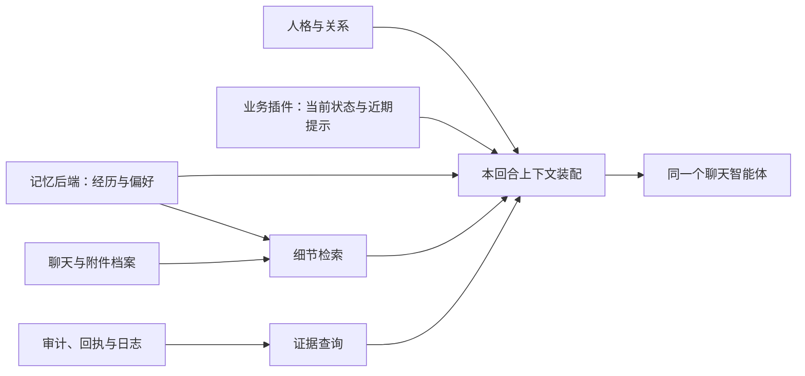

# 记忆架构调研与设计分析

类型：调研工作稿。创建与资料核对日期：2026-10-24（Asia/Shanghai）。阅读复核归[待办N2](待办清单.md#n2-尝试更多优化记忆的方案)；本文中的方案均为建议，选型、实施与部署尚未决定。

本文承接2026-10-23–24的讨论，保存文档—代码对应、公开资料和设计判断。源码核对起点为 `349439597cb86b76971b50715b2f145e9e2f36a5`；开始时已有文档改动，具体检查范围见[本次记录](verification/memory-research-2026-10-24/README.md)。现行运行规则仍以[文档25](25_人格、记忆与会话连续性.md)、[文档24](24_统一身份与权限管理.md)和代码为准。

本次未读取生产聊天或个人记忆正文，未查询用户举例对应的事项。以下例子均用于解释设计，不登记为用户事实，也不复制用户粘贴的真实QQ原文。公开项目的功能按资料核对日期理解；没有安装候选组件或验证它们在本项目上的效果。

## 1. 要解决的问题与阅读方式

用户希望保留三个模块：人格保存角色与关系等基本设定；记忆保存共同经历、用户信息和智能体做过的事；功能通过插件提供提醒、天气、账单、论文和项目接口。同一个智能体同时承担陪伴与助手职能，开发目标是插件化、低耦合。

七个问题的分析入口如下：

| 用户提出的问题 | 本文入口 |
| --- | --- |
| 现成记忆实现，尤其Mem0 | [3.1 现成方案](#31-现成方案) |
| 跨会话原文、RAG与向量数据库 | [3.2 细节档案与检索](#32-细节档案与检索) |
| Context Cascade Compression（C3） | [3.3 压缩论文](#33-压缩论文) |
| 日志作为精确回忆的兜底 | [3.4 证据查询](#34-证据查询) |
| 经历和偏好是否应区分 | [3.5 记忆类型](#35-记忆类型) |
| 怎样按语境决定回忆深度 | [3.6 回忆深度](#36-回忆深度) |
| 陪伴与助手共享信息，以及不同业务的结构 | [3.7 功能信息与陪伴衔接](#37-功能信息与陪伴衔接) |

本文区分三种结论：**实现事实**来自本仓库代码；**外部能力**来自公开项目文档或论文；**设计建议**是结合本项目作出的判断。资料中描述某项能力，不等于本项目已经具有该能力。

## 2. 已核对的文档—代码对应

以下是本次分析需要的事实摘要。完整规则、参数和既有验收继续由文档25维护，不在本稿复制一套运行规范。

| 关注点 | 实现事实及其含义 | 对应入口 |
| --- | --- | --- |
| 人格与两种职能 | 人格描述既包括回应情绪，也包括认真完成求助；关系不改变工具权限 | [角色卡](../roles/世凪.md)的“面对情绪”“帮忙时的认真” |
| 随消息进入的文档 | 四份受管投影为AGENTS、SOUL、IDENTITY、USER；宿主按可用性、会话类型及预算装配bootstrap，另有当前会话历史、当前输入和工具结果。仓库docs不会自动全部传入 | [personaFiles()](../chatbot/packages/access-control/workspaces.js)、[人格同步](../scripts/fusion/sync-persona.mjs)、[文档25上下文说明](25_人格、记忆与会话连续性.md#21-每条消息进入模型的内容)。固定宿主入口为 `loadWorkspaceBootstrapFiles` / `filterBootstrapFilesForSession` |
| 长短期材料 | 原聊天由宿主会话SQLite保存；有效个人事实和近期摘要另存连续性SQLite。后者是有界JSON快照，事实与摘要分开 | [状态结构](../chatbot/plugins/kurumi-memory/continuity/model.js)的 `limits` / `options()`、[表结构](../chatbot/plugins/kurumi-memory/continuity/schema.sql)、[存储](../chatbot/plugins/kurumi-memory/continuity/store.js) |
| 自动注入 | 可信本人入站后，prompt钩子调用 `application.context()`，注入个人事实和未过期摘要；该入口没有查询近期业务安排 | [registerContinuity()](../chatbot/plugins/kurumi-memory/continuity/plugin.js)的 `before_prompt_build` |
| 检索能力 | 显式search为规范化子串匹配；context按原文中的词与两个汉字片段排序，再按预算选取。没有向量相似检索或全历史RAG | [application.js](../chatbot/plugins/kurumi-memory/continuity/application.js)的 `view()` / `search()` / `context()` |
| 何时跨会话记住 | 模型判断后调用observe，明确记忆管理调用upsert；成功事务提交才形成持久事实或摘要。没有在agent_end后自动归纳整段对话 | [运行提示词](../scripts/fusion/templates/AGENTS.md)、[插件生命周期](../chatbot/plugins/kurumi-memory/continuity/plugin.js)、[change()](../chatbot/plugins/kurumi-memory/continuity/application.js) |
| 事实来源 | 新事实要求保留当前可信本人原文，摘要可以归纳但不等于确认事实；普通业务库、角色虚构和模型自己的话不能直接晋升为个人事实 | [continuityPolicy](../chatbot/plugins/kurumi-memory/continuity/policy.js)、插件的 `RULES` |
| 多会话与新聊天 | 本人重开仍使用同一有效记忆库；宿主历史与记忆库分开。跨会话工具另受权限约束，不能将尝试调用解释为成功搜索 | [文档25会话生命周期](25_人格、记忆与会话连续性.md#会话生命周期)、[权限映射](../chatbot/packages/access-control/permissions.js)的 `sessions_list` / `sessions_history` |
| 提醒列表 | 调用get工具时查询KnowledgeMap API；状态、版本和时间由业务记录提供。当前插件没有通用的近期安排prompt注入 | [remote.js](../chatbot/plugins/personal-reminder-list/remote.js)的 `taskItem()` / `registerRemoteList()`、[业务客户端](../chatbot/packages/knowledgemap-client/client.js) |
| 日志与执行证据 | 查询器适配原日志、会话和领域审计；部分关联依赖时间窗，需要核验 | [文档18](18_跨模块链路日志查询.md#已知边界)、[log-query.mjs](../scripts/fusion/log-query.mjs)、[事件契约](../chatbot/packages/observability/index.js) |
| 可插拔边界 | 当前记忆Policy/Store通过组合入口选择，Store明确要求同步方法；远端服务不能直接冒充这一接口 | [contracts.d.ts](../chatbot/plugins/kurumi-memory/continuity/contracts.d.ts)、[注册机制](../chatbot/packages/domain-adapters/index.js) |

对当前工作的评价：人格、授权、业务事实和个人记忆已有明确边界；来源、版本、幂等与生命周期也有实现。这些基础值得保留。现有P2主要承载小型个人事实与有限期摘要；事件组织、语义检索、细节展开和业务上下文衔接仍有扩展空间。长期记忆质量与陪伴体验是否合格，仍按[文档16](16_验收与测试总表.md)和[待办E1](待办清单.md#e1-人格和记忆)验收。

## 3. 七点分析

### 3.1 现成方案

有现成实现，但候选项目承担的职责不同。关注度可以作为筛选信号，不能替代中文效果、来源准确性、更新/遗忘语义及宿主兼容性验证。

| 候选 | 公开能力 | 对本项目的判断 |
| --- | --- | --- |
| [Mem0](https://docs.mem0.ai/integrations/openclaw) | 已有OpenClaw记忆插件，支持自动捕获、召回和显式记忆工具；可用托管或开源模式 | 适合作为第一轮候选。自动捕获是选择并提取记忆，不能视为完整聊天档案 |
| [OpenViking](https://github.com/volcengine/OpenViking) | 将上下文组织为L0概括、L1概要和L2原文，支持按需加载 | 直接对应“概要知道、细节展开”，适合作为分层检索对照候选 |
| [Hindsight](https://hindsight.vectorize.io/) | 区分被告知的事实、自身行动经历及归纳认识；结合语义、关键词、关系和时间检索 | 与事件、行动经历及偏好变化有关，可列入后续候选；提取结果仍需原始档案支持 |
| [Letta](https://docs.letta.com/agent-sdk/memory) | 将持久记忆、按需读取和后台整理纳入智能体状态与运行框架 | 引入时对既有宿主职责影响较大，当前优先级较低 |
| [Graphiti / Zep](https://help.getzep.com/graphiti/getting-started/overview) | Graphiti提供时态知识图谱；Zep提供托管上下文服务 | 当实体关系、关系变化和时间推理成为主要瓶颈时再评估，暂不增加图谱运维层 |

Mem0官方插件占用OpenClaw的memory插槽；OpenViking官方集成占用contextEngine插槽，还处理会话历史和压缩。接入影响不同，不能按相同安装风险理解。后者的具体边界见[OpenViking集成说明](https://docs.openviking.ai/en/agent-integrations/03-openclaw)。

初步建议：先比较Mem0与OpenViking，生产中确定一个主要记忆引擎和清楚的写入权威。多个独立引擎同时自动提炼、更新同一份记忆，会增加冲突处理和遗忘传播难度。候选中的“companion”等配置也不能证明实际陪伴效果。

### 3.2 细节档案与检索

百万token聊天适合建立跨会话检索。原始档案保存完整证据，全文/向量索引帮助定位；索引是可重建的派生材料。RAG指先检索相关材料，再将必要片段交给模型回答的流程。

“不区分会话”建议解释为同一身份的历史可以统一搜索，同时保留会话、消息、说话人、时间和来源信息。一个会话可以包含多个事件，一个事件也可以延续到多个会话；不应只以会话边界组织回忆。

建议检索同时使用语义、关键词、时间与实体条件。语义帮助识别换了说法的同一经历；关键词帮助定位公式名、编号等少见细节。混合检索已有现成能力，例如[Qdrant的混合查询](https://qdrant.tech/documentation/search/hybrid-queries/)。是否引入独立向量数据库，应由数据规模、现有全文检索、服务维护和实测收益共同决定。

现有宿主会话SQLite可以继续作为原始聊天来源。新增索引应通过明确的只读档案接口取得材料，并保留来源定位。附件细节还需要对应文件或页图，聊天摘要不能补出未保存的内容。

### 3.3 压缩论文

[Context Cascade Compression论文v2](https://arxiv.org/html/2511.15244v2)研究专门训练的编码器、解码器对文本的压缩与重建。与DeepSeek-OCR的比较限定在论文实验中；Fox测试文本主要为600–1300 tokens，并未证明百万token对话的长期记忆效果。

需要纠正的理解：论文的失败案例表现为开头保真较好，错误向后半段集中，并非“保留事件首尾、淡化中间”。作者将这种退化类比遗忘，不等于已经验证其适合陪伴记忆。

[官方仓库](https://github.com/liufanfanlff/C3-Context-Cascade-Compression)已经公开代码和权重。可以尝试现成模型推理，不必先从零训练。但压缩表示需要配套模型处理，接入当前普通文本聊天服务会涉及模型服务层变化。

建议将C3保留为独立研究方向。当前产品目标可先用人可读的事件摘要、细节索引与原文关联实现；精确公式、金额和原话仍需要原始材料核对。

### 3.4 证据查询

日志可以为回忆提供执行证据；查询入口应根据问题选择来源。

| 问题 | 优先来源 | 解释边界 |
| --- | --- | --- |
| 安排现在是否有效、是否改期 | 业务API当前记录 | 历史摘要可能已经过时 |
| 用户当时怎样表达 | 原始聊天 | 需要区分本人、引用、假设与模型回复 |
| 工具是否执行、结果是否送达 | 事务、领域审计及投递回执 | 创建成功、排队和送达是不同状态 |
| 文档中的具体公式 | 对应版本文件或页图 | 聊天里的描述只能作为该描述的来源 |

[文档18](18_跨模块链路日志查询.md#已知边界)已说明时间窗关联等限制。因此日志不应被假定为所有问题的最精确来源。

未来若提供给QQ智能体，建议新增按事件、时间和来源读取的窄证据接口。复用逻辑应抽到合适的库，再由开发CLI和插件组合入口使用，遵守[文档21](21_后端职责分层与代码整理.md)的依赖方向；共享运行包不反向导入运维脚本。现有文件/命令禁用与工具授权规则保持生效，参见[文档24](24_统一身份与权限管理.md)。

### 3.5 记忆类型

长期经历、偏好习惯与当前业务状态是不同维度，可以通过同一事件或实体关联。

| 类型 | 合成例子 | 需要保留的信息 |
| --- | --- | --- |
| 事件经历 | 上周完成一次研究汇报 | 时间、参与者、经过、结果与来源 |
| 偏好或习惯 | 通常较晚入睡 | 明确陈述或归纳依据、适用条件、更新时间 |
| 当前计划或业务状态 | 次日上午有一次安排 | 当前时间、版本、有效性与业务引用 |

一次不愿参加活动，不足以自动形成长期厌恶偏好。创建安排不证明后来实际参加；时间已过也不证明任务完成。当前代码已经区分active、completed和void，见 [taskItem()](../chatbot/plugins/personal-reminder-list/remote.js)。

“她做过什么”可以形成行动经历，例如曾协助完成某项任务；应保留任务和结果来源。“帮用户创建了安排”与“用户参加了活动”是不同事件。

建议未来允许事件、偏好和业务引用互相关联，同时保留来源类别。模型的归纳应标识为归纳，不能与用户明确事实混成同一种确定性记录。

### 3.6 回忆深度

记忆类型与详细程度互相独立。事件可以有概括和细节；偏好也可以有简述和形成依据。

| 深度 | 合成例子 | 适用场景 |
| --- | --- | --- |
| 概括 | 上周有一次汇报 | 识别话题、自然衔接 |
| 事件概要 | 汇报主题、讨论重点和结论 | 继续聊该经历 |
| 具体证据 | 某页公式的问题与当时讨论 | 精确追问、复盘或核对 |

检索可先返回概要，再按需要展开相邻消息、事件片段或附件。原始细节也应能直接命中；否则摘要未收录的罕见信息可能始终无法被找到。

模型可以依据问题的明确程度、现有材料和回答所需精度决定展开。涉及精确时间、金额、公式或原话时，需要核对相应来源。没有材料时保留不确定性，不用合理猜测补全。

能够检索到不等于必须说出。回应还应考虑当前语境、近期是否已经提过，以及用户是否愿意继续聊。建议保留原始细节，通过上下文预算控制读取量，不主动破坏中间过程来模拟人类遗忘。

### 3.7 功能信息与陪伴衔接

同一智能体可以在闲聊中引用业务信息。需要补充的是信息可见性：当前记忆钩子没有读取近期安排，业务get工具则需要被调用。同会话历史仍可见时可能自然联想；跨会话稳定衔接尚无专门保障，不能仅靠角色提示词推断已经做到。

建议使用混合上下文：

1. 固定携带少量人格、可信身份、当前时间及关键用户信息。
2. 自动提供有时间意义的少量业务提示，例如未来一天内仍有效的重要安排。
3. 根据话题召回相关事件概要、偏好或习惯。
4. 需要更精确的信息时，再展开原文、单项业务记录或执行证据。

“晚安”与“次日安排”在文字上可能没有相似性。时间窗口提供业务提示，可降低完全依赖模型主动查询而遗漏的概率。选择提及哪些安排，仍需要语境与重复控制。

不同插件保留自己的结构和时效规则：

| 插件 | 可提供的上下文 | 展开方式 |
| --- | --- | --- |
| 提醒列表 | 近期有效安排 | 读取单项详情与当前版本 |
| 记账 | 财务话题下的相关汇总 | 查明细、时间范围或具体记录 |
| 天气 | 有期限的天气资料 | 按地点、时间展开 |
| 论文 | 相关任务的进度与结论 | 读取任务、报告或原文 |

统一的是上下文提供协议，例如来源、简述、记录引用、更新时间和详情入口。金额、付款方式、地点、任务状态等字段仍归各领域解释；并不要求每个功能都具有三层摘要。

业务提示需要处理新鲜度。建议查询时使用有期限的缓存，并在已确认的业务变更后失效；网站侧变更也需要刷新或通知机制。正式回答具体状态时，以相应业务当前记录为准。历史安排摘要不能长期代替业务查询。

在当前用户发来消息后自然关心，与离线主动联系或创建到点提醒是不同能力。本文讨论上下文衔接，不扩大主动外发、调度或持久情绪范围。

## 4. 建议的模块连接方式

以下结构是设计建议，尚无对应实现：

可以新增一个小型ContextProvider（上下文提供者）协议。候选方法为 `getHighlights()`、`search()` 和 `get(ref)`，分别提供重要提示、搜索和详情。这些名称仅用于讨论，不是已注册工具或API。

功能插件提供自己的适配器，上下文装配消费公共协议。记忆后端不需要导入每个业务插件，也不成为账单、事项的第二个事实源。业务成功事件如需形成行动经历，应记录业务引用及当时结果，查询当前状态时仍回到业务接口。

远端记忆服务通过显式异步边界接入。现有同步Store继续遵守其契约，不能直接返回Promise或静默回退。共享注册逻辑、生命周期和组合位置沿用[文档21](21_后端职责分层与代码整理.md)的原则。

上下文协议不产生权限。主体由可信宿主确定，提供者复核当前授权；后端检索结果中的指令不参与身份判断。成员隔离仍按文档24实施。

## 5. 接入前需要明确的设计差异

### 5.1 未提炼与明确遗忘

当前插件 `RULES` 要求“被遗忘或记忆里查不到”均不通过其他工具找回，见 [plugin.js](../chatbot/plugins/kurumi-memory/continuity/plugin.js)。这比单纯禁止恢复已遗忘信息更宽，会限制本稿提出的原文展开。

建议未来区分：未被摘要提炼的细节，在获准档案范围内允许检索；明确要求遗忘的信息，对摘要、索引、原文召回和日志入口统一限制。现有哈希屏障只防相同文本自动重存，不能直接当成覆盖全部语义改写和新索引的方案。

该差异需要在后续设计中明确后，再更新文档25与代码。本次未改变G3、遗忘执行或档案访问规则，也不借新工具绕过它们。原聊天、备份的物理删除与检索禁用还应分别定义。

### 5.2 记忆写入与来源

当前事实写入依赖本次本人原文，外部引擎可能会处理多轮对话、工具结果和归纳文本。两种写入模型不能直接混用。

建议将提取、归纳结果保留为有来源的派生材料，再决定哪些可以进入已确认事实。原文、事件概要、推断、业务执行结果分别标识；召回内容不应被再次当成新的用户陈述反复捕获。最终替换当前事实存储前，应确定唯一写入入口、迁移与回退关系。

### 5.3 新鲜度、预算与降级

需要分别约定近期安排窗口、各领域缓存期限、每轮上下文预算和最深检索轮数。外部记忆服务不可用时，可以继续普通聊天并明确信息缺口；不能将未查到说成不存在，也不能伪造保存或读取成功。

部署位置、模型与embedding提供方会影响私密数据流、延迟和成本。自托管记忆服务不自动意味着模型调用也留在本地。以上均是后续选型评估维度，本文不预设服务商、账号或预算。

## 6. 建议顺序与待验证项

建议先补近期业务提示，再比较现成记忆后端和细节检索。日志证据按需扩展，C3保留实验方向。这是技术建议，不改变N2及E1既有排期，也不关闭现有补正与真人体验事项。

| 后续阶段 | 拟验证的问题 | 完成依据 |
| --- | --- | --- |
| 近期业务提示 | 闲聊能看到相关安排，改期或取消后不再误用旧内容 | 合成时间/状态用例；后续获准的真实交互单独验收 |
| 记忆后端比较 | Mem0或OpenViking是否改善中文经历与偏好召回 | 同一批合成数据、相同问题和预算；固定版本及模型 |
| 原文细节检索 | 摘要未包含的细节能否通过原文定位 | 返回真实来源，区分查到、查不到与信息不足 |
| 证据入口 | 能否准确区分任务创建、执行、结果和投递 | 事务/回执可对应，时间窗关联单独标识 |
| 压缩实验 | C3是否适配算力、模型接口及实际任务 | 独立实验，不以重建指标代替陪伴验收 |

候选方案至少比较以下维度，结果尚未产生：

- 中文换说法、跨会话事件、相对日期与同名事件的检索。
- 单次情绪与稳定偏好的区分，更正与取消后的时效处理。
- 罕见公式、编号和原话的来源定位，不只检查概要是否流畅。
- 明确遗忘对派生摘要、索引与各读取入口的约束，以及身份隔离。
- 提取遗漏、错误合并和无依据推断；同时记录未命中的重要材料。
- 每轮新增token、检索与提取时延、模型/embedding开销和维护复杂度。

所有用例先使用合成数据。用户举例不构成搜索真实记录或导入真实聊天的指令；涉及真实模型、生产档案接入、外发和部署时，按相应范围另记实施与验收。

## 7. 工作稿维护

- 本稿保存调查与候选分析；任务状态唯一归[待办N2](待办清单.md#n2-尝试更多优化记忆的方案)，业务验收归文档16。
- 方案确定并实施后，将有效契约提炼到文档25或对应业务文档，保留调查来源与被否决理由；不新建另一份人格/记忆运行规则。
- 外部链接会变化。实施时应固定组件版本、模型、配置和必要的代码提交，重验接口与资料中的能力。
- 本次文档检查、源码指纹和未覆盖范围见[文档工作记录](verification/memory-research-2026-10-24/README.md)，不将资料整理标记为记忆引擎已验收。

返回[文档入口](README.md)。
